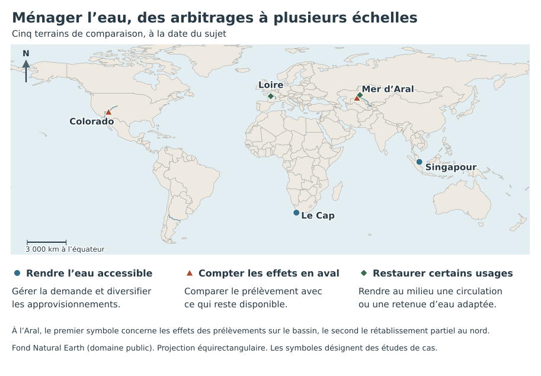
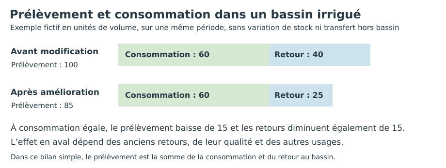
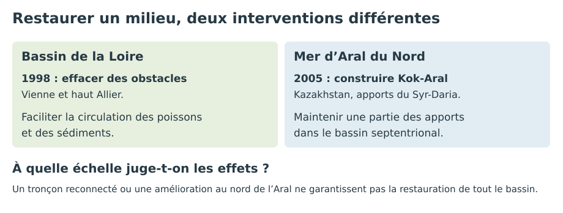

# BEL A/L — Géographie 2025 · Corrigé guidé

*Corrigé rédigé par IA, non officiel. Signalez toute erreur.*

**Rédaction** · modèle exact non renseigné (famille GPT-6) · effort non renseigné · vitesse non renseignée

**Révision** · modèle exact non renseigné (famille GPT-6) · effort non renseigné · vitesse non renseignée

## Présentation du sujet

L’ENS de Lyon propose une composition de géographie de cinq heures sans atlas. Le sujet associe l’eau douce, sa construction comme ressource et sa préservation. Le fond de carte mondial fournit les frontières étatiques et les grands fleuves. Les pages 2 à 8 du rapport reviennent notamment sur l’articulation entre **aménager** et **ménager**, ainsi que sur la nécessité de raisonner à plusieurs échelles. [Sujet officiel](https://www.ens-lyon.fr/sites/default/files/2025-07/Composition%20de%20g%C3%A9ographie.pdf) · [Rapport du jury](https://www.ens-lyon.fr/sites/default/files/2025-11/G%C3%A9ographie%202025%20RELU.pdf) · [Cadrage du programme](https://www.ens-lyon.fr/sites/default/files/2024-06/Lettre%20definitive%20de%20cadrage%20BEL%202025%20TC%20Geographie.pdf)

## Analyse du sujet

> [!INDICATION]
> De l’eau peut s’écouler devant une habitation dont les occupants restent privés d’eau potable. Quelles étapes séparent la présence du fleuve d’un approvisionnement sûr ?

#### Solution

Appeler l’eau une ressource signifie qu’il existe des usages, des techniques et des droits qui en organisent l’accès. La quantité accessible dépend du moment, de la qualité recherchée, des infrastructures, de leur entretien et de la capacité des usagers à se les partager. Une ressource renouvelable par le cycle de l’eau peut devenir localement indisponible.

**Ménager** invite à prendre soin de la ressource et du milieu qui la rend possible. Certaines infrastructures, par exemple un réseau d’assainissement, servent cet objectif. D’autres mettent des usages en concurrence ou doivent parfois être modifiées. Un devoir peut construire sa démonstration en suivant une eau depuis le lieu de collecte vers l’usager, puis vers le lieu de restitution.

## Problématique

> [!INDICATION]
> Économiser un mètre cube à la prise d’un canal équivaut-il toujours à rendre un mètre cube de plus disponible pour l’aval ?

#### Solution

À quelles conditions l’aménagement qui rend l’eau disponible aujourd’hui peut-il préserver les milieux et les droits d’accès dont dépend sa disponibilité future ? Le cas du canal impose de penser l’espace de référence. La consommation et les retours importent au bassin entier, alors que l’exploitant peut chercher avant tout à diminuer un volume acheté ou pompé.

## Plan détaillé

### I. Construire l’accès à la ressource

> [!INDICATION]
> Singapour reçoit des pluies abondantes. Pourquoi cette ville cherche-t-elle également à réutiliser ou dessaler de l’eau ?

#### Solution

Comparer le régime des pluies, le territoire de collecte, la demande, les réseaux et la qualité requise. Au Cap, reconstituer le passage d’une sécheresse régionale à des contraintes domestiques inégales. À Singapour, distinguer la distribution d’eau régénérée pour l’industrie et le retour en retenue avant potabilisation. Le bassin du Colorado permet de passer à une ressource organisée dans un ensemble régional et transnational.

### II. Suivre l’eau après la prise ou le captage

> [!INDICATION]
> Une exploitation prélève 100 unités et en retourne 40 au bassin. Après une modification, elle en prélève 85 et en retourne 25. Quelle quantité a-t-elle consommée dans les deux cas ?

#### Solution

On obtient 60 unités les deux fois dans cet exemple sans variation de stock. Il faut déterminer où et quand se faisaient les retours et si leur qualité permettait un nouvel usage. La réduction du prélèvement sur une parcelle ne suffit donc pas pour conclure à une économie nette à l’échelle du bassin. Passer à l’Aral permet de repérer des usages des milieux lacustres perdus lorsque l’irrigation amont se développe.

### III. Comparer les arbitrages plutôt que dresser un catalogue de remèdes

> [!INDICATION]
> On a construit un barrage au nord de l’Aral et enlevé deux ouvrages dans le bassin de la Loire. Pourquoi ces actions peuvent-elles toutes deux contribuer à restaurer des milieux ?

#### Solution

Sur la Vienne et l’Allier, défendre le rétablissement de certains trajets de la faune et du transit sédimentaire. Au nord de l’Aral, identifier la retenue d’une partie des apports du Syr-Daria dans un bassin où les activités de pêche avaient beaucoup reculé. Puis préciser la limite spatiale et temporelle de chaque résultat. L’analyse de la distribution au Cap complète cette comparaison en faisant apparaître les inégalités de capacité à réduire les usages.

## Références et exemples

| Terrain | Ce que l’on compare | Indicateur à préciser |
|---|---|---|
| Le Cap, pendant la crise de 2018 | Stocks régionaux et accès domestique | Volume consommé, fiabilité des points d’eau, marges d’économie par quartier. |
| Singapour | Pluie locale, eau importée, dessalée et régénérée | Qualité requise par l’usage et énergie nécessaire au traitement. |
| Colorado et mer d’Aral | Prélèvements en amont et ressources en aval | Débits ou volumes effectivement restitués, salinité et possibilités de pêche. |
| Bassin de la Loire et nord de l’Aral | Effacement d’obstacles et restauration par un nouvel ouvrage | Continuité retrouvée ou niveau lacustre restauré, avec indication du lieu. |

[Analyse de la crise du Cap par l’OCDE](https://www.oecd.org/en/publications/water-governance-in-cape-town-south-africa_a804bd7b-en/full-report/water-security-in-cape-town-south-africa_80d5435e.html) · [Agence publique de l’eau de Singapour](https://www.pub.gov.sg/-/media/PUB/PDF/PUB-Green-Bond-Report-for-FY2023.pdf) · [Mission parlementaire sur les continuités écologiques](https://www.assemblee-nationale.fr/14/rap-info/i3425.asp) · [Projet de la Banque mondiale pour le nord de l’Aral](https://documents1.worldbank.org/curated/en/888771468089960580/pdf/462360BRI0Box31e0no0FS231Kazakhstan.pdf)

## Pièges à éviter

- Ne pas confondre la quantité d’eau douce présente dans un territoire et la disponibilité d’eau potable pour chaque habitant.
- Préciser l’échelle d’une économie. La lisière de l’exploitation, la limite du réseau municipal et l’exutoire du bassin ne délimitent pas les mêmes phénomènes.
- Dans un diagnostic de pénurie, distinguer sécheresse, détérioration de la qualité et défaut d’accès ou de distribution.
- Un ouvrage utile à un lieu peut reporter des coûts en aval. À l’inverse, une sauvegarde locale d’habitat ou de ressource ne signifie pas que toute la région a retrouvé les conditions antérieures.
- Ne pas réduire la dernière partie à des injonctions. Chaque décision doit être rattachée à une collectivité, à des usagers et à une conséquence observable.

## Introduction et conclusion rédigées

L’introduction proposée ci-dessous part d’une restriction chiffrée au Cap et oppose des situations concrètes de desserte. La conclusion définit le ménagement par les relations qu’il préserve, puis demande comment mesurer ces effets lorsque les saisons sèches se prolongent.

## Composition proposée

### Introduction

Au Cap, en 2018, les réserves alimentant l’agglomération sud-africaine avaient tant baissé que les autorités préparèrent une interruption étendue de la distribution. Elles demandèrent aux habitants de limiter leur consommation à cinquante litres par personne et par jour. Cette restriction avait pourtant un sens différent pour un ménage habitué à remplir une piscine et pour une famille qui allait déjà chercher son eau à une borne collective. L’alerte concernait des barrages en amont, un réseau municipal et des gestes domestiques qui n’engageaient pas tous les habitants de la même façon. Que préserve-t-on exactement lorsqu’on demande de ménager l’eau ?

Le sujet porte d’abord sur l’eau douce. Une eau douce n’est pas nécessairement potable, tandis qu’une eau impropre à la boisson peut rendre d’autres services. Elle devient une ressource lorsqu’une société la rend accessible, en quantité et en qualité appropriées à un usage, au lieu et au moment voulus. La ménager consiste à prendre soin des conditions qui rendront cet usage et d’autres encore possibles dans la durée. Cela suppose de compter avec les rivières, les nappes, les zones humides et les rapports entre leurs usagers. À quelles conditions l’aménagement qui rend l’eau disponible aujourd’hui peut-il préserver les milieux et les droits d’accès dont dépend sa disponibilité future ? Il faut examiner comment se construit la ressource, suivre les effets des prélèvements au-delà des lieux bénéficiaires, puis étudier les arbitrages qui permettent de ménager l’eau à plusieurs échelles.

### I. Pour devenir une ressource, l’eau doit être accessible à une société

Un total annuel de précipitations explique mal à lui seul ce dont dispose un habitant. Entre le moment où l’eau tombe et celui où une personne peut la boire, il faut une possibilité de collecte, un traitement approprié et une distribution effective. Au Cap, les pluies hivernales de la région de climat méditerranéen alimentent des retenues qui servent ensuite durant la saison sèche. Des années de sécheresse successives ont montré la dépendance de cette ville à l’égard d’un système régional qui dessert également l’agriculture. L’alerte de 2018 concernait donc un volume stocké et des choix de répartition entre différents usages. Elle a également rendu visible ce que le volume total livré à la ville dissimulait. Le temps consacré à la collecte et la facilité de réduire une consommation dépendent de l’équipement du logement, des revenus et de la nature des dépenses en eau.

Une ville très arrosée peut elle aussi manquer d’eau utilisable dans certaines conditions. Singapour reçoit des précipitations tropicales abondantes mais dispose d’un territoire exigu, où logements, infrastructures et espaces de captage doivent coexister. L’agence publique combine plusieurs sources. Aux eaux recueillies localement et aux importations de Malaisie s’ajoutent le dessalement et la production d’une eau régénérée, commercialisée sous le nom de NEWater. Une partie de cette dernière alimente directement des usages industriels et une autre est introduite dans des retenues avant un nouveau traitement pour la distribution d’eau potable. Les qualités requises, les itinéraires de l’eau et le coût énergétique diffèrent. Une même molécule peut servir successivement à plusieurs usages sans que l’opération soit gratuite ou sans limite. La capacité institutionnelle à financer des usines et à maintenir les réseaux compte ici autant que l’abondance des pluies.

Dans les campagnes irriguées, la réalisation d’une prise ou d’un canal permet d’allonger une saison de culture et de sécuriser des récoltes. Dans le bassin du Colorado, ce que reçoit une parcelle agricole de l’Ouest des États-Unis dépend des apports de montagne, des retenues et de droits distribués entre de nombreux usagers. Stocker permet de desserrer la contrainte saisonnière. Lorsque les volumes promis sont élevés et que les apports diminuent, le stockage peut aussi retarder le moment où la pénurie devient visible. Une ville, une exploitation et le delta situé au Mexique se trouvent alors liés par le même aménagement, à des distances considérables. Il faut donc déplacer l’attention de la prise d’eau vers le trajet de l’eau après son usage.

### II. Une économie locale d’eau ne garantit pas la préservation de l’ensemble du bassin

Un volume prélevé dans une rivière n’est pas entièrement consommé au sens hydrologique. Une partie peut revenir au cours d’eau ou à la nappe après une utilisation agricole, industrielle ou urbaine. Une autre quitte le bassin ou retourne à l’atmosphère par évaporation ou transpiration des plantes. Le schéma d’irrigation permet de comprendre pourquoi une même opération peut être décrite comme une économie à l’échelle de l’exploitation et produire un résultat différent en aval. Si un agriculteur réduit les pertes de son réseau, il peut prélever moins pour maintenir une récolte. Toutefois, une part des anciennes infiltrations rechargeait peut-être une nappe exploitée plus bas. S’il utilise l’amélioration pour augmenter sa surface irriguée, la quantité totale consommée peut même s’accroître. Il faut donc suivre les volumes, la qualité et le moment de leur retour, ainsi que l’évolution des surfaces. Le résultat varie selon les sols, le fonctionnement du bassin et les règles d’allocation.

En Asie centrale, les prélèvements opérés dans les bassins de l’Amou-Daria et du Syr-Daria pour l’irrigation, notamment du coton, ont réduit les apports à la mer d’Aral. L’augmentation des surfaces mises en valeur en amont s’est accompagnée d’une contraction considérable du plan d’eau, d’une augmentation de la salinité et de la perte de ressources halieutiques pour des riverains. Des surfaces de l’ancien fond lacustre sont devenues des sources de poussières chargées en sels. Le mot de ressource change ici de sens selon le lieu d’observation. L’eau détournée soutenait un système agricole, alors que l’eau laissée au milieu lacustre soutenait une pêche et des activités littorales. La comparaison des deux rives dans le temps oblige à intégrer des usagers qu’un calcul de rendement au champ laissait hors du périmètre de décision.

La qualité fait également circuler les effets d’un aménagement. Une eau restituée immédiatement en aval d’une ville peut rester physiquement présente tout en exigeant un traitement supplémentaire pour l’usage suivant. Inversement, épurer une eau usée peut améliorer les conditions de vie aquatique et réduire le coût du captage en aval. Mais l’assainissement suppose des raccordements, une maintenance et des financements durables. Dans un quartier insuffisamment équipé, élargir effectivement l’accès à l’eau domestique et à l’évacuation des eaux usées relève aussi du ménagement. Une injonction générale à diminuer la consommation y risquerait de peser sur des besoins essentiels. Après les économies d’eau annoncées, il faut donc demander à qui la ressource est rendue, à quel prix et dans quel état.

### III. Ménager l’eau engage parfois à aménager autrement, parfois à défaire un ouvrage

Une première possibilité consiste à agir sur la demande en tenant compte de la marge de choix des usagers. Au Cap, les restrictions, l’information sur l’état des réserves et la modification de certaines pratiques ont contribué à éviter l’interruption générale redoutée, dans un contexte où les pluies sont aussi revenues. La crise n’a pas pour autant effacé les différences entre quartiers. Un ménage qui dépend d’une borne publique bénéficie peu de conseils sur la réduction de l’arrosage d’un jardin privé. Une tarification qui protège les usages essentiels et des mesures ciblant les volumes dont les usagers peuvent effectivement se passer soulèvent ainsi une question de justice. L’autorité doit aussi pouvoir distinguer les fuites de réseau des consommations choisies. Préserver un stock régional et améliorer la fiabilité d’une desserte locale peuvent relever d’un même projet.

Dans le bassin de la Loire, certaines décisions ont fait porter l’attention sur la continuité du milieu fluvial. En 1998, le barrage de Maisons-Rouges sur la Vienne et celui de Saint-Étienne-du-Vigan sur le haut Allier ont été effacés dans le cadre du plan Loire grandeur nature. Un ouvrage qui ralentit l’eau peut aussi contrarier les déplacements des poissons et les transports sédimentaires. Dans ces cas, retirer un obstacle redonne accès à des tronçons amont et permet au cours d’eau de remodeler certains habitats. L’opération ne rétablit pas à elle seule l’ensemble du bassin. Il reste à suivre les populations, la qualité de l’eau et les autres obstacles. Elle montre cependant qu’un barrage ancien peut perdre aux yeux d’une collectivité une partie de sa justification, lorsque les usages et les objectifs de protection sont redéfinis.

En mer d’Aral, un nouvel ouvrage a au contraire servi un objectif de restauration partielle. Au Kazakhstan, le barrage de Kok-Aral, achevé en 2005, a mieux retenu les apports du Syr-Daria dans la partie nord. La remontée du niveau et la diminution de la salinité y ont favorisé la reprise d’activités de pêche. L’amélioration se rapporte à une partie définie de l’ancienne mer. Elle ne résout pas la situation de l’ensemble du bassin ni le sort des territoires du sud. La confrontation avec la Loire empêche d’ériger l’effacement ou la construction en doctrine universelle. Il faut dire où l’eau sera maintenue ou remise en circulation, quels usages en bénéficieront et quels effets resteront hors de portée de la décision. Le croquis mondial localise ces arbitrages, tandis que les schémas montrent pourquoi la direction des flux compte autant que l’emplacement des ouvrages.

### Conclusion

Ménager l’eau revient à préserver les relations hydrologiques et sociales qui transforment une eau présente en ressource effectivement accessible. Un aménagement peut remplir cette fonction en sécurisant un approvisionnement ou en rendant une eau réutilisable. Il peut aussi déplacer vers l’aval des coûts qu’une mesure locale d’efficacité n’enregistre pas. Les choix du Cap, de Singapour, de la Loire et de l’Aral ont des effets différents parce que les usages, les milieux, les institutions et les périmètres de décision diffèrent. Dans un bassin confronté à des apports plus irréguliers, juger du succès d’une politique suppose finalement de pouvoir répondre à une question concrète. Après plusieurs saisons sèches, quels ménages, quelles activités et quels milieux disposent encore d’une eau utilisable ?
