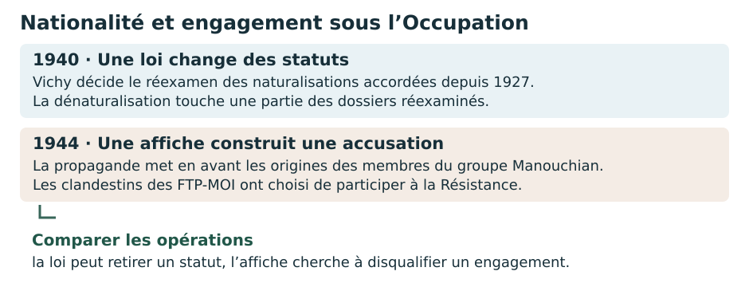

# BEL A/L — Histoire contemporaine 2025 · Corrigé guidé

*Corrigé rédigé par IA, non officiel. Signalez toute erreur.*

**Rédaction** · Modèle : OpenAI Codex (famille GPT-6) · Effort de raisonnement : non renseigné · Mode de vitesse : non renseigné.

**Révision** · Modèle : OpenAI Codex (famille GPT-6) · Effort de raisonnement : non renseigné · Mode de vitesse : non renseigné.

## Présentation du sujet

La composition commune d’histoire dure six heures. « Les étrangers dans la vie politique » est le libellé imprimé. Le programme situe l’enquête en France entre 1848 et 1986. Le rapport de la session explicite ces bornes et ajoute « en France » au titre. Pour préparer le devoir, réserver une place réelle aux décennies qui suivent la Libération. Le jury signale que beaucoup de copies ont écourté cette partie. [Sujet officiel](https://www.ens.psl.eu/sites/default/files/2025_al_tronc_commun_histoire.pdf) · [Rapport du jury, p. 2–6](https://www.ens-lyon.fr/sites/default/files/2025-11/Histoire%202025%20OK%20Lyon%20RELU.pdf)

## Analyse du sujet

> [!INDICATION]
> L’arrivée d’une personne sur le territoire français suffit-elle à la désigner comme étrangère ? À l’inverse, une personne née en France peut-elle être étrangère ?

#### Solution

Partir du critère juridique de la nationalité. L’immigration désigne un parcours, alors que la qualité d’étranger dépend du statut de l’intéressé à la date étudiée. Une naturalisation peut modifier cette qualité. Une propagande peut également désigner comme étranger un citoyen français, par exemple dans les attaques antisémites contre Léon Blum. Dans ce cas, le fait à expliquer est l’accusation et l’usage qu’en font ses auteurs.

La **vie politique** comprend des institutions et des pratiques. Pour retenir un exemple, préciser comment il met en jeu une décision publique, l’exercice de droits, un conflit entre groupes organisés ou une mobilisation. Le séjour d’un travailleur dans un foyer prend un sens politique lorsqu’un collectif conteste le règlement et en réclame la modification.

## Problématique

> [!INDICATION]
> Un résident dépourvu du droit de vote peut-il peser sur une décision collective ? Quel acteur décide qui peut séjourner, travailler, devenir français ou représenter les autres ?

#### Solution

Comment la présence des étrangers et leurs initiatives ont-elles contribué à déterminer qui pouvait, en France, intervenir dans les affaires communes ? Le raisonnement suit les étrangers comme acteurs, les discours tenus à leur propos et les règles que ces débats contribuent à modifier. La date de 1848 met en regard le suffrage universel masculin réservé aux Français et les solidarités révolutionnaires européennes. En 1986, la première cohabitation et la loi Pasqua donnent à la maîtrise des entrées et du séjour une traduction législative.

## Plan détaillé

Les césures de 1914 et de 1945 correspondent à des changements de l’intervention de l’État. Chaque partie associe deux histoires qui se rencontrent, celle des catégories définies par les pouvoirs publics et celle des pratiques par lesquelles des personnes interviennent.

### Partie I — De l’exil politique au « travail national » (1848–1914)

> [!INDICATION]
> Comparer deux engagements communards. Quelle source permettrait d’observer une action que les résultats des élections ne recensent pas ?

#### Solution

En 1848, la cause polonaise mobilise des républicains en France. Dès 1849, le pouvoir d’expulsion du ministre de l’Intérieur rend plus précaire l’activité politique d’un exilé. En 1871, le mandat de Frankel et l’organisation créée avec Dmitrieff montrent deux formes d’engagement accessibles dans une situation révolutionnaire. Dans la République consolidée, la nationalité et le travail deviennent des enjeux de législation. La loi de 1889 et celle de 1893 n’opèrent pas sur le même objet. Aigues-Mortes permet de montrer comment une violence locale engage la responsabilité de l’État et ses rapports avec l’Italie.

### Partie II — Identifier, recruter, exclure (1914–1945)

> [!INDICATION]
> Quelle différence y a-t-il entre recruter de la main-d’œuvre étrangère, accueillir un exilé et permettre une naturalisation ?

#### Solution

Pendant la Grande Guerre, l’État accroît son rôle de recruteur et d’identificateur. La convention franco-polonaise de 1919 prolonge la politique de recrutement lors de la reconstruction. La loi de 1927 facilite certaines naturalisations. La crise fait ensuite du travail national un thème de mobilisation, tandis que l’exil antifasciste pose la question de l’asile. Établir enfin ce qui change sous Vichy dans les politiques d’exclusion et suivre aussi les étrangers qui s’engagent dans la Résistance. Une identité attribuée par la propagande et une catégorie juridique exigent des vérifications distinctes.

### Partie III — Des travailleurs aux résidents qui revendiquent des droits (1945–1986)

> [!INDICATION]
> Si l’on s’en tenait à la suspension de l’immigration de travail en 1974, qu’ignorerait-on des personnes qui résident déjà en France ?

#### Solution

L’ordonnance de novembre 1945 établit un cadre durable pour le recrutement, l’entrée et le séjour. La voie syndicale, les luttes de travailleurs et les associations offrent des formes de participation. Suivre un conflit de logement jusqu’à l’interpellation de l’État, puis comparer le résultat à une revendication de papiers. Après 1981, placer côte à côte la liberté d’association, la carte de résident et le débat sur le vote municipal. Chacune de ces mesures concerne un droit précis et engage des institutions différentes.

## Références et exemples

| Repère | Fait à établir | Question qui en fait un exemple politique |
|---|---|---|
| 1893, Aigues-Mortes | Des travailleurs italiens sont massacrés dans le Gard. | Comment une rivalité locale se transforme-t-elle en crise diplomatique ? |
| 1939, Retirada | De nombreux républicains espagnols arrivés en France sont internés dans des camps. | Qui définit les conditions d’accueil d’un réfugié politique ? |
| 17 octobre 1961 | Des Algériens manifestant contre un couvre-feu discriminatoire sont réprimés à Paris. | Qui les administre avant l’indépendance et que change 1962 ? |
| 1983, Marche pour l’égalité et contre le racisme | Des marcheurs de nationalités différentes dénoncent violences et discriminations. | Comment parler de l’assignation à l’étrangeté sans la reproduire ? |

## Pièges à éviter

> [!PIEGE]
> Avant 1962, décrire la position des Algériens dans l’ordre colonial et dater les changements de statut. Le rapport admet plusieurs choix de périmètre pour la copie, à condition de les justifier.

> [!JURY]
> Le jury invite à distinguer les partis, les syndicats, les ligues et les associations. Une proposition politique prononcée en leur nom doit être attribuée à son acteur et replacée dans son contexte. [Rapport du jury, p. 3–5](https://www.ens-lyon.fr/sites/default/files/2025-11/Histoire%202025%20OK%20Lyon%20RELU.pdf)

## Introduction et conclusion rédigées

L’introduction de la composition ci-dessous met en relation une élection exceptionnelle et les conditions ordinaires d’accès aux droits politiques. La conclusion reprend la question du suffrage et l’élargit à la faculté d’intervenir par l’association, la grève et la participation aux débats publics.

## Composition proposée

### Introduction

En mars 1871, les électeurs du XIIIe arrondissement de Paris choisissent l’ouvrier hongrois Léo Frankel pour siéger à la Commune. Ses collègues valident son élection. Quelques semaines plus tard, il est chargé du Travail et de l’Échange. Le cas étonne dans une France où l’exercice ordinaire du suffrage est lié à la nationalité. Il fait surtout voir deux réalités que la seule lecture des textes électoraux laisserait confondre. Appartenir au corps des citoyens et prendre part à la définition d’un ordre commun sont des positions qui peuvent se recouvrir, et aussi se séparer. De la révolution de 1848 à la première cohabitation de 1986, les gouvernements français n’ont cessé de fixer et de déplacer la frontière entre nationaux et étrangers. Des exilés, des militants, des travailleurs et leurs familles ont pris part aux conflits dans lesquels cette frontière a été débattue.

Au sens juridique, est étranger en France celui qui n’a pas la nationalité française. Un Français peut avoir immigré ou être traité en étranger par ses adversaires. Un étranger peut être né en France. Les populations de l’empire relèvent encore d’autres statuts, dont l’indépendance des colonies transforme la portée. Quant à la vie politique, elle comprend les élections et les décisions de l’État, mais aussi les associations, les journaux, les syndicats et les mobilisations qui donnent à une revendication une audience collective. Comment la présence des étrangers et leurs initiatives ont-elles contribué à déterminer qui pouvait, en France, intervenir dans les affaires communes ? L’exilé et l’ouvrier étranger éclairent d’abord les tensions de l’universalité républicaine. Les guerres mondiales et l’entre-deux-guerres font ensuite des étrangers une population administrée à l’échelle nationale. Après 1945, l’extension des luttes sociales puis la politisation de l’immigration rendent plus visible le décalage entre participation collective et droits politiques.

### I. De 1848 à 1914, les étrangers à l’épreuve des frontières de la République

La révolution de février 1848 réunit à Paris des républicains de plusieurs pays. L’avenir des peuples européens y est une question de politique intérieure. Le 15 mai, la revendication d’un soutien français à la Pologne rassemble des manifestants et conduit à l’envahissement de l’Assemblée. On peut ainsi prendre la parole au nom des libertés d’un autre peuple et mettre en cause la conduite d’un gouvernement français. Le suffrage universel masculin proclamé la même année réserve pourtant le vote aux Français. La loi de décembre 1849 permet au ministre de l’Intérieur d’enjoindre à un étranger de quitter le territoire. L’asile qui rend possible l’activité d’un exilé lui laisse donc une position plus précaire que celle de ses camarades français.

La Commune révèle, dans un moment d’exception, les choix que recouvre cette distinction. En validant le mandat de Frankel, elle fait de la participation à un projet politique commun un titre à exercer une responsabilité. L’action des étrangères prend d’autres chemins. Élisabeth Dmitrieff, militante russe, participe avec Nathalie Lemel à la création de l’Union des femmes pour la défense de Paris et les soins aux blessés. L’organisation porte aussi des revendications relatives au travail des ouvrières. Ni Française ni électrice, Dmitrieff contribue à définir ce qu’une révolution devrait changer pour elles. Un registre électoral ne permettrait pas de retrouver cette intervention, dont les affiches et les associations conservent la trace.

La consolidation de la Troisième République donne une autre ampleur aux questions de nationalité et de travail. La loi de 1889 étend l’accès à la nationalité pour les enfants d’étrangers nés en France, dans un contexte où le service militaire fait de l’appartenance nationale une affaire d’égalité des charges. Inversement, la loi de 1893 sur la protection du travail national impose aux étrangers qui viennent travailler en France des formalités d’enregistrement. La République peut donc intégrer durablement des familles tout en marquant plus nettement la différence pour ceux qui restent étrangers. La même année, le massacre de travailleurs italiens à Aigues-Mortes transforme les rivalités entre ouvriers des salins en violence xénophobe et en crise entre la France et l’Italie. Le sort des étrangers engage désormais aussi bien la responsabilité des pouvoirs publics que les rapports avec un État voisin.

### II. De 1914 à 1945, une population recherchée, identifiée et divisée

La Grande Guerre transforme l’enjeu administratif. Tandis que les ressortissants des puissances ennemies font l’objet de surveillance ou d’internement, l’État organise le recrutement de travailleurs pour remplacer les mobilisés dans l’industrie et l’agriculture. Le décret du 2 avril 1917 institue une carte d’identité pour les étrangers. Le document rend une catégorie juridique visible dans les gestes ordinaires du séjour et du travail. Après 1918, les besoins de la reconstruction entretiennent ce mouvement. La convention franco-polonaise de 1919 organise un recrutement dont les bassins miniers deviennent l’un des principaux lieux d’accueil. Le travail d’un mineur polonais se trouve au croisement d’une demande patronale, d’une politique française de main-d’œuvre et d’un accord entre États. Chacun peut prétendre parler pour lui, sans pour autant représenter ses intérêts lorsqu’il se met en grève.

En 1927, le législateur facilite les naturalisations, notamment en réduisant la durée de résidence normalement requise. L’objectif démographique compte autant que l’adhésion individuelle au pays. L’acquisition de la nationalité transforme la situation des intéressés, sans effacer immédiatement toutes les restrictions politiques qui pèsent sur les naturalisés. La crise des années 1930 durcit les luttes sur le marché de l’emploi. La loi du 10 août 1932 ouvre la voie au contingentement de la main-d’œuvre étrangère dans certaines activités. Dans les régions minières, les départs et expulsions de Polonais rendent particulièrement inégaux les risques que prennent un gréviste français et son camarade étranger. Le statut de séjour fournit un moyen d’intervention dans un conflit du travail. À la même époque, l’exil antifasciste italien, allemand puis espagnol fait des libertés offertes par la France et de l’accueil des réfugiés des questions débattues à gauche comme à droite. En 1939, les camps où sont internés de nombreux républicains espagnols arrivés lors de la Retirada marquent les limites concrètes de l’hospitalité revendiquée.

Sous Vichy, la frontière du groupe national fait l’objet d’une politique d’exclusion. La loi du 22 juillet 1940 organise le réexamen des naturalisations accordées depuis 1927. Des personnes françaises peuvent ainsi perdre la qualité qui les protégeait. Les persécutions antisémites visent des Juifs français comme des Juifs étrangers, avec des mesures spécifiques frappant ces derniers. La nationalité et les catégories raciales imposées par le régime produisent des discriminations qui se recoupent sans être identiques. L’internement puis, sous l’Occupation, les déportations auxquelles concourent des autorités françaises donnent à ces distinctions des conséquences mortelles. Des étrangers prennent aussi part à la Résistance. Dans les FTP-MOI, des militants issus de l’immigration s’engagent contre l’occupant et ses soutiens. En 1944, l’Affiche rouge expose les noms et les origines de membres du groupe de Missak Manouchian pour discréditer leur combat. La propagande fait ainsi de leur étrangeté supposée ou réelle un argument contre un engagement dont les auteurs revendiquent la portée politique en France.

### III. De 1945 à 1986, défendre des droits dans le pays où l’on vit

En 1945, la reconstruction place à nouveau le recrutement de travailleurs étrangers parmi les priorités. L’ordonnance du 2 novembre fixe les conditions d’entrée et de séjour et crée l’Office national d’immigration. La situation d’un travailleur dépend désormais d’une politique dont les objectifs économiques ne se confondent pas avec la conquête de droits dans l’entreprise. Il peut s’organiser avec ses collègues, participer à une grève et faire reconnaître des revendications sans disposer du bulletin de vote qui lui permettrait de peser directement sur les élections nationales. Cette séparation des droits éclaire aussi les conséquences de la décolonisation. Avant 1962, les Algériens venus en métropole ne sont pas juridiquement des étrangers. La répression, à Paris le 17 octobre 1961, d’une manifestation d’Algériens contre un couvre-feu discriminatoire relève encore d’un conflit colonial. L’indépendance modifie ensuite les nationalités et les conditions de circulation. Employer d’un bout à l’autre la catégorie d’immigration étrangère ferait perdre le sens politique de cette rupture.

Avec la fin de la croissance rapide, les étrangers deviennent plus visibles comme acteurs portant leurs propres revendications. Dans les foyers de la Sonacotra, la contestation des redevances et des règlements intérieurs se prolonge au cours des années 1970. Les résidents se dotent de comités, coordonnent les refus de paiement et rendent publique la façon dont ils sont logés et surveillés. Leur interlocuteur est un gestionnaire de foyers, mais le conflit atteint aussi l’État, dont dépend l’organisation du logement des travailleurs migrants. D’autres mobilisations portent directement sur les papiers. En 1980, des travailleurs turcs du quartier parisien du Sentier entament une grève de la faim. L’action rend visibles des salariés employés dans la confection que l’absence de titre expose à l’éloignement. Leur démarche appelle une décision des pouvoirs publics et trouve des soutiens au-delà des ateliers. Ces mouvements expliquent pourquoi une histoire de la seule politique gouvernementale manquerait une partie de la transformation.

Les gouvernements interviennent dans un champ désormais fortement disputé. En 1974, la suspension de l’immigration de travail marque un tournant, alors même que les familles et les résidents installés continuent de faire leur vie en France. En 1981, la régularisation de nombreux travailleurs et la levée du régime d’autorisation préalable des associations étrangères modifient les conditions de l’action collective. En 1983, la Marche pour l’égalité et contre le racisme attire l’attention sur les violences racistes et les discriminations. Ses participants ont des nationalités diverses. Réduire les jeunes Français issus de l’immigration au rôle d’étrangers reproduirait précisément l’assignation qu’ils dénoncent. L’essor électoral du Front national, notamment à Dreux en 1983, rend manifeste une autre politisation de la présence immigrée. La carte de résident de dix ans créée en 1984 répond à une demande de stabilité. La loi Pasqua de septembre 1986 renforce les moyens de contrôle et d’éloignement. Assurer le séjour de personnes établies, durcir les conditions d’entrée et discuter de ceux qui devraient participer aux scrutins locaux deviennent des enjeux distincts, sur lesquels les acteurs composent des majorités différentes. À la borne finale, le droit de vote municipal des résidents étrangers demeure une revendication.

### Conclusion

La France de 1986 n’est pas simplement passée de l’exclusion des étrangers à leur participation. Dès 1848 et plus encore sous la Commune, des exilés pesaient sur la vie collective. Ce qui a changé est la manière de définir les intéressés, de contrôler leur présence et de rendre leur action visible. Les guerres et la reconstruction ont doté l’État d’instruments d’identification et de recrutement. Le travail, la Résistance, puis les luttes pour le logement ou le séjour ont donné aux étrangers des moyens de politiser une situation qu’ils ne pouvaient ordinairement modifier par le vote. La naturalisation, la fin de l’empire et les usages militants du mot « immigré » déplacent enfin le périmètre du groupe étudié. L’histoire de ces déplacements permet de saisir ce qui se joue dans les controverses de 1986. Elles portent ensemble sur l’autorité de l’État aux frontières et sur le pouvoir de ceux qui vivent déjà en France de prendre part aux décisions communes.
