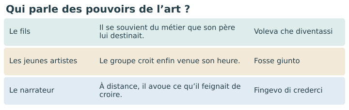

# BEL A/L — Italien (thème Lyon) 2025 · Corrigé brut

*Corrigé rédigé par IA, non officiel. Signalez toute erreur.*

**Rédaction** · GPT-6.2 Astra Ultra · vitesse non renseignée

**Révision (tour 1)** · GPT-6.2 Astra Ultra · vitesse non renseignée

[Sujet officiel](https://www.ens-lyon.fr/sites/default/files/2025-09/251113.pdf#page=15) · [Rapport du jury](https://www.ens-lyon.fr/sites/default/files/2025-11/Italien%202025%20OK%20Lyon%20RELU%20CMCM%20FIN.pdf#page=7) · [Archives de la session](https://www.ens-lyon.fr/formation/admission/archives-du-concours-lettres-et-sciences-humaines/concours-dentree-session-2025)

Giuliano da Empoli, Le Mage du Kremlin (2022). Épreuve de quatre heures. Les trois paragraphes de la page 15, de « Quand on est jeune » à « la malédiction de cet âge ». La dernière phrase s’adresse directement aux interlocuteurs du narrateur.

## Proposition de thème

Da giovani non ci si accontenta di fare qualcosa, si vuole anche giustificare ciò che si fa. Mio padre voleva che diventassi diplomatico. Mi immaginava già in un salotto viennese o parigino a passare al vaglio la letteratura russa con qualche anziano ambasciatore. Io invece volevo scrollarmi di dosso, una volta per tutte, quel mondo di intenzioni, doveri e progetti. Per questo mi sono iscritto all’Accademia d’arte drammatica di Mosca e ho cominciato a fare la vita sregolata dei teatranti.

Ai primi degli anni Novanta Mosca vibrava di elettricità. Avevamo appena compiuto vent’anni e ci si schiudeva davanti un mondo nuovo, proprio nel momento in cui avevamo finalmente la forza di conquistarlo. Le strade di Mosca, gli immensi edifici staliniani, i marciapiedi pieni di fango e i grandi lampadari della metropolitana erano quelli di sempre. Eppure, d’un tratto, ogni cosa sembrava racchiusa in una bolla di energia. Eravamo tanto su di giri che non dormivamo mai più di tre o quattro ore per notte. Ricordo le lezioni all’Accademia. Per la prima volta si poteva non soltanto andare a vedere spettacoli che arrivavano dall’Occidente, ma anche incontrare gli attori, i registi, e discutere con loro fino all’alba…

Eravamo persuasi che fosse giunto il nostro turno di rifondare la società su basi nuove, prigionieri com’eravamo dell’antica idea russa secondo cui l’arte non è soltanto cultura, è costruzione, profezia, verità. Venivamo da un mondo di parole non dette o bisbigliate, dove quei pochi che osavano pronunciarle a voce alta erano pazzi oppure eroi. Ancora non eravamo abituati all’idea che quelle parole non valessero nulla, che a contare fossero soltanto le azioni. In quegli anni i giornali che trattavano d’arte, di letteratura, vendevano milioni di copie. La gente stentava a credere che finalmente si potessero leggere tutte quelle parole, libere, senza filtri. Non ne aveva mai abbastanza. Immaginate in che stato fossimo noi che vivevamo nel mito dell’arte redentrice. A quei tempi perfino io fingevo ancora di crederci. Sapete come sono i giovani, prendono tutto terribilmente sul serio. È la maledizione di quell’età.

## Variantes de traduction

Le décor soviétique demeure matériellement identique. L’énergie appartient au regard de ces jeunes gens. Conserver les quatre éléments de la liste empêche de réduire le changement à une rénovation de la ville. Le passé récent *avevamo appena compiuto* situe le vingtième anniversaire juste avant l’élan collectif.

Le singulier collectif *la gente* impose un verbe au singulier. *Non ne aveva mai abbastanza* reprend, grâce à *ne*, les mots désormais lisibles. À la dernière ligne, le narrateur admet le peu de crédit qu’il accordait lui-même au mythe. *Crederci* permet de reprendre cette croyance sans lui chercher un nouvel objet. Pour l’image religieuse, *l’arte salvifica* insiste sur la puissance de salut, tandis que *l’arte redentrice* garde le nom d’agent et l’écho de la prophétie.
