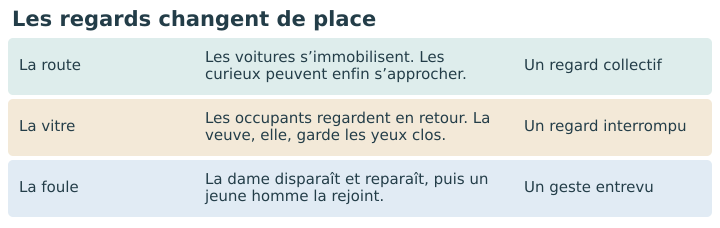

# BEL A/L — Japonais (commentaire et traduction) 2025 · Corrigé guidé

*Corrigé rédigé par IA, non officiel. Signalez toute erreur.*

**Rédaction** · GPT-6.2 Astra Ultra · vitesse non renseignée

**Révision (tour 1)** · GPT-6.2 Astra Ultra · vitesse non renseignée

[Sujet officiel](https://www.ens-lyon.fr/sites/default/files/2025-07/Commentaire%20et%20traduction.pdf#page=14) · [Rapport du jury](https://www.ens-lyon.fr/sites/default/files/2025-11/Japonais%202025%20OK%20Lyon%20RELU.pdf#page=2) · [Archives de la session](https://www.ens-lyon.fr/formation/admission/archives-du-concours-lettres-et-sciences-humaines/concours-dentree-session-2025)

堀辰雄, 聖家族 (Hori Tatsuo, La Sainte Famille, 1930). Épreuve commune de six heures. Commentaire en japonais, pages 14 et 15. Lignes 1 à 23, de la mort qui ouvre une saison au geste du jeune homme et au tiret final. Version française. Lignes 1 à 23, totalité du texte, de « 死があたかも » à « 彼女の腕をつかまえたのを―― ».

## Lire le sujet

**Identifier les sujets**

La mort ouvre une saison. Plus loin, un arrêt de la voiture semble réveiller la veuve. Enfin, la voiture repart en laissant sa propre propriétaire. Ces sujets inanimés participent à l’étrangeté de la scène.

**Suivre le regard**

La foule colle le nez aux vitres. Le regard des passagers va en sens inverse. Un seul visage semble se soustraire à cet échange. La question chuchotée conduit au nom, dont la lecture Saïki est indiquée en petits caractères.

**Distinguer l’apparence et le fait**

Relevez les expressions de ressemblance. La dame semble morte et le jeune homme paraît familier avec elle. L’identité du défunt et la relation exacte des deux personnages restent en suspens dans cet extrait.

**Retrouver le verbe final**

Le texte annonce que la foule a vu quelque chose et en diffère l’objet jusqu’au dernier geste. En français, une phrase d’annonce permet de maintenir cette attente. Le dernier tiret appartient au mouvement du récit.

## Commentaire

堀辰雄の『聖家族』（一九三〇年）は、この一節で葬儀に集まる人々を描きながら、肝心の死者の顔を一度も見せない。冒頭で「季節」を開くほど大きな働きを与えられた死は、車の列や窓の曇り、ある婦人のまぶたの静けさを通して初めて感じ取れる。生きている人が一瞬死んだように見え、やがてまた動き出すまでを、誰が、どの位置から見ているのか。人や物が止まるたびに、見る者と見られる者の関係も変わっていく。

最初の一文は、死を主語にして新しい時間の始まりを告げる。しかし「あたかも」と「かのようだった」が断定を両側から包む。少し先で「それは三月だった」と月が示されても、先の「季節」が単に春を指していたことにはならない。まだ冷たい空気がもうそれほど息苦しくないという二つの感覚の間に、その時間は位置している。死を起点に息のしやすさが語られるのは意外だが、次に窓を曇らせるのも生きた人々の息である。目には映らないものが、ここではガラスの表面に白く残る。

道幅の狭さのせいで、車は進んでいる時間より止まっている時間の方が長い。語り手があえて二つの時間を比較するのは、その停止がなければ生じない光景を準備するためだろう。群衆は乗客を「よく見よう」として鼻を窓につける。その動作がかえって窓を曇らせる。一方、見られている持主たちも群衆を「見かえして」いる。窓は単なる境界ではなく、二方向の視線が出会いながら互いを見通しきれない面になる。持主たちの笑顔には「不安そうな」という形容と舞踏会の比喩が同居する。葬儀に向かう人々が衆目を意識したとたん、華やかな夜会に向かう人々と似た表情になるところに、場面のかすかな皮肉がある。

その大勢のうち、一人だけは視線を返さない。目を閉じた婦人の頭がクッションに重くかかる。人々の短い問いのあとに「細木と云う未亡人だった」と名前と身分が置かれる順序が大切である。群衆が窓越しに見たのは、まだ誰とも知れない一つの姿にすぎない。「死人のように」といっても、この女性が自分の夫の葬儀に出るのだとは書かれていない。むしろ死者の家に向かう途中で、生者を内側から照らしてしまう死の比喩なのである。

夫人を「仮死」から蘇らせる文の主語は、意外にも車の停止である。しかも「ように思われた」「ように見えた」と、長さについても原因についても、外から見た印象であることが繰り返される。その後、夫人は運転手に任せず自分でドアを開ける。車の方は持主をその場に「置いたまま」動き出す。人と物とに順々に行為の主導権を渡すこの構文のおかげで、夫人は確かに自分で降りたのに、気づけば流れの中にひとり取り残されてもいる。

末尾では、最初に「人々は見た」と告げられてから、何を見たのかが明らかになるまで一息待たされる。帽子もなく髪を乱した青年が近づく間、夫人は群衆の中に浮き沈みする漂流物のように見える。青年の親しげな笑いは、窓の中に一様に浮かんだ先ほどの社交的な笑みとは違う、一人の相手に向けられた表情である。だが親しげに見えること以上に二人の仲を説明する言葉はない。腕をつかむ一瞬で文は長い線を引いて終わる。季節を開いた死から、生きた二人の思いがけない接触まで、読者は見物人と同じ場所に立たされている。二人の関係にまだ名前のつかないうちに、その関係が人目に触れる瞬間だけが訪れる。

## Version française

On eût dit que la mort venait d’ouvrir une saison.

Sur la route qui menait à la maison du mort, l’encombrement des automobiles allait croissant. La route était si étroite que chaque voiture en arrivait à passer plus de temps à l’arrêt qu’en mouvement.

C’était en mars. L’air était encore froid, mais on n’avait déjà plus autant de peine à respirer. Sans qu’on s’en fût aperçu, un attroupement de curieux avait entouré les voitures. Pour mieux voir les gens à l’intérieur, ils collaient le nez aux vitres. Cela couvrit les vitres d’une buée blanche. De l’autre côté, les propriétaires des voitures les regardaient à leur tour, avec un sourire inquiet, mais comme on en a en se rendant au bal.

Derrière l’une de ces vitres, ils aperçurent une femme qui avait l’air d’une grande dame. Elle gardait les yeux fermés et laissait peser sa tête sur le coussin, pareille à une morte.

« Qui est-ce donc ? »

Les gens se le demandaient à voix basse.

C’était une veuve du nom de Saïki. Un arrêt de la voiture, qui parut plus long que tous les précédents, sembla tirer la dame de cette mort apparente. Alors, tout en disant quelque chose à son chauffeur, elle ouvrit elle-même la portière et descendit. Juste à ce moment, la voiture de devant s’ébranla, si bien que la sienne à son tour se remit en marche, laissant là sa propriétaire.

Et voici ce que les gens virent presque au même instant. Un jeune homme sans chapeau, les cheveux en bataille, s’approchait comme en fendant la foule de cette dame que l’on voyait tantôt surnager, tantôt s’enfoncer, comme un objet à la dérive. Et, tout en lui souriant avec une familiarité manifeste, il lui saisit le bras —
