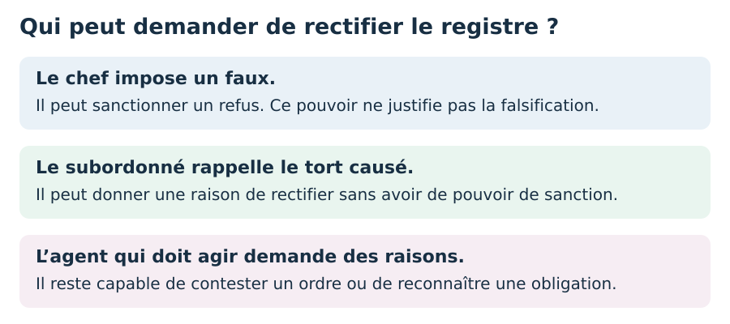
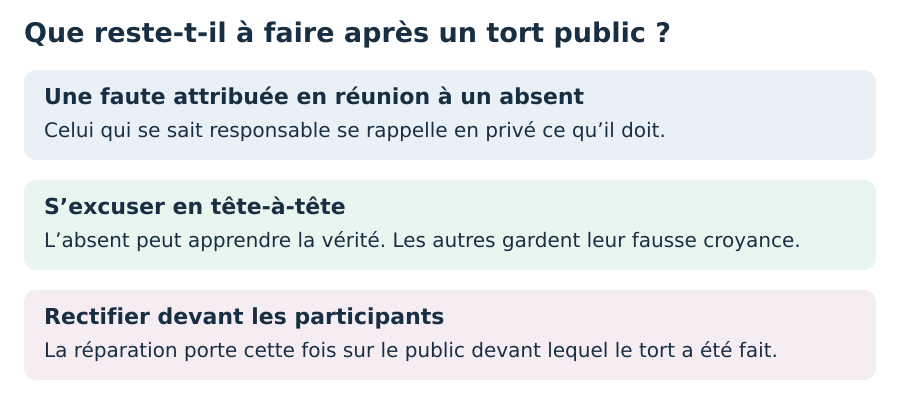

# BEL AL — Philosophie 2025 · Corrigé guidé

*Corrigé rédigé par IA, non officiel. Signalez toute erreur.*

**Rédaction** · modèle exact non renseigné (famille GPT-6) · effort non renseigné · vitesse non renseignée

**Révision (tour 1)** · modèle exact non renseigné (famille GPT-6) · effort non renseigné · vitesse non renseignée

**Révision (tour 2)** · GPT-6.2 Astra Ultra · vitesse non renseignée

**Révision (tour 3)** · GPT-6.2 Astra Ultra · vitesse non renseignée

**Révision (tour 4)** · GPT-6.2 Astra Ultra · vitesse non renseignée

## Présentation du sujet

L’écrit de tronc commun dure six heures. Le domaine au programme est la morale. Les seuls mots sur lesquels composer sont « Tu dois », placés entre guillemets. Le rapport lyonnais traite cet écrit commun au début du fascicule, avant les épreuves de spécialité. [Sujet officiel](https://www.ens.psl.eu/sites/default/files/2025_al_tronc_commun_philosophie.pdf) · [Rapport du jury 2025](https://www.ens-lyon.fr/sites/default/files/2025-11/Philosophie%202025%20OK%20Lyon%20RELU.pdf)

**Exercice de préparation.** Gardez la formule « tu dois rendre le livre demain » et faites varier uniquement la personne qui accorde un délai. Le témoin connaît la promesse ; la prêteuse peut, sous certaines conditions, en modifier le terme. Expliquez pourquoi savoir qu’une obligation existe, être autorisé à la rappeler et pouvoir en délier le destinataire sont trois pouvoirs différents. Revenez ensuite aux deux mots du sujet pour montrer ce qu’un interlocuteur peut entendre sans qu’un complément soit prononcé.

## Lire les deux mots

> [!INDICATION]
> Comparez « tu dois être arrivé », « tu dois prendre ce train pour être à l’heure » et « tu dois lui rendre ce qu’il t’a confié ». Quel genre de raison faudrait-il donner à chaque fois ?

#### Solution

Une conjecture porte sur ce qu’on croit arrivé. Une condition de réussite renvoie au but du voyageur. Une obligation peut subsister même si l’intéressé se désintéresse désormais de ce qu’il avait promis. La réplique « je ne veux plus y aller » est pertinente quand il s’agit d’attraper un train. Elle n’éteint pas la revendication de la personne à laquelle on doit restituer un dépôt. Les guillemets invitent à prendre les mots comme des paroles possibles dans une situation. Le sujet ne nomme ni un auteur ni un complément qui en fixerait d’emblée le sens.

> [!JURY]
> Le jury relève deux confusions. Grammaticalement, « dois » est ici à l’indicatif présent. La portée d’une injonction dépend des circonstances et de la relation entre les personnes. Le rapport invite aussi à tirer une conséquence philosophique de la deuxième personne du singulier. [Sujet officiel](https://www.ens.psl.eu/sites/default/files/2025_al_tronc_commun_philosophie.pdf) · [Rapport du jury 2025](https://www.ens-lyon.fr/sites/default/files/2025-11/Philosophie%202025%20OK%20Lyon%20RELU.pdf)

Imaginer que la personne à qui l’on s’adresse découvre le faux sans avoir le droit de modifier le registre. L’obligation pourrait alors porter sur l’alerte à donner. L’adresse contribue à déterminer le contenu même du devoir.

**Reformuler sans changer le fait.** Le registre doit être rectifié dans les trois cas. Dire « il faut » laisse l’auteur du geste ouvert, dire « tu dois » attribue une responsabilité et dire « je dois » la reprend en son nom. Vérifier qui a qualité pour attribuer cette responsabilité évite de prendre le simple fait d’interpeller pour une preuve de légitimité.

## Construire la difficulté

Un supérieur et la personne qu’il dirige peuvent prononcer l’un comme l’autre « tu dois ». Laquelle des deux paroles est légitime si le supérieur veut faire falsifier un registre ? La contrainte qu’il peut exercer, la force d’un motif et la capacité de juger de celui qui agit sont trois grandeurs distinctes. La question directrice peut dès lors porter sur le droit d’adresser une nécessité à quelqu’un qui reste responsable de sa conduite.

## Faire passer un argument d’une partie à l’autre

1. **Déterminer la prétention des mots.** L’indicatif présente la nécessité comme déjà réelle, tandis que le destinataire peut encore manquer à son obligation. Il faut expliquer comment une telle nécessité peut être connue et pourquoi elle s’adresse à lui.
2. **Éprouver l’autorité de celui qui parle.** L’analyse kantienne de la fausse promesse fournit un critère que l’interlocuteur peut examiner lui-même. Mais tout tiers n’a pas qualité pour délier quelqu’un d’une promesse faite à une personne précise. Cette différence empêche de confondre la raison d’agir et la voix qui pourrait la faire entendre.
3. **Éprouver l’adresse en l’absence du tiers.** La conscience peut reprendre la place de l’interlocuteur. Une simple voix intérieure peut néanmoins répéter une contrainte injuste. L’agent doit préciser ce qu’il doit, à qui et par quel acte.

## Repère de relecture

À la fin de chaque partie, reprendre les deux mots du libellé et leur donner une situation. La première partie fait entendre un rappel, la deuxième une exigence dont le locuteur doit pouvoir répondre, la troisième une adresse intérieure qui oblige à réparer un tort déterminé. Les exemples proposés dans la copie sont des expériences de pensée. La référence à Kant vise la deuxième section des *Fondements de la métaphysique des mœurs*, dans laquelle est examinée la maxime d’une fausse promesse.

## Composition proposée

## Introduction

« Tu dois » : la phrase peut être prononcée à voix basse, sans que personne ait donné d’ordre. Celui qui hésite à honorer une promesse interroge un ami. Deux mots lui reviennent en réponse. Ils lui indiquent que la décision lui appartient encore et que pourtant il ne peut pas tenir toutes les issues pour également bonnes. L’étrangeté de la formule tient à cette conjonction. Le verbe est à l’indicatif. Il semble constater quelque chose au sujet de celui que l’on tutoie. Mais il s’adresse à lui précisément parce que son action demeure à faire. Les guillemets invitent à entendre cette parole, le pronom à se demander qui parle à qui, l’absence de complément à chercher d’où viendrait la détermination de ce qui est dû. À quelles conditions un autre peut-il me dire « tu dois » en me laissant la responsabilité d’agir ? Il faut examiner ce que la formule prétend constater, puis le titre auquel quelqu’un peut l’adresser à autrui, pour comprendre enfin ce qui demeure de cette adresse lorsque je me parle à moi-même.

## I. Adresser une nécessité à quelqu’un qui peut s’y soustraire

Supposons qu’un voyageur doive prendre le premier train pour arriver avant midi. La phrase qu’on lui adresse condense un raisonnement. L’heure du rendez-vous et celle du départ sont déjà fixées. Il peut contester le choix de la fin ou découvrir un autre moyen. Supposons maintenant qu’un ami lui ait confié un objet et réclame sa restitution. Il ne suffit plus que le voyageur change de projet pour que cesse d’avoir un sens la parole « tu dois ». L’obligation engage sa relation à quelqu’un qui a compté sur lui. Le verbe est le même dans les deux cas. Il reste donc à déterminer de quelle nécessité il s’agit avant d’accorder à la formule l’autorité d’un jugement moral.

Une autre différence apparaît si l’on compare « tu dois être arrivé » et « tu dois revenir ». Dans le premier cas, à partir de l’heure qu’il est, je forme une conjecture sur un événement peut-être accompli. Dans le second, je peux te rappeler une obligation que tu es précisément sur le point de négliger. Si le fait de ne pas revenir suffisait à réfuter mon jugement, ce jugement n’aurait pas eu la force d’un reproche. L’obligation survit à sa violation. Inversement, si je te ramène par force, ton mouvement ne montrera pas que tu as reconnu une obligation. La personne du verbe importe parce que j’attends de toi une action dont tu puisses répondre.

Essayons de remplacer « tu dois » par « il faut ». Devant un registre erroné, « il faut rectifier » peut énoncer une raison d’agir que chacun approuvera, tout en laissant ouverte la question de l’agent. « Tu dois rectifier » demande à cet interlocuteur de répondre du rapport qu’il entretient à l’erreur. Le témoin et l’auteur de l’inscription peuvent reconnaître le même tort sans être tenus au même geste. Inversement, celui qui dit « je dois » assume déjà en son nom une exigence qu’un autre peut encore discuter. L’énoncé entre guillemets isole ainsi un moment fragile, celui où une nécessité prétend atteindre quelqu’un avant qu’il l’ait reprise à la première personne.

Si deux témoins savent qu’un registre est faux, la forme impersonnelle laisse ouverte la répartition de la tâche. Dire « tu dois le rectifier » oblige celui qui parle à donner une raison de viser cet interlocuteur précis. La capacité de corriger le registre ou la responsabilité de l’erreur peuvent fournir deux raisons distinctes.

Le silence qui suit la formule ne la rend donc pas immédiatement absolue. Entre deux personnes qui savent qu’une restitution est en jeu, ces seuls mots sont tout à fait déterminés. Prononcés devant quelqu’un qui ignore ce que l’on veut de lui, ils peuvent au contraire obtenir son acquiescement avant même que le contenu de l’exigence ait été révélé. Cette seconde possibilité rend suspecte l’assurance de celui qui parle. En présentant une nécessité à l’indicatif, ne risque-t-il pas de faire passer sa propre volonté pour une raison que son interlocuteur posséderait déjà ?

## II. Pouvoir donner un ordre et être fondé à rappeler une obligation

Un chef peut obtenir très vite l’action de son subordonné en disant « tu dois ». Son autorité institutionnelle explique alors pourquoi l’action suit. Elle ne règle pas tout ce que la formule prétend régler. Si le chef exige de fausser un registre pour dissimuler sa faute, le pouvoir qu’il a d’infliger une sanction demeure. Pourtant le subordonné a précisément une raison de lui résister. Se borner à mesurer la force respective des deux volontés ferait disparaître ce qui oppose l’ordre donné et l’obligation invoquée. On peut d’ailleurs imaginer la situation retournée. Le subordonné rappelle au chef son obligation de rectifier le registre. Sa phrase perd en puissance de contrainte et gagne en justification.

Mais suffirait-il que chacun juge souverainement de l’exigence qu’il reconnaît ? Si l’emprunteur pouvait dissoudre une promesse en cessant simplement d’y consentir, la personne à laquelle elle a été faite n’aurait rien reçu. Kant examine, dans la deuxième section des *Fondements de la métaphysique des mœurs*, le projet de promettre ce que l’on sait ne pas pouvoir tenir pour se procurer de l’argent. La difficulté tient à la maxime qui rendrait cette pratique permise à chacun. Si personne ne pouvait plus croire la parole donnée dans une telle situation, le procédé perdrait la confiance même qu’il exploite. Ce détour permet à l’emprunteur de comprendre une raison qui vaut pour lui alors même qu’il préférerait y échapper. La personne qui la lui rappelle peut l’inviter à faire cet examen sans se prévaloir d’une supériorité sur lui.

La même promesse permet d’aller plus loin. Je me suis engagé à rendre un livre demain. Sa propriétaire m’accorde une semaine de plus. Un ami qui a entendu mon engagement peut en témoigner fidèlement ; il se tromperait pourtant en continuant de m’adresser la même injonction pour demain. Aucun fait passé n’a changé. Une personne avait qualité pour modifier la créance, et elle l’a fait. À présent, supposons que le livre ait été confié à la propriétaire par la bibliothèque et que le délai engage également celle-ci. La permission obtenue ne règle plus tout. L’adresse au singulier fait ainsi chercher qui peut exiger quoi de qui. Déterminer le devoir suppose parfois de reconstituer plusieurs relations que les deux mots laissaient dans l’ombre.

Il ne s’ensuit pas que l’identité du locuteur soit toujours indifférente. Quand la personne lésée me dit « tu dois », elle fait aussi connaître ce que ma défaillance lui a fait supporter. Un tiers peut constater aussi bien qu’elle qu’un dépôt n’a pas été rendu. Elle seule peut, en son nom, me délier d’un engagement pris envers elle, si cet engagement ne met en cause aucun autre droit. La forme de seconde personne désigne ainsi deux rapports qu’il serait dommage de confondre. Je peux reconnaître la portée d’une raison proposée par quiconque. Je peux aussi découvrir que je dois répondre de ma conduite devant quelqu’un en particulier. Que devient cette seconde dimension en l’absence de tout interlocuteur ?

## III. S’adresser à soi sans s’accorder le dernier mot

Un témoin s’aperçoit après une réunion qu’il a laissé imputer à un absent une erreur dont il était lui-même responsable. Rentré chez lui, il se dit « tu dois ». Il pourrait employer la première personne. Le tutoiement introduit pourtant une distance précise. Il entend comme destinataire une exigence qu’il peut formuler comme juge de la situation. Il lui devient alors possible de considérer la place de l’absent et de demander ce qu’il lui doit, sans attendre que ce dernier ait eu connaissance de la scène. Ainsi l’adresse peut demeurer active lorsque personne ne parle effectivement à l’agent.

Ce dédoublement ne garantit pas que la voix intérieure dise juste. On peut continuer à s’imposer un ordre humiliant reçu dans l’enfance alors même que celui qui l’a donné est parti. L’insistance du commandement fournit une indication sur son emprise et laisse entière la question de son fondement. Dans le cas de la réunion, le témoin dispose d’une épreuve plus exigeante que la seule intensité de sa gêne. Peut-il formuler à celui qui a subi le tort ce qui s’est passé, identifier ce qu’il lui a fait porter et proposer un acte qui le répare ? Un aveu en privé peut le soulager alors qu’une rectification devant les participants seule corrigera l’attribution publique de la faute. En donnant un complément au verbe, le témoin découvre ce qu’il a concrètement à faire et s’expose à l’objection de celui qui devra vivre avec les conséquences.

L’autonomie ne consiste donc pas à se traiter en supérieur auquel on ne poserait jamais de questions. Elle désigne ici la capacité de prendre en charge la raison d’agir dont on a été, parfois d’abord contre son gré, le destinataire. Il demeure possible de refuser une sommation en expliquant pourquoi, comme de reconnaître un devoir qu’aucun supérieur ne rappelle. La formule ouvre cet intervalle entre celui qui se sait requis et celui qui répondra par son acte. Sans cet intervalle, l’action n’aurait plus personne à qui être imputée.

## Conclusion

« Tu dois » atteint son destinataire en lui parlant d’une exigence qui peut valoir avant son assentiment et qui pourtant requiert son jugement. L’indicatif fait entendre la prétention de celui qui parle à reconnaître une nécessité déjà là. La seconde personne fait revenir cette prétention vers quelqu’un qui peut lui demander ses raisons. Reste à compléter le verbe. Dès que l’on précise ce qui est dû, à qui et dans quelles circonstances, le destinataire peut distinguer une menace, un conseil relatif à ses fins et une obligation dont il est prêt à répondre. C’est dans cette possibilité de réponse que l’adresse, même intérieure, trouve sa légitimité morale.
