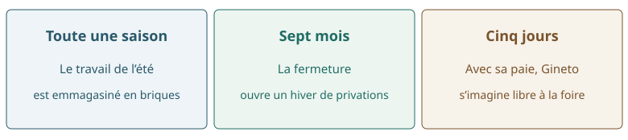

# BEL A/L — Portugais (commentaire et traduction) 2025 · Corrigé guidé

*Corrigé rédigé par IA, non officiel. Signalez toute erreur.*

**Rédaction** · GPT-6.2 Astra Ultra · vitesse non renseignée

**Révision (tour 1)** · GPT-6.2 Astra Ultra · vitesse non renseignée

Soeiro Pereira Gomes, *Esteiros* (1941). Épreuve commune de six heures. [Sujet, p. 18–19](https://www.ens-lyon.fr/sites/default/files/2025-07/Commentaire%20et%20traduction.pdf#page=18) · [Rapport du jury, p. 2–4](https://www.ens-lyon.fr/sites/default/files/2025-11/Portugais%202025%20OK%20Lyon%20RELU.pdf#page=2)

## Préparer le commentaire et la version

### Du paysage au salaire

Commencez par le changement de propriétaire de la main. Le chenal semblait un doigt de main ouverte. À la phrase suivante, cette main appartient aux tuileries qui prennent au fleuve son limon et aux ouvriers leurs forces. Plus loin, la taille des piles de briques se compare à celle des maisons. Lier ces deux images permet de montrer comment un même paysage contient une organisation du travail.

### Lire la scène de paie à plusieurs voix

Suivez un tour complet de distribution de l’argent avant de vous concentrer sur Gineto. Avec Malesso, les autres garçons plaisantent. Quand Guedelhas passe, ils savent ce qui attend la paie chez lui et se taisent. Pour Gineto, la fin de la saison ouvre cinq jours de liberté. Pour sa famille, les sept mois de privations qui suivent donnent un autre prix au salaire qu’il emporte. Le dernier geste, renoncer aux raisins pour aller à la foire, mérite autant de place dans le commentaire que sa révolte contre le maître.

### Décisions de version

Un « telhal » est ici une tuilerie. « Calcinar » se traduit par « cuire » et le même verbe s’applique à la brique puis au corps des jeunes. « Féria » désigne la paie. Dans la suite du commentaire, « Feira » désigne la foire. « Fiados » suppose des achats déjà faits à crédit, que les ouvriers règlent au moment de toucher leur paie. Les roseaux verts décorent les fours, les tiges sèches s’élèvent avec les fusées. Garder ce parallèle prépare la dernière phrase, où le même jour de fête suscite deux attentes sociales différentes.

## Comentário em português

Antes de apresentar uma personagem, Esteiros oferece ao leitor duas maneiras de olhar a margem do Tejo. Os pequenos canais parecem dedos de uma mão aberta, mas esses dedos pertencem a mãos avaras, capazes de roubar força a quem trabalha. A imagem inicial contém o problema que o relato vai explorar. Como contar a história de uma exploração coletiva sem reduzir cada criança ao mesmo destino? Entre o fecho das oficinas e a ida de Gineto à Feira, a narrativa passa do plural de uma paisagem à singularidade de um desejo.

A dedicatória aos filhos dos homens «que nunca foram meninos» dá ao outono um calendário próprio. O tempo que se mede aqui não é só o das estações, mas o que resta de infância a quem vende o seu trabalho. A chuva faz estremecer a água e os corpos no mesmo movimento. Ao dizerem o que deve o vento secar e o sol cozer, os mestres parecem enunciar uma lei natural. A frase seguinte aproxima o tijolo e a carne dos rapazes, como se os dois entrassem no mesmo processo de fabrico. No entanto, logo se corrige uma explicação exclusivamente meteorológica. Os patrões deixam de arriscar dinheiro sobretudo pela quebra das vendas. Os montes de tijolos que excedem em tamanho as casas dos trabalhadores tornam visível, numa simples comparação de volumes, o que foi feito do esforço do verão.

Dizer que a indústria é pobre pode ser uma queixa sincera na boca de quem paga a renda. A narração muda, porém, a medida dessa pobreza ao descer dos negócios aos farrapos dos garotos e às sete horas de comboio dos valadores. Também a festa antiga tem duas faces. No mesmo momento os patrões sorriam, seguros de um acordo, e os trabalhadores cantavam à espera de outra vida. O corte entre as partes do capítulo leva-nos a um pagamento em que o alegado acordo pode ser posto à prova. Gineto desafia o mestre, Sagui brinca com a pouca carne que lhe sobra e todos acabam por se calar quando o homem ameaça suspender a paga. «Féria» e «Feira» quase permutam as mesmas letras. É uma diferença suficiente para fazer depender cinco dias de diversão de um punhado de moedas.

A chamada do mestre poderia produzir apenas uma lista de salários. Cada resposta abre, pelo contrário, uma história. Malesso anuncia um fato novo que, segundo a troça de Gineto, já tem dois anos. Quando passa Guedelhas, o grupo suspende as piadas porque sabe quem espera o dinheiro em casa. É nesse conjunto que primeiro se ouve Gineto. Depois de o vermos ameaçar e insultar, a narrativa recua à época em que, levado pelas orelhas para o trabalho, o rapaz atravessava o rio a nado para explorar a outra margem. O regresso ao telhal começava logo na manhã seguinte. Essa repetição ajuda a compreender a revolta sem fazer do rapaz um exemplo edificante. Pode assustar os companheiros, deixar o irmão pequeno na lama e saber mais de colheitas do que suporiam os donos dos pomares.

A Feira parece enfim permitir-lhe comprar por cinco dias a liberdade que antes procurava nas fugas. A expressão «como um homem» aparece duas vezes com efeitos opostos. Na primeira ocorrência, anuncia a promessa de ser senhor do próprio destino. Na segunda, designa a necessidade de vender os braços para pagar o passeio. À saída, ele muda de ideia quanto às uvas e segue pela estrada. É uma pequena decisão que só ele toma. Mas o último olhar do narrador desce-lhe até aos pés sem botas e às calças remendadas. Enquanto o rapaz antegoza a festa, o leitor continua a ver no seu corpo o preço que a tornou possível. A dedicatória adquire assim a força de uma biografia que ainda está por acabar.

## Version française, lignes 7–23

Les tuileries fermèrent. Aux premiers signes de l’automne, les premières pluies firent tressaillir la vase noire des chenaux et le vent rude troua les haillons des gamins, mêlant dans un même frisson les eaux et les corps. Sur les fours et les machines aussi passa une rafale qui désolait tout qui rabattait la fumée au lieu de la laisser monter. C’est qu’il fallait du vent à cette industrie, bien sûr, mais aussi du soleil. Du vent pour sécher, du soleil pour cuire, tranchaient les maîtres. Or le soleil restait bas. Il ne cuisait ni les briques ni les jeunes chairs des gars.

Ce fut moins pour cette raison que parce que les ventes allaient mal que les patrons refusèrent de risquer davantage d’argent dans les fournées. Mauvaise année… On disait la même chose tous les ans. Depuis qu’était apparue la tuile française. Et le parpaing de ciment avait encore aggravé les choses.

« Une industrie bien pauvre, monsieur Castro », se lamentait Zé Vicente en payant le loyer du terrain. « Bien pauvre… » Et elle l’était, depuis les gamins en loques jusqu’aux terrassiers qui venaient de très loin, sept heures de train à rêver de salaires journaliers hors d’atteinte. Voilà pourquoi le 7 septembre passait maintenant sans une fête, comme un jour ordinaire. Autrefois, c’était sacré. On touchait sa paie, on réglait trois mois d’achats à crédit et on faisait la fête avant de se quitter. Les garçons brûlaient leurs dernières forces à décorer la tuilerie, se faisaient un orchestre de boîtes de conserve et de crécelles, défilaient en cortège. Et tandis que les roseaux verts des chenaux ondulaient au sommet des fours, les tiges sèches des fusées montaient vers le ciel. Patrons et maîtres souriaient, persuadés que la concorde était assurée. Garçons et terrassiers chantaient, avides d’une vie meilleure.
