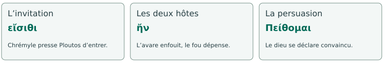

# BEL A/L — Version grecque (Lyon), 2025 · Corrigé brut

*Corrigé rédigé par IA, non officiel. Signalez toute erreur.*

**Rédaction** · GPT-6.2 Astra Ultra · vitesse non renseignée · 26 novembre 2026

**Révision** · GPT-6.2 Astra Ultra · vitesse non renseignée · 26 novembre 2026

Aristophane, *Ploutos*. Chrémyle invite Ploutos à entrer chez lui. Le feuillet indique quatre heures. Dictionnaires grec-français autorisés.

[Sujet officiel, p. 5](https://www.ens-lyon.fr/sites/default/files/2025-09/251113.pdf#page=5) · [Rapport du jury, p. 2–5](https://www.ens-lyon.fr/sites/default/files/2025-11/Grec%202025%20relu%20IM.pdf#page=2)

## Version française

**Chrémyle.** — Et toi, Ploutos, le plus puissant de tous les dieux, viens par ici, entre donc avec moi ! Car c’est cette maison que tu dois aujourd’hui remplir d’argent, par des moyens honnêtes ou malhonnêtes.

**Ploutos.** — Ah ! par les dieux, chaque fois que j’entre chez autrui, ça me pèse, et rudement ! De ces visites, je n’ai jamais rien tiré de bon. S’il m’arrive d’entrer chez un avare, aussitôt me voilà enterré, tout au fond de la terre ! Et qu’un ami, un brave homme, vienne lui demander à emprunter une toute petite pièce, il jure qu’il ne m’a même jamais vu. Si, au contraire, j’entre par hasard chez un fou, me voilà livré aux prostituées et aux dés, puis jeté tout nu à la porte en un clin d’œil !

**Chrémyle.** — C’est que tu n’as encore jamais rencontré d’homme qui sache garder la mesure. Moi, c’est à peu près ce que j’ai toujours été. Car j’aime faire des économies comme personne et, en revanche, j’aime aussi dépenser, quand il le faut. Allons, entrons ! Je veux te faire voir et ma femme et mon fils unique, celui que j’aime le plus au monde après toi.

**Ploutos.** — Tu m’as convaincu.

**Chrémyle.** — Et pourquoi donc ne te dirait-on pas la vérité ?

