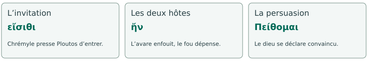

# BEL A/L — Version grecque (Lyon), 2025 · Corrigé guidé

*Corrigé rédigé par IA, non officiel. Signalez toute erreur.*

**Rédaction** · GPT-6.2 Astra Ultra · vitesse non renseignée · 26 novembre 2026

**Révision** · GPT-6.2 Astra Ultra · vitesse non renseignée · 26 novembre 2026

Aristophane, *Ploutos*. Chrémyle invite Ploutos à entrer chez lui. Le feuillet indique quatre heures. Dictionnaires grec-français autorisés.

[Sujet officiel, p. 5](https://www.ens-lyon.fr/sites/default/files/2025-09/251113.pdf#page=5) · [Rapport du jury, p. 2–5](https://www.ens-lyon.fr/sites/default/files/2025-11/Grec%202025%20relu%20IM.pdf#page=2)

## Donner une voix aux deux personnages

> [!INDICATION]
> Lis à haute voix la première invitation et l’ultime question de Chrémyle. Où, entre les deux, le dieu de la richesse avait-il quelque raison de douter de lui ?

Au vocatif, Chrémyle appelle le dieu Ploutos. **δεῦρ’**, **εἴσω** et l’impératif élidé **εἴσιθ’** insistent sur le mouvement. **ἥν** reprend la maison, **σε** est le sujet de l’infinitif et **μεστήν** caractérise la maison une fois remplie. Le heurt entre **δικαίως** et **κἀδίκως** donne déjà un doute sur la probité de cet hôte empressé. Dans la réplique de Ploutos, **πάνυ**, rejeté après le mot « maison », porte sur le déplaisir. **οὐδὲν … πώποτε** cumule « rien » et « jamais ». Le petit **αὐτοῦ** reprend l’expérience d’aller chez les autres.

### Les deux mésaventures

L’unique note rapproche **ἤν** de **ἐάν**. Avec le subjonctif **τύχω** et le participe **εἰσελθών**, les deux hypothèses donnent des expériences susceptibles de se renouveler. **ὡς** suivi de l’accusatif d’une personne marque ici un déplacement chez elle. L’avare enfouit Ploutos et prétend n’avoir jamais vu la richesse. L’ami demande **τι μικρὸν ἀργυρίδιον**, où l’adjectif et le diminutif rendent la somme plus dérisoire encore. Le fou fait le contraire de l’avare. **παραβεβλημένος**, parfait passif, laisse Ploutos subir la dépense. **γυμνός** le montre déshabillé au moment où il se retrouve dehors. Les aoristes **κατώρυξεν** et **ἐξέπεσον** font surgir à chaque fois un résultat, d’où le tour oral « me voilà… ».

### La promesse et la pointe

Chrémyle se donne pour un homme de mesure. L’enclitique **πως** nuance son autoportrait. Les deux participes **φειδόμενος** et **ἀναλῶν** dépendent de **χαίρω**. Il prend donc plaisir à faire des économies et à dépenser. Le comique tient aussi à la place du fils dans ses affections. Dans **ἰδεῖν σε**, le dieu est sujet de l’infinitif. La femme et le fils en sont les objets. **μετὰ σέ** place le dieu avant l’enfant. **Πείθομαι** peut se rendre par « je te crois » ou « tu m’as convaincu ». Le jury signale une coquille au dernier vers et rétablit **τἀληθῆ**, crase de **τὰ ἀληθῆ**. L’optatif **λέγοι** avec **ἄν** appelle le conditionnel. Un motif pour dire la vérité au dieu de la richesse vient de se faire entendre dans chaque flatterie.

## Version française

**Chrémyle.** — Et toi, Ploutos, le plus puissant de tous les dieux, viens par ici, entre donc avec moi ! Car c’est cette maison que tu dois aujourd’hui remplir d’argent, par des moyens honnêtes ou malhonnêtes.

**Ploutos.** — Ah ! par les dieux, chaque fois que j’entre chez autrui, ça me pèse, et rudement ! De ces visites, je n’ai jamais rien tiré de bon. S’il m’arrive d’entrer chez un avare, aussitôt me voilà enterré, tout au fond de la terre ! Et qu’un ami, un brave homme, vienne lui demander à emprunter une toute petite pièce, il jure qu’il ne m’a même jamais vu. Si, au contraire, j’entre par hasard chez un fou, me voilà livré aux prostituées et aux dés, puis jeté tout nu à la porte en un clin d’œil !

**Chrémyle.** — C’est que tu n’as encore jamais rencontré d’homme qui sache garder la mesure. Moi, c’est à peu près ce que j’ai toujours été. Car j’aime faire des économies comme personne et, en revanche, j’aime aussi dépenser, quand il le faut. Allons, entrons ! Je veux te faire voir et ma femme et mon fils unique, celui que j’aime le plus au monde après toi.

**Ploutos.** — Tu m’as convaincu.

**Chrémyle.** — Et pourquoi donc ne te dirait-on pas la vérité ?

