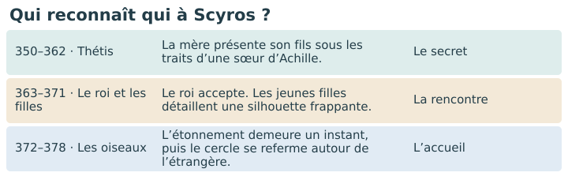

# BEL A/L — Version latine (Lyon) 2025 · Corrigé brut

*Corrigé rédigé par IA, non officiel. Signalez toute erreur.*

**Rédaction** · GPT-6.2 Astra Ultra · vitesse non renseignée

**Révision (tour 1)** · GPT-6.2 Astra Ultra · vitesse non renseignée

[Sujet officiel](https://www.ens-lyon.fr/sites/default/files/2025-09/251113.pdf#page=4) · [Rapport du jury](https://www.ens-lyon.fr/sites/default/files/2025-11/Latin%202025%20relu%20IM.pdf#page=2) · [Archives de la session](https://www.ens-lyon.fr/formation/admission/archives-du-concours-lettres-et-sciences-humaines/concours-dentree-session-2025)

Stace, Achilléide, I, 350–378 (référence donnée par le rapport). Écrit de spécialité de quatre heures. Sujet, page 4. Les vingt-neuf vers du feuillet, de Hanc tibi à ad alta cubilia ducunt. Les numéros des notes ci-dessous sont ceux du livre I.

## Version française

« Cette jeune fille que voici, ô roi, dit-elle, c’est la sœur de notre Achille. Ne vois-tu pas combien son visage a l’air farouche et comme elle soutient la comparaison avec son frère ? C’est elle que nous te confions. Pleine d’ardeur, elle voulait porter sur ses épaules les armes et l’arc, et repousser le mariage à la manière des Amazones. Mais le souci de mon enfant mâle me suffit. Qu’elle porte, elle, les corbeilles et les objets sacrés. À toi, par la discipline que tu lui imposeras, de mater son caractère indocile et de la maintenir dans le rôle qui revient à son sexe, jusqu’à ce qu’elle soit en âge de se marier et de quitter sa réserve de jeune fille. Ne lui permets ni de se livrer aux audacieux exercices de la palestre ni d’errer parmi les repaires des bêtes dans les bois. Élève-la à l’intérieur et tiens-la à l’écart, parmi des jeunes filles pareilles à elle. Avant tout, souviens-toi de la tenir loin du rivage et du port. Tu viens de voir les voiles des Phrygiens. Déjà, en traversant la mer, les navires ont appris à trahir les droits qui lient les hommes entre eux. »

Le vieillard se rend à ses paroles et accueille le petit-fils d’Éaque, dissimulé par l’ingéniosité de sa mère. Qui pourrait faire obstacle aux ruses des dieux ? Bien plus, de lui-même, il rend hommage à la déesse en tendant une main suppliante et la remercie de l’avoir choisi. Et la foule des pieuses filles de Scyros ne se lasse pas de fixer avec une insistance extrême le visage de la nouvelle venue. Comme elle se distingue par son port de tête et par ses cheveux ! Quelle ampleur dans ses épaules et sa poitrine ! Puis elles l’invitent à se joindre à leurs danses et à prendre part à leurs rites purs. Elles lui font place et se réjouissent de la toucher.

Ainsi font les oiseaux d’Idalie lorsqu’ils fendent les nuages moelleux. Depuis longtemps ces colombes vivent groupées, au ciel comme au logis. Si une étrangère vient d’une autre contrée et mêle ses ailes aux leurs, toutes, dans un premier temps, s’étonnent et frémissent. Bientôt elles volent de plus en plus près. En plein ciel, peu à peu, elles en ont fait l’une des leurs et, dans un battement d’ailes bienveillant, l’entourent joyeusement et la conduisent vers leurs nids haut perchés.

## Notes de langue et de lecture

**V. 350–354 · hanc, germanam, ut**

Hanc anticipe le geste de présentation, avant le verbe tradimus. Germanam est en apposition et nostri se rattache à Achillis. Dans l’exclamation indirecte, ut porte sur l’apparence, avec un verbe « être » sous-entendu. Genas est un accusatif de relation. Dans arma… arcumque… ferre, deux objets dépendent du même infinitif, lui-même complément de petebat.

**V. 355–360 · ferat, frange, tene, memento**

Ferat a pour sujet la prétendue fille. Frange et tene s’adressent au roi. La note sur sexuque tene explicite le rôle que Thétis prétend faire respecter. Dum ouvre le terme de l’éducation demandée. Soluendus est un adjectif verbal accordé à pudor. Ale vient de alo, avec le sens large d’« élever ». Memento introduit arcere.

**V. 361–365 · didicere, parentis, diuum**

Les voiles phrygiennes rappellent le passage du navire de Pâris, comme l’indique le feuillet. Didicere est un parfait pour didicerunt. Le sujet en est carinae, les carènes pour les navires. Dans le récit, pater désigne respectueusement Lycomède, tandis que parentis, au génitif, renvoie à la mère. Diuum est le génitif pluriel de diuus et obstet un potentiel.

**V. 365–369 · ueneratur, quantum, comis**

Le complément sous-entendu de ueneratur est la déesse. Electus s’accorde avec le roi, choisi par elle. Turba est un nom collectif singulier et uisu indique la façon de fixer le visage de la nouvelle venue. Les deux quantum introduisent des exclamations. Ceruice et comis sont deux ablatifs coordonnés. Le second appartient à coma, « la chevelure ».

**V. 370–373 · sociare choros, Idaliae uolucres**

Les jeunes filles invitent Achille à s’associer à leurs danses et à s’approcher des cérémonies sacrées. La comparaison conserve une désignation poétique des colombes, les oiseaux d’Idalie, lieu associé à Vénus. Mollia nubila est le complément d’objet de frangunt, « fendre les nuages ». Nubila et nubilis, l’âge de se marier, ont des formes et des sens distincts.

**V. 374–378 · hospita, propius, fecere suam**

Le sujet singulier de iunxit et de uenit est l’oiseau venu d’une autre région, au milieu d’un groupe déjà uni. Cunctae renvoie aux colombes. Propius est un comparatif redoublé. Fecere est le parfait de facio pour fecerunt. Suam reprend la nouvelle venue, désormais adoptée. Dans plausu secundo l’adjectif signifie « favorable » et colore le bruit des ailes.
