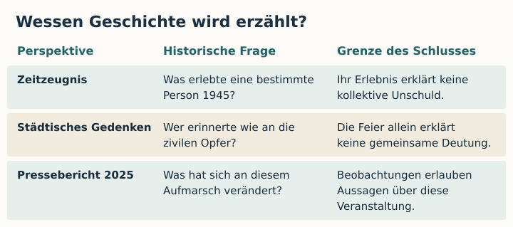

# BEL B/L — Allemand (oral, option) 2025 · Corrigé guidé

*Corrigé rédigé par IA, non officiel. Signalez toute erreur.*

**Rédaction** · GPT-6.2 Astra Ultra · vitesse non renseignée

[Sujet officiel](https://www.ens.psl.eu/sites/default/files/sujets_allemand_oral_option.pdf) · [Rapport du jury](https://www.ens.psl.eu/sites/default/files/2025_bl_rapport_oral_allemandl_option.pdf)

## Préparer l’explication

Le sujet reproduit la version abrégée d'un article de Michael Krell paru dans *Zeit Online* le 26 mars 2025. L'oral d'option donne 1 h 30 de préparation, vingt minutes d'explication et dix minutes d'entretien. Le jury indique qu'il attend des connaissances historiques plus approfondies qu'au tronc commun et reproduit les questions qu'il a effectivement posées. Les réponses ci-dessous proposent des formulations pour travailler ces questions.

Pour préparer l'introduction, dater successivement l'événement de 1945, ses usages en RDA, l'importance du rassemblement dans les années 2000, son recul et l'affluence de 2025. Dans le commentaire, dissocier trois objets que l'article rapproche, la mort des civils, les commémorations de la ville et la réappropriation militante du deuil. Le jury souligne que les finalités du bombardement restent discutées. Pour vingt minutes, réserver environ deux minutes à l'introduction, cinq ou six à chacun des trois moments et deux à la conclusion. Revenir au texte après chaque détour historique.

## Wer darf im Namen der Dresdner Toten sprechen?

[Début du document dans le PDF officiel](https://www.ens.psl.eu/sites/default/files/sujets_allemand_oral_option.pdf#page=1)

Ein Trauermarsch ruft zunächst die Vorstellung hervor, dass Menschen schweigend ihrer Toten gedenken. Michael Krell beginnt seinen Artikel vom 26. März 2025 für Zeit Online mit einem Bild, das diese Erwartung weckt und gleichzeitig stört. Die Kleidung ist schwarz, die Musik instrumental, die Menge bewegt sich fast wortlos durch Dresden. Schon im ersten Absatz bezeichnet der Journalist die Teilnehmer als Neonazis. Seine Frage lautet also nicht, ob es 1945 in Dresden Tote gegeben hat, um die getrauert werden darf. Sie lautet, wie eine politische Bewegung aus einem tatsächlichen Leid eine falsche Erzählung über den Nationalsozialismus gewinnen kann und warum diese Erzählung auch achtzig Jahre später junge Menschen erreicht.

Ich möchte zuerst die verschiedenen Zeiten auseinanderhalten, die an diesem Dresdner Wochenende zusammenkommen. Dann werde ich untersuchen, wessen Aussagen der Journalist als Belege verwendet und wie weit sie tragen. Schließlich möchte ich auf die besondere Rolle der Familienerinnerung eingehen. Denn die im Titel genannte Vorstellung vom Opfer lebt, so zeigt der Artikel, nicht einfach weiter, weil sie bereits vorhanden wäre. Menschen treffen in der Gegenwart Entscheidungen darüber, welche Geschichte sie aus einem überlieferten Erlebnis machen.

Was ist historisch geschehen? Am 13. und 14. Februar 1945 griffen zunächst britische, dann amerikanische Luftstreitkräfte Dresden an. Die Zerstörung traf das Stadtzentrum und kostete sehr viele Zivilisten das Leben. Die historische Kommission der Stadt kam Jahrzehnte später auf eine Größenordnung von bis zu etwa 25.000 Toten. Eine solche Zahl ist eine historisch überprüfte Schätzung. Sie bezeichnet Menschen, deren Tod Gegenstand von Geschichtsschreibung und Trauer ist. Das nationalsozialistische Deutschland führte zu diesem Zeitpunkt seit Jahren einen Angriffs- und Vernichtungskrieg, und die Verfolgung und Ermordung der europäischen Juden war nicht das Werk einer von der deutschen Gesellschaft getrennten, fremden Macht. Beide Sachverhalte gehören zu einer Erklärung des Februar 1945. Der zweite nimmt dem ersten nichts von seinem menschlichen Gewicht.

Zur Frage nach den Absichten der Alliierten empfiehlt sich besondere Genauigkeit. Dresden lag im Zusammenhang der alliierten Kriegführung und der Entwicklungen an der Ostfront. Die Bedeutung der Stadt für Transporte und Industrie spielte in den damaligen Planungen eine Rolle. Die Wirkung auf die dicht bebaute Stadt und ihre Zivilbevölkerung gehört ebenso zu einer Beurteilung der Angriffe. Unter Historikern wird darüber gestritten, welches Gewicht die verschiedenen militärischen und politischen Überlegungen hatten und wie die Entscheidung angesichts des Kriegsverlaufs zu bewerten ist. Die Frage nach einer möglichen Rechtfertigung muss außerdem von der Frage nach dem damaligen Entscheidungsprozess unterschieden werden. Wer eine einzige Absicht als restlos erwiesen ausgibt, riskiert, dieses schwierige Feld der Forschung zu schließen. Wer einen offenen Streit über Absichten zur Behauptung macht, die nationalsozialistischen Verbrechen seien damit aufgerechnet, verlässt es ganz.

Krell spricht von einem Opfermythos. Der Begriff wird missverständlich, wenn man hört, schon die Opfer seien erfunden. Das Gegenteil ist der Fall. Die historisch falsche Behauptung betrifft die Rolle, die aus ihrem Tod für eine ganze Nation abgeleitet wird. In der von Krell kritisierten Erzählung erscheint das deutsche Volk als unschuldige Gemeinschaft, an der andere aus maßloser Zerstörungswut gehandelt hätten. Aus einer Aussage über das Schicksal einzelner Menschen wird damit eine Behauptung über die Unschuld eines Kollektivs. Dazwischen liegt ein Schluss, für den die Erinnerung an eine Familie keinen Beweis liefern kann. Selbst eine vollkommen zuverlässige Schilderung einer Bombennacht beantwortet nicht die Frage, wer den europäischen Krieg begonnen oder wer Juden verfolgt und ermordet hat.

Die Geschichte dieser Umdeutung beginnt nicht bei der im Artikel beschriebenen Demonstration. Bereits die NS-Propaganda nutzte die Zerstörung und verbreitete weit überhöhte Angaben. Nach dem Krieg gehörte das Gedenken früh zum Leben der Stadt, etwa in kirchlichen Zusammenhängen und beim Erinnern an die Zerstörung im Februar. Spätestens am ersten Jahrestag 1946 wurde öffentlich an die Toten erinnert. In der DDR konnten staatliche Deutungen die westlichen Alliierten als Urheber eines verbrecherischen Angriffs hervorheben und daraus eine Anklage gegen die westlichen Mächte in der Gegenwart gewinnen. Diese Deutung war Teil einer anderen politischen Ordnung als der heutige Neonazismus. Aus einer einzelnen Erklärung zur DDR folgt weder, dass alle Dresdner dieselbe Vorstellung teilten, noch, dass jede heutige Trauerfeier diese Linie fortsetzte. Gerade die konkurrierenden Erinnerungen machen den Ort zu einem umkämpften historischen Zeichen.

Wie stellt der Journalist die gegenwärtige Auseinandersetzung dar? Nach dem langen Bild des Zuges folgen sofort zwei verschiedene Schätzungen. Die Polizei spricht von rund 2.000 Teilnehmern, unabhängige Beobachterinnen eher von 3.000. Später nennt die befragte Beobachterin des Kulturbüros Sachsen eine Spanne von zwei- bis dreitausend. In einem Bericht, der eine politische Entwicklung erklären will, wäre es verführerisch, die höchste Zahl als eindeutigen Befund an den Anfang zu setzen. Krell lässt uns stattdessen erkennen, wer zählt. Der Unterschied ändert nichts daran, dass deutlich mehr Menschen als zuletzt kamen. Aber aus der niedrigeren Zahl und dem Vorjahreswert lässt sich kein exakter Wachstumsprozentsatz mit Dezimalstellen gewinnen. Der Leser kann ein Ergebnis über den Trend akzeptieren und bei der absoluten Zahl vorsichtig bleiben.

Nun wechselt der Artikel den historischen Maßstab. In den frühen zweitausender Jahren war Dresden ein besonders bedeutender Treffpunkt der europäischen Neonaziszene. Seit Mitte der 2010er-Jahre verlor der Marsch an Gewicht. Der Rückgang der NPD und die veränderte Protestlandschaft gehören zu den vom Autor genannten Umständen. Während der Pandemie schien die überregionale Bedeutung fast verschwunden zu sein. Die Wortwahl beschreibt eine zeitweilige Wahrnehmung, keine unumkehrbare Entwicklung. Aus der Sicht von 2025 hat sich die Erwartung als voreilig erwiesen. Krell unterscheidet damit zwei Fragen, die man auch in der Analyse demokratiefeindlicher Bewegungen trennen muss. Geht eine bestimmte Organisation zurück? Und welche politischen Deutungsmuster können einen solchen organisatorischen Rückgang überdauern?

Die zeitliche Nähe zum achtzigsten Jahrestag gehört zur Erklärung des erneuten öffentlichen Interesses. Eine runde Zahl hat keine eigenständige politische Absicht. Sie gibt Zeitungen, Städten, Familien und politischen Gruppen einen gemeinsamen Anlass, das Erinnern sichtbar zu machen. Dass sehr verschiedene Akteure denselben Jahrestag beachten, bedeutet noch keine Gemeinsamkeit ihrer Aussagen. Gerade bei einer Stadt wie Dresden kann das äußere Bild der Trauer leicht verdecken, welchen Zusammenhang eine bestimmte Veranstaltung herstellt oder ausspart. Krell entscheidet sich deshalb, die politische Zuordnung im ersten Absatz auszusprechen. Sein Bericht lässt das Bild eines scheinbar rein privaten Schmerzes gar nicht erst zum vollständigen Schlüssel des Geschehens werden.

Auch der Blick über Deutschland hinaus hat zwei Seiten. Die Erwähnung der rechtsextremen Veranstaltung in Budapest macht deutlich, dass es grenzüberschreitende Bezüge in dieser politischen Szene gibt. Zugleich behandeln mehrere Orte und nationale Erinnerungsgeschichten unterschiedliche historische Ereignisse. Dass Menschen sich auf ähnliche politische Deutungen beziehen, bedeutet nicht, dass jedes Treffen von einer gemeinsamen Leitung abhängt. Ein zeitlicher Zusammenhang kann außerdem ganz praktische Auswirkungen auf die Zusammensetzung einer Menge haben. Der Artikel führt mehrere Umstände an, die sich in einem einzelnen Jubiläumsjahr überlagert haben. Er liefert keine Grundlage für die Behauptung, genau einer davon sei die Hauptursache oder jede Frau und jeder Mann in diesem Dresdner Zug habe vorher an einer anderen Veranstaltung teilgenommen.

Warum spricht die Überschrift ausdrücklich von jungen Neonazis? Das Wort „jung“ bezeichnet hier eine Beobachtung über die Zusammensetzung. Im Artikel kommt sie vor allem von Mara Knauthe, die für eine zivilgesellschaftliche Organisation rechtsextreme Aktivitäten in Sachsen beobachtet. Sie vergleicht die Anwesenden mit früheren Jahren und ordnet die sichtbare Verjüngung in weitere Entwicklungen im Land ein. Das ist eine wichtige Perspektive, weil sie wiederholte Beobachtung erlaubt. Sie ersetzt keine repräsentative Befragung aller Teilnehmer. Der Leser kann also die qualitative Beobachtung ernst nehmen, ohne aus ihr eine Aussage über eine ganze sächsische Jugend abzuleiten. Wer die beiden Gruppen sprachlich gleichsetzt, würde dem Rechtsextremismus eine gesellschaftliche Repräsentativität zuschreiben, die der Artikel nicht belegt.

Die Familienerinnerung erklärt, weshalb die jüngere Altersstruktur historisch so bedeutsam ist. Ein junger Mensch von heute erinnert sich nicht selbst an eine Bombennacht des Jahres 1945. Er kann aber mit jemandem aufgewachsen sein, der sich erinnert oder eine überlieferte Familiengeschichte erzählt. Solche Erzählungen enthalten oft Einzelheiten, die in einem Überblickswerk keinen Platz haben, einen verlorenen Gegenstand, die Angst vor einer Trennung oder das Bild einer verschwundenen Straße. Ihre Nähe ist eine Stärke. Sie kann zugleich zum Problem werden, wenn aus dem Satz, die eigenen Großeltern hätten gelitten, der Anspruch entsteht, die ganze Geschichte Deutschlands aus ihrer Perspektive zu erzählen. Der persönliche Zeuge kann gerade in der Beschreibung seines Leidens glaubwürdig sein und über die politischen Zusammenhänge nur begrenztes Wissen besitzen.

Krell zeigt, dass politische Akteure an diese Nähe anknüpfen. Für eine demokratische Erinnerungskultur stellt sich damit eine anspruchsvollere Aufgabe als die Wahl zwischen Familienerzählung und Geschichtsbuch. Man kann einer Großmutter aufmerksam zuhören und zugleich wissen wollen, was sie an einem bestimmten Tag sehen konnte, welche Nachrichten sie erreichten und welche Menschen in ihrem Bericht nicht vorkommen. Man kann eine Geschichte durch Briefe, Archivmaterial oder Berichte von Verfolgten ergänzen. Solche Fragen beschädigen das Andenken an den Einzelnen nicht. Sie verhindern, dass eine spätere Generation ein einzelnes Leben stellvertretend für ein angeblich unschuldiges Volk in Anspruch nimmt. In dieser Fähigkeit zur Ergänzung liegt für mich ein wichtiger Unterschied zwischen Gedenken und Mythos.

Schließlich ist die Rolle einzelner Wörter entscheidend. Krell kennzeichnet die rechtsextreme Bezeichnung, die den Bombenkrieg mit dem Holocaust verknüpft, ausdrücklich als Parole. Der historische Begriff Holocaust bezeichnet die systematische Ermordung der europäischen Juden. Wird er auf die Bombardierung einer deutschen Stadt übertragen, verschwindet der Unterschied zwischen der nationalsozialistischen Vernichtungspolitik und dem alliierten Luftkrieg. Zugleich kehren sich für den Hörer die Rollen von Tätern und Verfolgten scheinbar um. Man könnte über das Leid in Dresden, die militärischen Entscheidungen und das Völkerrecht diskutieren, ohne auch nur einmal diese irreführende Gleichsetzung vorzunehmen. Das Wort dient also nicht der Präzision einer historischen Untersuchung. Es soll die Maßstäbe verändern, mit denen der Hörer den Nationalsozialismus beurteilt.

Ich komme an den Anfang des Artikels zurück. Die schweigende Menge ist für Krell keineswegs eine Menge ohne Aussage. Ihre politische Bedeutung erschließt sich aber auch nicht aus der schwarzen Kleidung allein. Er verbindet die Beobachtung mit der Geschichte der Veranstaltung, unterscheidet Schätzungen und lässt eine ortskundige Beobachterin zu Wort kommen. Daraus ergibt sich ein begrenztes, aber klares Urteil. 2025 hat die Beteiligung bei diesem Aufmarsch deutlich zugenommen, und jüngere Teilnehmer sind stärker sichtbar. Die achtzig Jahre seit 1945 haben den Streit über die Bedeutung von Dresden also nicht erledigt. Bei jeder neuen Erzählung stellt sich erneut die Frage, ob das Schicksal bestimmter Menschen in seinem historischen Zusammenhang gewürdigt oder als Beweis einer kollektiven Unschuld ausgegeben wird. Gerade das genaue Erinnern an die Zivilisten ist ein Grund, diesen Unterschied festzuhalten.

### Entretien d’entraînement

**Welche Luftstreitkräfte griffen Dresden an und welchen Zielen galt der Angriff?** Britische und amerikanische Luftstreitkräfte waren beteiligt. Die Stadt hatte Verkehrs- und Industriefunktionen. Im Zusammenhang mit dem Kriegsverlauf und der Ostfront wurden verschiedene militärische und politische Ziele diskutiert. Die Folgen für die Zivilbevölkerung waren verheerend. Die Gewichtung der Motive und die Bewertung des Angriffs bleiben Gegenstand historischer Debatten.

**Wann begann das Gedenken, und wie wurde es in der DDR verwendet?** Es gab sehr früh nach dem Krieg lokale und kirchliche Erinnerung, spätestens zum ersten Jahrestag 1946. In der DDR ließ sich das Ereignis staatlich als Anklage gegen die westlichen Alliierten einsetzen. Privates, kirchliches und staatliches Gedenken hatten weder zwingend dieselbe Form noch dieselbe politische Bedeutung.

**Warum ist Dresden für die extreme Rechte ein Erinnerungsort?** Die weit sichtbaren Zerstörungen und die wirklichen zivilen Opfer lassen sich aus dem Zusammenhang des von Deutschland begonnenen Krieges lösen und für eine Erzählung kollektiver Unschuld vereinnahmen. Der Artikel belegt die besondere Bedeutung der Aufmärsche spätestens für die frühen 2000er-Jahre. Die Vorgeschichte der politischen Umdeutung reicht weiter zurück.

**Wie erklären Sie die im Text als Parole gekennzeichnete Zusammensetzung mit „Holocaust“?** Sie beansprucht für den alliierten Luftangriff einen Begriff für die nationalsozialistische Ermordung der europäischen Juden. Die Gleichsetzung relativiert den Holocaust und verschiebt die Rollen von Tätern und Opfern. Zur Anerkennung des Leids der Dresdner Zivilisten braucht man diesen Vergleich nicht.

**Bedeutet Budapest, dass diese Bewegungen miteinander kooperieren oder konkurrieren?** Der Artikel zeigt transnationale Bezüge und zugleich mehrere Orte, deren Veranstaltungen ein teilweise ähnliches Publikum interessieren können. Gemeinsame Deutungen und Konkurrenz um Aufmerksamkeit schließen sich nicht aus. Das Verhältnis der Organisationen im Einzelnen belegt die Terminnähe nicht.

