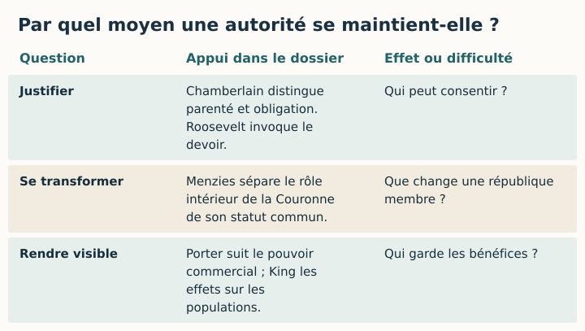

# BEL B/L — Anglais 2025 · Corrigé brut

*Corrigé rédigé par IA, non officiel. Signalez toute erreur.*

**Rédaction** · GPT-6.2 Astra Ultra · vitesse non renseignée

**Révision (tour 1)** · GPT-6.2 Astra Ultra · vitesse non renseignée

[Sujet officiel](https://www.ens.psl.eu/sites/default/files/2025_blses_epreuve_a_option_sujet_anglais.pdf) · [Rapport du jury](https://www.ens.psl.eu/sites/default/files/2025_bl_rapport_ecrit_anglais_option.pdf)

## Who gets to call an empire by its name?

At the Royal Colonial Institute in 1897 Joseph Chamberlain could expect applause for identifying a mission peculiarly suited to British talents. In 1956 the Australian prime minister Robert Menzies regretted that the word *empire* could scarcely be spoken approvingly. Yet in 1967 Martin Luther King had no need of the word to describe the relationship between American investments and American interventions abroad. What, then, changes when the vocabulary of empire becomes disreputable? Read alongside Theodore Roosevelt's address of 1899, these voices make Bernard Porter's distinction between formal rule and informal influence indispensable. They also put it under pressure. A change of vocabulary can hide continuity, but it can also register a genuine change in who governs whom.

**Who belongs to the imperial “we”?** Chamberlain tells his British audience a story of moral advance. Treating colonies as possessions supposedly gave way first to the fear that they were liabilities, then to a proper understanding of Britain's responsibilities. What sounds like a single generous formula actually contains two. Settlers in self-governing colonies are kin, linked by descent, religion and language. The inhabitants of tropical territories, whom Europeans cannot hope to outnumber, are beneficiaries of an obligation discharged for them. They receive no corresponding invitation to determine whether imperial rule has secured their prosperity. By making “possession” the outgrown vice of an earlier age, the speech can retain unequal government in the present while claiming to have overcome its selfish justification.

Roosevelt speaks two years later to a men's club in Chicago. As governor of New York, he has to recommend an imperial future to citizens accustomed to identifying their nation with a rebellion against Britain. He turns a question about governing the Philippines into a test of his listeners' manhood. “Strenuous” action honours their forefathers; asking whether the governed consent becomes evidence of the questioner's timidity. Chamberlain divides imperial subjects into relatives and wards, Roosevelt his fellow Americans into men willing to act and their supposedly unworthy opponents. In both cases the speaker selects the constituency entitled to judge him before making his case. Porter's comparison of continental dispossession and overseas annexation exposes a weakness in the American claim to historical innocence: a change of transport does not alter what settlement meant to those whose land was taken.

**What happens when the constitution changes?** Menzies writes in *The Times* from a self-governing country for which the Crown is still a practical institution. His examples range from the making of a statute to the title held by the opposition leader. It makes constitutional sense for both the government and its parliamentary opponent to claim the same sovereign. It does not follow that the same claim can be made for India. Menzies dates the decisive formula to 1948: a republic could belong to the Commonwealth and recognise its head without making that sovereign part of its domestic government. The paradox of a Crown Commonwealth inside a wider Commonwealth expresses an actual loss of uniformity. It also indicates the perspective from which that loss looks regrettable. The Australian prime minister's contrast between peaceful British and aggressive Communist imperialism is an argument of the Cold War, not an accepted distinction between two species of rule.

Porter's historical comparison complicates any easy succession from possession to free association. Commercial access, loans and bases can extend power without requiring governors everywhere. Conversely, the acquisition of a colony did not make British officials omnipotent: their dependence on local collaborators constrained what they could do. Nor does Porter give administrators and investors interchangeable motives. Paternalist officials sometimes frustrated the capitalist interests that had helped bring annexation about. The historian can recognise discontinuity in the Commonwealth while asking who dominated the less visible economic relationships that survived the formal empire.

**What would count as giving up an empire?** King's address at Riverside Church makes that question moral and material. Vietnam becomes a symptom. Referring to Guatemala and other countries prevents his American listeners from dismissing one intervention as an exceptional mistake. Where Roosevelt treats withdrawal as a refusal to do one's share of global work, King asks who receives the profits for which stability is maintained. His account of the Good Samaritan draws a further distinction: relieving the injured traveller changes one life; altering the road that keeps producing victims changes a social arrangement. Addressed to a congregation, the biblical figure turns a familiar duty of individual charity into an exacting public duty. The costs of militarism appear in foreign lives and in the domestic programmes that lose resources. King closes by claiming that reforming those priorities would itself be the best defence against communism. That last word makes his disagreement with Menzies sharper. The two speakers can share a Cold War concern and draw opposite lessons about the use of Western power.

The decisive disagreement concerns who may define service to others. Chamberlain and Roosevelt speak as if their readiness to undertake burdens established the benefit to those governed. Menzies shows how one institution can stop exercising an internal power even while a symbolic association persists. Porter gives a vocabulary for tracing power after the flags have changed, and King supplies a test for its supposed beneficiaries: can the people whose society is being transformed decide what is to change and retain the benefits? An empire may survive the loss of its good name. Equally, accepting a common name need not entail accepting a common ruler.

