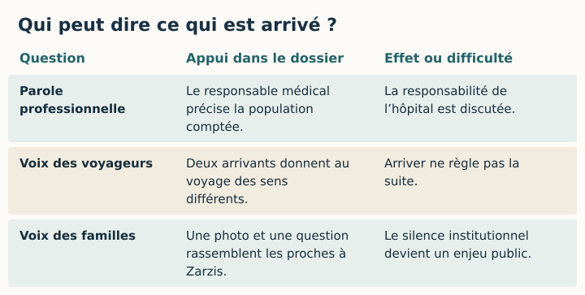

# BEL B/L — Arabe 2025 · Corrigé brut

*Corrigé rédigé par IA, non officiel. Signalez toute erreur.*

**Rédaction** · GPT-6.2 Astra Ultra · vitesse non renseignée

**Révision (tour 1)** · GPT-6.2 Astra Ultra · vitesse non renseignée

[Sujet officiel](https://www.ens.psl.eu/sites/default/files/2025_blses_epreuve_a_option_sujet_arabe.pdf)

## مَن يملك رواية الرحيل؟ من أرقام الهجرة المغاربية إلى أسماء المفقودين

يبدو الرحيل، حين يُقاس بعدد المغادرين، حركةً تنتهي بمجرد بلوغ الضفة الأخرى. لكن النصوص الثلاثة تضع نهاية الرحلة نفسها موضع سؤال. ففي خبر نشرته النهار سنة 2020 يغادر أطباء شبان تونس ويبقى المستشفى الذي تركوه موضوع احتجاج. وفي تحقيق لمونت كارلو الدولية سنة 2021 يصل جزائريون إلى إسبانيا من غير أن يكون الوصول جوابا نهائيا عما ينتظرهم. أما تحقيق أوريان 21 سنة 2022 فيبدأ تحديدا حيث تنقطع أخبار المسافرين. كيف تتغير مسؤولية المجتمع تجاه الهجرة عندما ينتقل الكلام من ممثل مهنة يحصي الخارجين إلى من خاض الرحلة ثم إلى من لا يعرف إن كان قريبه قد وصل أصلا؟

**ما الذي يقيسه العدد؟** ينسب الخبر الأول تقدير الثمانين في المائة إلى عميد الأطباء التونسيين، ويحدد في المتن الجماعة التي يتحدث عنها: المسجلون الجدد منذ شهر مايو، وغالبيتهم من الشبان. ليس الرقم نسبة إلى مجموع أطباء البلاد. وتلك الدقة تغير معنى العنوان، إذ يصبح السؤال عن قدرة المستشفى على الاحتفاظ بمن يدخلون المهنة. ويشير العميد إلى البطالة وتوجيه بعض الشبان إلى مناطق داخلية قبل أن يكتسبوا الخبرة اللازمة، فضلا عن أوضاع المؤسسات نفسها. وقد جاء تصريحه على إثر وفاة طبيب شاب في مستشفى جندوبة بعد سقوطه في مصعد معطّل. فحين يسأل عن نتيجة الزيارات التفقدية ويعترض على تحميل طبيبة حديثة العهد بالعمل تبعات الصيانة، يجعل من حادث فردي اختبارا لتوزيع المسؤولية المؤسسية. حتى يوم الغضب المزمع يستثني الحالات الاستعجالية. لذلك لا يختزل الاحتجاج في قرار المغادرة؛ إنه فعل يقوم به الباقون أيضا.

يقيس النص الثاني أعداد الوصول والاعتراض والوفيات، ثم يخرج من لغة الإحصاء إلى وجه شاب مرهق على الشاطئ. لا تعدّ هذه الأرقام الشيء نفسه: لا يشمل من وصل إلى إسبانيا جميع من غادر الجزائر، ومن انقطع خبره ليس بالضرورة في عداد المتوفين المؤكدة وفاتهم. وفي التحقيق الثالث يكتسب هذا الفرق معنى مؤلما. فالأب الذي أُبلغ بأن ابنه «مفقود» يسأل عما تعنيه الكلمة. تستطيع الإدارة أن تسجل حالة، لكن الاسم الذي تطلقه عليها لا يجيب عن السؤال الذي سيلازم الأسرة سنوات.

**أي معنى للاختيار حين يضيق ما يمكن اختياره؟** يورد التحقيق عن الجزائريين شهادتين لا تتطابقان. يفسر خالد ديه رغبته في متابعة الطريق إلى فرنسا بأن له هناك أهلا وأصدقاء وأنه لا يتكلم الإسبانية. وأحمد بن صفية، الذي أخفى الأمر عن عائلته اتقاء لقلقها، يعود فيحذر الآخرين من المخاطرة التي أقدم عليها. يجتمع في الشهادتين نقص الأفق الاقتصادي والحاجة إلى علاقة مع أشخاص معروفين. مع ذلك، يفصل النص بين من يشعر بالارتياح عند نهاية مرحلة ومن يستعيد الرحلة ليحذر منها. ولا تجوز مساواة ظروف هؤلاء بظروف الأطباء، فالشهادة المهنية تطرح إمكانات ومسؤوليات مختلفة. ما يجمع الحالتين هو أن القول إن الإنسان غادر بإرادته لا يكفي لتفسير ما ضاق أمامه في بلده ولا كلفة مغادرته على من بقي.

**من السؤال العائلي إلى المطالبة العامة.** في جرجيس تحمل النساء صور أقاربهن في موكب يجمع عائلات من بلدان متعددة. يظل السؤال باللهجة المحلية قريبا من كلام البيت، غير أن رفعه في الشارع يوجهه هذه المرة إلى سلطات الشمال والجنوب. خرج الموكب في السادس من سبتمبر سنة ٢٠٢٢. واختير هذا اليوم إحياءً لذكرى غرق مركب قبالة لامبيدوزا في اليوم نفسه من سنة ٢٠١٢. يقيس التقويم عشر سنوات، أما الأسرة التي لا تعرف مصير قريبها فلا تستطيع أن تجعل من الذكرى خاتمة لانتظارها. تروي رشيدة الزهدلي كيف بدأ سؤالها عن أبيها شأنا يخص عائلتها، ثم اكتشفت، من خلال الجمعية، آلافا يتقاسمون الانتظار. وفي حالة أب آخر، تبدو الوعود الكاذبة بأخبار ابنه اعتداءً جديدا على حق الأسرة في المعرفة.

لا يكتفي التحقيق بتقديم الحزن صورةً تستدر العطف. إنه يضع إلى جانب شهادات الأسر نقد الجمعيات لنقل مراقبة الحدود الأوروبية إلى الجنوب، ثم يعرض الجدل الذي أثاره كلام مبعوث مفوضية اللاجئين عن دور الأمهات. وحين تستنكر النساء هذا الاتهام ويربطن بين انسداد الآفاق في بلادهن وعدم التكافؤ في التنقل بين ضفتي المتوسط، يطالبن بأن يُسمع تفسيرهن لا أن تُعرض صورهن فحسب. من هنا يختلف مدلول المسؤولية في الوثائق: للمستشفى واجب تجاه أطبائه ومرضاه، وللدول أسئلة تتعلق بالحماية والمعلومات، وللصحافة اختيار بين إعادة إنتاج العدد وإعطاء صاحب الاسم حق الكلام. في نهاية الموكب تُطوى اللافتة، أما السؤال الذي كُتب عليها فلا يُطوى معها.

