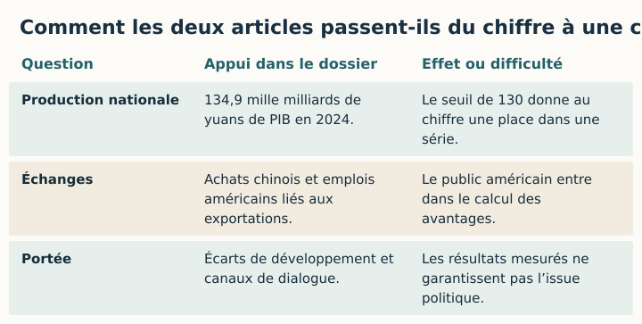

# BEL B/L — Chinois 2025 · Corrigé brut

*Corrigé rédigé par IA, non officiel. Signalez toute erreur.*

**Rédaction** · GPT-6.2 Astra Ultra · vitesse non renseignée

**Révision (tour 1)** · GPT-6.2 Astra Ultra · vitesse non renseignée

[Sujet officiel](https://www.ens.psl.eu/sites/default/files/2025_blses_epreuve_a_option_sujet_chinois.pdf) · [Rapport du jury](https://www.ens.psl.eu/sites/default/files/2025_bl_rapport_ecrit_chinois_option.pdf)

## 从一个总量到一次通话：两篇报道怎样解释中国经济的分量

2025年1月17日，《新京报》报道中国国内生产总值首次越过130万亿元。一天后，玉渊潭天分析习近平同美国当选总统特朗普的电话。前一篇的读者面对一个大数字，后一篇的读者面对一条简短的外交消息。两篇都追问“意味着什么”，说明作者关心的不只是已经发生的事，还包括公众应该如何理解它。问题在于，从经济规模推到国家实力、再推到合作的必要性，中间有哪些理由？数字能够证明什么，又有哪些判断来自解释数字的人？

**门槛是怎样成为故事的？** 《新京报》开头给出2024年的具体数值134.9万亿元，但标题选的是一个整数关口。134.9便于统计，130则便于叙述“第一次”。国家统计局局长康义又把它放进一条时间线：2020年经济总量越过100万亿元，接下来的两个年份先后越过110万亿和120万亿。于是读者看到的不是孤立的一年，而是一串仿佛可以逐步攀登的台阶。把一年的新增经济规模同一个中等国家全年的经济总量相比，更把一个抽象的增量变成可想象的尺度。然而这项比较本身既不能解释增长的全部原因，也没有告诉读者普通家庭收入增加了多少。

报道随后用不同单位给“实力”划出几层含义。新能源汽车和手机的产量说明生产能力，国内零售和固定资产投资涉及内需，进口额则说明别国企业也能从中国市场找到买家。一个市场要既能抵御外部不稳定，又能继续对外开放，表面似有张力。文章的解释是，完整的产业体系和大市场首先提供回旋余地，扩大进口又使国内需求可以成为别人的机会。在这里应当注意说话者：《新京报》记者是在转述一场发布会，材料中的许多结论是统计部门负责人为年度数据赋予的意义。文章末尾有关人均产出与发展不均衡的保留并非闲笔，它限制了开头那座“台阶”的适用范围。国家总量达到新水平，不等于每一个人都已达到发达经济体的生活水平。康义还说，近年来中国对世界经济增长的年贡献率基本在百分之三十左右。这里比较的是新增的产出。如果把这个比例写成中国占世界生产总值的份额，就把“增长了多少”误读成了“一共有多少”。

**同一市场，怎样改用对方的账本来讲？** 第二篇报道不再以中国在世界上的名次为起点，而转向美国企业、劳动者和消费者。它把中美贸易、在华美企的利润、美国对华出口支持的就业以及中国商品对日常生活成本的影响分开来算。文中提到的93万个就业岗位是由美国对华出口支撑的，不能写成由在华美企直接雇用的美国人数。反过来读第一篇中2.6万亿美元的货物进口规模，就更能理解两篇之间的承接：一个总数用来表现市场的世界地位，另一组例子则要让互利变成可以在美国国内辨认的利益。这也解释了为什么后一篇既有数字，又有关于冲突不应成为选择的判断。前者表明两国经济相连；后者是报道希望交往双方接受的政策方向，两者不能相互替代。

**为什么经济联系还需要政治机制？** 如果贸易往来足以自动解决分歧，通话的时机便不值得大书特书。文章偏偏指出，当时距离特朗普正式就职还有三天，韩正还将作为中方特别代表出席就职典礼。它让复旦大学的吴心伯解释双方传递信号的作用，再请中国人民大学的刁大明说明高层沟通渠道的具体含义。两位学者的发言把一次新闻事件延伸为关于联系能否持续的讨论。台湾问题也在通话中出现，可见对共同经济利益的强调并未消除政治分歧。尤其应当辨明，当报道把以往交流机制的停摆归咎于美方时，它表达的是自己对责任的归属，不是电话双方共同发布的结论。文中可以确认的共同决定是保持联系，不能据此断言关系已经稳定。

从国内生产总值到领导人通话，两篇报道都试图把一项当下的事实放进较长的叙事：增长应当提升抵御风险的能力，贸易相连应当给对话提供理由。但它们的结尾也留下两道不能用数字直接跨过的门槛。一道是总量同人均发展之间的距离，一道是相互依赖同政治互信之间的距离。把两道距离说清楚，既能说明为什么报道郑重其事地安排这些数字，也能看出一串数字还不足以替未来作出保证。

