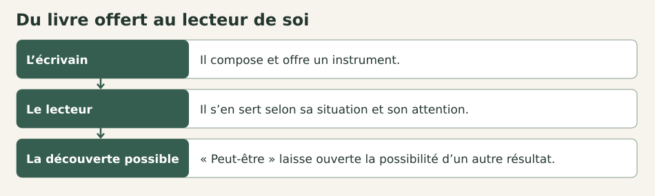
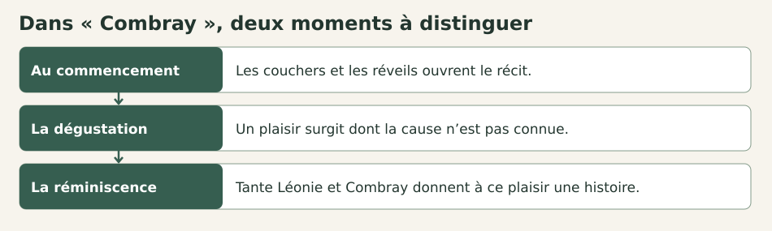

# BEL BL — Composition française 2025 · Corrigé guidé

*Corrigé rédigé par IA, non officiel. Signalez toute erreur.*

**Rédaction** · Claude Opus 4.8 · effort non renseigné · vitesse non renseignée

**Révision (tour 1)** · modèle exact non renseigné · effort non renseigné · vitesse non renseignée

**Révision (tour 2)** · GPT-6.2 Astra Ultra · vitesse non renseignée

**Révision (tour 3)** · GPT-6.2 Astra Ultra · vitesse non renseignée

**Révision (tour 4)** · GPT-6.2 Astra Ultra · vitesse non renseignée · 26 novembre 2026

## Présentation du sujet

L’épreuve écrite commune aux ENS Ulm et Lyon dure six heures. Le rapport B/L indique le coefficient 3.

« L’écrivain ne dit que par une habitude prise dans le langage insincère des préfaces et des dédicaces : « mon lecteur ». En réalité, chaque lecteur est quand il lit le propre lecteur de soi-même. L’ouvrage de l’écrivain n’est qu’une espèce d’instrument optique qu’il offre au lecteur afin de lui permettre de discerner ce que sans ce livre il n’eût peut-être pas vu en soi-même ».

Marcel Proust, Le Temps retrouvé (1927), À la Recherche du temps perdu, Paris, Gallimard, coll. « Bibl. de la Pléiade », 1989, t. IV, p. 489-490.

En vous fondant sur des exemples précis, vous analyserez les enjeux et la pertinence d’une telle affirmation.

**Le sujet.** Une réflexion sur la relation triangulaire auteur–œuvre–lecteur, saisie sous un angle paradoxal : la *dénonciation* d’une illusion — l’adresse « mon lecteur » n’est qu’une convention « insincère » de préface — et la *réévaluation* de la lecture comme expérience intérieure, le livre devenant « instrument optique » qui médiatise (fait voir) et déforme (toute optique transforme). Le rapport souligne la double négation restrictive (« ne dit que », « n’est qu’une espèce ») qui oriente d’emblée la réflexion vers la limitation de la fonction de l’œuvre.

**Les critères du jury.** La section I du rapport examine les trois propositions de Proust et plusieurs plans. Dans la section II, le jury oppose les copies qui analysent l’instrument et savent en discuter les limites à celles qui accumulent les allusions. Les pages 6 à 9 permettent de contrôler l’introduction, les transitions, la conclusion et l’expression.

**Exemple de répartition des six heures.** Lire et analyser la citation pendant 30 minutes ; consacrer 45 minutes au problème et au plan, 30 minutes aux exemples, 3 h 30 à la rédaction et 45 minutes à la relecture. Cette répartition indicative totalise 360 minutes.

Face à une lecture très personnelle, demander quel passage a fait apparaître ce que le lecteur reconnaît en lui. Ce retour au détail de l’œuvre permet d’éprouver le rôle exact de l’instrument décrit dans la citation.

**Pourquoi le conditionnel passé importe-t-il ?** « Sans ce livre il n’eût peut-être pas vu » compare la lecture à ce qui aurait pu rester inaperçu. Le livre offre une possibilité. Le lecteur peut ne pas la saisir, la retrouver plus tard ou voir autre chose que le souvenir du narrateur. Cette variation donne un sens précis au réglage de l’instrument optique.

## Partie I — Comprendre le sujet

### Étape 1 — Analyser la citation

> [!INDICATION]
> Repérez la structure de la phrase : quelles propositions articulent-elles, et quels mots introduisent chaque mouvement (« en réalité ») ?

> [!INDICATION]
> Interrogez la double négation restrictive (« ne dit que », « n’est qu’une espèce ») : que devient la fonction de l’œuvre si on la réduit à un instrument ?

> [!INDICATION]
> Analysez la métaphore de l’« instrument optique » : que fait un instrument d’observation — médiation, déformation, grossissement ?

#### Solution

La citation articule trois propositions qu’il faut distinguer. (1) « L’écrivain ne dit que par une habitude prise dans le langage insincère des préfaces et des dédicaces : “mon lecteur” » : constat d’insincérité — l’adresse au lecteur est une fiction d’usage rhétorique, marque d’une distance constitutive entre le temps de l’écriture et celui de la lecture. (2) « En réalité, chaque lecteur est quand il lit le propre lecteur de soi-même » : renversement — la lecture n’est plus réception d’un message mais acte réflexif, autoscopie médiatisée par le texte. (3) « L’ouvrage de l’écrivain n’est qu’une espèce d’instrument optique [...] afin de lui permettre de discerner ce que sans ce livre il n’eût peut-être pas vu en soi-même » : métaphore scientifique — l’instrument médiatise (il fait voir) et déforme (toute optique transforme) ; le livre est un dispositif de révélation d’une vérité intérieure. Le sujet oppose donc deux conceptions du rapport auteur-lecteur : la relation factice de l’écrivain à un lecteur convenu, et la relation authentique du lecteur à lui-même par le détour de l’œuvre. La double négation restrictive (« ne dit que », « n’est qu’une espèce ») oriente la réflexion vers la limitation de la fonction de l’œuvre — point de départ du débat sur sa « pertinence ».

> [!PIEGE]
> Ne paraphrasez pas la citation avec des synonymes approximatifs : la fidélité aux termes choisis est indispensable.

> [!PIEGE]
> Ne négligez aucune des trois propositions : une lecture partielle de la citation pénalise toute la copie.
> [!JURY]
> Rapport 2025 (p. 5) : « une mauvaise analyse du syntagme “instrument optique” a par exemple pénalisé tout le reste de la copie ».

### Étape 2 — Analyser la consigne et dégager les enjeux

> [!INDICATION]
> Que demande exactement la consigne — expliquer, ou juger de la « pertinence » de l’affirmation ?

> [!INDICATION]
> Quels sont les enjeux théoriques du sujet : théorie de la lecture, place de l’auteur, fonction de l’art ?

#### Solution

La consigne (« en vous fondant sur des exemples précis, vous analyserez les enjeux et la pertinence d’une telle affirmation ») demande un jugement évaluatif : il ne suffit pas d’expliquer la citation, il faut en discuter la pertinence, c’est-à-dire éprouver la thèse proustienne et en montrer éventuellement les limites. Les enjeux : la théorie de la lecture (réception vs introspection), la place de l’auteur (dépossédé de son œuvre), la fonction de l’art (instrument de connaissance de soi vs gratuité du beau vs engagement). Le thème général : la lecture comme expérience réflexive et herméneutique, et ce qu’elle fait voir — ou non — du lecteur.

> [!JURY]
> Rapport 2025 (p. 4) : « la plupart des copies présentaient une bonne intention d’analyse mais [...] la compréhension du sujet restait parfois fragile ».

### Étape 3 — Problématiser

> [!INDICATION]
> Partez de la tension interne de la citation : dénonciation d’une illusion d’un côté, promesse d’une connaissance de soi de l’autre — que devient la littérature si elle n’est « qu’un » instrument ?

> [!INDICATION]
> Formulez une question claire qui fasse jouer les termes du sujet les uns contre les autres, sans jargon.

#### Solution

Problématique retenue : la lecture doit-elle nécessairement être le levier d’une introspection du lecteur, ou l’œuvre excède-t-elle ce retour à soi en ouvrant au monde, à l’autre et à une beauté qui ne sert à rien ? Elle fait tenir ensemble les deux faces du sujet — dénonciation de l’illusion de communication et réévaluation de la lecture comme retour à soi — tout en ménageant le dépassement (la restriction « n’est qu’un instrument » peut réduire l’œuvre à un miroir du moi). Variante acceptable citée par le jury : « Dans quelle mesure l’expérience de lecture est-elle indépendante de la volonté de l’écrivain ? »

> [!PIEGE]
> Ne vous contentez pas de reprendre la citation sous forme interrogative.

> [!PIEGE]
> Évitez le vocabulaire outrageusement théorique qui frôle le ridicule (rapport, p. 9).
> [!JURY]
> Rapport 2025 (p. 6) : problématique citée comme réussie, « La lecture doit-elle nécessairement être un levier de l’introspection du lecteur ? »

## Partie II — Construire le devoir

### Étape 4 — Faire l’inventaire des références et exemples

> [!INDICATION]
> Listez les auteurs et œuvres que vous maîtrisez vraiment et qui répondent au sujet — qualité sur quantité.

> [!INDICATION]
> Pour chaque référence, notez ce qu’elle apporte précisément à l’argument (un exemple analysé, pas un nom posé).

#### Solution

Pour tester l’adresse à un lecteur, partez du livre I des *Confessions*. Rousseau invite ses semblables à l’entendre, puis les engage à dévoiler leur propre cœur. Le regard change donc d’objet. Pour éprouver le verbe « discerner », relevez dans « Combray » le moment où le narrateur pose la tasse. La sensation seule lui laisse ignorer ce qu’il cherche. Dans « Au lecteur », observez enfin à quelle place arrive le « tu » derrière le « nous ». Chaque exemple fait ainsi porter la discussion sur une opération distincte du lecteur.

> [!PIEGE]
> Pas de catalogue de références (« cases à cocher ») : chaque exemple doit être analysé et relié à la problématique.

> [!PIEGE]
> Vérifiez l’exactitude de chaque citation et de chaque attribution d’œuvre : le jury repère immédiatement une référence non maîtrisée.
> [!JURY]
> Rapport 2025 (p. 6) : « il est aisé pour le jury de constater qu’une référence n’est pas maîtrisée. L’artifice est souvent grossier. » (p. 5) : « Proust n’a pas écrit “Longtemps je me suis couché tard” », « En attendant Godot de Brecht (sic) », « le ‘surmoi’ n’est pas le ‘ça’ » ; « Flaubert n’a pas écrit en 1950 ».

### Étape 5 — Construire le plan

> [!INDICATION]
> Cherchez une progression logique : de l’illusion dénoncée au renversement proustien, puis au dépassement qui juge la « pertinence » de la thèse.

> [!INDICATION]
> Vérifiez que chaque partie fait avancer la réponse à la problématique et qu’aucune ne reste sur le seuil du sujet.

#### Solution

Le premier mouvement éprouve l’autorité de l’adresse aux lecteurs à partir de la convocation de Rousseau. Le deuxième étudie la part de l’attention et de la mémoire dans le discernement qu’envisage Proust. Le troisième suit les effets d’une lecture qui oblige aussi à découvrir une forme ou à juger un autre que soi. Le rapport accepte plusieurs plans, pourvu que le passage d’un moment à l’autre fasse avancer la discussion.

> [!METHODE]
> Un plan possible n’est pas un plan imposé : le rapport précise que « le jury n’attendait pas un type de plan spécifique » (p. 3) — ce qui compte est la rigueur du traitement de tous les aspects du sujet.
> [!JURY]
> Rapport 2025 (p. 3) : « les plans qui se sont efforcés de traiter avec rigueur le sujet sans en omettre un aspect [...] ont évidemment été valorisés ».

**Distinguer deux événements du récit.** L’incipit de *Du côté de chez Swann* ouvre sur les couchers. L’épisode de la madeleine appartient ensuite à « Combray ». L’exemple éclaire la distance entre la perception présente et ce qu’elle permet de reconnaître, sans identifier mécaniquement le lecteur réel et le personnage qui se souvient.

## Partie III — Rédiger

### Étape 6 — Rédiger l’introduction

> [!INDICATION]
> Amorce brève et précise, puis citez intégralement la citation du sujet en la rapportant à sa source.

> [!INDICATION]
> Analysez les mots-clés et les rapports logiques, mettez en évidence la tension, posez la problématique, annoncez le plan en phrases fluides (sans « dans une première partie » ni numérotation).

#### Solution

L’introduction rédigée ci-dessous (étape 7) suit les temps attendus : amorce précise (la préface qui nomme son lecteur et l’instrument qui lui est offert), citation intégrale et fidèlement rapportée à sa source, analyse des termes et des rapports logiques (les deux restrictions, « en réalité », « instrument optique »), mise en évidence de la tension, problématique, annonce du plan en phrases rédigées fluides — sans « dans une première partie » ni numérotation.

> [!JURY]
> Rapport 2025 (p. 7) : « La citation du sujet doit être reproduite intégralement et fidèlement. » L’annonce de plan se fait « sans recourir au numéro de partie (I.II.III) ou phrases lourdes du type ‘dans une première partie’ ».

### Étape 7 — Rédiger le développement et la conclusion

> [!INDICATION]
> Chaque partie est introduite et conclue ; les transitions montrent l’avancée de la réflexion. Dans chaque paragraphe, l’exemple est analysé et relié à la thèse.

> [!INDICATION]
> Rédigez tout, sans titres ni numéros apparents. Conclusion en deux temps : bilan répondant à la problématique, puis ouverture affirmative sans nouveau développement.

#### Solution

Les intertitres de la dissertation servent de repères pour la relecture. Dans la copie, la progression passe par les transitions.

### Introduction

**Problématique** : la lecture doit-elle nécessairement être le levier d’une introspection du lecteur, ou l’œuvre excède-t-elle ce retour à soi en ouvrant au monde, à l’autre et à une beauté qui ne sert à rien ?

L’auteur d’une préface peut appeler son destinataire « mon lecteur » avant de savoir si le livre rencontrera quelqu’un. Le possessif traite comme acquise une relation qui dépend pourtant d’un acte futur et libre. Dans *Le Temps retrouvé*, le narrateur met en cause cette désignation : « L’écrivain ne dit que par une habitude prise dans le langage insincère des préfaces et des dédicaces : “mon lecteur”. En réalité, chaque lecteur est quand il lit le propre lecteur de soi-même. L’ouvrage de l’écrivain n’est qu’une espèce d’instrument optique qu’il offre au lecteur afin de lui permettre de discerner ce que sans ce livre il n’eût peut-être pas vu en soi-même. » La comparaison conserve une relation entre l’auteur et autrui, celle du don d’un instrument, alors même qu’elle retire à l’auteur la possession imaginaire de son destinataire.

La phrase se construit sur deux restrictions — « ne dit que », « n'est qu'une espèce » — qui réduisent et déplacent. La première proposition démasque une habitude : l'adresse « mon lecteur », familière des préfaces et des dédicaces, n'est qu'une convention « insincère ». Le mot critique une convention qui transforme une relation souhaitée en possession acquise. Il désigne la distance irréductible entre celui qui écrit et celui qui lira, distance qui fait du destinataire une fiction. La deuxième proposition, introduite par « en réalité », opère le renversement : le véritable objet de la lecture n'est pas autrui mais le lecteur lui-même, qui, lisant, devient « le propre lecteur de soi-même ». La troisième enfin déploie la métaphore de l'« instrument optique » — lunette, microscope, lorgnette : comme tout appareil d'observation, il ne livre pas une image brute mais une perception *ajustée*, à la fois révélée et altérée par le détour.

Une tension traverse donc l'affirmation. D'un côté, elle congédie l'idée que l'œuvre communiquerait un auteur à son lecteur ; de l'autre, elle fait du livre le moyen d'une connaissance de soi. Mais cette promesse même inquiète : si l'ouvrage « n'est qu'une espèce d'instrument », s'il ne vaut que par ce qu'il fait voir *en soi*, que reste-t-il de la part du monde, de l'auteur, de l'altérité du texte ? La lecture doit-elle nécessairement être le levier d'une introspection, et l'expérience littéraire se laisse-t-elle réduire à un retour du lecteur sur lui-même ?

On montrera d’abord que l’œuvre semble parler de son auteur et à son lecteur, mais que cette communication se dérobe et justifie la défiance proustienne. On verra ensuite comment Proust fait de la lecture une herméneutique de soi. On se demandera enfin si l'instrument optique ne fait pas voir bien davantage que soi : le monde, l'autre, et une beauté qui n'est au service de personne.

### I. À qui s’adresse le livre ?

On croit spontanément que lire, c'est recevoir une parole : l'auteur se confie, le lecteur l'écoute. L'adresse « mon lecteur » scelle ce pacte de confidence. C'est précisément cette évidence que Proust tient pour « insincère ».

La littérature de l'intime paraît la contredire. Les *Confessions* de Rousseau s'ouvrent sur un projet de transparence absolue : « Je veux montrer à mes semblables un homme dans toute la vérité de la nature. » Rousseau se présente livre à la main au Jugement dernier et convoque ses semblables comme témoins de son récit : le lecteur prend ainsi place dans un dispositif de justification morale. Chez Chateaubriand, les *Mémoires d'outre-tombe* poussent la logique à son terme : l'auteur s'adresse par-delà la mort à un lecteur à venir, seul dépositaire fidèle d'un moi que le temps aura effacé. Dans ces œuvres, « mon lecteur » n'est pas une figure de style : c'est l'interlocuteur devant qui l'écrivain justifie son existence.

Mais cette transparence revendiquée se révèle, à l'examen, une construction. Philippe Lejeune, dans *Le Pacte autobiographique*, montre que l'écriture de soi repose sur un « contrat de lecture », donc sur une médiation : il n'y a pas de sincérité qui ne passe par les codes du langage et la mise en forme d'une identité. La confidence est déjà composition. Proust le savait mieux que quiconque, lui qui, dans le *Contre Sainte-Beuve*, récuse l'idée que l'œuvre serait l'épanchement du « moi » social de l'auteur : « un livre est le produit d'un autre moi que celui que nous manifestons dans nos habitudes ». L'écrivain ne se livre pas ; il se fabrique.

C'est pourquoi l'auteur lui-même se retire de son œuvre à mesure qu'il la croit la remplir. Flaubert en a fixé la formule canonique dans sa correspondance avec Louise Colet : « L'auteur, dans son œuvre, doit être comme Dieu dans l'univers, présent partout et visible nulle part. » L'écrivain irrigue chaque phrase mais ne s'y donne jamais en personne : il s'y absente. Dès lors l'adresse « mon lecteur » apparaît pour ce qu'elle est — un geste rhétorique qui mime une communication que la structure même de l'écriture rend impossible. Entre le temps où Flaubert écrit *Madame Bovary* et celui où nous le lisons s'ouvre un intervalle que nulle adresse ne comble. Le destinataire visé n'est jamais le lecteur réel : il est, selon le mot d'Umberto Eco dans *Lector in fabula*, un « lecteur modèle » inscrit dans le texte, c'est-à-dire une fiction de lecture.

Ainsi, la première proposition de Proust se vérifie : l'« insincérité » n'est pas une faute mais un constat de distance. L'œuvre ne met pas en contact deux présences. Reste alors à comprendre ce qui se joue vraiment dans la lecture, dès lors que l'auteur s'en est retiré. C'est le renversement qu'opère la deuxième proposition.

### II. Apprendre à discerner

Si l'auteur n'est plus au rendez-vous, la lecture n'est pas pour autant vide : elle change de destinataire. « En réalité, chaque lecteur est quand il lit le propre lecteur de soi-même. » Le livre cesse d'être un message pour devenir un instrument de connaissance.

Que l'auteur se dépossède de son œuvre, c'est la condition de ce transfert. Roland Barthes, dans son essai « La Mort de l'auteur », tire les conséquences du geste flaubertien : une fois écrit, le texte n'appartient plus à celui qui l'a produit ; « la naissance du lecteur doit se payer de la mort de l'Auteur ». Le lieu où l'œuvre existe n'est pas la conscience de l'écrivain, mais l'acte de lecture, où le sens se tient et se rejoue. Le lecteur n'est donc pas le disciple d'un maître qui lui délivrerait une vérité : il est celui qui, par le texte, *s'interprète*. L'« instrument optique » ne projette pas une image venue du dehors ; il ajuste le regard que le lecteur porte sur lui-même, et fait affleurer, selon les mots de Proust, « ce que sans ce livre il n'eût peut-être pas vu en soi-même ».

Dans « Combray », le narrateur éprouve un plaisir dont la cause lui échappe. Une nouvelle gorgée reproduit de moins en moins vivement la sensation recherchée. « Je pose la tasse et me tourne vers mon esprit », écrit-il, avant que le goût soit reconnu comme celui du morceau offert par tante Léonie. Un même objet extérieur suscite ainsi deux opérations de l’attention, boire à nouveau et chercher en soi. Pour le lecteur du roman, la scène peut rendre sensible une différence dont il n’avait pas le nom, celle qui sépare éprouver et reconnaître. Il peut la comprendre sans avoir jamais mangé de madeleine. Le « peut-être » du sujet laisse à chacun la latitude d’éprouver l’instrument ou de s’arrêter devant lui.

Cette conception confère au lecteur une activité insoupçonnée. Michel de Certeau, dans *L'Invention du quotidien*, décrit la lecture comme un « braconnage » : le lecteur ne reçoit pas passivement le texte, il y circule, y prélève, se l'approprie, « invente dans les textes autre chose que ce qui en était l'intention ». Loin d'être, comme le craignaient certaines copies, un état d'inertie, la lecture est un travail d'élucidation et de refiguration : l'œuvre, produit d'une subjectivité, devient le miroir actif d'une autre subjectivité. Ce que Proust nomme « discerner », c'est ce travail — un ajustement optique qui demande l'effort du lecteur.

L’instrument optique pose une autre difficulté. Une lunette peut révéler une différence qui existait avant qu’on la voie ; son champ, son grossissement et son réglage déterminent pourtant ce qui devient discernable. Le texte intervient de manière comparable par la disposition de ses phrases. Dans les *Confessions*, Rousseau demande à ses semblables d’entendre son récit et de s’examiner à leur tour. Selon qu’il accepte cette convocation ou qu’il remarque la manière dont le narrateur conduit sa défense, le lecteur découvre moins un portrait de lui déjà tracé qu’une disposition à croire, à soupçonner ou à juger. Cette découverte peut modifier le jugement qu’il portera la prochaine fois. Lire donne ainsi une forme à une expérience de soi que l’on ne saurait reconstruire à l’identique sans l’œuvre.

Mais c'est ici que la pensée proustienne montre sa limite. En faisant du livre un « instrument » et de la lecture un retour à soi, ne risque-t-elle pas d'enfermer l'expérience littéraire dans un cercle narcissique ? La restriction — « n'est qu'une espèce d'instrument optique » — pourrait réduire l'œuvre à un simple outil de développement personnel.

### III. Ce que la lecture nous fait découvrir d’autrui

La force de Proust est d'avoir arraché la lecture à la passivité ; sa fragilité est de l'avoir peut-être trop rapportée au seul sujet lisant. Il faut donc demander si l'œuvre ne fait pas voir infiniment plus que soi.

D'abord, une tradition esthétique conteste que la beauté soit un *instrument*. Gautier revendique la gratuité de l'art : « Il n'y a de vraiment beau que ce qui ne peut servir à rien ; tout ce qui est utile est laid », écrit-il dans la préface de *Mademoiselle de Maupin*. L'instrument est, par définition, subordonné à une fin ; or l'œuvre d'art, pour cette tradition, ne sert à rien et vaut par elle-même. Lire un poème de Mallarmé, dont la syntaxe retorse résiste à toute « utilité », ce n'est pas se connaître : c'est éprouver une forme pour elle-même, admirer un objet verbal qui ne renvoie qu'à sa propre nécessité. Le beau n'est pas une lunette braquée sur le moi ; il peut être une présence qui se suffit.

Baudelaire place lui aussi son destinataire dans le livre. Dans « Au lecteur », le « nous » de la première strophe semble permettre à chacun de rester anonyme au sein d’une humanité partagée. Le dernier vers fait soudain place à l’apostrophe au singulier. Qui vient de lire l’inventaire des vices en y reconnaissant les autres se trouve expressément appelé à rendre compte de sa propre lecture. Le mot « semblable » maintient en outre le poète dans le cercle du jugement. La découverte intime a donc besoin d’un autre, capable de m’adresser la parole et de se compromettre avec moi dans ce qu’il m’apprend.

C'est peut-être qu'il faut relire la métaphore proustienne elle-même contre la tentation narcissique qu'elle paraît porter. Proust écrit que le livre fait voir « ce que sans ce livre il n'eût peut-être pas vu en soi-même » : or ce « soi-même » n'est pas un fonds déjà constitué que la lecture viendrait exhumer. Il est un soi *élargi*, décentré, qui s'est augmenté de tout ce que le détour par l'autre lui a appris. Dans sa préface au *Sésame et les lys* de Ruskin — ce bref essai sur « la lecture » —, Proust le dit avec netteté : l'écrivain ne peut que susciter en nous un désir ; « notre sagesse commence où celle de l’auteur finit ». Le livre n'est donc pas un terminus où le lecteur se rejoint : c'est un seuil à partir duquel il se dépasse. Lire l'autre, c'est moins se retrouver que se transformer. L'instrument optique ne nous rend pas à nous-mêmes : il élargit l'angle de notre regard jusqu'à y faire entrer ce que nous n'étions pas.

Ainsi la restriction proustienne, prise au mot, se dément par son propre mouvement. Si l'œuvre « n'est qu'un instrument », cet instrument excède pourtant le lecteur qui s'en sert : il lui ouvre un monde, une forme, une conscience autres, sans lesquels le « soi » qu'il croit retrouver n'existerait même pas.

### Conclusion

La formule de Proust tire sa puissance d'un double geste. En dénonçant l'adresse « insincère » des préfaces, elle démasque l'illusion d'une communication directe entre l'auteur et son lecteur : l'écrivain se retire de son œuvre, et nul « mon lecteur » ne comble la distance qui les sépare. Mais en faisant du livre un « instrument optique », elle refonde la lecture comme expérience intérieure : lire, c'est se lire, discerner en soi ce que le texte, par son détour, rend enfin visible. L'affirmation est pertinente en ceci qu'elle rend au lecteur son activité et à la lecture sa fécondité herméneutique.

Sa limite tient à la restriction même qui la porte : l'œuvre y risque d'être réduite à un miroir du moi. Or l'instrument optique fait voir bien plus que soi — une forme gratuite, un monde, une conscience étrangère. C'est pourquoi la lecture est peut-être moins un retour qu'un décentrement : en lisant l'autre, le sujet se transforme plus qu'il ne se retrouve. L’apostrophe finale du poème de Baudelaire en offre l’épreuve. Pour que je reconnaisse ma part du portrait commun, il faut que l’autre m’appelle et m’y désigne. Entre l'autoscopie proustienne et la fraternité baudelairienne, la lecture demeure ce rare instrument qui nous fait voir, dans le même mouvement, le plus intime de nous-mêmes et le plus lointain d'autrui.

> [!PIEGE]
> Superposer des exemples ne démontre pas : chaque exemple doit être soigneusement analysé et relié au raisonnement général.

> [!PIEGE]
> Ne multipliez pas les astérisques et flèches indicatives : la lisibilité de la graphie pénalise ou sert la clarté de la pensée (rapport, p. 9).
> [!METHODE]
> Conventions typographiques : titres d’œuvres en italiques (soulignés à la main dans une copie), titres de poèmes et de chapitres entre guillemets (rapport, p. 9).
> [!JURY]
> Rapport 2025 (p. 7) : « superposer n’est pas démontrer, résumer n’est pas analyser ». (p. 8) : « il n’est pas nécessaire d’écrire des copies de plus de vingt pages » ; les erreurs de conjugaison et d’accord « restent trop fréquentes pour un concours de ce niveau » (« il prends », « il a écris »). (p. 9) : l’épreuve attend « problématisation, démonstration et illustration ».

## Bilan

**Comprendre avant d’écrire.** Analyser séparément chaque proposition de la citation, sans paraphrase approximative ; le syntagme clé (« instrument optique ») commande toute la copie : médiation et déformation.

**Problématiser.** Une question claire, non jargonnante, qui joue les termes du sujet les uns contre les autres et ménage le débat sur la « pertinence » de l’affirmation.

**Construire.** Un plan en deux ou trois parties dont chaque partie fait progresser la réponse ; des exemples précis, nommés (auteur + titre), analysés et reliés à la thèse — jamais un catalogue de références.

**Rédiger.** Une introduction situe la citation, en donne le texte, en analyse la tension et annonce la progression ; développement avec introductions et conclusions de partie et transitions ; conclusion en deux temps (bilan répondant à la problématique, ouverture affirmative sans nouveau développement). Soigner la langue (présent de l’indicatif, accords), les titres en italiques, et relire.

[Sujet officiel](https://www.ens.psl.eu/sites/default/files/2025_blses_sujet_composition_francaise.pdf) · [Rapport du jury](https://www.ens.psl.eu/sites/default/files/2025_bl_rapport_ecrit_francais.pdf)
