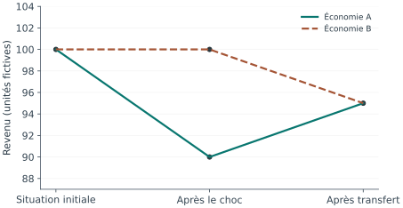
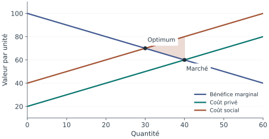

# ENS · B/L · Économie à option 2025 · Billet 1 · Corrigé brut

*Corrigé rédigé par IA, non officiel. Signalez toute erreur.*

**Rédaction** · GPT-6.2 Astra Ultra · vitesse non renseignée · 26 novembre 2026

Le billet de la page 1 donne le choix entre deux questions, sans document d’accompagnement. Le candidat prépare une seule leçon pendant 1 h 30 et dispose de 15 minutes pour l’exposer, puis de 15 minutes de discussion. Chaque proposition ci-dessous peut être présentée indépendamment. [Billet officiel, page 1](https://www.ens.psl.eu/sites/default/files/economie_18_et_19_juin.pdf#page=1) · [Rapport du jury 2025](https://www.ens.psl.eu/sites/default/files/2025_bl_rapport_oral_economie_option.pdf)

## Fédéralisme fiscal en Europe

### Introduction

Pendant la pandémie, les États de l’Union européenne ont soutenu les revenus sur leurs propres budgets. Ils ont aussi choisi de financer un plan de relance par un emprunt commun. Ces deux réponses à un choc sanitaire mettent en jeu deux choix différents. Qui décide où va l’euro supplémentaire ? Qui porte le risque lorsque certaines économies sont plus touchées que d’autres ? Le fédéralisme fiscal étudie la répartition des compétences de dépense, de prélèvement et de transfert entre niveaux de gouvernement. L’Union offre un terrain particulier, car un marché très intégré et, pour une partie de ses membres, une monnaie unique coexistent avec des budgets largement nationaux. **Quelles fonctions économiques gagnent à être exercées en commun, et comment en conserver la responsabilité politique ?**

### I. Choisir le niveau de décision à partir du service rendu

Le financement local d’un équipement peut être approprié lorsque ses bénéficiaires habitent principalement la collectivité et que celle-ci connaît leurs préférences. Une petite ville et une métropole peuvent ainsi choisir différemment entre deux projets de transports. Dans le raisonnement de décentralisation associé à Wallace Oates, le gain vient de l’adaptation à des besoins hétérogènes. Si chaque collectivité peut offrir la quantité qui lui convient, imposer partout le même niveau risque de produire ici une dépense peu valorisée et ailleurs une pénurie. L’argument exige que les coûts et les bénéfices restent pour l’essentiel à l’intérieur de chaque territoire et que la production locale ne fasse pas perdre d’économies d’échelle importantes.

Le calcul change pour une interconnexion ferroviaire transfrontalière. La collectivité qui paie ne tient compte que d’une partie du gain de temps à l’étranger. Un projet dont le bénéfice total dépasse le coût peut être abandonné si aucun des partenaires n’y trouve seul son compte. Un cofinancement européen peut aligner la décision sur l’intérêt de l’ensemble. La gestion quotidienne peut demeurer locale. Le même raisonnement vaut pour la recherche et pour des biens publics où la mise en commun évite la duplication de dépenses fixes. La subsidiarité invite à préciser le problème qui déborde les frontières avant d’en déduire la compétence à transférer.

### II. Mettre en commun une partie de l’assurance contre les chocs

Dans l’union monétaire, un pays touché par une récession particulière ne peut pas ajuster seul le taux directeur ni le taux de change de sa monnaie. Les prélèvements nationaux diminuent et les dépenses d’assurance augmentent automatiquement, mais une hausse du coût de l’emprunt peut en limiter le financement lorsque les besoins sont les plus forts. Le partage des risques par les marchés de capitaux, les mouvements de travailleurs et les transferts publics sont alors des mécanismes complémentaires. [BCE, partage des risques dans la zone euro](https://www.ecb.europa.eu/press/economic-bulletin/html/eb201803.en.html)

Prenons deux économies de même taille dont les revenus initiaux valent chacun 100. Un choc fait tomber celui de A à 90 et laisse celui de B à 100. Si un fonds verse 5 à A et prélève 5 sur B, le revenu après transferts vaut 95 de chaque côté. Le revenu total de l’union reste 190. Le mécanisme modifie la répartition de la perte au présent. Si la situation s’inverse à la période suivante, les rôles peuvent s’échanger. Ce cas relève d’une assurance entre territoires. Un transfert durable vers une région systématiquement plus pauvre répond, lui, à un objectif de redistribution ou de convergence. Enfin, si tous perdent ensemble, un transfert interne ne restaure pas le revenu total. Un emprunt commun peut répartir le financement dans le temps.

### III. Concevoir un partage des risques qui rende les gouvernements responsables de leurs décisions

Le cadre financier pluriannuel européen soutient des politiques communes, dont la cohésion. Le dispositif temporaire NextGenerationEU a ajouté la faculté de lever des fonds sur les marchés au niveau de l’Union et de financer des prêts et des subventions. Il lie une partie des financements à des plans et à leur exécution. Cette opération donne une illustration de solidarité et d’investissement commun. Un instrument temporaire déclenché à l’occasion d’une crise ne constitue cependant pas, par sa seule existence, un stabilisateur qui se déclencherait automatiquement à chaque récession. [Commission européenne, plan de relance pour l’Europe](https://commission.europa.eu/strategy-and-policy/recovery-plan-europe_en)

Un dispositif d’assurance peut par exemple utiliser une hausse du chômage par rapport à une référence nationale, afin de limiter la confusion entre choc conjoncturel et disparité permanente. Il faut alors disposer de statistiques comparables et accepter que le déclenchement puisse être imparfait. Une coassurance laisse une part de la dépense au niveau national, ce qui préserve une incitation à prévenir les risques, mais réduit le lissage. Une conditionnalité rigide peut retarder les fonds et aggraver la récession. Enfin, qui vote la ressource, qui contrôle le fonds et qui doit répondre d’un échec ? Une répartition claire de ces rôles est une condition de la légitimité d’un budget commun.

### Conclusion

L’enjeu n’est pas de fixer une taille idéale de budget européen indépendamment de son emploi. Les préférences locales justifient certaines compétences décentralisées, les externalités justifient un cofinancement et les chocs asymétriques donnent une raison d’organiser l’assurance. Le choix économique devient concret quand on précise les bénéficiaires, le risque à mutualiser, les contributions et l’autorité à laquelle les électeurs pourront demander des comptes.

## Les défaillances de marché

### Introduction

Un prix peut refléter parfaitement le coût de production supporté par une entreprise et laisser de côté la gêne imposée aux riverains. Des acheteurs et des vendeurs peuvent donc conclure des échanges mutuellement avantageux alors que la quantité produite est excessive pour la collectivité. Une défaillance de marché désigne une circonstance dans laquelle les décisions décentralisées ne conduisent pas à une allocation efficace. Elle se distingue d’un jugement sur la justice de la répartition initiale. **Quelles conditions de coordination font défaut, et comment établir qu’une intervention améliore effectivement la situation ?**

### I. Certains coûts et certains bénéfices n’entrent pas dans les décisions privées

Dans un modèle concurrentiel, les acheteurs comparent leur disposition marginale à payer au prix et les entreprises le prix à leur coût marginal. Si tous les effets pertinents sont pris en compte et si les agents prennent les prix comme donnés, ces arbitrages peuvent faire coïncider bénéfice marginal et coût marginal social. Une externalité apparaît lorsqu’une décision affecte directement un tiers sans que cet effet passe par une compensation de marché. Une nuisance conduit ainsi à un coût social supérieur au coût privé. Une activité dont les connaissances profitent à d’autres peut au contraire présenter un bénéfice social supérieur au bénéfice privé.

Considérons un exemple fictif où le bénéfice marginal d’une quantité $q$ vaut $100-q$, le coût marginal privé $20+q$ et le dommage marginal externe 20. L’équilibre privé vérifie $100-q=20+q$, soit $q=40$. L’optimum collectif vérifie $100-q=40+q$, soit $q=30$. Une taxe de 20 par unité fait coïncider les incitations privées avec les coûts sociaux dans cet exemple. Le dommage à la marge persiste à l’optimum. Pour les unités entre 30 et 40, le coût social excède le bénéfice. La perte de surplus est l’aire d’un triangle de base 10 et de hauteur 20, soit 100 unités de valeur. Cet exercice indique la donnée difficile à établir sur le terrain, le dommage marginal au niveau pertinent.

### II. Droits d’exclusion, pouvoir de marché et information changent le problème

Pour une information de recherche librement accessible, un utilisateur supplémentaire peut bénéficier d’un résultat sans réduire sa disponibilité pour les autres. Si chacun attend que d’autres financent la production, une disposition à payer collective élevée peut coexister avec un financement privé insuffisant. Un bien public pur associe non-rivalité et difficulté d’exclusion. Une ressource commune, telle une nappe dont chaque prélèvement diminue le stock accessible, est au contraire rivale. Le problème y est la surexploitation. Les règles de prélèvement, la surveillance mutuelle et la gouvernance d’usagers peuvent avoir un rôle différent de celui d’une subvention à la recherche.

Le pouvoir de marché permet par ailleurs de relever un prix au-dessus du coût marginal et d’écarter des échanges avantageux. Il faut distinguer l’entente qui restreint délibérément l’offre d’une activité où des coûts fixes considérables rendent la duplication des réseaux coûteuse. Dans ce second cas, une régulation de l’accès et des tarifs peut être préférable à une multiplication d’infrastructures identiques. L’asymétrie d’information fournit encore un autre diagnostic. Si les acheteurs d’occasion observent mal la qualité, un prix fondé sur la qualité moyenne peut pousser les vendeurs de bons biens à se retirer. Une garantie ou une certification crédible modifie alors les informations disponibles au moment de la transaction.

### III. Comparer les institutions à partir d’une défaillance identifiée

Une taxe laisse les agents choisir la quantité à partir d’un prix commun. Des quotas échangeables fixent la quantité totale couverte et permettent aux entreprises dont la réduction est moins coûteuse de vendre des droits. Dans les deux cas, l’effet dépend du contrôle des émissions. Une norme peut être plus simple à appliquer lorsque le produit est observable et l’émission difficile à mesurer. Si les parties sont peu nombreuses, les droits clairement attribués et les coûts de négociation faibles, elles peuvent aussi contracter pour réduire la nuisance. La répartition des gains dépend alors de l’attribution initiale des droits. Avec de très nombreux riverains, identifier toutes les victimes et conclure un accord devient difficile.

L’État a lui aussi des contraintes d’information et d’incitation. Une subvention à la recherche peut financer des projets qui auraient eu lieu de toute façon. Un régulateur peut connaître imparfaitement les coûts du réseau qu’il contrôle. Pour juger une politique, il faut poser une question contrefactuelle. Quelle quantité, quelle qualité et quelle distribution des coûts observerait-on avec la règle proposée, par rapport à une institution réaliste de référence ? Une compensation des ménages modestes peut compléter une tarification de la nuisance sans faire disparaître le signal marginal.

### Conclusion

Externalité, bien public, monopole et information privée décrivent des mécanismes différents. Leur diagnostic oriente vers des instruments différents, dont l’efficacité dépend de l’information, de la mise en œuvre et des réactions des agents. Un équilibre de marché peut être efficace et très inégalitaire. Corriger une défaillance et choisir une redistribution restent deux objectifs qu’une politique peut combiner à condition de les distinguer.
