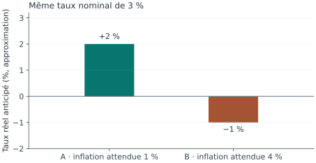
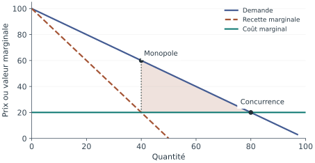

# ENS · B/L · Économie à option 2025 · Billet 2 · Corrigé guidé

*Corrigé rédigé par IA, non officiel. Signalez toute erreur.*

**Rédaction** · GPT-6.2 Astra Ultra · vitesse non renseignée · 26 novembre 2026

Le billet de la page 2 donne le choix entre deux questions, sans document d’accompagnement. Le candidat prépare une seule leçon pendant 1 h 30 et dispose de 15 minutes pour l’exposer, puis de 15 minutes de discussion. Chaque proposition ci-dessous peut être présentée indépendamment. [Billet officiel, page 2](https://www.ens.psl.eu/sites/default/files/economie_18_et_19_juin.pdf#page=2) · [Rapport du jury 2025](https://www.ens.psl.eu/sites/default/files/2025_bl_rapport_oral_economie_option.pdf)

## Préparer la leçon

Choisir la question pour laquelle on peut définir les termes et expliquer un exemple précis. Sur une feuille, réserver une colonne aux hypothèses du modèle et une autre aux observations qui en éclairent la portée. Pour quinze minutes, compter deux minutes pour poser le problème, environ quatre pour chacun des trois moments et une pour formuler la réponse.

## Optimalité monétaire de la zone euro

### Introduction

La même variation du taux directeur concerne une économie en forte expansion et une autre qui perd des emplois. Le choix d’une monnaie commune ne se juge donc pas seulement à la stabilité du change qu’elle procure. Il faut aussi demander quels ajustements remplacent l’instrument national de change et la politique monétaire propre. Une zone monétaire optimale, au sens de l’analyse lancée par Robert Mundell, est un espace où les avantages de l’unification monétaire l’emportent sur les coûts d’ajustement qu’elle entraîne. **À quelles conditions l’hétérogénéité de la zone euro demeure-t-elle compatible avec une politique monétaire unique ?**

### I. Une monnaie commune procure des gains qui augmentent avec l’intégration

> [!INDICATION]
> **Comparer deux régimes monétaires réalisables.** Préciser pourquoi un change flottant peut absorber un choc local et quelles autres difficultés il entraîne. Ne comptabiliser qu’une fois le gain de disparition du risque de change interne.

Deux entreprises qui facturent dans une même monnaie n’ont plus à convertir leurs paiements entre elles ni à se couvrir contre une variation bilatérale des monnaies nationales. Les prix deviennent plus directement comparables. Ces gains concernent aussi les ménages qui se déplacent et les entreprises qui empruntent ou investissent de part et d’autre d’une frontière. Ils dépendent de l’intensité des échanges. Plus les économies négocient et produisent ensemble, plus elles rencontrent fréquemment ces coûts de transaction et plus leur suppression peut compter.

Il faut comparer l’union monétaire à une alternative réaliste. Le change flottant permet en principe une dépréciation si une économie perd de la compétitivité, mais il peut aussi fluctuer brutalement et renchérir les importations. Un régime de changes fixes ajustables expose à des tensions lorsque la parité paraît insoutenable. La disparition du risque de change interne peut encourager les contrats de long terme. Elle ne supprime ni le risque de défaillance d’un emprunteur ni le besoin de surveiller les déséquilibres financiers. Enfin, un choc commun qui fait baisser la demande partout peut appeler une orientation monétaire commune. Dans ce cas, la renonciation à une réponse individuelle coûte relativement peu.

### II. Face à un choc asymétrique, le coût dépend des possibilités d’ajustement

> [!INDICATION]
> **Passer du taux nominal au taux réel.** Avec les anticipations du schéma, calculer aussi les taux réels exacts par (1 + taux nominal)/(1 + inflation attendue) − 1. L’approximation est très proche pour ces valeurs.

Supposons que la demande chute principalement dans une région spécialisée dans le tourisme. Une baisse du taux d’intérêt soutiendrait son activité, alors que l’économie voisine, proche de ses capacités, préférerait peut-être une orientation plus ferme. La banque centrale réagit à la situation d’ensemble. De plus, un même taux nominal ne signifie pas un même taux réel. Si le taux nominal est de 3 % et l’inflation attendue de 1 % en A, le taux réel anticipé est proche de 2 %. Avec 4 % d’inflation attendue en B, il est proche de −1 %. Cet exemple pédagogique suppose des conditions de crédit comparables et ignore les primes de risque. Une désinflation localisée peut ainsi alourdir le taux réel précisément dans la zone affaiblie.

La mobilité du travail peut réduire le chômage dans la région touchée, à condition que les qualifications soient transférables et que les personnes puissent accéder au logement et surmonter les obstacles de langue. La diversification productive limite la portée d’un choc sectoriel. Les prix et salaires relatifs peuvent s’ajuster, mais une baisse nominale des revenus est lente et peut accroître le poids des dettes. Les actionnaires qui possèdent des actifs dans plusieurs régions partagent les pertes de revenus. Le crédit peut lisser la consommation au cours du temps, si le prêteur continue à financer les ménages et les entreprises lorsque le choc survient.

Les budgets nationaux amortissent une récession par leurs stabilisateurs automatiques. Le financement devient cependant plus difficile si le choc détériore la signature d’un État et fragilise les banques qui en détiennent les titres. La crise des dettes souveraines a montré l’importance de ce lien. Des institutions de supervision bancaire communes et des mécanismes publics de partage des risques peuvent réduire les coûts d’ajustement. Le partage des risques reste distinct d’un transfert permanent à une région moins productive. [BCE, bulletin consacré au partage des risques](https://www.ecb.europa.eu/press/economic-bulletin/html/eb201803.en.html)

### III. L’optimalité est en partie produite par les institutions communes

Les critères de zone monétaire optimale ne donnent pas un verdict immuable. L’intégration des chaînes de valeur peut synchroniser les cycles par les échanges. Elle peut aussi accroître la spécialisation régionale et donc l’exposition à des chocs sectoriels différents. Il faut examiner les deux mécanismes et le type de choc. Le renchérissement de l’énergie en 2022 a touché l’ensemble de la zone avec une intensité différente selon les structures de consommation, le mix énergétique et les mesures publiques. Une même politique monétaire orientée vers la stabilité des prix s’est alors transmise dans des économies hétérogènes.

Une capacité budgétaire commune, des dispositifs d’assurance, une mobilité facilitée et des marchés financiers mieux intégrés peuvent diminuer le coût de la monnaie unique. Chacun a cependant des conditions. La mutualisation appelle une responsabilité commune sur les règles et leur financement. La circulation des capitaux peut partager les risques ou alimenter un boom local de crédit. La mobilité ne devrait pas être présumée gratuite pour un ménage dont les attaches professionnelles et familiales sont locales. Un diagnostic empirique comparerait la synchronisation des cycles, l’ampleur de la perte de revenu qui se transmet à la consommation et les délais de retour à l’emploi après un choc.

### Conclusion

La monnaie unique est particulièrement avantageuse quand les échanges sont intenses et que des mécanismes réels, financiers et budgétaires absorbent les chocs propres à chaque économie. La question de son optimalité porte donc aussi sur les institutions bâties après l’adoption de l’euro. Les bénéfices commerciaux, la stabilité recherchée et le coût des ajustements restent à apprécier pour des populations et des chocs précis.

### Questions d’entretien sur le premier sujet

**Une monnaie commune exige-t-elle des économies identiques ?** Des structures différentes peuvent partager une monnaie lorsque les risques sont suffisamment répartis et les ajustements peu coûteux. L’identité des structures ne garantirait pas non plus une transmission identique du crédit.

**Le déplacement des travailleurs suffit-il après un choc durable ?** Il peut rapprocher travailleurs et emplois, mais ses coûts privés et territoriaux comptent. La reconversion, l’ajustement des prix relatifs et le financement des services locaux peuvent compléter la mobilité.

## La concurrence en économie

### Introduction

Deux entreprises peuvent se disputer vigoureusement des clients, tandis qu’une multitude d’entreprises locales peuvent chacune être protégées par la distance. La concurrence désigne à la fois un mécanisme de rivalité et, en théorie, un ensemble d’hypothèses permettant de déterminer les prix. **Quand la rivalité entre offreurs discipline-t-elle le pouvoir de marché et quand faut-il des règles pour préserver ce mécanisme ?**

### I. Un modèle de référence relie prix, coût et gains à l’échange

> [!INDICATION]
> **Tracer une recette marginale différente de la demande.** Une baisse du prix nécessaire pour vendre une unité de plus s’applique aussi aux unités précédentes. Pour une demande linéaire, la recette marginale a ici deux fois la pente de la demande.

En concurrence parfaite, chaque vendeur ou acheteur traite le prix comme donné. L’entrée, la mobilité des ressources et la disponibilité de l’information contribuent à cette situation. Pour une entreprise intérieure à son domaine de production, maximiser son profit conduit à produire jusqu’à égalité entre prix et coût marginal, sur la partie pertinente de la courbe de coût. Sur un marché sans externalités où les dispositions à payer mesurent les bénéfices marginaux, les unités dont la valeur pour l’acheteur dépasse le coût de production sont échangées. C’est le sens précis du gain d’efficacité. Un prix concurrentiel peut néanmoins être hors de portée d’un ménage très pauvre.

Prenons une demande inverse $p=100-q$ et un coût marginal constant de 20, sans coût fixe. En concurrence, $p=20$ et $q=80$. Un monopoleur qui applique un prix unique maximise $(100-q)q-20q$. Sa recette marginale vaut $100-2q$, d’où $q=40$ et $p=60$. Sur les unités conservées, une partie du surplus des acheteurs passe au producteur. Sur les unités de 40 à 80, les échanges auraient procuré un gain net mais disparaissent. La perte sèche est un triangle d’aire $(80-40)(60-20)/2=800$. Il faut distinguer cette perte collective du transfert de surplus sur les unités vendues.

### II. La rivalité effective dépend de l’entrée et de la manière de se faire concurrence

> [!INDICATION]
> **Séparer perte sèche et transfert.** Décomposer la baisse de surplus des acheteurs en rectangle transféré au producteur et triangle d’échanges supprimés. Seul le triangle mesure la perte nette dans l’exemple.

Si deux entreprises proposent exactement le même bien, sans contrainte de capacité, et si les acheteurs comparent facilement les prix, une légère baisse peut attirer toute la demande. Dans le modèle de Bertrand avec mêmes coûts marginaux constants, cette possibilité suffit à ramener le prix au coût marginal. À l’inverse, la différenciation, les coûts de recherche, des capacités limitées ou une clientèle captive permettent une marge positive. Dans un oligopole où les quantités sont choisies avant la réalisation des ventes, l’effet d’une production supplémentaire sur le prix discipline l’offre de chaque firme, mais ne reproduit pas automatiquement la solution du modèle de prix.

Le taux de concentration n’a donc de sens qu’après avoir défini le marché pertinent. Pour un consommateur, quels biens et quelles zones géographiques sont de réelles alternatives ? Pour un entrant, le capital initial, l’accès au réseau ou la possibilité de porter les données des clients jouent-ils le rôle de barrières ? Une entreprise dominante peut avoir grandi grâce à une innovation appréciée. À l’inverse, une faible part sur un marché national ne garantit aucune solution de repli aux clients d’une commune isolée. Un diagnostic doit regarder les possibilités de substitution, les marges, la qualité et la facilité d’entrée.

La rivalité peut porter sur le service après-vente, les délais, les procédés ou la création de nouveaux produits. La perspective temporaire d’une rente encourage certains investissements risqués. Une firme durablement protégée peut cependant investir moins pour améliorer sa qualité ou empêcher l’expérimentation d’un rival. Deux entreprises peuvent aussi avoir besoin de normes communes pour que leurs produits soient compatibles. Il faut alors comparer le gain de coordination à son éventuel usage pour exclure de nouveaux participants.

### III. Une politique de concurrence arbitre entre efficacité, innovation et accès

Le droit européen distingue les ententes qui restreignent la concurrence et l’abus d’une position dominante. Une position élevée n’est pas à elle seule un abus. Un cartel de prix supprime la pression qui pousserait chaque entreprise à faire une offre plus avantageuse. Une pratique d’éviction peut empêcher un concurrent efficace d’accéder à la clientèle. Le contrôle d’une concentration étudie prospectivement les effets d’une opération, ses gains d’efficacité et les solutions de remplacement des acheteurs. [Commission européenne, articles 101 et 102 du traité](https://competition-policy.ec.europa.eu/antitrust-and-cartels/legislation/competition-law-treaty-articles_en)

Dans une infrastructure à coûts fixes élevés et coûts marginaux faibles, il peut être moins coûteux de garder un réseau commun et d’ouvrir les services qui l’utilisent à plusieurs entreprises. La tarification de l’accès doit alors permettre la maintenance tout en évitant de protéger indûment l’opérateur historique. Si l’objectif est que des ménages éloignés ou modestes aient accès au service, il faut également définir les obligations de desserte et leur mode de financement. Une politique de concurrence ne tranche pas à elle seule ce choix distributif.

### Conclusion

La concurrence est un mécanisme dont les résultats dépendent de la structure des coûts, de l’information, des possibilités réelles de substitution et de la durée des positions acquises. Le modèle concurrentiel fournit une référence pour chiffrer un écart. L’enquête sur le marché détermine si une intervention sur les prix, les pratiques, l’entrée ou l’infrastructure est justifiée.

### Questions d’entretien sur le second sujet

**Une concentration élevée suffit-elle à prouver un abus ?** Il faut définir le marché, établir le pouvoir de l’entreprise et qualifier le comportement. Une grande part de marché peut provenir d’une innovation, tandis que des coûts de changement peuvent rendre la concurrence faible malgré plusieurs vendeurs.

**Pourquoi concurrence pour le marché et concurrence dans le marché diffèrent-elles ?** Dans la première, les candidats concourent pour obtenir un droit de desserte. Dans la seconde, plusieurs opérateurs servent simultanément les clients. Une concession unique peut économiser un réseau, mais l’autorité doit encadrer la qualité, le prix et le renouvellement.
