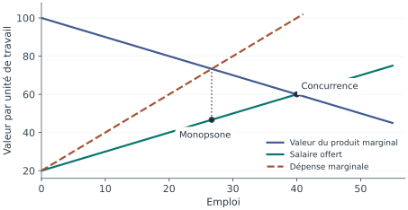
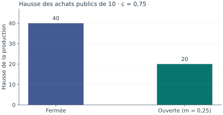

# ENS · B/L · Économie à option 2025 · Billet 3 · Corrigé guidé

*Corrigé rédigé par IA, non officiel. Signalez toute erreur.*

**Rédaction** · GPT-6.2 Astra Ultra · vitesse non renseignée · 26 novembre 2026

Le billet de la page 3 donne le choix entre deux questions, sans document d’accompagnement. Le candidat prépare une seule leçon pendant 1 h 30 et dispose de 15 minutes pour l’exposer, puis de 15 minutes de discussion. Chaque proposition ci-dessous peut être présentée indépendamment. [Billet officiel, page 3](https://www.ens.psl.eu/sites/default/files/economie_18_et_19_juin.pdf#page=3) · [Rapport du jury 2025](https://www.ens.psl.eu/sites/default/files/2025_bl_rapport_oral_economie_option.pdf)

## Préparer la leçon

Choisir la question pour laquelle on peut définir les termes et expliquer un exemple précis. Sur une feuille, réserver une colonne aux hypothèses du modèle et une autre aux observations qui en éclairent la portée. Pour quinze minutes, compter deux minutes pour poser le problème, environ quatre pour chacun des trois moments et une pour formuler la réponse.

## Les coûts salariaux, un handicap pour l’emploi ?

### Introduction

Lorsque le salaire horaire d’une entreprise augmente, un poste devient plus coûteux si la productivité reste constante. Dans le même temps, le salaire constitue un revenu qui contribue à la consommation, et une rémunération plus élevée peut faciliter le recrutement. Par coûts salariaux, on entend ici la rémunération et les cotisations à la charge de l’employeur, diminuées le cas échéant des aides liées à l’emploi. Le salaire net perçu et le coût supporté par l’entreprise sont donc deux grandeurs différentes. **Dans quelles situations une variation de coût salarial se transmet-elle au nombre de postes, et comment en mesurer l’effet global ?**

### I. Rapporter le coût au produit du travail et aux possibilités de substitution

> [!INDICATION]
> **Nommer le coût pertinent.** Placer dans deux colonnes le coût horaire et le coût par unité produite. Un calcul de compétitivité doit tenir compte de la productivité et du produit dont on compare les prix.

Pour une entreprise preneuse de prix qui peut ajuster ses effectifs, l’embauche d’une heure supplémentaire est profitable tant que la valeur de son produit marginal dépasse son coût. Avec un capital donné et des rendements marginaux décroissants du travail, une hausse du coût horaire réduit la quantité de travail demandée, toutes choses égales par ailleurs. À plus longue échéance, l’entreprise peut modifier son procédé ou la combinaison de ses facteurs. La facilité de substituer des machines au travail varie selon les tâches. Une hausse de prix peut aussi réduire ses ventes et, par cet effet d’échelle, sa demande de plusieurs facteurs.

Le coût salarial unitaire se calcule en divisant le coût du travail par la valeur physique ou en volume produite, avec un numérateur et un dénominateur cohérents. Si le coût horaire passe de 24 à 25,20 euros pendant que la productivité réelle passe de 4 à 4,2 unités par heure, le coût du travail par unité reste à 6 euros. Comparer des pays ou des entreprises sur le seul salaire horaire confondrait ici coût et productivité. Les qualifications, la formation et l’organisation du travail comptent aussi. Pour une activité exportatrice, la demande dépend en outre du taux de change et de l’élasticité des achats au prix. Une entreprise peut absorber une partie du surcoût dans sa marge ou vendre plus cher un produit de meilleure qualité.

### II. Quand l’employeur fixe le salaire, le lien avec l’emploi change

> [!INDICATION]
> **Retrouver le point de coude du monopsone.** À un plancher de 55, résoudre 20 + L = 55. Comparer ensuite la valeur du produit marginal à 55 pour les unités juste avant le coude et à la dépense marginale d’origine juste après.

Si les travailleurs disposent de peu d’employeurs accessibles ou s’il est coûteux de changer de poste, une entreprise peut faire face à une offre de travail croissante. Pour embaucher davantage en appliquant un même salaire à tous, elle doit relever la rémunération des salariés déjà présents. Sa dépense marginale pour une embauche dépasse alors le salaire. Un salaire initial trop faible peut aller de pair avec un emploi inférieur à celui d’un marché concurrentiel.

Prenons un exemple avec une rémunération d’offre $w=20+L$ et une valeur du produit marginal du travail égale à $100-L$. En concurrence, l’intersection donne $L=40$ et $w=60$. Le monopsoniste maximise son profit en comparant le produit marginal à la dérivée de sa dépense totale $(20+L)L$, soit $20+2L$. Il choisit donc $L=80/3$, environ 26,7, et verse environ 46,7. Un plancher de 55 lui permet de recruter jusqu’à 35 personnes au même salaire. La valeur de la dernière embauche vaut 65, supérieure à 55, tandis qu’au-delà de 35 la dépense marginale repasse au-dessus de cette valeur. L’emploi monte à 35. Un plancher très supérieur au salaire concurrentiel ferait au contraire reculer la demande. Le résultat dépend de la situation initiale et du niveau retenu.

L’enquête de David Card et Alan Krueger compare l’emploi de restaurants de restauration rapide au New Jersey et en Pennsylvanie après la hausse du salaire minimum du premier État en 1992. Cette comparaison avant-après avec groupe témoin ne met pas en évidence la baisse relative d’emploi attendue par le modèle concurrentiel le plus simple. Sa portée dépend de la comparabilité des tendances et du secteur étudié. Elle ne permet pas de conclure qu’une hausse de toute ampleur serait sans coût, ni d’identifier à elle seule un monopsone. [Card et Krueger, étude sur la restauration rapide](https://www.nber.org/papers/w4509)

### III. Une politique de coût du travail se juge sur les emplois nets et sur son financement

Un allègement ciblé de cotisations peut réduire le coût d’un emploi sans réduire immédiatement son salaire net. Son incidence dépend du salaire plancher, de la négociation et du rapport des élasticités de l’offre et de la demande. Une partie peut se transmettre au salarié ou au prix de vente. Il faut distinguer les emplois supplémentaires de ceux qui auraient existé sans aide. Si l’exonération décroît fortement quand le salaire augmente, elle renchérit le coût marginal d’une augmentation et peut affecter les progressions salariales. Les entreprises peuvent aussi substituer des travailleurs éligibles à d’autres, sans accroître autant le nombre total d’emplois.

À l’échelle macroéconomique, la baisse générale des salaires modifie les revenus des consommateurs et les ventes attendues. Une stratégie qui gagne des parts de marché pour une entreprise ne peut pas être transposée à toutes sans étudier les réactions des partenaires. Inversement, un gain durable de productivité permet une hausse de rémunération compatible avec des coûts unitaires stables. Évaluer une réforme exige donc d’observer les heures et les postes, les secteurs exposés et abrités, la masse salariale et le financement de la mesure. Une comparaison de part et d’autre d’un seuil d’éligibilité peut renseigner sur les effets locaux, à condition de vérifier que les entreprises n’ajustent pas stratégiquement la rémunération autour du seuil.

### Conclusion

Le coût salarial peut peser sur l’emploi lorsqu’il dépasse la valeur du travail supplémentaire et que la production ou l’organisation s’ajuste. Son niveau absolu ne suffit pas à diagnostiquer un handicap. Le pouvoir de fixation du salaire, la productivité, la demande adressée aux entreprises et le financement d’une politique déterminent le sens et l’ampleur du résultat.

### Questions d’entretien sur le premier sujet

**Que faut-il supposer dans la comparaison New Jersey–Pennsylvanie ?** Sans la hausse propre au New Jersey, la différence d’évolution entre groupes aurait dû être suffisamment stable. Un choc de demande local ou une modification de la composition des restaurants pourrait perturber cette comparaison.

**Des postes supplémentaires garantissent-ils un gain de volume de travail ?** Un employeur peut ajuster les horaires plutôt que le nombre de contrats. Il faut comparer les heures ou emplois en équivalent temps plein, ainsi que les changements de qualification.

## Politiques macroéconomiques dans un monde globalisé

### Introduction

Lorsqu’un gouvernement soutient la demande, une partie des achats supplémentaires se porte sur des produits importés. Le partenaire bénéficie alors d’une impulsion qu’il n’a pas financée. En même temps, des mouvements de capitaux peuvent modifier rapidement les conditions dans lesquelles les agents nationaux empruntent. L’ouverture concerne les échanges de biens et services, les actifs et les monnaies. **Comment transforme-t-elle l’efficacité des instruments nationaux et l’intérêt de les coordonner ?**

### I. Les échanges transmettent les chocs et les impulsions budgétaires

> [!INDICATION]
> **Fixer le régime de change avant de choisir l’instrument.** Pour chaque mécanisme, préciser si la banque centrale défend une parité, fixe son taux librement ou participe à une union monétaire. La transmission ne peut être déduite de la seule ouverture commerciale.

Dans un modèle de court terme à prix fixes et capacités inutilisées, écrivons $Y=C+I+G+X-M$, avec une consommation additionnelle de $c$ par euro de revenu et des importations additionnelles de $m$ par euro de revenu. En supposant ici impôts, investissement et exportations constants, une hausse de $G$ engendre $\Delta Y=\Delta G/(1-c+m)$. Avec $c=0{,}75$ et $m=0{,}25$, le multiplicateur est 2. Un achat public supplémentaire de 10 donne 20 de production nationale supplémentaire, dont 5 de demande additionnelle d’importations. Dans le même modèle fermé, le multiplicateur serait 4. Il s’agit d’un exercice conditionnel, sensible à la propension à importer de la dépense initiale, aux impôts, aux contraintes d’offre et à la réaction monétaire.

Du point de vue du partenaire, nos importations sont des exportations. Si sa production et son revenu augmentent, il peut à son tour importer davantage de nos produits. Ce retour dépend de sa taille, de ses propres capacités et du réseau de partenaires communs. Une économie petite et ouverte recueille souvent moins des bénéfices internes d’une relance isolée. Une relance coordonnée peut internaliser ces retombées en récession, mais elle accroît surtout les tensions de prix si toutes les économies butent déjà sur leurs capacités.

### II. Change et mobilité des capitaux conditionnent la marge de manœuvre monétaire

> [!INDICATION]
> **Suivre un euro de dépense chez le partenaire.** Dans l’exemple, la hausse de la production nationale de 20 engendre 5 d’importations. Repartir de ces 5 comme demande étrangère et repérer ce qui pourrait revenir sous forme d’exportations.

Le triangle d’incompatibilité exprime une contrainte. Avec des capitaux très mobiles, un pays qui maintient une parité crédible ne peut fixer durablement son taux indépendamment du taux extérieur en l’absence de prime de risque et de dévaluation anticipée. Si ses titres rapportent moins, des arbitrages exercent une pression sur le change. Pour maintenir la parité, la banque centrale doit intervenir ou ajuster le taux. Des contrôles de capitaux relâchent la contrainte, moyennant des coûts et des contournements possibles. Un membre d’une union monétaire participe à une politique commune et conserve d’autres instruments nationaux, notamment budgétaires et prudentiels.

À change flottant, une détente monétaire peut réduire le coût du crédit et entraîner une dépréciation qui stimule les exportations nettes. L’effet dépend du comportement des prix, du contenu importé de la production et des élasticités des volumes échangés. Une dépréciation renchérit en monnaie nationale le service d’une dette libellée en devise et peut fragiliser les emprunteurs. Dans le modèle de Mundell-Fleming à prix fixes, petite économie et parfaite mobilité des capitaux, une relance budgétaire en change flottant peut être neutralisée par l’appréciation et le recul des exportations nettes. Ce résultat limite indique quelles hypothèses vérifier, notamment une mobilité imparfaite, un taux directeur au plancher ou une réaction monétaire différente.

### III. Coordonner suppose de distinguer le choc commun des objectifs nationaux

Lors d’une crise financière, le retrait de fonds d’une banque dans un pays peut contraindre ses filiales à réduire leurs prêts ailleurs. Des accords de liquidité entre banques centrales ou une coordination de la supervision cherchent à limiter ces transmissions. Après le choc sanitaire, l’Union européenne a ajouté aux budgets nationaux une réponse financée par emprunt commun. Une réponse collective peut soutenir l’investissement des pays dont la marge budgétaire est moindre et limiter les divergences entre partenaires. Ses effets doivent être appréciés au regard du calendrier, du ciblage, des capacités productives et des modalités de remboursement. [Commission européenne, plan de relance européen](https://commission.europa.eu/strategy-and-policy/recovery-plan-europe_en)

La coordination n’exige pas de fixer partout le même déficit ou le même calendrier. Un pays en récession et un pays en surchauffe ont des besoins différents. Il existe aussi des conflits d’objectifs, par exemple lorsqu’une dépréciation soutient la demande intérieure en détournant une partie de celle du voisin. L’institution commune peut organiser des échanges d’information, définir une règle de stabilisation, financer un bien public ou servir de prêteur. La solution dépend du canal d’interdépendance et de la possibilité de rendre chaque gouvernement responsable de son engagement.

### Conclusion

L’ouverture n’annule pas les instruments macroéconomiques. Elle déplace leurs effets à travers les importations, le change, les bilans et les marchés financiers. Le diagnostic doit annoncer le régime de change, l’origine du choc et l’état des capacités. Il devient alors possible de déterminer qui reçoit l’impulsion, qui en supporte le coût et où la coordination apporterait un gain.

### Questions d’entretien sur le second sujet

**Le multiplicateur vaut-il toujours moins en économie ouverte ?** Dans le petit modèle sans rétroaction étrangère, une propension à importer positive réduit le multiplicateur national. Une réaction du partenaire, le régime de change, l’attitude de la banque centrale ou la composition des achats peuvent modifier cette comparaison.

**Une hausse des taux étrangers appelle-t-elle une hausse identique du taux national ?** Une parité crédible avec forte mobilité des capitaux lie les rendements attendus, compte tenu du risque et de la variation anticipée du change. Une monnaie flottante ou des contrôles de capitaux modifient cette contrainte.
