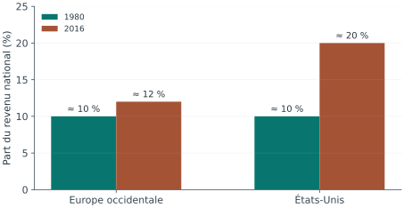
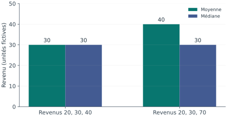

# ENS · B/L · Économie à option 2025 · Billet 4 · Corrigé brut

*Corrigé rédigé par IA, non officiel. Signalez toute erreur.*

**Rédaction** · GPT-6.2 Astra Ultra · vitesse non renseignée · 26 novembre 2026

Le billet de la page 4 donne le choix entre deux questions, sans document d’accompagnement. Le candidat prépare une seule leçon pendant 1 h 30 et dispose de 15 minutes pour l’exposer, puis de 15 minutes de discussion. Chaque proposition ci-dessous peut être présentée indépendamment. [Billet officiel, page 4](https://www.ens.psl.eu/sites/default/files/economie_18_et_19_juin.pdf#page=4) · [Rapport du jury 2025](https://www.ens.psl.eu/sites/default/files/2025_bl_rapport_oral_economie_option.pdf)

## Comment expliquer l’évolution récente des inégalités économiques dans les pays riches ?

### Introduction

Les États-Unis et l’Europe occidentale présentaient vers 1980 une part du revenu national revenant au centième le plus aisé proche de 10 %. En 2016, cette part approchait 20 % aux États-Unis et 12 % en Europe occidentale. Ce contraste suffit à écarter l’idée d’une évolution identique dans toutes les économies exposées à des technologies et des marchés mondiaux proches. Les inégalités économiques peuvent porter sur des revenus, la consommation ou des patrimoines. Nous prendrons principalement la distribution des revenus depuis les années 1980, en examinant ce que l’accumulation de richesse et la redistribution changent à son interprétation. **Comment expliquer à la fois la concentration croissante de certains revenus et les fortes différences d’ampleur entre pays et périodes ?** [World Inequality Report 2018, comparaison historique des hauts revenus](https://wir2018.wid.world/executive-summary.html)

### I. Le diagnostic dépend de la ressource, de l’unité et de la période

Le salaire d’une personne en emploi peut évoluer différemment du revenu de son ménage si le nombre de personnes qui travaillent change ou si le ménage perçoit des prestations. Les revenus primaires comprennent notamment rémunérations du travail et revenus de la propriété. Le revenu disponible tient compte de transferts et de prélèvements directs. Le niveau de vie usuel rapporte le revenu disponible du ménage à ses unités de consommation. Une hausse du chômage peut écarter du calcul des salaires les personnes aux rémunérations les plus faibles et, dans le même temps, accroître l’inégalité de ressources entre ménages. Une série de salaires des seuls actifs occupés ne répond donc pas à la même question qu’une série de niveaux de vie.

Si la part du centième supérieur passe de 10 à 20 %, cela représente une hausse de dix points et un doublement de sa part. Ce résultat peut tenir à des gains concentrés au sommet et coexister avec une relative stabilité du rapport entre le neuvième et le premier seuil décile. Le Gini résume davantage l’ensemble de la distribution, tandis que le taux de pauvreté monétaire compte les personnes sous un seuil défini relativement au niveau de vie médian. À court terme, les indicateurs peuvent diverger de la tendance sur plusieurs décennies. En France métropolitaine, pour les personnes en logement ordinaire du champ de l’enquête, l’Insee observe en 2022 des niveaux d’inégalité proches de ceux de 2021 et parmi les plus élevés depuis 1996. Il signale des ruptures d’enquête qu’il faut traiter pour comparer les années. [Insee, revenus et pauvreté en 2022](https://www.insee.fr/fr/statistiques/8216285?sommaire=8278909)

### II. Les marchés du travail et du capital produisent des écarts cumulatifs

Les technologies numériques peuvent accroître la demande pour des tâches complémentaires des outils nouveaux, automatiser certaines tâches routinières et faciliter une diffusion mondiale de la production de quelques entreprises ou individus. Si l’offre de compétences complémentaires progresse moins vite que la demande, leurs rémunérations relatives peuvent augmenter. Les travailleurs déplacés vers d’autres activités subissent des coûts de reconversion, dont l’ampleur dépend de la mobilité et des débouchés locaux. Le commerce international change lui aussi la structure de la demande de travail. Un gain agrégé de productivité ou de pouvoir d’achat peut coexister avec des pertes durables dans certains bassins d’emploi. Pour attribuer ces pertes au commerce ou à la technologie, il faut des comparaisons entre travailleurs ou régions différemment exposés, au-delà de la simultanéité des tendances.

Une seconde série de mécanismes concerne la propriété. Le propriétaire d’actifs reçoit une part de son revenu sous forme de loyers, de dividendes ou d’intérêts et peut épargner une partie de ces flux. Des différences durables de taux d’épargne, d’héritages et de rendement cumulent des écarts de patrimoine. L’appréciation immobilière enrichit directement certains propriétaires, tandis qu’un locataire fait face à des contraintes différentes. Une plus-value non réalisée modifie le patrimoine sans apparaître nécessairement dans la définition statistique du revenu. Il serait donc imprudent de déduire une concentration précise de richesse de la seule distribution des salaires. L’accès différencié à la propriété et à la formation relie néanmoins les deux distributions d’une génération à la suivante.

### III. Les institutions déterminent comment ces chocs se traduisent en ressources disponibles

La fixation des salaires dépend des conventions collectives, des règles du salaire minimum et du pouvoir de négociation dans l’entreprise. Une même hausse de productivité peut relever les salaires ordinaires, les profits ou les rémunérations des dirigeants selon les institutions et la concurrence sur les marchés. Les systèmes scolaires et la formation continue peuvent élargir l’accès aux qualifications demandées ou reproduire une forte sélection familiale. L’hétérogénéité des trajectoires entre États-Unis et Europe occidentale fournit une raison d’examiner ces mécanismes. Avec deux courbes, on ne peut isoler l’effet causal de la fiscalité, de la syndicalisation ou de l’enseignement de masse.

Les impôts et prestations modifient ensuite le passage du revenu primaire au revenu disponible. Une assurance chômage ou des transferts d’urgence peuvent atténuer une perte d’emploi sans restaurer le revenu marchand initial. Des services financés collectivement, comme l’éducation et les soins, modifient aussi les conditions de vie, quoique leur imputation monétaire exige des conventions. Comparer la distribution avant et après redistribution précise le rôle comptable des politiques. Simuler une réforme avec des comportements inchangés renseigne sur son effet immédiat. Pour une conclusion à long terme, il faut encore examiner l’offre de travail, l’épargne, la transmission des patrimoines et les réactions à la fiscalité.

### Conclusion

La concentration du haut des revenus a nettement augmenté dans certains pays riches, mais les trajectoires de niveaux de vie et de patrimoines diffèrent selon les institutions et l’horizon. Technologie, échanges et accumulation du capital offrent des mécanismes. Leur articulation avec la formation des salaires, l’éducation et la redistribution explique pourquoi une même transformation économique ne se traduit pas partout par la même distribution.

## Le PIB et ses critiques

### Introduction

Si une entreprise de restauration prépare un repas, sa valeur ajoutée entre dans le produit intérieur brut. Si des proches préparent le même repas à partir des mêmes ingrédients, la plupart de leurs heures de cuisine ne sont pas comptabilisées comme une production de service. Ce contraste pose la question de la frontière d’un agrégat, et de l’usage que l’on souhaite en faire. Le PIB mesure la production des unités résidentes sur le territoire pendant une période. **Quelles conclusions peut-on tirer de sa variation, et quels phénomènes exigent une mesure complémentaire ?**

### I. Un compte de production cohérent, utile pour mesurer l’activité

Additionner les ventes compterait plusieurs fois les consommations intermédiaires. Si un agriculteur vend 2 de blé à un boulanger qui vend 5 de pain et qu’on néglige les autres consommations, leurs valeurs ajoutées sont 2 et 3. La production finale vaut 5. Aux prix du marché, le PIB égale la somme des valeurs ajoutées brutes, augmentée des impôts nets de subventions sur les produits. Du côté de la demande, il égale la consommation finale, la formation brute de capital et le solde extérieur. Les importations sont soustraites pour isoler la production intérieure déjà incluse dans les achats. Les revenus distribués et les prélèvements sur la production fournissent une troisième lecture du même circuit. [Insee, définition du PIB et trois approches](https://www.insee.fr/fr/metadonnees/definition/c1365)

Le passage de la valeur au volume est essentiel. Si dix biens identiques vendus 2 euros deviennent dix biens vendus 2,20 euros, la production nominale passe de 20 à 22, mais la quantité est inchangée. En pratique, de multiples prix varient et les produits changent de qualité, d’où l’emploi d’indices et de volumes chaînés. Pour comparer des économies de tailles différentes, on peut rapporter le PIB à la population. Pour comparer le pouvoir d’achat interne entre pays, les parités de pouvoir d’achat offrent une autre conversion que le cours de change. Le revenu national brut corrige en outre le PIB des flux nets de revenus primaires avec le reste du monde.

### II. Les frontières du compte n’épuisent ni le bien-être ni la distribution

Les dépenses de services publics non marchands entrent dans les comptes. En l’absence d’un prix de marché pertinent, leur production est souvent évaluée à partir des coûts. Une dépense supplémentaire de santé peut financer un meilleur accès aux soins, une hausse des prix des facteurs ou des besoins accrus liés à une maladie. Pour apprécier l’état de santé, il faut des indicateurs de résultats et de répartition. De même, l’essentiel des activités domestiques pour usage propre n’est pas valorisé, tandis que certains services, par exemple celui de logement des propriétaires occupants, donnent lieu à imputation. Les comparaisons dans le temps peuvent changer lorsque des activités passent de la sphère domestique au marché.

La moyenne par habitant peut progresser sans hausse pour la personne médiane. Si trois revenus de 20, 30 et 40 passent à 20, 30 et 70, la moyenne passe de 30 à 40 tandis que la médiane reste à 30. L’exemple porte sur le revenu, mais il explique pourquoi rapporter un produit agrégé au nombre d’habitants ne dit pas à qui revient le supplément. Le temps libre, la sécurité et la santé ne peuvent pas non plus être déduits d’un seul total monétaire. Un même revenu supplémentaire peut avoir des effets différents selon les ressources et les besoins initiaux.

### III. Associer flux, patrimoine et soutenabilité à la décision étudiée

Le mot « brut » indique que la consommation de capital fixe n’a pas été soustraite. Une catastrophe peut détruire un stock de bâtiments sans que la valeur détruite entre comme production négative dans le PIB courant. La reconstruction donne lieu à de la production au moment où elle a lieu, tout en mobilisant des ressources qui auraient eu d’autres usages. La hausse de l’activité de réparation ne suffit donc pas à établir un enrichissement. La catastrophe peut également interrompre la production, de sorte que le signe du mouvement du PIB total dépend des deux effets.

Le même problème se pose pour les prélèvements de ressources et les émissions. La mesure de la valeur ajoutée courante peut coexister avec une dégradation du patrimoine naturel ou des coûts futurs pour d’autres générations. Des comptes d’actifs, des indicateurs physiques d’émissions et une mesure de consommation de capital complètent la série de production. Un indicateur composite peut faciliter une comparaison de bien-être, au prix de choix de pondération entre dimensions qui doivent être justifiés. Un tableau de bord préserve les unités propres à chaque objectif mais exige que les décideurs explicitent leurs arbitrages.

### Conclusion

Le PIB reste pertinent pour suivre le cycle, comparer des volumes de production ou rapporter certaines recettes et dépenses à une mesure de l’activité. Pour étudier la répartition, il faut des revenus par groupes. Pour étudier la soutenabilité, il faut des stocks et des flux physiques. La critique la plus féconde consiste à préciser la question économique avant de choisir l’indicateur.
