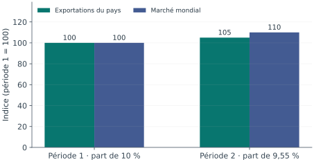
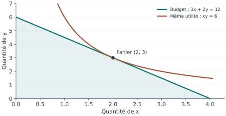

# ENS · B/L · Économie à option 2025 · Billet 5 · Corrigé guidé

*Corrigé rédigé par IA, non officiel. Signalez toute erreur.*

**Rédaction** · GPT-6.2 Astra Ultra · vitesse non renseignée · 26 novembre 2026

Le billet de la page 5 donne le choix entre deux questions, sans document d’accompagnement. Le candidat prépare une seule leçon pendant 1 h 30 et dispose de 15 minutes pour l’exposer, puis de 15 minutes de discussion. Chaque proposition ci-dessous peut être présentée indépendamment. [Billet officiel, page 5](https://www.ens.psl.eu/sites/default/files/economie_18_et_19_juin.pdf#page=5) · [Rapport du jury 2025](https://www.ens.psl.eu/sites/default/files/2025_bl_rapport_oral_economie_option.pdf)

## Préparer la leçon

Choisir la question pour laquelle on peut définir les termes et expliquer un exemple précis. Sur une feuille, réserver une colonne aux hypothèses du modèle et une autre aux observations qui en éclairent la portée. Pour quinze minutes, compter deux minutes pour poser le problème, environ quatre pour chacun des trois moments et une pour formuler la réponse.

## Les stratégies nationales de compétitivité dans l'économie mondiale

### Introduction

Un pays peut perdre une part des exportations mondiales au profit d’un pays qui s’industrialise, tout en augmentant ses exportations et le niveau de vie de ses habitants. Inversement, un excédent commercial peut s’accroître parce qu’une récession comprime les importations. La compétitivité a donc besoin d’un objectif précis. Au niveau d’une entreprise, il s’agit de soutenir la concurrence avec profit. Pour un pays, la question est de maintenir une production et des revenus soutenables dans une économie ouverte. **Comment améliorer la capacité productive et les débouchés d’un pays sans confondre la prospérité avec la conquête de parts de marché ?**

### I. Identifier les prix relatifs qui comptent pour les acheteurs

> [!INDICATION]
> **Définir ce que le pays cherche à améliorer.** Mettre en regard trois objectifs possibles, la part des exportations, la valeur ajoutée créée dans le pays et le revenu réel des ménages. Chercher un cas où les trois évoluent différemment.

Pour un producteur, le coût du travail par unité produite est le coût horaire divisé par la productivité horaire réelle. Si les rémunérations progressent de 3 % et la productivité de 2 %, le coût unitaire progresse de $1{,}03/1{,}02-1$, soit environ 1 %. Un partenaire dont le coût unitaire progresse plus vite peut perdre de la compétitivité relative même s’il part d’un niveau de salaire inférieur. Le coût de l’énergie, des intrants et du capital intervient également. L’entreprise peut répercuter la hausse sur son prix, comprimer sa marge ou changer de produit.

Le taux de change effectif réel agrège des prix relatifs entre pays et les pondère par les échanges. Il faut annoncer la convention de cotation avant d’interpréter une hausse de l’indice. Une dépréciation nominale peut abaisser le prix étranger des exportations mais renchérit les intrants importés. Si le prix d’un composant étranger est 50 dollars, une variation du cours de 1 à 1,10 euro par dollar en porte le coût de 50 à 55 euros. Un exportateur qui incorpore beaucoup de composants importés ne bénéficie donc pas intégralement de la dépréciation. La réaction des volumes prend du temps et dépend de l’existence de substituts. Dans la zone euro, le taux de change nominal entre membres n’est plus un instrument national.

Une baisse ciblée de prélèvements peut réduire les coûts des entreprises, mais son financement affecte d’autres agents. Une hausse des compétences qui améliore durablement la productivité ouvre une autre voie. Pour apprécier ces stratégies, il faut comparer les coûts unitaires relatifs, les prix effectivement payés sur les marchés de destination et l’évolution des volumes, plutôt que conclure à partir du seul salaire horaire.

### II. Les entreprises exportent aussi une qualité, des délais et des connaissances

> [!INDICATION]
> **Vérifier le dénominateur de la part de marché.** Refaire les deux divisions 100/1 000 puis 105/1 100. La progression de la demande mondiale peut excéder celle des ventes d’un exportateur qui continue pourtant à vendre davantage.

Deux voitures vendues à des prix différents peuvent répondre à des besoins différents. Fiabilité, services, réputation ou respect de normes permettent une compétitivité dite hors prix. Une hausse de prix unitaire à l’exportation peut ainsi traduire une montée en gamme. L’accès à un marché étranger s’accompagne souvent de coûts fixes, par exemple de certification, de distribution et de connaissance des règles locales. Les entreprises les plus productives franchissent plus aisément ces seuils. Une corrélation entre exportation et productivité s’explique donc en partie par la sélection des entreprises, même si l’expérience des marchés étrangers peut aussi favoriser l’apprentissage.

L’État peut agir sur l’infrastructure, la formation, la recherche et les difficultés de financement. Une entreprise peut sous-investir dans une innovation si d’autres en reprennent une partie des connaissances. Un soutien à la recherche peut alors produire un gain collectif supérieur au bénéfice privé. Il faut néanmoins vérifier que l’aide déclenche un investissement supplémentaire et n’accorde pas simplement une rente à un projet déjà rentable. Une politique sectorielle doit pouvoir être révisée si la technologie ou la demande évolue. Le rapport Draghi sur la compétitivité européenne, publié en 2024, met notamment en relation innovation, coût de l’énergie et capacité d’investissement. Il invite à distinguer les instruments nationaux de ceux qui nécessitent l’échelle du marché européen. [Commission européenne, rapport Draghi](https://commission.europa.eu/topics/competitiveness/draghi-report_en)

### III. Juger une stratégie nationale par ses effets internes et internationaux

Une part de marché a un dénominateur. Si les exportations d’un pays passent de 100 à 105 tandis que le marché mondial passe de 1 000 à 1 100, sa part baisse de 10 % à environ 9,55 % malgré la hausse de ses ventes. Une spécialisation sur des marchés dont la demande mondiale croît peu peut donner ce résultat sans perte de performance des entreprises dans chacun de leurs créneaux. Il faut décomposer les effets des produits, des destinations et des performances sur ces marchés. Les chaînes mondiales de valeur invitent aussi à distinguer exportations brutes et valeur ajoutée créée sur le territoire.

Au niveau macroéconomique, le solde extérieur courant est lié à l’écart entre épargne et investissement nationaux. Une économie qui investit beaucoup peut présenter un déficit tout en améliorant ses capacités futures. Un excédent généré par une forte compression des importations peut accompagner un sous-investissement. Toutes les économies ne peuvent simultanément améliorer leur solde extérieur vis-à-vis les unes des autres. Une stratégie appuyée uniquement sur la réduction des salaires ou une course aux subventions risque de déplacer l’activité sans gains durables et de réduire le revenu des ménages ou les ressources fiscales. Des normes communes et une coopération sur les infrastructures peuvent au contraire améliorer la productivité de plusieurs partenaires.

### Conclusion

Les indicateurs de coûts et de parts de marché servent à diagnostiquer une difficulté précise. L’objectif final demeure la productivité, le revenu réel et l’emploi soutenables. Une stratégie est convaincante lorsqu’elle identifie un obstacle, explicite un mécanisme d’investissement ou de formation, et vérifie les effets sur la valeur ajoutée nationale aussi bien que sur les exportations.

### Questions d’entretien sur le premier sujet

**Une dépréciation rend-elle immédiatement tous les exportateurs plus compétitifs ?** Cela dépend des monnaies de facturation, des intrants importés, de la répercussion sur les prix et de la réaction des clients. Le bilan peut évoluer entre le court et le long terme.

**Des exportations de forte valeur brute garantissent-elles un gain national équivalent ?** Une partie du prix peut couvrir des composants importés. Les comptes en valeur ajoutée identifient la contribution des producteurs résidents, puis il reste à déterminer quels agents perçoivent les revenus correspondants.

## Le choix en économie

### Introduction

Une hausse du prix des transports peut conduire un ménage à modifier ses trajets, à renoncer à une autre dépense ou à conserver son abonnement faute d’alternative. Constater qu’il « a choisi » ne dit donc pas encore quelles options il avait, ce qu’il préférait ou comment sa décision s’est formée. L’économie étudie les arbitrages sous rareté, du consommateur à la collectivité. **Que permet de comprendre la représentation d’un choix comme un arbitrage sous contrainte, et où faut-il en enrichir les hypothèses ?**

### I. Représenter le coût d’opportunité et la contrainte

> [!INDICATION]
> **Commencer par l’ensemble accessible.** Sur les axes des deux biens, placer les deux paniers extrêmes puis indiquer la région sous la droite budgétaire. Le taux d’échange de marché s’obtient en suivant sa pente.

Un choix implique le renoncement à la meilleure autre possibilité accessible. Pour le consommateur, la contrainte s’écrit $p_xx+p_yy\leq R$. Dans un exemple où le revenu vaut 12 et les prix 3 et 2, acquérir une unité de $x$ coûte une unité et demie de $y$. Le panier de quatre unités de $x$ et zéro de $y$, comme celui de zéro et six, épuise le budget. L’ensemble des paniers strictement sous la droite est également accessible. On ne peut juger les préférences d’un ménage à partir de ce qu’il n’achète pas sans vérifier si le panier correspondant était à sa portée.

Avec des préférences représentées par $U(x,y)=xy$ sur les quantités positives, un optimum intérieur égalise le taux marginal de substitution $y/x$ au rapport des prix $3/2$. La contrainte saturée donne $x=2$ et $y=3$. L’utilité sert ici à ordonner les paniers. Une transformation strictement croissante de $U$ conserve les mêmes décisions. La condition de tangence suppose notamment différentiabilité et solution intérieure. Si deux biens sont des substituts parfaits, une solution en coin peut être optimale. Ce contraste empêche de transformer une règle de calcul en loi indépendante des préférences.

La modification d’un prix change à la fois le coût relatif et le pouvoir d’achat du revenu donné. Une décomposition en effet de substitution et effet de revenu permet de les distinguer. Pour un bien normal, la hausse de son prix propre réduit normalement la quantité demandée par les deux canaux. Pour un bien inférieur, ils peuvent jouer en directions opposées. Les observations de demande gagnent donc à distinguer prix, revenu et disponibilité d’alternatives.

### II. Choisir avec du temps, de l’incertitude et une information coûteuse

> [!INDICATION]
> **Contrôler l’optimum autrement que par le dessin.** Substituer y = 6 − 1,5x dans xy. La fonction 6x − 1,5x² atteint son maximum pour x = 2. Les paniers en coin donnent ici une utilité nulle.

L’arbitrage concerne aussi plusieurs dates. Consommer aujourd’hui un euro qui aurait pu être épargné revient à renoncer à $1+r$ euros demain pour un taux réel $r$, sous réserve du risque et de l’accès effectif au crédit. Un jeune qui souhaite se former peut anticiper des gains futurs et être malgré tout contraint par ses ressources présentes. Un comportement attribué à l’impatience peut ainsi tenir à une impossibilité d’emprunter. Pour distinguer ces mécanismes, une enquête peut exploiter un changement d’accès à une bourse ou au financement et comparer les comportements à ressources initiales semblables.

En présence de risque, les probabilités et les préférences à l’égard du risque interviennent. Un agent à utilité concave du revenu peut préférer une somme certaine à une loterie de même espérance monétaire. Une assurance transfère des ressources des états où l’agent va bien vers ceux où il subit une perte, mais sa valeur dépend de la prime, des exclusions et des changements de comportement. Si les probabilités sont inconnues ou l’information très coûteuse, la recherche de la « meilleure » solution consomme elle-même du temps. La rationalité limitée d’Herbert Simon conduit à s’intéresser aux règles qui permettent de s’arrêter sur une option satisfaisante. Observer les options consultées et le moment de l’arrêt peut en apprendre davantage que la seule décision finale.

### III. L’architecture des options et les choix collectifs

Une option présélectionnée peut être conservée parce qu’elle convient, qu’elle est perçue comme une recommandation, ou que la modifier demande un effort. À budget et prix apparents identiques, un changement de présentation peut donc déplacer des comportements. Pour évaluer cet effet, on pourrait répartir aléatoirement des usagers entre plusieurs présentations en conservant l’accès effectif aux mêmes options. Déterminer quel réglage est préférable du point de vue du bien-être exige ensuite de connaître les objectifs des personnes et les conséquences de leur décision. Une hausse de l’adhésion ne suffit pas à prouver une amélioration pour tous.

Enfin, une politique publique choisit entre des usages collectifs de ressources rares. Une analyse coûts-bénéfices cherche à comparer les gains et coûts d’un projet à ceux d’une solution de référence. Les dispositions monétaires à payer dépendent toutefois des revenus et les bénéficiaires des économies de temps ne sont pas forcément ceux qui financent les travaux. L’agrégation des préférences individuelles suppose une règle. Selon la distribution des ressources et la place accordée à l’équité, deux projets dont le surplus agrégé est proche peuvent appeler des décisions différentes.

### Conclusion

Le modèle de choix oblige à préciser ce qui est accessible, le prix du renoncement et le critère de classement. Il fournit ensuite des prédictions conditionnelles à confronter aux décisions réelles. Les institutions, l’information et la distribution des ressources déterminent à la fois les possibilités des agents et le sens qu’on peut donner aux choix observés.

### Questions d’entretien sur le second sujet

**La préférence révélée identifie-t-elle tout le classement ?** Elle informe sur les arbitrages effectivement offerts. Un choix ne révèle rien de décisif sur un panier inaccessible ou ignoré. Des observations sous plusieurs contraintes permettent de tester la cohérence du comportement.

**Pourquoi la courbe d’indifférence la plus haute n’est-elle pas toujours tangente ?** Le panier optimal peut être en coin, les biens peuvent être indivisibles ou les préférences présenter un angle. L’optimum reste le meilleur panier accessible, alors que l’égalité des pentes a un domaine plus étroit.
