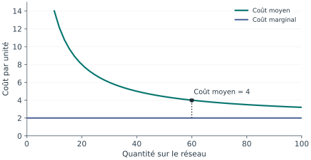
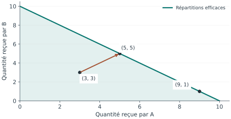

# ENS · B/L · Économie à option 2025 · Billet 6 · Corrigé guidé

*Corrigé rédigé par IA, non officiel. Signalez toute erreur.*

**Rédaction** · GPT-6.2 Astra Ultra · vitesse non renseignée · 26 novembre 2026

Le billet de la page 6 donne le choix entre deux questions, sans document d’accompagnement. Le candidat prépare une seule leçon pendant 1 h 30 et dispose de 15 minutes pour l’exposer, puis de 15 minutes de discussion. Chaque proposition ci-dessous peut être présentée indépendamment. [Billet officiel, page 6](https://www.ens.psl.eu/sites/default/files/economie_18_et_19_juin.pdf#page=6) · [Rapport du jury 2025](https://www.ens.psl.eu/sites/default/files/2025_bl_rapport_oral_economie_option.pdf)

## Préparer la leçon

Choisir la question pour laquelle on peut définir les termes et expliquer un exemple précis. Sur une feuille, réserver une colonne aux hypothèses du modèle et une autre aux observations qui en éclairent la portée. Pour quinze minutes, compter deux minutes pour poser le problème, environ quatre pour chacun des trois moments et une pour formuler la réponse.

## L’Etat et le marché

### Introduction

Dans l’électricité, des producteurs peuvent se concurrencer tout en utilisant un réseau commun soumis à des règles d’accès et de tarification. Le marché de l’énergie, le financement de l’infrastructure et les obligations de desserte ne répondent pas exactement aux mêmes contraintes. L’État désigne ici les pouvoirs publics qui établissent et appliquent des règles, lèvent des ressources et fournissent ou financent des services. Le marché coordonne des décisions décentralisées par les échanges et les prix. **Comment articuler ces deux modes de coordination en tenant compte des limites de chacun et du but collectif poursuivi ?**

### I. Rendre l’échange possible et comprendre ce qu’il coordonne

> [!INDICATION]
> **Séparer les quatre décisions publiques.** Pour un réseau d’électricité, identifier qui finance, qui produit, qui fixe le tarif et qui garantit la desserte. Ces fonctions peuvent être confiées à des acteurs différents.

Pour que deux personnes échangent, il faut que chacune sache de quoi elle peut disposer, à quel moment elle sera payée et ce qui se passe si le produit livré ne correspond pas au contrat. Les règles de propriété, les tribunaux, les normes de qualité et les institutions monétaires contribuent à rendre les engagements crédibles. Une plateforme ou une association peut aussi élaborer des règles privées. La puissance publique intervient dans leur définition, leurs limites et les recours disponibles, y compris pour les partenaires les moins puissants. Le marché est donc une organisation institutionnelle, dont les règles influencent les transactions possibles.

Si de nombreux agents prennent les prix comme donnés, ceux-ci condensent de l’information sur les coûts et la rareté. Une hausse du prix d’un intrant incite des entreprises qui ne connaissent pas la cause précise de la pénurie à l’économiser ou à rechercher des substituts. Ce mécanisme évite à une autorité de déterminer chaque quantité à partir des informations locales. Il suppose toutefois des prix qui reflètent les coûts pertinents, des échanges susceptibles d’être conclus et suffisamment d’agents pour limiter le pouvoir de marché. Un prix peut également exclure des consommateurs à faible revenu dont le besoin est pourtant important. Le critère d’efficacité ne tranche pas la question de leurs droits d’accès.

### II. Adapter l’intervention à ce que le prix ne prend pas en charge

> [!INDICATION]
> **Vérifier le financement au coût marginal.** Au volume de 60, écrire deux colonnes pour les recettes et les coûts. Réfléchir à l’incidence d’un abonnement fixe sur un ménage qui consomme peu.

Une activité polluante peut imposer un dommage non compensé. Une taxe proportionnelle au dommage marginal, si celui-ci est connu, rend l’émission coûteuse pour son auteur tout en lui laissant le choix de l’ajustement. Des permis négociables peuvent fixer une quantité globale et répartir l’effort entre les entreprises. L’autorité doit mesurer les émissions et faire respecter les règles. Une quantité d’émissions fixée et un prix des émissions fixé n’exposent pas aux mêmes risques lorsque les coûts de réduction sont mal connus. Le marché de droits est lui-même un instrument d’action publique.

Un réseau à coûts fixes élevés illustre une toute autre difficulté. Avec un coût total fictif $C(q)=120+2q$ pour $q>0$, le coût marginal vaut 2 et le coût moyen $120/q+2$. Pour 60 unités, un réseau coûte 240, tandis que deux réseaux produisant 30 unités chacun coûteraient ensemble 360. Dédoubler le réseau gaspillerait 120 dans ce cas. Mais si l’on fixe le tarif à 2 pour guider la consommation sur le coût marginal, la recette de 120 couvre seulement le coût variable et laisse les 120 de coût fixe à financer. Au même volume, un tarif uniforme de 4 couvre le coût moyen mais peut décourager des usages dont le bénéfice dépasse 2. Un abonnement fixe, un financement public ou des tarifs différenciés changent la répartition et les décisions. L’efficacité de la production, l’équilibre financier et l’accès universel entrent donc dans un arbitrage.

À côté de la régulation et de la production, l’État assure des revenus ou finance des services en nature. Une assurance sociale peut couvrir des risques mal mutualisés par des contrats privés et redistribuer entre groupes. Séparer, lorsque c’est possible, le signal de rareté et une aide ciblée permet de poursuivre deux objectifs simultanément. Un transfert monétaire financé par l’impôt peut préserver une incitation à économiser une ressource tout en limitant la charge sur les ménages qui disposent de peu d’alternatives.

### III. Comparer des institutions réelles, compte tenu de l’information et des incitations

Le régulateur ne connaît pas forcément le coût réel de l’opérateur. S’il rembourse toute dépense constatée, celui-ci est peu incité à maîtriser ses coûts. S’il fixe un prix plafond, l’opérateur conserve une partie des gains de productivité mais peut aussi dégrader une qualité difficile à observer. D’où l’intérêt d’indicateurs de fiabilité, de délais d’intervention et de satisfaction des usagers, ainsi que de mécanismes de contrôle et de recours. L’organisation de la production compte autant que la propriété publique ou privée de l’entreprise.

Une mise en concurrence pour obtenir une concession peut exploiter l’information de plusieurs candidats. Elle exige un cahier des charges, une répartition des risques et la possibilité de vérifier ce qui est livré. Si les dimensions essentielles de qualité sont difficiles à contractualiser et si changer d’opérateur est très coûteux, le gain attendu de la concurrence initiale peut s’éroder. À l’inverse, une administration en monopole peut répondre à des objectifs politiques multiples, subir la pression de groupes organisés ou manquer d’incitations à révéler ses coûts. Le bon contrefactuel est une autre organisation réalisable, soumise elle aussi à des contraintes.

### Conclusion

L’État peut créer un marché, recourir aux prix, en corriger les effets, garantir un accès ou assurer directement une prestation. Pour choisir, il faut distinguer production, financement, régulation et redistribution. La comparaison prend alors un contenu vérifiable en examinant le coût, la qualité, les risques supportés et la répartition effective des services.

### Questions d’entretien sur le premier sujet

**Une entreprise publique peut-elle exercer un pouvoir de marché ?** Oui. La structure des coûts et les alternatives des usagers subsistent quel que soit le propriétaire. Le contrôle politique peut changer les objectifs et les mécanismes de responsabilité, sans supprimer le besoin d’évaluer prix et qualité.

**Qui porte le risque dans une concession ?** Il faut lire le contrat. Un transfert du risque de coûts au prestataire peut renforcer les incitations à l’efficacité, mais aussi augmenter la prime demandée ou inciter à réduire une qualité difficile à vérifier.

## Pareto, l'utilité et la justice sociale

### Introduction

Dix unités d’un bien sont à partager entre deux personnes qui en désirent toutes deux davantage. Donner neuf unités à la première et une à la seconde peut être efficace au sens de Pareto, tout comme donner cinq à chacune. Comment un critère exigeant qu’il n’existe plus de gain mutuel peut-il accepter des répartitions aussi différentes ? **Que permet la notion d’utilité pour désigner une amélioration collective, et quels jugements supplémentaires faut-il assumer pour parler de justice ?**

### I. Le critère de Pareto construit un accord à partir des préférences individuelles

> [!INDICATION]
> **Construire un exemple où le critère reste muet.** Placer deux répartitions de dix unités sur la frontière, puis indiquer qui gagne et qui perd lors du passage de l’une à l’autre. Le silence du critère est ici un résultat du raisonnement.

Une modification est une amélioration de Pareto si personne ne la juge moins bonne et si au moins une personne la juge strictement meilleure. Une allocation est efficace au sens de Pareto lorsque aucune autre allocation réalisable ne satisfait cette condition. Si dix unités sont disponibles et que seules huit ont été distribuées, attribuer les deux restantes à une personne qui les désire est une amélioration. Si toutes les unités sont distribuées et que chacun préfère davantage du bien, toute réattribution accroît la quantité de l’un en réduisant celle de l’autre. Toutes les répartitions exhaustives de cet exemple sont donc efficaces.

En théorie ordinale, une fonction d’utilité représente un classement. Si une personne préfère A à B, on peut écrire $u(A)>u(B)$. Une transformation strictement croissante conserve ce classement. La valeur numérique 10 chez Paul ne permet ainsi pas d’affirmer une satisfaction « deux fois supérieure » à la valeur 5 chez Jeanne. Le critère de Pareto requiert seulement que chacun puisse classer sa propre situation avant et après. Cette faible exigence explique la solidité du jugement quand il y a accord et son silence dès que les intérêts s’opposent.

Dans une économie avec plusieurs biens, des échanges volontaires peuvent améliorer les deux situations si les taux marginaux de substitution diffèrent. À un optimum intérieur avec préférences régulières et possibilité d’échanger, ces taux doivent coïncider, sans quoi un échange marginal mutuellement bénéfique resterait disponible. L’échange peut donc déplacer l’économie vers une frontière des possibilités d’utilité. La position finale sur cette frontière dépend notamment des dotations initiales et des conditions de négociation.

### II. L’efficacité d’un équilibre ne dit pas si son point de départ est juste

> [!INDICATION]
> **Préciser ce que l’on compare entre les personnes.** Changer l’unité de représentation de l’utilité d’une seule personne. Son classement reste identique, alors que la somme des utilités peut conduire à un autre choix social.

Le premier théorème du bien-être relie un équilibre concurrentiel à une allocation efficace sous des hypothèses telles que la prise des prix comme donnés, l’absence d’externalités, des marchés pour les biens pertinents et la non-satiété locale. Ce résultat porte sur l’impossibilité d’améliorer un agent sans en léser un autre. Il est compatible avec une distribution des droits de propriété extrêmement concentrée. Les demandes sont des dispositions à payer au regard d’un budget, et celui-ci dépend des ressources initiales. Un besoin intense ne crée pas automatiquement une demande solvable.

Le second théorème, sous des hypothèses supplémentaires de convexité et de régularité, suggère qu’on peut soutenir une allocation efficace donnée par des prix après redistribution appropriée des dotations. Ce résultat sépare en théorie le choix distributif et la coordination concurrentielle. Une redistribution forfaitaire indépendante des décisions individuelles est cependant difficile à mettre en œuvre avec des aptitudes et des besoins imparfaitement observables. Un impôt sur le travail peut modifier l’offre de travail, et une prestation sous condition de ressources peut changer les incitations au voisinage du seuil. L’instrument effectivement disponible compte pour relier efficacité et redistribution.

Une amélioration dite potentielle, où les gagnants pourraient compenser les perdants, ne satisfait pas le critère de Pareto si les perdants ne reçoivent rien. Prenons une réforme qui procure 12 euros à un groupe et en coûte 8 à un autre. Le gain monétaire net est 4. Une compensation effective comprise entre 8 et 12 pourrait améliorer le sort des deux sous des hypothèses simples sur les préférences et les coûts du transfert. Sans cette compensation, il reste une perte. Une somme de dispositions à payer n’est pas à elle seule un jugement sur la justice de la réforme.

### III. Choisir une conception de la justice oblige à dire ce qui doit être comparé

Une fonction de bien-être social additive peut privilégier le maximum de la somme des utilités. Pour interpréter cette somme, il faut choisir des représentations comparables et des pondérations. Dans l’exemple des dix unités, si l’on pose explicitement des utilités comparables $u_i=\sqrt{x_i}$ et des poids égaux, la concavité implique que $\sqrt5+\sqrt5$ dépasse $\sqrt9+\sqrt1$. Une unité supplémentaire compte davantage pour l’agent le moins doté. Avec des utilités linéaires de même poids, toutes les répartitions exhaustives donneraient la même somme. L’égalité ne découle donc pas de la seule opération d’addition.

Un critère qui maximise la situation du plus défavorisé sélectionne également une répartition égalitaire dans l’exemple symétrique. Il exprime un principe distinct de la maximisation d’une somme. Ce calcul de maximin sur des utilités doit être distingué du principe de différence de John Rawls, qui s’inscrit dans un système de libertés et d’égalité équitable des chances et concerne notamment les perspectives en biens premiers des moins avantagés. Amartya Sen propose encore de s’interroger sur les possibilités effectives de mener certaines activités. Deux personnes dotées du même revenu peuvent avoir des possibilités de déplacement très différentes selon leur santé ou l’accessibilité des transports. Changer la grandeur évaluée change le problème de justice lui-même.

### Conclusion

L’utilité ordinale permet de vérifier des améliorations unanimement acceptables. L’efficacité de Pareto décrit l’épuisement des gains possibles sans perdant et ne classe pas toutes les répartitions. Parler de justice oblige à justifier une information supplémentaire, les ressources, les libertés ou les satisfactions à comparer, et le poids à donner aux personnes les moins favorisées.

### Questions d’entretien sur le second sujet

**Pourquoi la compensation potentielle ne suffit-elle pas ?** Une personne qui supporte encore une perte ne juge pas la réforme meilleure. Indiquer qui reçoit la compensation, de quel montant, comment elle est financée et quels coûts sa mise en œuvre entraîne.

**Égalité des ressources et égalité des possibilités sont-elles équivalentes ?** Des besoins différents modifient ce qu’il est possible de faire avec une même dotation. L’accessibilité du logement ou des déplacements peut donc être pertinente même à revenu égal.
