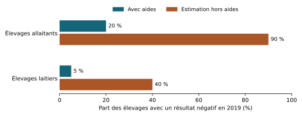
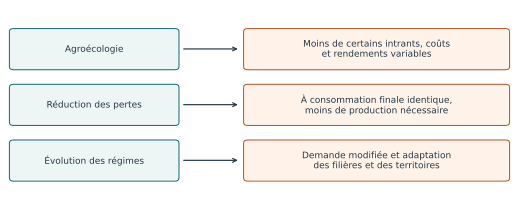

# ENS B/L · Économie, oral commun 2025 — Vers une agriculture durable ? · Corrigé brut

*Corrigé rédigé par IA, non officiel. Signalez toute erreur.*

**Rédaction** · GPT-6.2 Astra Ultra · vitesse non renseignée · 26 novembre 2026

## Quel résultat attendre de la transition ?

Un éleveur qui entretient des prairies permanentes peut contribuer à préserver un paysage et des sols. Ses bovins émettent aussi du méthane. Dans les comptes de l’exploitation, ni le bénéfice collectif du premier effet ni le dommage climatique du second ne sont entièrement rémunérés ou facturés. Comment satisfaire les besoins alimentaires en préservant les ressources, tout en assurant la viabilité des exploitations et l’accès des ménages à l’alimentation ? Une agriculture durable doit pouvoir se maintenir économiquement, socialement et écologiquement dans le temps. Le dossier suggère qu’une politique de production isolée déplace une partie des coûts, tandis qu’une action conjointe sur l’offre, la consommation et la répartition du revenu peut les réduire.

## Comparer les coûts collectifs aux incitations des exploitations

Le document 1 de l’OFCE situe le problème. Dans l’Union européenne en 2020, l’agriculture émet 382,4 millions de tonnes équivalent CO₂, environ 12 % de l’ensemble. Ce volume a reculé d’environ 21 % depuis 1990, contre 33 % pour l’ensemble des émissions de l’UE. Le graphique montre un recul de 22 % des émissions de la fermentation entérique entre 1990 et 2020, qui demeure la source agricole la plus importante. Les sols exploités arrivent ensuite. Une tonne équivalent CO₂ permet d’agréger des gaz dont le pouvoir de réchauffement diffère. Les contributions nationales à la valeur ajoutée et aux émissions divergent également. Dans le premier graphique, l’Italie représente une part de la valeur ajoutée agricole européenne sensiblement supérieure à sa part des émissions de ce secteur. Les différences de spécialisation et de prix empêchent d’y voir, à elles seules, une mesure pure de performance technique.

Le Pacte vert fixe un objectif de neutralité climatique pour 2050 et une baisse d’au moins 55 % des émissions nettes de l’UE entre 1990 et 2030. Ce taux concerne l’économie européenne entière. Les engagements nationaux au titre du partage de l’effort couvrent plusieurs secteurs, dont l’agriculture et les transports routiers. Ils ne permettent pas d’attribuer automatiquement à chaque exploitation le même taux de baisse.

En présence d’une externalité négative, une partie du coût de production incombe à des tiers. Si ce coût ne se retrouve pas dans le prix, la quantité produite peut dépasser le niveau socialement souhaitable. Une rémunération des services rendus par une prairie et une incitation à diminuer les émissions nettes peuvent alors se compléter. Pour les calibrer, il faut mesurer le gain supplémentaire par rapport à ce qui se serait passé sans aide et éviter de compter deux fois le carbone stocké. La seule progression des surfaces en herbe donnerait une image trompeuse si elle accompagnait un cheptel supplémentaire dont les émissions excèdent le stockage additionnel.

Or les soutiens existants poursuivent aussi des objectifs de production, de revenu et d’aménagement rural. La Cour des comptes (document 2) évalue à 4,3 milliards d’euros par an les aides publiques à l’activité bovine, principalement au titre de la politique agricole commune, hors aides fiscales et sociales de ce chiffrage. En 2019, environ 20 % des élevages allaitants avaient un résultat courant avant impôt négatif malgré les aides, contre environ 5 % des élevages laitiers. Sans aides, les estimations du ministère atteignent respectivement 90 % et 40 %. Ces nombres éclairent la dépendance comptable des exploitations à court terme. Une suppression durable changerait également prix, productions et décisions de sortie. La fragilité de certains élevages tient aussi à leur faible pouvoir de négociation face aux fournisseurs et acheteurs. L’incidence finale d’une aide peut donc bénéficier en partie à d’autres acteurs.

## Agir sur les rendements, les pertes et la demande finale

L’agroécologie peut diminuer les intrants chimiques et préserver la biodiversité. Pendant une conversion, certaines productions requièrent davantage de travail, de terres ou d’équipements. L’effet sur les coûts et les rendements dépend du système initial. À demande inchangée, si les quantités domestiques baissent, les prix peuvent monter. Le revenu des producteurs dépend alors de l’effet combiné du prix, de la quantité et du coût. Les importations peuvent augmenter et déplacer à l’étranger une partie des émissions évitées. Pour estimer le bénéfice climatique, il faut suivre les émissions contenues dans la consommation autant que les émissions sur le territoire.

C’est le sens de la complémentarité étudiée par Guyomard, Soler et Détang-Dessendre (document 4). Réduire les pertes permet de satisfaire une même demande alimentaire finale avec moins de production en amont. Faire évoluer les régimes alimentaires modifie la demande adressée aux différentes filières. Si elle se déplace vers des produits moins intensifs en émissions, le gain climatique peut être plus important. Des économies de dépenses alimentaires sont envisageables dans le scénario étudié si les comportements changent substantiellement, sans taxe à la consommation à l’origine de ce changement. Pour les filières animales, la baisse des quantités demandées peut au contraire se combiner avec une baisse des prix. Une amélioration du bilan collectif peut donc engendrer des pertes concentrées dans certains territoires.

Le document 3 empêche de tenir ce changement de comportement pour acquis. Entre les moyennes triennales centrées sur 2009 et 2019, les achats de viande de boucherie fraîche diminuent de 17 % chez les ménages de moins de 35 ans en France métropolitaine hors Corse. Leurs achats de fruits diminuent aussi de 7 %, alors que les achats de volailles et lapins frais augmentent. Une baisse de viande fraîche ne démontre donc pas un basculement général vers une alimentation plus végétale. Ces chiffres portent sur des quantités achetées par catégorie de ménages. Les repas pris hors domicile, les pertes et la composition des groupes limitent ce qu’on peut en conclure sur les quantités ingérées par personne. La disponibilité de plats adaptés, la restauration collective, le prix relatif des aliments et le temps nécessaire à leur préparation peuvent faire évoluer les choix.

## Organiser la transition selon les situations de revenu et les résultats environnementaux

L’excédent brut d’exploitation (EBE) mesure un solde d’exploitation après prise en compte, notamment, des subventions, fermages et charges de personnel. Il doit encore couvrir l’usure du capital et les charges financières. Le document 5 porte sur les exploitations métropolitaines hors micro-exploitations en 2020. Par exploitation, l’EBE moyen est de 71 900 euros et le résultat courant avant impôt (RCAI) de 37 000 euros. Par équivalent temps plein non salarié, ils sont de 52 100 et 26 800 euros. Un EBE par actif mesure une ressource productive brute. Le niveau de vie dépend aussi des impôts, des autres revenus et de la composition du ménage. Le graphique des distributions révèle de forts écarts internes, par exemple en élevage porcin, et des écarts entre médianes. Une même exigence d’investissement peut être supportable pour une exploitation peu endettée et inaccessible à une autre.

La Cour des comptes propose de croiser performance économique et services environnementaux. On peut soutenir la viabilité d’une exploitation en difficulté qui fournit des services vérifiables, accompagner une conversion lorsque le modèle est profitable mais polluant, et envisager une reconversion quand les deux dimensions sont défavorables. Les paiements pour services environnementaux, l’accès au conseil et au crédit, l’accompagnement de filières territoriales et une aide transitoire aux ménages modestes répondent à des obstacles distincts. Les aides doivent laisser un intérêt à réduire le dommage supplémentaire au lieu de rétablir mécaniquement la rentabilité d’un volume élevé d’émissions.

Le mouvement vers une agriculture durable est donc possible sous conditions. Il dépend de ce que l’on produit, de ce qui est effectivement consommé et de la répartition des coûts de conversion. Son évaluation devrait suivre ensemble les émissions nettes et importées, la biodiversité, le revenu des exploitants et le coût d’un panier alimentaire accessible. Avec des indicateurs de résultat et des soutiens ajustés aux situations, il devient possible de distinguer une amélioration durable d’un simple transfert d’activité ou de dommage vers d’autres territoires.

[Dossier officiel, pages 19 à 27 du recueil](https://www.ens.psl.eu/sites/default/files/economie_sujets_25_juin.pdf#page=19) · [Rapport du jury de l’oral commun d’économie](https://www.ens.psl.eu/sites/default/files/2025_bl_rapport_oral_economie_tronc_commun.pdf) · [Règlement de l’UE sur la répartition de l’effort, modification de 2023](https://eur-lex.europa.eu/eli/reg/2023/857/oj)
