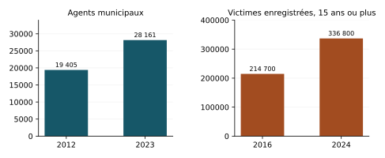
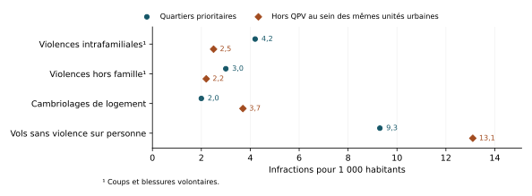

# Délinquance et criminalité : déterminants et fonctionnement · Corrigé guidé

*Corrigé rédigé par IA, non officiel. Signalez toute erreur.*

**Rédaction** · GPT-6.2 Astra Ultra · vitesse non renseignée · 26 novembre 2026

ENS, filière B/L · Épreuve orale commune d’économie, session 2025.

La préparation dure une heure trente, avec calculatrice autorisée. L’exposé et l’entretien durent chacun quinze minutes.

## Organiser la préparation

Écrire en haut du brouillon « victimes enregistrées », « faits subis » et « arrestations ». Relever dans chaque document laquelle de ces grandeurs est effectivement observée. Classer ensuite les documents par usage. Les documents 1 et 3 posent le problème de mesure, les documents 2 et 4 proposent des mécanismes et le document 5 confronte plusieurs objectifs publics. L’expérience de Baltimore peut être préparée sous la forme de trois colonnes, une par groupe assigné, pour expliquer le rôle du témoin à l’oral.

## Introduction

En France, le nombre de victimes de coups et blessures volontaires enregistrées parmi les personnes de quinze ans ou plus est passé de 214 700 en 2016 à 336 800 en 2024. Sur une période en partie commune, les effectifs des polices municipales ont augmenté. Faudrait-il en conclure que les moyens engagés pour la sécurité sont inefficaces ? Le rapprochement, frappant sur la page du Sénat, laisse de côté le recours au dépôt de plainte, l’évolution des besoins et ce qui se serait produit sans ces moyens.

L’économie publique étudie ici des dommages subis par les victimes, des ressources collectives consacrées à la prévention et des choix sous contrainte de budget. Les infractions ont des victimes, des formes juridiques et des conditions sociales diverses. Le terme de criminalité est employé dans le dossier au sens large, qui peut réunir crimes et délits. Comment identifier les déterminants économiques des atteintes et évaluer l’action publique lorsque l’enregistrement des faits, les comportements et les interventions se répondent ? Je distinguerai la mesure des faits, les mécanismes individuels et collectifs, puis les critères d’une politique publique.

## I. Mesurer des atteintes et leurs coûts

### L’enregistrement dépend aussi de la capacité à signaler les faits

Le document 1 rassemble deux graphiques d’un rapport du Sénat de mai 2025. Le premier montre une hausse de 19 405 agents de police municipale en 2012 à 28 161 en 2023, soit environ 45 %. Il s’agit de l’effectif municipal, une partie des moyens publics de sécurité. Le second compte des victimes enregistrées par la **police et la gendarmerie**, avec un autre champ et d’autres dates. Entre 2016 et 2024, la hausse du total est d’environ 57 %. La part intrafamiliale passe de 44 % à 57 %, et la part des autres faits de 56 % à 43 %. Avec les pourcentages arrondis du document, cela correspond à environ 94 500 puis 192 000 victimes enregistrées de violences intrafamiliales. Les autres victimes enregistrées augmentent aussi en nombre, alors que leur part diminue.

Un meilleur accueil des plaintes peut contribuer à rendre visibles des atteintes autrefois tues. Si la probabilité de signalement augmente, une hausse des enregistrements est compatible avec plusieurs trajectoires de la violence subie. À l’inverse, un effectif de police peut augmenter en réponse à des besoins antérieurs. L’étude devrait rapprocher données administratives, enquêtes anonymes de victimation et informations sur le contexte, en respectant leur champ et leur calendrier. Une enquête de victimation comporte aussi des limites de mémoire, de non-réponse et d’échantillonnage. L’intérêt est de pouvoir constater et étudier l’écart entre les sources.

### Le résultat territorial change avec la nature de l’infraction

Le document 3, une note de décembre 2023 du service statistique du ministère de l’Intérieur, présente des moyennes de 2021–2022 pour 1 000 habitants en France hors Mayotte. Il distingue les quartiers prioritaires de la politique de la ville (QPV), les unités urbaines qui en comprennent et leurs parties situées hors QPV. La colonne du milieu inclut les QPV. Pour comparer deux espaces disjoints, prenons la première et la dernière. Les coups et blessures volontaires intrafamiliaux enregistrés sont respectivement de 4,2 et 2,5 pour mille. Les cambriolages de logement suivent le sens inverse, 2,0 et 3,7 pour mille. Les vols sans violence contre des personnes sont également moins nombreux pour 1 000 habitants dans les QPV, 9,3 contre 13,1. Les faits les plus rares, comme les homicides, appellent une attention particulière aux faibles effectifs et aux arrondis.

La localisation renseigne sur des lieux, et le dénominateur compte des habitants. Les déplacements quotidiens modifient le nombre de personnes effectivement présentes dans ces lieux. Le nombre de logements, leur occupation et les occasions de signalement peuvent différer aussi. Déduire le comportement individuel d’un résident à partir d’un taux local serait une erreur d’échelle. Les divergences entre types d’infractions invitent précisément à examiner plusieurs mécanismes.

## II. Des incitations aux interactions sociales

### Le choix sous contrainte et ses limites

Le document 4 de Christophe Soullez (2014) propose deux échelles d’analyse. Au niveau d’une personne, l’approche par le choix rationnel s’intéresse à la comparaison des conséquences attendues de plusieurs actions. Un emploi durable et une formation reconnue donnent des perspectives auxquelles une rupture de parcours ferait renoncer. En économie, cette meilleure possibilité abandonnée constitue un coût d’opportunité. L’analyse peut expliquer pourquoi améliorer l’accès à l’emploi change certains choix, sans faire l’hypothèse que toute personne calcule chaque conséquence ni traiter le comportement violent comme une simple transaction. Les circonstances, l’information et les normes comptent également. Les coûts pour la victime, ses proches et les services publics ne se confondent pas avec ceux pris en compte par l’auteur.

À l’échelle des pays, Soullez oppose l’hypothèse de désorganisation liée à une modernisation rapide à celle d’une baisse de certaines infractions quand les conditions de vie s’améliorent. Les études citées rapprochent la prospérité ou le chômage du niveau de criminalité, et examinent séparément les inégalités. L’indice de Gini résume la dispersion relative des revenus. Deux pays peuvent avoir le même revenu moyen et des distributions très différentes. Une corrélation entre Gini et infractions peut aussi refléter la structure démographique, les services publics, les définitions juridiques et les pratiques d’enregistrement. Elle ne permet jamais d’imputer à une personne pauvre la probabilité déduite d’une comparaison internationale.

### Pourquoi le groupe peut amplifier une intervention

Le document 2 d’Yves Zenou (2014) ajoute les interactions entre pairs. Le parcours d’un jeune peut dépendre des perspectives de ses proches et des normes de son groupe. Une intervention qui bénéficie directement à l’un d’eux peut donc affecter d’autres personnes. C’est le sens du multiplicateur social. La difficulté empirique est de séparer l’influence réciproque, la tendance à fréquenter des personnes semblables et l’exposition à une même école, au même marché du travail ou aux mêmes institutions. Les corrélations observées dans des quartiers modestes de Boston ne permettent pas à elles seules de démêler ces effets.

À Baltimore, le programme *Moving to Opportunity* répartit 638 familles entre trois groupes. Le premier se voit proposer une aide au logement assortie d’un accompagnement et de conditions sur le quartier de destination. Le second reçoit une aide au logement avec un choix plus libre. Le groupe témoin conserve sa situation d’accès ordinaire sans aide spéciale du programme. Le texte rapporte des baisses de 30 à 50 % des arrestations des jeunes pour des délits relativement au groupe témoin et une baisse des arrestations pour actes violents dans les groupes aidés. La comparaison entre groupes constitués avant les déménagements est plus instructive qu’une simple corrélation entre voisins. Elle mesure d’abord l’effet de l’offre d’aide et de son contexte. Le changement résidentiel peut modifier simultanément école, relations, revenus disponibles et pratiques locales d’enregistrement. L’expérimentation n’isole donc pas un coefficient pur d’influence des pairs.

Le texte cite également des recherches sur les parcours après un séjour dans un même établissement pénitentiaire. Elles invitent à inclure les effets des relations nouées en détention dans l’évaluation des politiques de réinsertion. Les résultats américains portent sur des publics et des institutions particuliers. Les généraliser aux jeunes des QPV français demanderait des données adaptées et une comparaison institutionnelle.

## III. Évaluer les interventions par les dommages qu’elles évitent

### Agir sur les organisations et sur les besoins de santé

Soullez compare certaines organisations criminelles à des entreprises en raison de la division des tâches et de la diversification des activités. Cette analogie a une limite majeure. Les contrats légaux et les recours ordinaires en justice, qui réduisent les coûts de transaction entre entreprises, ne structurent pas ces échanges de la même façon. La coercition et les dommages imposés à des tiers donnent ici une raison particulière à l’intervention publique. Une politique limitée à une seule activité ou à un nombre d’interpellations ne mesure pas ces dommages.

Le document 5 de Clotilde Champeyrache (*The Conversation*, janvier 2025) étudie cette question à propos du narcotrafic. L’article cite deux estimations rapportées en 2022, 900 000 consommateurs quotidiens de cannabis et 600 000 personnes ayant déjà touché à la cocaïne selon la formulation de l’extrait. La fréquence de consommation du second groupe n’y est pas donnée. Ces populations peuvent se recouper et leurs nombres ne s’additionnent pas en un indicateur cohérent. L’addiction peut rendre la demande peu sensible à court terme à certaines variations de prix. L’offre et l’accessibilité influent également sur la consommation. Pour les pouvoirs publics, cette interdépendance rend complémentaires l’accès aux soins, la prévention des entrées dans la consommation et la coopération institutionnelle contre les organisations. Les pistes défendues dans l’article relèvent d’une analyse argumentée. Leur efficacité comparative reste à évaluer.

### Comparer un résultat observé à une situation contrefactuelle

Une politique doit annoncer son résultat attendu avant de choisir l’indicateur. Pour un meilleur accueil des victimes, l’augmentation initiale des signalements peut aller de pair avec une réduction des délais d’accès à la protection. Pour des aides à la réinsertion, on peut suivre l’accès à l’emploi, la stabilité du logement, le bien-être des personnes et la répétition d’atteintes. Les dépenses comptables ne couvrent qu’une partie du coût. Employer une ressource publique à une mission oblige à renoncer à un autre usage. Les bénéfices devraient inclure les dommages évités pour les personnes, en accordant une attention aux groupes les plus exposés et aux droits de chacun.

Si un programme d’accompagnement est déployé à des dates différentes, comparer l’évolution de territoires proches avant et après le déploiement donne une première stratégie d’évaluation. Elle suppose que leurs trajectoires auraient été comparables en l’absence du programme et qu’une variation du signalement ne se confonde pas avec son effet. Il faut également suivre les territoires voisins. Une amélioration dans une zone peut s’accompagner d’un déplacement du problème ou, à l’inverse, profiter à son entourage. Les deux cas changent le bilan collectif.

## Conclusion

Les disparités enregistrées deviennent intelligibles quand on sépare l’exposition, le signalement, les incitations et les effets de milieu. Les cinq documents plaident pour juger les politiques sur les dommages effectivement évités, leur répartition et leur coût, en confrontant plusieurs sources à une situation contrefactuelle crédible. Ce critère sert aussi bien à évaluer un dispositif de soutien aux victimes qu’une action de prévention ou de réinsertion.

## Préparer l’entretien

### La hausse des enregistrements prouve-t-elle une hausse aussi forte du nombre de faits ?

Il faut distinguer la survenue d’une atteinte, son éventuel signalement et sa prise en compte statistique. Une hausse de l’un ou l’autre des deux derniers facteurs peut accroître le nombre observé. Des enquêtes auprès de la population renseignent sur des faits signalés et non signalés. Comparer des évolutions sur un même champ permet de discuter les interprétations.

### Les parts de 44 % et 57 % représentent-elles une hausse de 13 % ?

La différence est de 13 **points**. Rapporté à la part de départ, l’accroissement relatif de cette part est d’environ 30 %. Le nombre de victimes enregistré dans la catégorie croît davantage, puisque le total augmente aussi. On obtient les effectifs approximatifs en multipliant chaque part par le total de son année.

### Comment une expérience de logement renseigne-t-elle sur la causalité ?

L’attribution aléatoire de l’offre réduit les différences initiales systématiques entre groupes. La comparaison des personnes selon l’offre reçue tient compte du fait que toutes les familles ne déménagent pas. Comparer seulement celles qui ont déménagé réintroduirait une sélection. Le résultat observé dépend aussi de la manière de mesurer les arrestations et du contexte de Baltimore.

### Une variation du nombre de saisies suffit-elle à évaluer la politique publique ?

Cet indicateur dépend à la fois de l’activité des institutions et du phénomène qu’elles recherchent. Sa variation est compatible avec des états très différents. On peut croiser les atteintes subies par les habitants, des indicateurs de santé publique et l’accès aux soins, tout en suivant les coûts budgétaires et les conditions dans lesquelles les droits sont exercés.

### Quel est le gain collectif d’un programme de prévention ?

Il comprend ses effets directs sur les participants et des effets indirects sur les proches, les victimes potentielles et les services publics. L’évaluation doit considérer le coût du programme et ce que le même budget permettrait d’obtenir autrement. La répartition des bénéfices entre groupes compte aussi dans une décision publique.

## Sources

Le fascicule officiel du 24 juin contient trois dossiers. Celui-ci occupe les pages 11 à 19. [Dossier du jury](<https://www.ens.psl.eu/sites/default/files/sujet_dossiers_24_juin_economie.pdf#page=11>)

Document 1. Sénat, rapport 671, mai 2025, sources ministère de l’Intérieur et SSMSI. Page 12 du fascicule.

Document 2. Zenou, Regards croisés sur l’économie, 2014. Pages 13 à 14 du fascicule.

Document 3. SSMSI, Info rapide 29, décembre 2023. Page 15 du fascicule.

Document 4. Soullez, Regards croisés sur l’économie, 2014. Pages 16 à 17 du fascicule.

Document 5. Champeyrache, The Conversation, janvier 2025. Pages 18 à 19 du fascicule.

Nina Guyon et Sandra Poncet présentent les conditions de l’épreuve et les attentes du jury. La liste de la deuxième page confirme le sujet. [Rapport du jury](<https://www.ens.psl.eu/sites/default/files/2025_bl_rapport_oral_economie_tronc_commun.pdf>)
