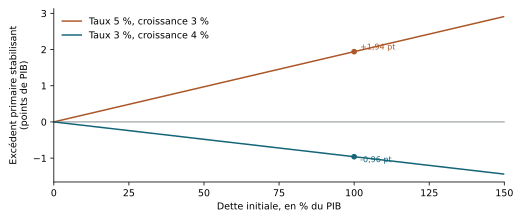
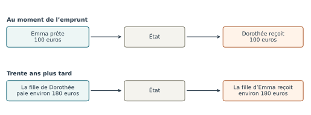

# ENS B/L · Économie, oral commun 2025 — L’équilibre budgétaire : une priorité ? · Corrigé guidé

*Corrigé rédigé par IA, non officiel. Signalez toute erreur.*

**Rédaction** · GPT-6.2 Astra Ultra · vitesse non renseignée · 26 novembre 2026

## Préparer les quinze minutes

Le jury prévoit 1 h 30 de préparation et quinze minutes d’entretien après l’exposé. La calculatrice est autorisée. Réserver quinze minutes à la distinction entre stock de dette, solde primaire et solde total. Pendant trente minutes, refaire l’équation et le schéma des transferts. En vingt-cinq minutes, classer les arguments selon le moment de l’ajustement, la composition du budget et le risque de refinancement. Conserver vingt minutes pour préparer puis répéter les transitions. À l’oral, compter deux minutes pour l’ouverture, quatre pour la dynamique, cinq pour les arbitrages et quatre pour les choix de trajectoire et la conclusion.

## Quel équilibre viser ?

En France, selon le Conseil d’analyse économique (document 1), les administrations publiques ont perçu en 2023 l’équivalent de 51,5 % du PIB et dépensé 55 % du PIB avant paiement des intérêts. Le déficit primaire est donc de 3,5 points de PIB. Avec deux points de charges d’intérêt, le déficit total atteint 5,5 points. Que gagnerait-on à vouloir fermer immédiatement cet écart ? Le solde mesure un flux annuel, la dette un stock d’engagements accumulés. Le retour à l’équilibre annuel est un objectif possible. La capacité de financer durablement les politiques publiques, y compris lors du prochain choc, constitue un critère plus large. À quelles conditions le redressement des comptes doit-il l’emporter sur la stabilisation de l’activité ou le financement d’un investissement ?

## Le besoin de financement dépend du solde primaire, de la croissance et du taux d’intérêt

Notons $b_t$ la dette publique rapportée au PIB de l’année $t$, $s_t$ l’excédent primaire rapporté à ce même PIB, $r_t$ le taux d’intérêt nominal moyen sur l’encours antérieur et $g_t$ la croissance nominale du PIB. En l’absence d’ajustements entre flux et stock, l’État paie les intérêts sur la dette héritée et déduit son excédent primaire de son besoin d’emprunt. En divisant chaque terme par le PIB de l’année, on obtient

$$
b_t-b_{t-1}=\frac{r_t-g_t}{1+g_t}\,b_{t-1}-s_t.
$$

Pour stabiliser le ratio, il faut donc un excédent primaire égal au premier terme de droite, qui peut lui-même être négatif. Reprenons les valeurs du document 4 en précisant l’hypothèse souvent implicite d’une dette initiale de 100 % du PIB. Avec un taux de 5 % et une croissance de 3 %, l’excédent stabilisant vaut environ 1,94 point de PIB. Si la dette initiale valait 50 % du PIB, il suffirait d’environ 0,97 point. Inversement, avec un taux de 3 % et une croissance de 4 %, un déficit primaire de près de 0,96 point stabiliserait le premier ratio. Un budget global équilibré gèlerait le stock nominal en l’absence d’ajustements, et la croissance nominale ferait alors baisser le ratio.

Rien n’assure que le différentiel favorable se maintienne. Dans le document 2, le taux à dix ans moins la croissance nominale vaut −5,1 points en France en 1967. Il devient positif pendant une partie des années 1980 et 1990. Le taux à dix ans auquel on peut émettre et le taux moyen déjà servi sur tout le stock se rapprochent au fil des refinancements. Ils peuvent sensiblement diverger à court terme. Les graphiques de dettes brutes et de soldes primaires montrent les perturbations des crises de 2008 et de 2020. Un fort déficit lors d’une récession et une chute du PIB peuvent ensemble pousser le ratio à la hausse. La note du document 2 donne un déficit primaire français de 3,7 % en 2023, avec des prévisions en fin de série. Le document 1, publié plus tard, donne 3,5 %. On utilisera une même source pour faire l’addition avec les intérêts.

**Reconstituer les signes.** Partir de 100 euros de dette et de 100 euros de PIB. À 5 % d’intérêt et avec un excédent primaire de deux euros, la nouvelle dette nominale vaut 103 euros. Si le PIB passe lui aussi à 103 euros, le ratio est inchangé. Les deux euros représentent précisément 1,94 % du nouveau PIB.

## Comparer le coût de l’emprunt à celui de son abandon ou de son report

Un État peut renouveler les titres qui arrivent à échéance. Sa faculté de lever l’impôt et la durée de son existence rendent cette opération ordinaire, sous réserve de trouver des prêteurs et de rester solvable. Thomas Philippon discute en 2019 l’analyse de Blanchard (document 4). Quand la croissance dépasse durablement le taux d’intérêt, la même charge nominale est répartie sur une base fiscale grandissante. Des ressources peuvent alors aller à des investissements dont bénéficient aussi les générations suivantes. À l’inverse, une prime de risque, un choc de croissance ou le renouvellement d’une dette arrivant rapidement à échéance peuvent durcir la contrainte. Une règle d’équilibre annuel peut amplifier une récession si une hausse d’impôts ou une coupe de dépenses diminue le revenu et les recettes au moment où le secteur privé réduit déjà sa demande.

Qui porterait la charge d’un emprunt ? Dans l’exemple de Xavier Ragot (document 3), Emma prête 100 euros à l’État. Dorothée reçoit et dépense un transfert de même montant. Trente ans plus tard, la fille d’Emma hérite d’une créance d’environ 180 euros. Dans le scénario retenu, la fille de Dorothée paie l’impôt qui rembourse la première. Les gagnants et perdants se répartissent aussi à l’intérieur de chaque génération. Si la dette est détenue à l’étranger, une partie du paiement sort du revenu national disponible. Même avec des créanciers résidents, l’impôt peut modifier les décisions de travail ou d’investissement. Il faut donc examiner qui prête, qui reçoit, qui sera taxé et ce que l’emprunt finance.

Les effets sur le capital transmis dépendent du contexte. Près du plein emploi, la demande publique de financement peut renchérir le crédit et évincer un investissement privé. L’équivalence ricardienne suppose notamment des ménages anticipant les impôts futurs et capables d’épargner en conséquence. En sous-emploi, une commande publique peut au contraire soutenir les ventes et susciter des investissements complémentaires. Ragot cite une estimation moyenne de trois à quatre points de base de taux pour un point de dette supplémentaire rapportée au PIB. Avec trente points de dette en plus, l’ordre de grandeur serait un point de taux, toutes choses égales par ailleurs. Or le taux réel observé est passé de 2,8 à 0,8 % dans l’exemple. La hausse de l’épargne mondiale a pu dominer cet effet partiel. Cette baisse observée n’identifie pas ce qu’aurait été le taux sans dette supplémentaire.

**Séparer le transfert et l’investissement.** Sur le schéma, faire nommer par le jury la personne qui possède le titre dans trente ans, puis celle qui paie l’impôt. Modifier ensuite une seule hypothèse. Si l’emprunt finance une infrastructure rentable, aux transferts entre personnes s’ajoute un effet sur les ressources futures.

## Établir une trajectoire selon la conjoncture, la qualité des dépenses et les risques

Le document 1 chiffre trois pressions relativement à 2023. En 2030, le vieillissement, la transition verte et la défense augmenteraient ensemble le déficit primaire de 1,8 point de PIB dans le scénario optimiste et de plus de 3,3 points dans le pessimiste. En 2070, les impacts combinés seraient respectivement −0,2 et +3,7 points. Il s’agit d’écarts de scénario. Les ajouter sans justification à un futur déficit de référence reviendrait à tenir toutes les autres recettes et dépenses pour constantes. Pour les retraites par répartition, l’indexation de droits sur les prix signifie qu’une croissance plus lente de la productivité et des salaires alourdit le poids relatif des pensions. Pour la transition, reporter un investissement avantageux allège le flux de dépenses présent, mais peut renchérir l’adaptation future.

Une trajectoire crédible distingue donc les déficits temporaires de récession des écarts persistants à politique inchangée. Elle évalue les investissements d’après leur rendement social, y compris les dommages évités, et teste la sensibilité des charges d’intérêt à un taux plus haut. Lorsque l’activité est solide, contenir des dépenses peu efficaces ou élargir des assiettes fiscales réserve une marge pour les chocs futurs. Reste à discuter publiquement les pertes de revenu ou de service que supportent différents ménages. L’équilibre annuel peut devenir une étape d’assainissement. La priorité économique est de maintenir la capacité d’action dans le temps, en confrontant le coût d’un ajustement aujourd’hui aux risques que créerait son report.

**Lire un scénario.** Sous l’hypothèse pessimiste à l’horizon 2070, les contributions au déficit primaire supplémentaire sont de 1,7 point pour le vieillissement, un point pour la transition et un point pour la défense. Les 3,7 points sont une somme de contributions, exprimée relativement à 2023.

## Relances du jury

**Un déficit total peut-il coexister avec une dette stable en proportion du PIB ?** Oui. Dans l’exemple numérique, l’État ajoute trois euros à sa dette, ce qui constitue un déficit total. Comme le PIB augmente dans la même proportion, le ratio reste stable.

**Un taux à dix ans plus élevé se retrouve-t-il aussitôt dans toute la charge ?** Les anciennes obligations à taux fixe conservent leur coupon. Le coût moyen évolue à mesure des échéances et des nouvelles émissions. Une maturité longue ralentit la transmission.

**Comment arbitrer entre deux réductions de dépenses du même montant ?** Comparer leur effet immédiat sur la demande, le rendement social futur des programmes, les groupes touchés et l’existence d’une solution moins coûteuse. Une économie budgétaire identique la première année peut produire des trajectoires très différentes.

[Dossier officiel, pages 1 à 10 du recueil](https://www.ens.psl.eu/sites/default/files/economie_sujets_25_juin.pdf#page=1) · [Rapport du jury de l’oral commun d’économie](https://www.ens.psl.eu/sites/default/files/2025_bl_rapport_oral_economie_tronc_commun.pdf)
