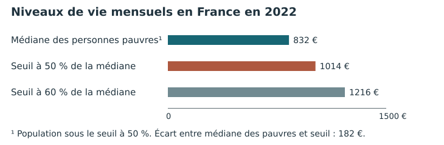
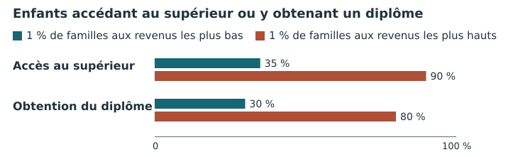

# BEL B/L — La lutte contre la pauvreté · Corrigé guidé

*Corrigé rédigé par IA, non officiel.*

**Rédaction** · GPT-6.2 Astra Ultra · vitesse non renseignée

Épreuve orale commune d’économie de la session 2025. Le jury prévoit 1 h 30 de préparation, quinze minutes d’exposé et quinze minutes d’entretien. Les questions de discussion ci-dessous sont proposées pour l’entraînement.

## Introduction

> [!INDICATION]
> Pendant la préparation, dresser une colonne pour les mesures de la pauvreté, une pour les mécanismes qui la font durer et une pour les interventions évaluées. Revenir à ces trois colonnes pour formuler la question économique.

En France, en 2022, le seuil de pauvreté à 50 % du niveau de vie médian s’établit à 1 014 euros mensuels pour une personne seule. La moitié des personnes sous ce seuil dispose de moins de 832 euros. Une politique qui augmente leurs ressources peut donc améliorer concrètement leur situation avant même de leur faire franchir la ligne statistique. Faut-il voir dans cette intervention le prix à payer pour davantage d’équité, ou peut-elle aussi permettre un meilleur usage des ressources ? La réponse dépend de ce qui entretient la pauvreté et de la capacité des dispositifs à atteindre les ménages concernés. Je partirai de ce que l’on mesure en France, puis des investissements auxquels certains ménages doivent renoncer, pour examiner enfin ce qui rend une intervention effective.

## I. Une mesure relative éclaire le choix du public et de l’objectif

> [!INDICATION]
> Relever dans le document 2 un seuil en euros, un taux au sein d’un groupe et une part de ce groupe parmi les pauvres. Pour chaque statistique, nommer l’année et les personnes au dénominateur.

Le niveau de vie est le revenu disponible du ménage après prélèvements directs et prestations, rapporté à ses unités de consommation. On tient ainsi compte du partage de certaines dépenses dans un ménage. La médiane partage la population en deux moitiés. Le document 2 compte 8,1 % des personnes sous la moitié de cette médiane en 2022. Porter le seuil à 60 % revient à compter les personnes jusqu’à 1 216 euros et accroît mécaniquement le taux de pauvreté. Il faut garder le même seuil relatif et tenir compte des ruptures de série pour comparer les années. Depuis le point bas de 2002, l’Observatoire fait état de 1,4 million de personnes pauvres supplémentaires et d’une hausse de 1,5 point en vingt ans. Le nombre peut croître aussi parce que la population totale augmente.

Le montant médian de 832 euros parmi les personnes pauvres permet de compléter le taux. L’écart au seuil de 1 014 euros est de 182 euros, soit une intensité de la pauvreté d’environ 18 %. Donner une petite somme à un ménage très loin du seuil peut diminuer cet écart tout en laissant le taux inchangé. Une politique jugée uniquement au nombre de franchissements aurait intérêt à cibler les ménages juste sous le seuil, même si la privation est plus forte ailleurs. L’échelle du document 2 mêle par ailleurs des niveaux de vie de 2022 et des montants de minima sociaux de 2024. Comparer une prestation individuelle à un niveau de vie exige de connaître toutes les ressources et la composition du ménage.

Les risques sont inégalement répartis. Au seuil de 50 %, 24,5 % des chômeurs sont pauvres, contre 8,1 % dans toute la population en 2022. Dans le tableau de 2021 sur les 15 ans ou plus hors étudiants, 13,2 % des personnes sans diplôme ou avec le seul certificat d’études sont pauvres, et celles-ci représentent 32,2 % des personnes pauvres. La fréquence au sein du groupe et le poids du groupe dans la pauvreté répondent à deux questions distinctes. Orienter une aide vers un groupe au taux élevé peut laisser de côté beaucoup de ménages modestes appartenant à d’autres groupes.

## II. Le manque de ressources d’aujourd’hui peut réduire le revenu de demain

> [!INDICATION]
> Construire une chaîne de trois étapes à partir d’un exemple de formation. Préciser ce qu’un marché du crédit complet permettrait et identifier l’obstacle qui empêche le financement. Demander ensuite quelle variable du document 3 pourrait refléter cette chaîne.

Stefan Dercon (document 1) repart des théorèmes du bien-être. Sous des hypothèses fortes de concurrence et de marchés complets, un équilibre peut être efficace au sens de Pareto. L’efficacité ainsi définie est compatible avec une grande inégalité initiale. Sous des conditions supplémentaires, notamment de convexité, des transferts forfaitaires de dotations permettraient de choisir une autre allocation efficace, mise en œuvre par les marchés. Dans la pratique, l’impôt et les prestations peuvent modifier des décisions. Surtout, la situation de départ comporte déjà des pertes d’efficacité. Un jeune pour qui une formation serait rentable peut manquer d’argent pour se loger pendant ses études. Une banque qui connaît mal ses perspectives et ne peut prendre ses revenus futurs comme garantie risque de ne pas lui prêter. L’économie se prive alors d’une qualification productive.

Les imperfections d’assurance aggravent ce mécanisme. Si un accident ou une perte d’emploi impose de vendre un équipement de travail, une difficulté transitoire réduit les revenus futurs. À l’échelle locale, la faiblesse de l’offre de transport ou d’enseignement peut limiter le rendement des initiatives individuelles. Le manque d’actifs et ces défaillances se renforcent. Une aide à la formation, une assurance ou un investissement public local peut alors augmenter à la fois les possibilités de la personne et la richesse produite. Le coût d’un programme, son financement et la valeur des projets effectivement rendus possibles demeurent à mesurer.

Les travaux de l’IPP (document 3) montrent l’ampleur des écarts liés à l’origine. Dans les cohortes françaises étudiées, environ 35 % des enfants des 1 % de familles aux plus faibles revenus accèdent au supérieur, contre 90 % à l’autre extrémité. Pour l’obtention du diplôme, les ordres de grandeur sont 30 et 80 %. La comparaison américaine porte sur des cohortes différentes et fait également apparaître un lien avec le revenu parental. L’écart français de diplôme observé inclut tout le parcours antérieur au baccalauréat, l’information et la possibilité matérielle de poursuivre. Il ne donne pas l’effet causal d’une bourse.

La géographie donne une autre piste. À parents situés au 25e centile des revenus, les personnes vivant à l’âge adulte hors de leur département d’enfance atteignent en moyenne le 49e centile, contre le 43e pour celles qui y vivent toujours. L’écart est de six rangs centiles moyens. Partir peut faciliter l’accès à un emploi, mais obtenir une offre d’emploi peut aussi déclencher le déménagement. Les ressources et les diplômes peuvent jouer sur les deux. On peut donc proposer une aide à la mobilité en précisant l’hypothèse à tester et le groupe de comparaison nécessaire.

## III. Le barème, le recours et les effets dans le temps

> [!INDICATION]
> Opposer deux mécanismes temporels du document 5 en répondant à deux questions. Combien reste-t-il aujourd’hui d’un euro gagné ? Quel investissement deviendra possible demain ? Utiliser le document 4 pour vérifier à quelle condition l’aide prévue entre vraiment dans le budget.

Guillaume Allègre discute deux usages du mot « trappe » (document 5). Avec l’ancien RMI différentiel, un euro de revenu d’activité supplémentaire pouvait être compensé par un euro de prestation en moins. Le gain monétaire immédiat à reprendre un petit emploi pouvait alors être nul. Dans certaines configurations, le passage au RSA aurait ramené le taux marginal effectif de 100 % à 32 %, laissant 68 centimes d’un euro supplémentaire avant d’éventuels frais. Une contrainte budgétaire modifiée ne suffit pas à prévoir une reprise d’emploi. Encore faut-il une offre accessible, des horaires compatibles et une solution de transport ou de garde. L’auteur souligne la difficulté d’établir une réponse comportementale à partir du seul barème.

L’autre trappe est dynamique. Une longue période de faibles revenus peut détériorer le logement ou la santé et empêcher la recherche d’un emploi. Sécuriser le revenu libère alors une capacité d’investissement. Revaloriser une prestation, financer un service de proximité ou réduire progressivement les aides lors d’une reprise d’emploi agissent sur des contraintes différentes. Réduire le rythme de retrait améliore le gain marginal d’activité, au prix d’un versement à des ménages plus nombreux ou d’une autre source de financement. Une évaluation regarderait le revenu disponible immédiat, puis l’accès aux soins, à la formation et à l’emploi dans la durée.

Encore faut-il toucher la prestation. Castell et ses coauteurs étudient quinze prestations dans deux expériences françaises auprès de demandeurs d’emploi (document 4). Les personnes ayant bénéficié d’une rencontre d’information et d’aide aux démarches ont une probabilité de recours à une nouvelle prestation supérieure de 31 % en termes relatifs. L’effet se concentre sur des formulaires complexes pour lesquels le professionnel pouvait aider directement. Le simulateur en ligne produit dans la seconde expérience un effet plus faible et statistiquement non significatif. Ces résultats rendent crédible le rôle du temps, des pièces et des erreurs de dossier. La stigmatisation reste une autre explication possible. Les personnes les moins enclines à venir au rendez-vous semblent en retirer davantage à la marge. Une invitation facilement accessible et une assistance humaine peuvent donc compter autant que l’existence du droit.

## Conclusion

> [!INDICATION]
> Donner un critère de réussite à court terme et un autre à long terme. Pour chacun, préciser ce qui serait arrivé aux mêmes personnes sans intervention.

Lutter contre la pauvreté consiste à garantir des conditions de vie et à permettre des choix qu’un manque de ressources rend impossibles. L’objectif d’équité suffit à justifier une préférence collective pour cette garantie. L’efficacité peut elle aussi y gagner si une intervention corrige un défaut de crédit, d’assurance ou d’accès aux droits. Pour choisir les instruments, on mesurera la distance au seuil et le recours effectif aussi bien que les transitions vers la formation et l’emploi, en comparant les trajectoires à celles d’un groupe crédiblement comparable.

## Discussion avec le jury

> [!INDICATION]
> Refaire le calcul d’intensité sans lire le texte. Pour l’expérience, choisir un taux initial hypothétique et calculer successivement une hausse relative de 31 % et une hausse de 31 points.

**Que signifie une hausse de recours de 31 % ?** Si, à titre d’illustration, 20 personnes sur 100 ouvrent une nouvelle prestation dans la situation de référence, une hausse relative de 31 % conduit à 26,2 sur 100. L’augmentation vaut alors 6,2 points. Le taux initial de 20 % est fictif et la comparaison entre expériences ne permet pas d’isoler parfaitement chaque composante de l’entretien.

**Un transfert peut-il améliorer le sort des ménages pauvres tout en maintenant le taux de pauvreté ?** Oui. Si aucune personne ne franchit le seuil, l’incidence reste la même, mais les ressources et l’intensité de la pauvreté peuvent s’améliorer. Si tous les niveaux de vie doublent et que les prix restent identiques, le seuil relatif double aussi et les positions relatives sont conservées.

**Pourquoi s’intéresser aux externalités ?** Une meilleure desserte d’un quartier peut faciliter l’accès à l’emploi de plusieurs habitants et élargir le recrutement des entreprises. Un ménage isolé ne prendrait pas en charge l’intégralité du coût d’un équipement bénéficiant à d’autres. On comparera les gains sociaux aux coûts de construction, de fonctionnement et de financement.

**Comment tester l’effet d’une aide à la mobilité ?** Un déploiement progressif réparti par tirage au sort entre territoires comparables permettrait de comparer les offres acceptées, les revenus et les coûts de logement. On examinerait aussi les pertes éventuelles d’appui familial, les délais d’ajustement et les effets sur les territoires de départ.
