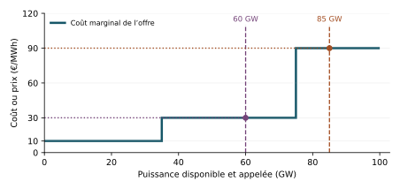
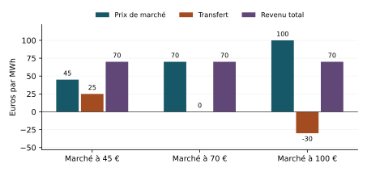

# Le marché européen de l’électricité : efficacité de court terme, défis de long terme · Corrigé brut

*Corrigé rédigé par IA, non officiel. Signalez toute erreur.*

**Rédaction** · GPT-6.2 Astra Ultra · vitesse non renseignée · 26 novembre 2026

ENS, filière B/L · Épreuve orale commune d’économie, session 2025.

## Introduction

Une éolienne produit à coût variable très faible. Pourtant, lorsque souffle le vent, un client européen peut encore payer une électricité dont le prix de gros dépend du gaz. Et quelques heures plus tard le même marché peut afficher un prix négatif. Ces situations paraissent déconcertantes si l’on attend un prix unique capable de rémunérer un investissement sur trente ans, d’assurer l’équilibre électrique de l’heure à venir et de rendre la facture prévisible pour les consommateurs.

L’électricité se stocke avec des contraintes de coût, de capacité et de durée. Production et consommation doivent être équilibrées en permanence. Le marché de gros organise les échanges entre producteurs et fournisseurs, lesquels vendent ensuite aux ménages et aux entreprises sur le marché de détail. Quelles tâches peut-on confier au prix de court terme et de quels engagements supplémentaires l’investissement bas-carbone a-t-il besoin ? Le dossier permet de partir du fonctionnement de l’échange, d’en examiner les risques et de tester les solutions sur deux nouveaux usages, le transport routier et l’informatique.

## I. Un prix pour équilibrer l’offre et la demande à un instant donné

### Pourquoi le coût de la dernière unité appelée importe

La note du Conseil d’analyse économique (document 1, mars 2023) décrit les marchés de la veille pour le lendemain et les ajustements dans la journée. Les capacités disponibles définissent l’offre à une échéance donnée. Dans le modèle concurrentiel simplifié, on classe les unités par coût marginal croissant, c’est-à-dire le coût d’un MWh supplémentaire compte tenu des équipements déjà disponibles. On appelle successivement les unités jusqu’à couvrir la demande. Le prix du MWh est déterminé par l’unité marginale et vaut pour toutes les unités acceptées dans la zone de prix. Cette règle permet, sous les hypothèses de concurrence et de contraintes correctement prises en compte, de satisfaire la demande prévue au moindre coût variable total.

Dans le graphique du document 1, les largeurs des blocs représentent des puissances, leurs hauteurs des coûts par unité d’énergie. Le gaz fixe le prix dans l’exemple parce que la capacité appelée doit aller jusque-là dans l’ordre de mérite. Aux heures où des moyens moins coûteux suffisent, le gaz peut rester à l’arrêt. Une unité qui produit à un coût inférieur au prix perçoit une rente inframarginale par MWh. Une partie de cette marge contribue à couvrir l’entretien fixe, le capital et son financement. On ne peut conclure à un profit net en observant la seule différence entre le prix horaire et le coût variable.

Sur la figure proposée, à une demande de 60 GW, des moyens dont le coût variable est de 30 €/MWh suffisent. À 85 GW, il faut recourir aussi à une unité à 90 €/MWh. Faire produire un MWh supplémentaire à cette heure coûte donc 90 euros dans ce modèle. Une demande capable de déplacer certaines consommations vers une autre heure évite un coût au système. Les prix de détail peuvent pourtant réagir avec retard ou être contractuellement lissés. Une facture comprend aussi les réseaux, les taxes et les conditions du contrat de fourniture.

### L’interconnexion mutualise des capacités sous contrainte

Les bourses sont couplées dans les limites des interconnexions. Deux zones disposant de marges d’échange peuvent utiliser des moyens disponibles chez le voisin pour remplacer des unités nationales coûteuses. Si l’interconnexion sature, les prix des zones peuvent diverger. Dans le document 2 du Cercle des économistes (octobre 2023), Katheline Schubert invoque l’hiver 2022, marqué en France par une disponibilité nucléaire réduite. À ses yeux, les importations ont contribué à éviter le rationnement. Le bénéfice de l’intégration ne se déduit donc pas du coût moyen du parc national une année normale. La comparaison pertinente inclut les périodes où des capacités complémentaires sont nécessaires.

## II. Ce que le prix de gros laisse à financer et à assurer

### Comment un prix peut devenir négatif

Dans le document 3 (juin 2024), Dominique Finon rapporte que, certains jours des trois mois précédents, des prix négatifs ont alterné avec des prix supérieurs à 100 €/MWh. À une heure de forte production éolienne ou solaire et de faible demande, une unité peu flexible peut accepter de payer momentanément pour produire si arrêter puis redémarrer lui coûte davantage. Les contraintes du réseau peuvent également empêcher d’écouler une production locale. Le gestionnaire peut demander un écrêtement, c’est-à-dire réduire temporairement l’injection. Un prix négatif de gros ne signifie donc ni que produire et transporter le courant est toujours gratuit, ni que le tarif final devient négatif pour tous les ménages.

Finon souligne un problème de financement. Un moyen de pointe ou de flexibilité peut être indispensable durant quelques heures seulement, alors que sa construction exige un investissement initial et que sa recette future est incertaine. Sur le papier, certains modèles permettent de couvrir les coûts fixes grâce aux prix de rareté et aux rentes attendues. En pratique, les prix futurs, le nombre d’heures d’utilisation, les règles publiques et la concurrence d’autres moyens sont incertains. C’est sur la capacité de ces revenus à financer à temps les équipements jugés nécessaires que porte la contestation de l’auteur. Une batterie peut acheter lors d’une abondance et restituer lors d’une pointe, mais elle supporte des pertes et des coûts de capacité. Un contrat rémunérant sa disponibilité apporte une recette distincte de la vente de MWh. Le foisonnement géographique des productions et la modulation de la demande peuvent également réduire les besoins de pointe.

### Deux manières de partager le risque

Les documents 1 et 2 présentent le contrat pour différence bidirectionnel. Le producteur vend son électricité sur le marché. Dans un exemple simple où prix de vente et prix de référence coïncident, si le prix de référence est inférieur au prix d’exercice, la contrepartie publique verse la différence. Dans la situation inverse, le producteur reverse l’excédent. Avec un prix d’exercice de 70 €/MWh et un prix de marché de 45, le complément vaut 25 €/MWh. À 100, le reversement est de 30 €/MWh. Le revenu unitaire se stabilise pour la production couverte. Les décisions réelles de conception portent notamment sur le volume garanti, le prix de référence, l’exposition aux heures négatives et la durée.

Le contrat privé de long terme, ou PPA, engage un producteur et un acheteur. Les deux peuvent gagner en prévisibilité, mais le risque de défaillance de la contrepartie ou d’écart entre production et consommation subsiste. Le document 1 évoque des garanties de quinze à vingt ans pour certains contrats pour différence. Le document 2 situe en 2023 le débat sur l’éligibilité du nucléaire existant. Une centrale déjà amortie peut nécessiter de nouveaux investissements de prolongation. Un appel d’offres et des règles publiques transparentes peuvent limiter une garantie excessive. Il faut déterminer qui supporte le risque si les prix durables sont plus bas que prévu et qui bénéficie des reversements lorsque le prix de référence dépasse le prix d’exercice.

## III. L’investissement dépend aussi des usages que l’on veut satisfaire

### Le fret routier illustre un problème de coordination

Dans le document 4, la note franco-allemande du CAE et du GCEE (mars 2025) relie la décarbonation du fret routier aux camions à batterie et au déploiement des bornes. La figure de l’Agence européenne pour l’environnement empile les contributions des modes de transport aux **émissions totales de gaz à effet de serre de l’UE-27**. La route est la couche la plus importante. La hauteur totale, proche de 30 % sur une partie de la projection, représente le poids de l’ensemble des transports dans les émissions totales. Cette part relative pourrait monter alors même que les émissions du transport baissent, si celles des autres secteurs diminuent plus vite. La rupture à partir de 2023 sépare observations et projections reposant sur les scénarios explicités dans la note. Le graphique ne fournit pas à lui seul une comparaison du cycle de vie d’un camion diesel et d’un camion électrique.

Un transporteur hésitera à acheter un camion électrique si les tournées ne peuvent être couvertes avec les bornes attendues. Un investisseur en bornes hésitera si trop peu de camions les utilisent. Cet effet de complémentarité peut bloquer des investissements pourtant souhaitables ensemble. La note propose un soutien ciblé au démarrage et de la recherche sur les batteries et la recharge. L’efficacité de ce soutien dépend de l’usage attendu, du calendrier de raccordement et des alternatives comme le report modal ou l’amélioration logistique. Des tarifs qui encouragent la recharge des flottes à des heures moins tendues peuvent diminuer le coût de réseau et d’approvisionnement tout en préservant la prévisibilité du prix moyen.

### L’informatique illustre le risque d’une demande mal anticipée

L’entretien avec Anne-Laure Ligozat et Alex de Vries (document 5, novembre 2024) présente une consommation mondiale de 460 TWh en 2022 pour l’ensemble « centres de données, cryptomonnaies et IA », soit près de 2 % selon les chiffres cités. La comparaison avec la consommation française de 445 TWh en 2023 sert d’ordre de grandeur. Le premier périmètre couvre plusieurs usages mondiaux et le second tout un pays l’année suivante. Pour 2026, l’augmentation anticipée du premier ensemble est comprise entre 160 et 590 TWh par rapport à 2022. En additionnant la base, on obtient un intervalle illustratif de 620 à 1 050 TWh, sous les hypothèses de la projection. L’estimation de 85 à 134 TWh annuels en 2027 pour certains serveurs dédiés à l’IA porte sur un autre champ et dépend des capacités de production annoncées.

Un centre de données peut consommer moins d’énergie par calcul tout en consommant davantage au total si le nombre de calculs augmente suffisamment. C’est l’effet rebond. Il ne suffit pas de connaître les TWh annuels pour préparer le raccordement. La puissance appelée localement aux heures de pointe, les délais de construction du réseau, l’eau nécessaire au refroidissement et les émissions associées aux équipements entrent aussi dans le bilan. D’où l’intérêt de préparer plusieurs scénarios, d’examiner les usages flexibles et de faire supporter aux décisions de localisation une partie des coûts qu’elles imposent au réseau.

## Conclusion

Le prix de court terme a une fonction précise. Il oriente la mobilisation des moyens disponibles et fournit une information sur la rareté du MWh à l’heure considérée. Le financement et l’assurance des capacités futures appellent des engagements à plus long terme, publics ou privés, dont les règles répartissent le risque. L’enjeu européen consiste à combiner l’équilibre de chaque heure, la solidarité permise par les interconnexions et des décisions crédibles sur les équipements et usages à financer.

## Sources

Le fascicule officiel du 24 juin contient trois dossiers. Celui-ci occupe les pages 20 à 27. [Dossier du jury](<https://www.ens.psl.eu/sites/default/files/sujet_dossiers_24_juin_economie.pdf#page=20>)

Document 1. Conseil d’analyse économique, note 76, mars 2023, adaptation du dossier. Pages 21 à 22 du fascicule.

Document 2. Schubert, Le Cercle des économistes, octobre 2023. Page 23 du fascicule.

Document 3. Finon, blog Sciences², Le Monde, juin 2024. Pages 24 à 25 du fascicule.

Document 4. CAE et GCEE, mars 2025, figure Agence européenne pour l’environnement 2024. Page 26 du fascicule.

Document 5. Ligozat et de Vries, entretien Polytechnique Insights, novembre 2024. Page 27 du fascicule.

Nina Guyon et Sandra Poncet présentent les conditions de l’épreuve et les attentes du jury. La liste de la deuxième page confirme le sujet. [Rapport du jury](<https://www.ens.psl.eu/sites/default/files/2025_bl_rapport_oral_economie_tronc_commun.pdf>)
