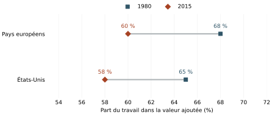
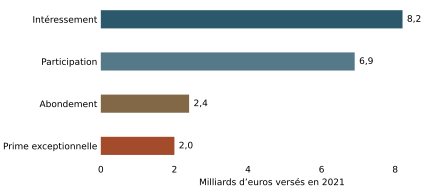

# BEL B/L · Épreuve orale commune d’économie 2025 · Le partage de la valeur ajoutée · Corrigé guidé

*Corrigé rédigé par IA, non officiel. Signalez toute erreur.*

**Rédaction** · GPT-6.2 Astra Ultra · vitesse non renseignée · 26 novembre 2026

## Préparer le commentaire économique

Le jury accorde une heure et demie de préparation avec calculatrice. Le passage comprend quinze minutes d’exposé et quinze minutes d’entretien. Pour l’exposé, on peut réserver deux minutes à l’introduction, quatre minutes à chacune des trois parties et une minute à la conclusion. Pendant la préparation, rédigez une phrase de lecture pour chaque graphique et entraînez-vous à expliquer les mécanismes sans lire vos notes.

## Introduction

Entre 2009 et 2016, les sociétés du CAC 40 ont versé à leurs actionnaires 67 % de leurs bénéfices selon l’étude citée par le document 1. Peut-on en conclure que les salariés se sont partagé tout au plus un tiers de ce qu’ils ont produit ? Les salaires ordinaires ont déjà été versés lorsque l’on mesure le bénéfice. Un dividende élevé soulève une question sur l’emploi des profits, sans donner directement la part des salaires dans la richesse créée.

Comment expliquer l’évolution de cette part et que peuvent changer les dispositifs qui associent les salariés aux résultats de leur entreprise ? Les documents 1 et 2 comparent l’Europe, les États-Unis et plusieurs trajectoires nationales. La note du Conseil d’analyse économique (CAE, 2023) et la synthèse de France Stratégie (2025) permettent ensuite de passer du partage comptable aux effets des instruments français. Il faut d’abord choisir l’indicateur pertinent, puis identifier les mécanismes susceptibles de le déplacer, enfin examiner qui gagne effectivement à un versement supplémentaire.

## I. Mesurer le partage suppose de choisir la richesse et les revenus que l’on compare

> [!INDICATION]
> Écrivez les deux fractions « dividendes / bénéfice » et « rémunération du travail / valeur ajoutée ». Pour chaque chiffre des documents 1 et 2, reportez au brouillon le pays, les dates et le dénominateur.

La valeur ajoutée (VA) est la valeur de la production diminuée des consommations intermédiaires. Retrancher les composants achetés à un fournisseur évite de compter deux fois la même production. Pour une société, la valeur ajoutée brute se répartit au compte d’exploitation entre rémunération des salariés, impôts sur la production nets des subventions correspondantes et excédent brut d’exploitation. La rémunération comprend les salaires et les cotisations sociales à la charge des employeurs. L’excédent est mesuré avant consommation de capital fixe. Une partie doit permettre le renouvellement du capital usé. Le dividende intervient encore en aval, après d’autres opérations telles que les paiements d’intérêts et d’impôts sur les bénéfices. Une entreprise peut distribuer davantage à bénéfice donné en puisant moins dans ses résultats pour financer ses projets. Elle peut aussi distribuer davantage parce que ses bénéfices ont augmenté.

Le document 1 juxtapose les 67 % des bénéfices du CAC 40 aux 91 % d’une étude sur le S&P 500. Ces grandes sociétés cotées forment des sélections. Ni ces pourcentages ni l’écart entre eux ne donnent un taux de marge national. Pour suivre le partage fonctionnel des revenus entre travail et capital, Piton et Vatan rapportent le revenu attribué au travail à la valeur ajoutée. De 1980 à 2015, leur série passe de 68 % à 60 % dans les pays européens considérés, et de 65 % à 58 % aux États-Unis. Les baisses atteignent respectivement 8 et 7 points. Une baisse de part peut coexister avec une hausse du revenu du travail si la richesse totale augmente assez vite. Par exemple, sur une VA passant de 100 à 120, une part de 60 % donne 72, contre 68 initialement.

Le document 2 change la période et l’agrégat. Entre 1991 et 2013, les salaires rapportés au PIB reculent d’environ 8 points en Espagne, d’environ 5 points aux États-Unis et très peu en France. Les barres mesurent une variation, sans indiquer quel pays offrait le niveau de départ le plus élevé. La quasi-stabilité française sur cet intervalle est compatible avec la baisse européenne sur une période plus longue. Le PIB aux prix du marché inclut aussi les impôts nets des subventions sur les produits, en plus de la somme des valeurs ajoutées. Le travail indépendant crée une difficulté supplémentaire. Le revenu mixte d’un artisan rémunère ses heures de travail et son capital. Dans une comparaison qui ne retient que les salaires au numérateur, le passage de l’indépendance au salariat peut faire monter la part mesurée alors même que les rémunérations changent peu.

## II. Technique, concurrence et institutions modifient la répartition des revenus primaires

> [!INDICATION]
> Partez de la masse salariale divisée par la valeur ajoutée. Formulez un mécanisme qui agit sur le numérateur, puis un mécanisme qui agit sur le dénominateur. Quelle observation permettrait de les départager ?

Soient une rémunération nominale moyenne par heure, le nombre d’heures salariées et une valeur ajoutée exprimée en euros. Multiplier les deux premières grandeurs puis diviser par la troisième fait apparaître la part salariale. À champ constant, cette part baisse si la rémunération horaire croît moins vite que la VA nominale par heure salariée. Pour comparer des évolutions réelles, il faut déflater les deux termes de façon cohérente. Le pouvoir d’achat calculé avec les prix à la consommation pose une question distincte du coût du travail rapporté au prix de la production.

Le document 1 avance une première hypothèse. Une machine peut remplacer certaines tâches, un logiciel permettre à la même équipe de servir davantage de clients. Si les entreprises substituent suffisamment de capital au travail lorsque son coût relatif baisse, une plus grande part de la valeur créée peut rémunérer ce capital. Lorsque capital et travail qualifié sont complémentaires, la technologie peut au contraire relever la productivité et la rémunération de certains salariés. La seule observation d’un investissement en robotique ne permet donc pas de prévoir le sens ni l’ampleur du mouvement agrégé. Une mutation sectorielle peut aussi augmenter le poids de secteurs à faible part salariale sans baisse de cette part à l’intérieur de chaque secteur.

Une deuxième hypothèse tient à la formation des prix et au partage des rentes. Une entreprise capable de maintenir un prix plus élevé par rapport au coût marginal peut dégager une marge accrue. La concentration peut également modifier les possibilités d’emploi alternatives et la négociation salariale. En sens inverse, un salaire minimum ou la négociation collective peuvent soutenir les rémunérations dans certains segments. Le document 2 mentionne le Smic, le poids des investisseurs institutionnels et les indépendants comme pistes pour comprendre la trajectoire française. Son graphique ne tranche pas entre elles. Il faudrait notamment suivre marges, salaires, structure sectorielle et statuts d’emploi sur une période et avec un périmètre communs. La pression des actionnaires peut peser sur les salaires ou sur l’investissement, mais augmenter la fraction distribuée d’un profit déjà réalisé ne modifie pas à elle seule la valeur ajoutée passée.

## III. Le montant versé aux salariés ne suffit pas à mesurer ce qui leur est transféré

> [!INDICATION]
> Avant de juger une prime de 100 euros, dites quel aurait été le salaire fixe sans le dispositif. Comparez ensuite votre raisonnement avec les résultats distincts du CAE pour la participation et pour l’intéressement.

Le document 3 distingue quatre dispositifs. La participation obligatoire relève d’une formule liée au bénéfice au-delà d’une rémunération conventionnelle des capitaux propres de 5 %. Dans la présentation simplifiée de la note, on prend la moitié de cet excédent positif et on applique la part de la masse salariale dans la VA. L’intéressement est lié à des objectifs de performance ou de résultats convenus dans l’entreprise. L’abondement est un complément de l’employeur à un dispositif d’épargne salariale. La prime de partage de la valeur (PPV) est une prime dont l’employeur peut décider le versement. Les modalités et les incitations fiscales diffèrent. Pour 2021, la note chiffre la prime exceptionnelle de pouvoir d’achat, qui précédait la PPV.

En 2021, les montants cités sont de 6,9 milliards d’euros de participation, 8,2 d’intéressement, 2,4 d’abondement et 2,0 de primes exceptionnelles, soit 19,5 milliards au total et un ordre de grandeur de 1 % du PIB. La distribution se concentre dans les entreprises grandes et rentables et bénéficie davantage aux salariés déjà les mieux payés. Modifier le partage capital-travail à l’intérieur d’une entreprise peut donc accroître les écarts de rémunération entre salariés de différentes entreprises. Pouvoir de négociation et composition des entreprises couvertes importent autant que la masse versée.

Le bon point de comparaison est la rémunération que le salarié aurait reçue sans le dispositif. Une prime de 100 euros accompagnée d’un salaire fixe inférieur de 70 euros au salaire qui aurait prévalu représente un gain brut de 30 euros. Une exonération portant sur toute la prime devient alors coûteuse par euro transféré. Le CAE estime, dans le scénario examiné, un coût public de 21 à 38 centimes par euro de profits effectivement redirigé vers les salariés. Ses analyses de la participation obligatoire ne décèlent ni substitution au salaire ni baisse de l’investissement, mais pas davantage de hausse de productivité. Les estimations relatives à l’intéressement et à la PPV suggèrent davantage de substitution. D’où la proposition d’adosser le dispositif à une formule commune liée aux profits, avec des paramètres négociables. La participation peut aussi déplacer une partie de la redistribution financée par l’impôt sur les sociétés.

Qu’attendre de l’effet incitatif ? Un salarié associé au résultat peut être incité à fournir davantage d’effort ou à mieux coopérer. Dans une grande équipe, son effort individuel pèse peu dans la prime collective. Une rémunération variable lui transfère par ailleurs une partie du risque conjoncturel qu’il supporte déjà par son emploi. Le document 4 fait état de gains de productivité dans de nombreuses études, mais aussi d’estimations nulles ou négatives. Les études portent surtout sur des entreprises et des horizons courts. Les entreprises qui choisissent l’intéressement peuvent déjà être plus productives. Un emploi gagné chez l’une peut correspondre à une part de marché perdue par un concurrent. Enfin, même pour une entreprise plus productive, les effets sur l’emploi diffèrent selon qu’elle baisse ses prix, investit ou distribue son résultat. Les estimations sur la participation obligatoire concernent un instrument et un contexte précis.

## Conclusion

Une part des bénéfices distribués, une part salariale nationale et une prime individuelle ont des dénominateurs et des conséquences différents. La baisse européenne de long terme et l’évolution française de 1991 à 2013 invitent à examiner simultanément choix productifs, concurrence, institutions salariales et mesure du travail indépendant. En France, le partage des profits peut relever le revenu de certains salariés. Son efficacité dépend de ce que le versement ajoute au salaire, de sa couverture et de son coût public. Les comparaisons disponibles étayent mieux ces conclusions au niveau des entreprises que leurs effets durables sur l’emploi et le partage agrégé.

## Questions possibles pour l’entretien

### Comment lire la baisse de la part du travail aux États-Unis ?

Le passage de 65 à 58 % correspond à 7 points de pourcentage. Rapportée au niveau initial, la baisse est de 7/65, soit environ 10,8 %. Si la VA en volume a suffisamment augmenté, le revenu réel total du travail peut avoir progressé durant cette période. Il faut encore connaître les effectifs et la dispersion pour se prononcer sur le salaire d’une catégorie précise.

### Comment fonctionne le seuil de la participation ?

Prenons un exemple simplifié. Le bénéfice pertinent est de 12 millions d’euros, les capitaux propres de 100 millions et le rapport entre masse salariale et VA de 60 %. La référence à 5 % des capitaux propres représente 5 millions. La moitié de l’excédent est de 3,5 millions. Multipliée par 0,60, elle donne une réserve de 2,1 millions. Fixer le bénéfice à 4 millions dans le même exemple ferait tomber la réserve calculée à zéro. Les notions fiscales précises de la formule légale doivent être distinguées de cet exercice.

### Pourquoi un coût fiscal élevé peut-il accompagner une petite prime nette de substitution ?

Un avantage fiscal porte sur le versement éligible, même si une partie remplace une hausse de salaire attendue. Si le coût public était de 12 euros et le transfert supplémentaire de 40 euros, le rapport serait de 30 centimes par euro transféré. C’est un exemple de calcul. Les 21 à 38 centimes du document 3 sont les estimations du CAE dans le cadre qu’il étudie.

### Une entreprise plus productive grâce à l’intéressement crée-t-elle forcément des emplois ?

À production donnée, une équipe plus productive peut produire avec moins d’heures. Des prix plus bas et une demande suffisamment élastique peuvent au contraire accroître la production et l’emploi. La croissance de la demande peut venir de clients gagnés sur des concurrents. Il faudrait donc observer les prix, la production et l’emploi de toutes les entreprises pertinentes, puis construire un scénario sans la réforme pour établir l’effet agrégé.
