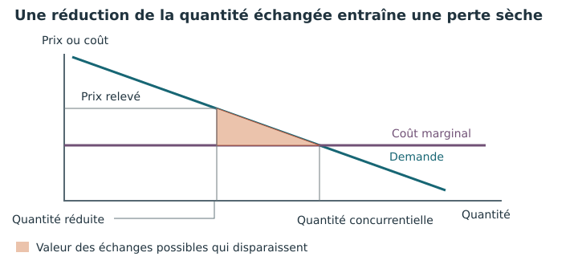
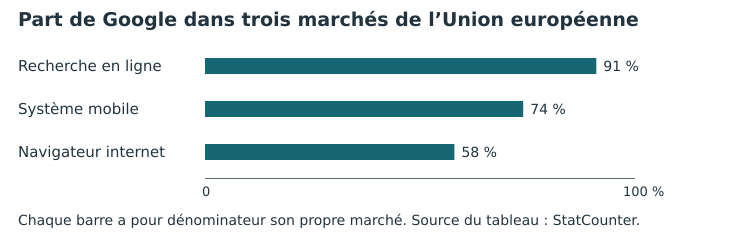
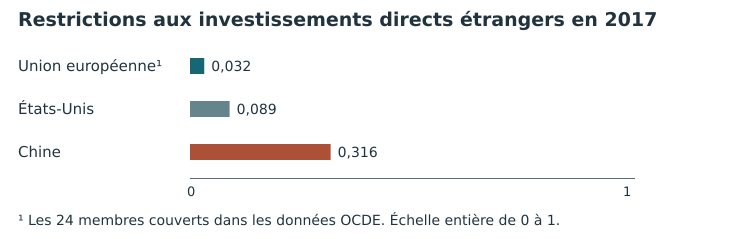

# BEL B/L — La politique de concurrence européenne face aux nouveaux défis · Corrigé guidé

*Corrigé rédigé par IA, non officiel.*

**Rédaction** · GPT-6.2 Astra Ultra · vitesse non renseignée

Épreuve orale commune d’économie de la session 2025. Le jury prévoit 1 h 30 de préparation, quinze minutes d’exposé et quinze minutes d’entretien. Les questions de discussion ci-dessous sont proposées pour l’entraînement.

## Introduction

> [!INDICATION]
> Partir du classement d’un service par un moteur de recherche. Identifier l’usager, l’entreprise qui cherche un client et la plateforme qui organise la rencontre. Cette situation fait apparaître le problème avant de nommer l’instrument européen.

Un moteur de recherche peut rendre un service précieux en aidant des acheteurs à trouver des vendeurs. Si la même entreprise vend aussi un service concurrent, l’ordre des résultats influe sur les chances de ses rivaux d’atteindre ces acheteurs. Un prix d’utilisation nul peut ainsi coexister avec un pouvoir de marché important. Le dossier pose une question qui dépasse le numérique. Comment maintenir la possibilité d’entrer et d’innover dans le marché intérieur lorsque la grande taille peut à la fois réduire les coûts et protéger une entreprise de la concurrence ? Il faut d’abord comprendre ce que l’Union cherche à préserver et à mesurer, puis examiner le cas des plateformes et enfin les tensions entre intégration, ouverture et politique industrielle.

## I. Préserver la rivalité exige de mesurer ses effets

> [!INDICATION]
> Tracer une demande décroissante et un coût marginal constant. Repérer les échanges qui auraient créé un gain pour les deux parties et qui disparaissent lorsque le prix augmente. Revenir alors à la différence entre transfert et perte sèche.

Le document 1 présente la politique de concurrence comme une condition de fonctionnement du marché intérieur. En concurrence, des clients peuvent changer de fournisseur et une entreprise qui réduit ses coûts ou améliore son produit attire des ventes. Une entente peut au contraire relever le prix et restreindre les quantités. Les acheteurs qui restent sur le marché paient davantage, ce qui transfère une partie de leur surplus aux producteurs. D’autres renoncent à un bien dont la valeur pour eux dépassait pourtant le coût de production. Ces échanges perdus constituent une perte sèche. À plus long terme, la possibilité de gagner des parts de marché stimule l’innovation, alors qu’une rente peut aussi financer des investissements risqués. La question devient celle des conditions de renouvellement de la rivalité.

Les institutions agissent à différents moments. Les règles antitrust permettent de poursuivre les ententes et les abus d’une position dominante. Une concentration est examinée avant sa réalisation lorsque les conditions du contrôle sont remplies. On compare les gains d’efficacité envisageables et le risque qu’un acteur supplémentaire disparaisse. Une entreprise dominante peut devoir sa taille à un produit apprécié. Il faut caractériser le comportement, les substituts disponibles et les obstacles à l’entrée pour juger d’un abus. Les règles concernent également les entreprises établies hors de l’Union qui agissent sur le marché intérieur.

Que disent les données ? Le document 2a suit les taux de profit des entreprises hors agriculture et immobilier. Vers 2015, la courbe américaine se situe un peu au-dessus de 0,21 et la courbe européenne de pondération propre un peu au-dessus de 0,18. La série européenne repondérée avec la structure industrielle américaine reste inférieure à la série américaine en fin de période. La composition sectorielle explique donc une partie de l’écart et laisse subsister une différence. Ces taux de profit ne sont pas des majorations de prix sur le coût marginal. Le risque, les coûts fixes, la productivité et les conventions comptables peuvent aussi modifier le ratio constaté.

Le document 2b mesure la variation du CR8, la part cumulée des huit premières entreprises d’un secteur, en prenant 2000 pour origine. Le gain américain approche six points de concentration en fin de période, tandis que les séries européennes restent proches de zéro ou légèrement en dessous, selon le périmètre. Un point zéro en 2000 décrit la variation depuis l’année de base. Il n’indique pas l’absence initiale de concentration. Traiter chaque pays comme un marché ou prendre l’Union entière modifie les parts de marché des entreprises. Une firme peut détenir une forte part nationale tout en faisant face à de nombreux concurrents à l’échelle européenne. Les écarts transatlantiques concordent avec une concurrence moins affaiblie en Europe sur la période considérée. Ils ne permettent pas, seuls, d’attribuer ce résultat à l’action de la Commission.

## II. Le numérique conduit à intervenir en amont de certains comportements

> [!INDICATION]
> Suivre une personne qui envisage de changer de messagerie. Sa décision dépend de ce que font ses contacts. Reprendre le raisonnement du côté d’une entreprise qui souhaite proposer une application et relier les deux faces du marché.

Le document 4 montre pourquoi la délimitation du marché importe. Dans le tableau, Google représente 91 % de la recherche en ligne dans l’Union et 58 % du navigateur internet dans l’Union, mais 6 % du cloud professionnel au niveau mondial. Pour le commerce en ligne, Amazon représente 49 % aux États-Unis et 22 % dans l’Union selon les sources rassemblées. Une part n’a de sens qu’associée à un produit et à un territoire. Les lignes proviennent de plusieurs organismes et décrivent les observations du rapport. Les additionner entre segments ou les considérer comme les parts à la date du concours aboutirait à une mesure trompeuse.

Pourquoi une avance peut-elle s’autoentretenir ? Un service numérique supporte souvent un coût fixe élevé et un coût faible pour un utilisateur de plus. Sur une messagerie, la présence des correspondants augmente directement l’utilité du réseau. Sur une place de marché, plus d’acheteurs rendent la plateforme attractive aux vendeurs, lesquels enrichissent en retour l’offre des acheteurs. Les données accumulées, les réglages par défaut et le coût du transfert d’un historique peuvent aussi décourager le changement. Une entreprise fournissant une infrastructure d’accès peut donc rendre la distribution d’un service rival difficile. En même temps, les économies d’échelle peuvent améliorer le produit. Pour évaluer le résultat, on regarde le choix, la qualité et les possibilités d’entrée, y compris lorsque l’usage paraît gratuit.

Le document 5 décrit l’application en mars 2024 du règlement sur les marchés numériques, ou DMA, à 22 services de plateforme essentiels appartenant alors à six groupes. Des obligations s’appliquent en amont à des services désignés comme contrôleurs d’accès. Si un magasin d’applications indépendant peut atteindre les utilisateurs, les développeurs peuvent comparer plusieurs canaux et leurs commissions. Si deux messageries peuvent communiquer, quitter un fournisseur fait perdre moins de contacts. La portabilité peut réduire le coût du changement. L’encadrement du croisement des données entre services sans consentement agit sur l’avantage informationnel. L’interdiction de favoriser son propre service répond au conflit d’intérêts de l’exemple initial.

Le droit antitrust permet de sanctionner des abus établis, mais dans un marché à effets de réseau le temps d’une procédure peut suffire à affaiblir durablement un concurrent. L’obligation préalable change le calendrier de l’intervention. Le règlement prévoit selon le dossier jusqu’à 10 % du chiffre d’affaires mondial total en amende et jusqu’à 20 % en cas de récidive. Une obligation formellement respectée peut toutefois laisser subsister de grands obstacles pratiques. On observerait la facilité réelle du changement, la possibilité d’utiliser plusieurs services, les commissions et les entrées, en surveillant aussi la sécurité et la confidentialité des échanges. Une baisse de la part du leader peut être un indice parmi d’autres, sans constituer à elle seule le but du règlement.

## III. Articuler ouverture extérieure et investissements communs

> [!INDICATION]
> Sur l’indice du document 3, vérifier quel pôle correspond à la fermeture. Formuler ensuite une proposition de politique industrielle et préciser quel marché ou quel investissement elle devrait améliorer.

L’indice de restrictivité des investissements directs étrangers du document 3 va de zéro pour l’ouverture totale à un pour la fermeture totale. En 2017, il vaut 0,032 pour les 24 membres de l’Union couverts, 0,089 aux États-Unis et 0,316 en Chine. L’écart Chine–Union représente 0,284 unité d’indice. Cet indicateur de restrictions réglementaires ne donne ni la part des importations ni la proportion des offres étrangères rejetées. Il met en évidence une asymétrie susceptible d’influer sur les conditions d’expansion des entreprises. Il ne suffit pas à établir qu’une concentration européenne serait efficace ou qu’une fermeture symétrique avantagerait les consommateurs.

Une entreprise européenne de grande taille peut amortir la recherche ou l’investissement industriel sur un marché plus vaste. Fusionner deux entreprises déjà concurrentes peut cependant relever les prix intérieurs sans ouvrir aucun débouché extérieur. Il faut vérifier les économies annoncées, la possibilité de les obtenir autrement et la concurrence qui subsistera. Le règlement européen sur les subventions étrangères présenté dans le document 1 vise des distorsions sur le marché intérieur, notamment dans certaines acquisitions ou procédures de commande publique. Il répond à un autre problème que l’ouverture aux investissements mesurée par l’indice.

L’article 107 du traité encadre les aides publiques sélectives susceptibles de fausser la concurrence et d’affecter les échanges entre États membres. Il prévoit des justifications et des dérogations. Les services d’intérêt économique général obéissent à des règles particulières. Une mission de transport peut ainsi avoir à desservir des territoires peu rentables. Le document 1 rappelle aussi l’encadrement temporaire de crise de 2022, puis son extension à la transition en 2023 et les projets importants d’intérêt européen commun. Une technologie propre dont les bénéfices climatiques et les connaissances diffusées profitent à d’autres acteurs peut être sous-financée par le seul marché. Une aide ciblée sur ce bénéfice peut rapprocher l’investissement de son niveau socialement souhaitable. Elle risque aussi de financer un projet déjà rentable ou de déplacer une usine d’un État membre vers un autre. Des objectifs vérifiables, une coordination entre États et l’examen de l’investissement supplémentaire permettent d’arbitrer.

## Conclusion

> [!INDICATION]
> Proposer un indicateur de résultat pour un contrôleur d’accès, puis un second pour une aide publique. Dans chaque cas, nommer le résultat qui justifierait l’intervention.

Les nouveaux défis renouvellent les objets et le calendrier de la politique européenne de concurrence. La maîtrise d’un accès numérique appelle des obligations préalables, tandis que les investissements transfrontaliers ou climatiques demandent une appréciation de leurs effets collectifs. Le critère commun est la possibilité durable de mieux produire, entrer et choisir dans le marché intérieur. Il oblige à définir le marché, comparer les effets avec une situation sans intervention et tenir compte à la fois du consommateur actuel et de l’innovateur de demain.

## Discussion avec le jury

> [!INDICATION]
> Pour une question sur les ratios, donner le numérateur, le dénominateur et l’unité. Pour une question de politique économique, préciser quel mécanisme relie la règle au résultat et quel autre facteur pourrait expliquer les mêmes données.

**Une entreprise avec une grande part de marché impose-t-elle toujours un prix élevé ?** Une innovation ou un coût marginal faible peuvent lui donner une grande part tout en attirant les clients par un prix bas. On étudierait les substituts, la facilité d’entrée et la réaction des clients à une dégradation du prix ou de la qualité. Les plateformes à prix nul pour les usagers peuvent facturer les annonceurs ou les vendeurs.

**La perte sèche est-elle égale au profit du producteur ?** Avec un prix supérieur au coût marginal, une partie de la dépense supplémentaire des clients est un transfert vers l’entreprise. La perte sèche s’attache aux unités pour lesquelles la disposition à payer aurait couvert le coût, mais qui ne sont plus échangées. On la lit entre demande et coût marginal sur cet intervalle de quantités.

**Les huit premières entreprises gagnent six points. Leurs prix ont-ils augmenté de 6 % ?** Le CR8 mesure une part de marché cumulée. Une variation de six points de cette part n’implique aucun taux déterminé de variation des prix. Une firme productive peut gagner des clients en réduisant ses prix.

**Comment évaluer l’interopérabilité ?** On observerait la proportion d’utilisateurs qui peuvent effectivement communiquer entre fournisseurs, l’adoption des concurrents et les coûts de changement avant et après l’obligation. Un service comparable soumis à un autre calendrier aiderait à distinguer la réforme d’une innovation simultanée.
