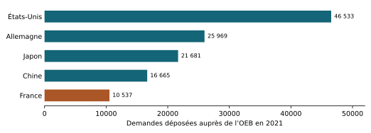
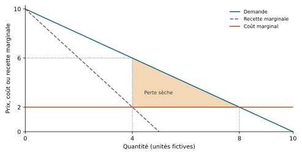

# ENS B/L · Économie, oral commun 2025 — Faut-il protéger l’innovation ? · Corrigé brut

*Corrigé rédigé par IA, non officiel. Signalez toute erreur.*

**Rédaction** · GPT-6.2 Astra Ultra · vitesse non renseignée · 26 novembre 2026

## Que veut-on protéger ?

Un logiciel s’appuie sur des solutions antérieures, tandis qu’un médicament peut demander dix à douze ans de développement avant sa mise sur le marché, selon les intervenants du document 3. Dans les deux cas, qui supporte le coût de la recherche, qui peut utiliser le résultat et à quelles conditions ? Une invention est une solution nouvelle. L’innovation suppose sa mise en œuvre, par exemple sous la forme d’un produit ou d’un procédé. Le brevet donne, sur un territoire et pour une durée limitée, le droit d’interdire certains usages de l’invention divulguée. Il peut aussi être concédé sous licence. L’objectif collectif est de favoriser la production et la diffusion de connaissances utiles. Jusqu’où donner une exclusivité à un inventeur lorsque d’autres auront besoin de son résultat pour innover à leur tour ?

## Pourquoi rémunérer la recherche et sous quelle forme ?

La connaissance est largement non rivale. Une idée utilisée par une équipe peut encore être exploitée par une autre. Lorsqu’elle est facile à imiter et difficile à garder secrète, l’entreprise qui a payé la conception, les essais et le développement supporte des coûts que l’imitateur pourra éviter. Si le gain privé anticipé est inférieur au coût de recherche alors que le gain social le dépasse, un projet utile reste dans les cartons. Von Pottelsberghe et Broekaert insistent dans le document 3 sur ce mécanisme dans les secteurs où coûts fixes, délais et risques sont élevés. L’exclusivité peut rendre le gain attendu suffisant pour attirer des financeurs. Le projet peut toujours échouer techniquement ou commercialement. L’argument d’équité, qui reconnaît un droit à l’inventeur, est d’une autre nature que ce calcul de bien-être.

Le nombre de demandes traduit une utilisation croissante du dispositif. Le graphique mondial de l’OMPI (document 1a) passe d’environ 2,6 millions de demandes en 2014 à quelque 3,5 millions en 2023, avec un repli en 2019. Les deux autres graphiques portent sur les demandes auprès du seul Office européen des brevets en 2021. Les États-Unis en comptent 46 533 et la France 10 537. Parmi les déposants français, Safran est à 540 demandes et le CEA à 528. Ce dernier chiffre rappelle le rôle des organismes de recherche. Une invention peut faire l’objet de plusieurs demandes territoriales, une demande peut être rejetée et la valeur sociale varie fortement entre inventions. Une hausse du nombre de dossiers administratifs ne mesure donc pas l’effet causal des brevets sur le progrès technique.

Rémi Lallement (document 2) étudie les entreprises innovantes en France entre 2002 et 2004. Celles de 250 salariés ou plus déclarent bien plus fréquemment des dépôts de brevets que celles de 10 à 49 salariés. Les deux groupes utilisent également l’avance technologique, les marques ou le secret. Ces modes de protection peuvent se combiner. Une marque protège un signe distinctif. Le secret évite une divulgation, mais une découverte indépendante peut en réduire brutalement l’intérêt. L’avance du premier entrant procure un temps d’apprentissage ou une clientèle avant l’imitation. Pour une PME qui modifie fréquemment un procédé difficile à observer, une procédure longue et des frais de défense élevés rendent ces moyens particulièrement importants. Les écarts observés peuvent aussi refléter les secteurs où se trouvent les grandes entreprises.

## Le prix de l’exclusivité apparaît à l’usage et à l’étape suivante de l’innovation

Une fois l’invention créée, empêcher certains usages peut coûter à la collectivité. Imaginons une demande décroissante et un coût marginal de reproduction constant. Sous concurrence au coût marginal, chaque unité dont la disposition à payer dépasse le coût serait fournie. Un titulaire qui maximise son profit sans discrimination de prix réduit la quantité et fixe un prix supérieur au coût marginal. Une partie du surplus passe des acheteurs au producteur. Pour les ventes qui disparaissent, le surplus perdu par les acheteurs excède le coût évité par le producteur. Ce sont ces échanges perdus qui forment la perte sèche. Le graphique illustre un marché construit pour raisonner et ne prétend pas mesurer cette perte dans un secteur donné.

Il faut ensuite tenir compte des inventeurs futurs. Dans un secteur cumulatif, chaque génération a besoin des résultats de la précédente. Le document 4 rapporte le blocage éprouvé par Curtiss face aux droits des frères Wright. Un produit électronique peut incorporer de nombreux composants brevetés par des détenteurs différents. Chacun fixe sa redevance sans internaliser la baisse des ventes que sa décision inflige aux autres. Les redevances empilées peuvent décourager une amélioration qui aurait pourtant couvert le coût réel de ses composants. Un portefeuille de droits peut même donner un fort pouvoir de négociation contre un producteur qui a déjà engagé des dépenses irrécupérables. L’incertitude sur la validité d’une revendication et les frais de procès renforcent cette menace.

Levine et Nuvolari (document 3) soulignent le rôle des innovations non brevetées et des pratiques défensives dans l’informatique. Leurs contradicteurs invoquent les bénéfices futurs de produits qui risqueraient de ne jamais voir le jour sans possibilité d’appropriation. Les exemples de secteurs ou d’expositions historiques ne suffisent pas à départager ces positions. Les technologies, le temps nécessaire à l’imitation, la demande et le financement public y diffèrent également. La comparaison pertinente porterait sur des projets semblables exposés à une variation de protection indépendante de leur potentiel initial.

## Adapter les instruments aux obstacles rencontrés par les innovateurs

Une première réponse consiste à examiner rigoureusement la nouveauté et la portée des revendications. Accorder un monopole étendu sur une idée déterminante pour plusieurs technologies futures entraîne plus de coûts en aval qu’un droit étroitement circonscrit. Des licences accessibles permettent de rémunérer l’inventeur et de diffuser l’invention. Les pools et licences croisées du document 4 peuvent simplifier la négociation quand les brevets sont complémentaires. Ils risquent aussi d’exclure un entrant dépourvu de portefeuille ou de faciliter une entente si leurs membres contrôlent des technologies substituables. L’autorité de concurrence doit donc examiner les conditions d’accès et la façon dont les tarifs sont formés.

Dans l’audition de l’OCDE (document 5), Philippe Aghion propose de considérer simultanément les rentes des entreprises qui innovent et celles qu’un acteur en place peut préserver en fermant le marché. Un entrant aura d’autant plus intérêt à investir qu’il peut espérer garder une part des fruits de sa découverte et accéder au marché. Une acquisition qui supprime un concurrent innovant potentiel peut nuire aux futurs produits avant même que les prix actuels changent. À l’inverse, la mise en commun de ressources peut faciliter leur développement. Examiner l’enjeu dynamique exige d’étudier les projets en cours et les possibilités d’entrée.

L’exclusivité reste un instrument parmi d’autres. Des contrats de recherche publique ou des prix d’innovation peuvent rémunérer un résultat en prévoyant une diffusion à faible coût. Le financement public doit alors sélectionner des projets utiles ou définir et vérifier le résultat promis. Une aide ouverte à plusieurs concurrents peut orienter la recherche vers des technologies propres dont le bénéfice climatique est mal rémunéré. La réponse au sujet tient à cet arbitrage. Il est justifié de protéger la possibilité d’innover et de couvrir les coûts de découverte, tout en maintenant, pour les usagers et les innovateurs suivants, des droits d’accès compatibles avec la diffusion.

[Dossier officiel, pages 11 à 18 du recueil](https://www.ens.psl.eu/sites/default/files/economie_sujets_25_juin.pdf#page=11) · [Rapport du jury de l’oral commun d’économie](https://www.ens.psl.eu/sites/default/files/2025_bl_rapport_oral_economie_tronc_commun.pdf)
