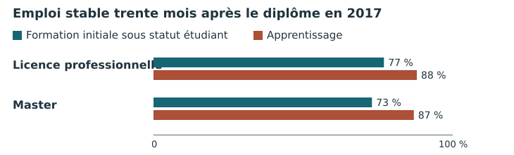
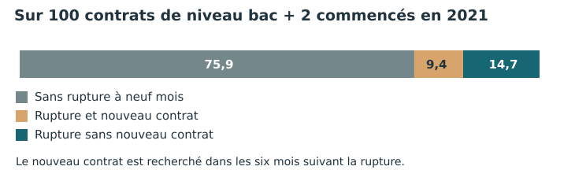

# BEL B/L — Quel effet des réformes de l’apprentissage ? · Corrigé guidé

*Corrigé rédigé par IA, non officiel.*

**Rédaction** · GPT-6.2 Astra Ultra · vitesse non renseignée

Épreuve orale commune d’économie de la session 2025. Le jury prévoit 1 h 30 de préparation, quinze minutes d’exposé et quinze minutes d’entretien. Les questions de discussion ci-dessous sont proposées pour l’entraînement.

## Introduction

> [!INDICATION]
> Préciser au brouillon si chaque graphique mesure un stock de personnes à une date, un flux de nouveaux contrats, une part en emploi stable ou un montant en euros. Choisir ensuite un résultat à expliquer et un indicateur pour juger la qualité des parcours.

Fin 2023, la France compte plus d’un million d’apprentis, contre moins de 440 000 en 2018 selon l’article de Sandrine Foulon. Un contrat d’apprentissage associe un emploi rémunéré en entreprise à une formation conduisant à une qualification. À la signature, il compte donc à la fois dans l’emploi et dans la formation. Que mesure son essor ? Une place nouvellement créée peut ouvrir une voie auparavant inaccessible, remplacer une formation sous statut étudiant ou modifier la forme d’une embauche qui aurait eu lieu de toute façon. Quel effet des réformes de l’apprentissage faut-il retenir pour les jeunes, les employeurs et les finances publiques ? J’examinerai la réponse des acteurs aux aides, puis les débouchés et les ruptures, avant de discuter le rendement des dépenses engagées.

## I. Les aides ont modifié le prix de l’embauche et la composition des entrées

> [!INDICATION]
> Se placer successivement du côté d’un centre de formation, d’un employeur et d’un jeune. Préciser en quelle unité chacun compare un gain et un coût. Les deux profils du document 2a diffèrent en âge, diplôme et durée.

La loi de 2018 a élargi l’accès en âge et organisé un financement des centres de formation d’apprentis (CFA) en fonction des contrats signés (document 1). Ouvrir une place devient plus intéressant si une inscription apporte au centre un financement supplémentaire. Pour l’employeur, la décision dépend de la contribution productive du jeune, du temps de tutorat, de la rémunération et de la perspective de recruter une personne déjà formée. L’aide à l’embauche réduit le coût net du contrat. Elle peut rendre rentable l’accueil d’un jeune demandant du temps d’encadrement. Le jeune reçoit un salaire et acquiert une expérience, mais la possibilité d’en bénéficier dépend de l’accès à une entreprise et à un centre.

Le document 2a distingue la réforme du financement et le changement d’échelle de l’aide exceptionnelle en 2020. En juillet 2020, pour un apprenti de 20 ans préparant un diplôme supérieur au bac, rémunéré au minimum pendant 18 mois, l’aide représentait 92 % de la rémunération sur le contrat, hors revalorisations du smic. Pour le profil de 18 ans en formation au plus de niveau bac et engagé pour 24 mois, elle couvrait alors 59 % du coût du travail, puis 44 % en 2024. L’écart de couverture de 33 points entre les deux profils en juillet 2020 ne mesure pas un effet pur du diplôme. La durée, le salaire lié à l’âge et l’ancien périmètre de l’aide changent aussi. Le temps du maître d’apprentissage reste un coût même lorsque la rémunération est largement subventionnée.

Le graphique 2b suit des entrées cumulées sur douze mois. Avant 2020, la courbe du secondaire est au-dessus de celle du supérieur. Après 2020, les deux augmentent, mais le supérieur dépasse le secondaire et arrive à environ 530 000 entrées sur douze mois en 2024, contre environ 330 000 dans le secondaire. Ces flux ne sont pas le stock d’un million d’apprentis du document 1. La durée des contrats et leurs renouvellements relient flux et stock. L’essor associé aux réformes a donc transformé le public. L’augmentation du total ne garantit pas que les jeunes qui rencontraient le plus de difficultés se sont vu offrir les places supplémentaires.

Près de 44 % des entreprises auraient de toute façon recruté des alternants, selon l’estimation relayée dans le document 1. C’est une illustration de l’effet d’aubaine. Un versement à une entreprise qui aurait recruté sans prime augmente la dépense sans créer ce recrutement supplémentaire. Les 44 % portent sur des entreprises dans l’énoncé cité. Les interpréter comme 44 % de tous les contrats ou de toute la dépense supposerait de connaître les nombres d’apprentis et les montants par entreprise. La note d’opinion propose de réorienter l’aide. Sa proposition relève d’un arbitrage à évaluer.

## II. L’expérience en entreprise facilite certaines transitions, sous conditions

> [!INDICATION]
> Lire le document 3 d’abord à diplôme constant. Le mot « stable » renvoie à une caractéristique de l’emploi occupé. Relever l’année du diplôme avant d’utiliser cette enquête pour discuter la réforme de 2018.

L’apprentissage peut accroître le capital humain, c’est-à-dire les compétences utiles à la production, par la mise en pratique de connaissances. Il donne aussi à l’employeur le temps d’observer une personne et au jeune celui d’évaluer le poste. Ce meilleur appariement peut conduire à une embauche durable. Le document 3 observe les conditions d’emploi trente mois après l’obtention d’une licence professionnelle ou d’un master en 2017. Pour le master, la part d’emploi stable est de 87 % en apprentissage et de 73 % sous statut étudiant, soit 14 points d’écart. Pour la licence professionnelle, elle atteint 88 % contre 77 %, soit 11 points. Stabilité inclut notamment CDI, fonctionnaires, professions libérales et indépendants. Un emploi stable n’est donc pas nécessairement un CDI chez l’ancien maître d’apprentissage.

Les différences concernent aussi le temps plein, par exemple 99 % contre 94 % en master, et l’accès à des emplois de cadre ou de profession intermédiaire, 95 % contre 90 % en master. Ces indicateurs de conditions d’emploi ne permettent pas de convertir l’écart de stabilité en nombre d’emplois créés. Les deux voies peuvent recruter des étudiants de spécialités, d’expérience et de réseaux différents. Les entreprises sélectionnent leurs apprentis. L’enquête porte sur des diplômés français de 30 ans ou moins dans le champ précisé, hors reprise d’études dans les deux ans, et corrige la non-réponse. Les diplômes datent de 2017, donc d’avant la réforme. La comparaison éclaire les rendements possibles de la voie, sans identifier l’effet de la prime sur les jeunes nouvellement attirés.

Le document 5 met l’accent sur un maillon indispensable, la continuité du contrat. Pour les bac + 2 commencés en 2021, 24,1 % des contrats sont rompus dans les neuf premiers mois. Sur 100 contrats commencés, 9,4 conduisent à un nouveau contrat dans les six mois suivant la rupture et 14,7 n’en ont pas dans ce délai. Parmi les seuls contrats rompus, environ 39 % correspondent donc à un retour en apprentissage dans ce délai. La rupture peut défaire un mauvais appariement tout en ouvrant la voie à un autre. L’absence de nouveau contrat dans les six mois laisse inconnue une éventuelle reprise d’études sous un autre statut.

Le document 5a rapproche expérience d’accueil et continuité. À caractéristiques observées comparables, un employeur ayant accueilli son premier apprenti en 2015 présente pour les contrats de 2022 une probabilité de rupture supérieure de 0,9 point à celle du groupe de référence 2012-2014, intervalle de confiance de 0,5 à 1,4 point. Les centres ayant débuté en 2021 ou 2022 présentent des écarts d’environ six points par rapport au groupe ancien. L’ancienneté est observée à partir de 2012. Les caractéristiques de tutorat et de recrutement imparfaitement observées peuvent encore différer. Depuis la réforme applicable aux contrats conclus à partir de 2019, la sortie au-delà des 45 premiers jours travaillés en entreprise a aussi été assouplie. Le CFA doit accompagner l’apprenti licencié dans sa recherche et lui permettre de poursuivre la formation théorique pendant six mois. Comparer la qualité des parcours demande de suivre ruptures, reprises et obtention du diplôme.

## III. Évaluer les emplois supplémentaires et le coût de leur financement

> [!INDICATION]
> Avant d’utiliser l’axe du document 4, associer la courbe aux allocataires et les barres aux millions d’euros. Demander quel dénominateur manque pour estimer le risque de chômage d’un ancien apprenti.

L’assurance chômage couvre désormais davantage d’anciens apprentis (document 4). En 2019, on compte en moyenne 73 000 allocataires en fin de mois après apprentissage et 320 millions d’euros d’indemnisation sur l’année. En 2023, les valeurs sont 136 000 et 770 millions. La dépense représente alors environ 2 % des 34,6 milliards d’euros d’indemnisation totale, contre environ 1 % en 2019. La hausse peut tenir au nombre accru de sortants, à leur éligibilité, à la durée d’indemnisation ou aux salaires de référence. On ne peut en déduire une hausse de la probabilité individuelle de chômage. Le droit à indemnisation fournit par ailleurs une assurance pendant la recherche d’emploi. La dépense publique et la perte de ressources pour la collectivité sont deux notions distinctes.

Le document 1 rapporte une estimation de 22 milliards d’euros de coût public de l’apprentissage en 2022. Diviser ce chiffre par le stock de fin 2023 mélangerait années, nature de la dépense et unité d’observation. Pour une évaluation, on comparerait les dépenses supplémentaires aux bénéfices supplémentaires sur une même cohorte. Du côté des gains figurent les compétences, le revenu du jeune, la production future, les embauches durables et d’éventuelles recettes publiques. Du côté des ressources mobilisées, on trouve le temps de formation des enseignants et des tuteurs et les usages alternatifs des fonds. Les salaires ou les transferts entre agents doivent être traités en cohérence avec le point de vue retenu pour éviter de les compter deux fois.

Un ciblage plus marqué sur les jeunes sans qualification pourrait réduire les effets d’aubaine si la prime y crée davantage d’occasions nouvelles. Il peut aussi susciter des effets de seuil ou priver certains étudiants du supérieur, contraints financièrement, de la possibilité de poursuivre. Une bourse répondrait directement à cette dernière contrainte, tandis qu’une aide au tutorat répondrait à la difficulté d’encadrement. Pour départager ces instruments, une modification d’éligibilité ou de barème pourrait fournir une comparaison entre groupes proches exposés différemment, avant et après le changement. Il faudrait tester la comparabilité des tendances antérieures et suivre le diplôme, l’emploi, la rémunération et les substitutions entre contrats. Une embauche d’apprenti qui remplace un recrutement ordinaire ne doit pas être comptée comme une création nette pour l’ensemble du marché.

## Conclusion

> [!INDICATION]
> Répondre à trois niveaux distincts. Dire ce qui est établi sur les volumes, ce que les données suggèrent sur les parcours et ce qu’il reste à identifier pour décider d’une dépense supplémentaire.

Les réformes ont accompagné une forte hausse des contrats, particulièrement dans le supérieur. L’apprentissage peut rapprocher formation et embauche et améliorer certaines conditions d’emploi. La sélection des candidats, le développement de nouveaux centres, les ruptures et l’effet d’aubaine interdisent toutefois de donner à tout contrat supplémentaire le même rendement. L’évaluation pertinente suit les jeunes et les alternatives qui leur étaient ouvertes. Elle peut alors indiquer où un euro de soutien supplémentaire améliore le plus la qualification et l’accès durable à l’emploi.

## Discussion avec le jury

> [!INDICATION]
> Calculer de tête l’ordre de grandeur de 9,4 sur 24,1 puis expliquer le dénominateur. Pour tout coût moyen, commencer par dire à quelle question répondrait le quotient.

**Une baisse du coût de l’apprentissage fait-elle forcément augmenter autant l’emploi total ?** La demande d’apprentis peut augmenter parce que les entreprises emploient davantage de jeunes ou substituent un apprenti à un autre salarié. L’offre de jeunes et de places de formation limite également la réponse. Les contrats signés seuls ne permettent pas de calculer l’emploi net créé.

**Pourquoi l’écart de 14 points en master est-il compatible avec un effet individuel plus faible ?** Les entreprises peuvent sélectionner des étudiants qui auraient aussi trouvé plus facilement un emploi stable sous statut étudiant. Les spécialités et les territoires diffèrent. Le résultat observé chez des diplômés de 2017 et l’effet causal d’une prime ultérieure répondent à des questions distinctes.

**14,7 % des contrats rompus restent-ils sans suite à six mois ?** Ce chiffre vaut sur tous les contrats commencés du niveau étudié. Rapporté aux 24,1 % rompus, il représente environ 61 % des contrats rompus. La situation observée est l’absence de nouveau contrat d’apprentissage dans le délai défini.

**Un euro d’indemnisation est-il un euro de perte sociale ?** L’assurance verse une ressource à un jeune qui remplit les conditions. Le coût budgétaire s’inscrit bien dans les comptes, mais l’évaluation collective tient aussi compte du bénéfice d’assurance, du financement et des comportements de recherche d’emploi.
