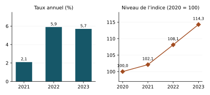
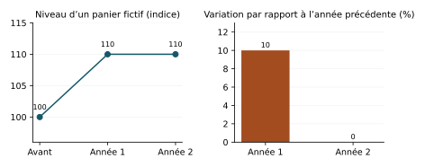

# Le retour de l’inflation ? · Corrigé brut

*Corrigé rédigé par IA, non officiel. Signalez toute erreur.*

**Rédaction** · GPT-6.2 Astra Ultra · vitesse non renseignée · 26 novembre 2026

ENS, filière B/L · Épreuve orale commune d’économie, session 2025.

## Introduction

Un ménage qui retrouvait en 2023 les mêmes articles qu’en 2021 pouvait constater deux choses ensemble. Le panier coûtait beaucoup plus cher et son prix augmentait un peu moins vite que l’année précédente. Selon la Banque de France, l’indice français des prix à la consommation harmonisé (IPCH) a progressé de 2,1 % en 2021, 5,9 % en 2022 et 5,7 % en 2023. La petite décélération de 2023 laisse le niveau des prix bien plus haut. Un pouvoir d’achat perdu ne se reconstitue que si les revenus réels se redressent.

Le mot « retour » recouvre ainsi deux questions. Une poussée générale des prix a bien eu lieu après la pandémie. A-t-elle rétabli un régime dans lequel salariés, entreprises et prêteurs anticipent durablement des hausses élevées et adaptent leurs contrats en conséquence ? Pour répondre, il faut identifier les impulsions du premier épisode, éclairer leur propagation à l’aide de la comparaison historique et apprécier ce que mesurent les alertes américaines de février 2025.

## I. Des hausses sectorielles ont fait monter l’indice général

### Un choc d’offre peut se diffuser bien au-delà du secteur touché

Le document 1 d’Aldama, Le Bihan et Le Gall (Banque de France, 2024) montre d’abord une décomposition comptable de l’IPCH. À chaque trimestre, les contributions en points de l’énergie, de l’alimentation et de l’ensemble des produits manufacturés et services composent le glissement annuel de l’indice. La hausse du prix d’un poste pèse d’autant plus qu’il occupe une part importante dans le panier. L’énergie contribue fortement au début de la poussée, puis l’alimentation prend de l’importance. La courbe dépasse momentanément les moyennes annuelles citées en introduction. Elle représente une variation sur douze mois à une date donnée.

Prenons une boulangerie. Une hausse du prix de l’énergie renchérit directement le chauffage du ménage, mais elle augmente aussi le coût de cuisson et celui des livraisons. Si le boulanger répercute une partie de la hausse, le prix du pain montera et cette contribution apparaîtra dans l’alimentation. Attribuer tous les mouvements au seul poste dans lequel on les observe masquerait la transmission du choc initial. Au niveau agrégé, une offre plus coûteuse peut faire monter les prix tout en freinant la production. Une demande particulièrement vive pour des biens dont les capacités de production sont contraintes peut amplifier cette hausse.

### Comment le modèle distingue les impulsions

Dans leur deuxième graphique, les économistes appliquent le modèle semi-structurel de Bernanke et Blanchard aux données françaises du premier trimestre 1990 au deuxième trimestre 2023. Les relations estimées relient prix, salaires, anticipations et tensions sur le marché du travail, approchées par le rapport entre emplois vacants et chômeurs. Ils construisent une trajectoire de référence en l’absence des chocs survenus à partir de 2020. Les écarts attribuables aux différents chocs s’ajoutent aux conditions initiales et à un résidu. Les couleurs correspondent désormais à des **causes estimées**. Leur ampleur dépend des relations retenues dans le modèle.

En France, les chocs énergétiques de 2021 puis alimentaires de 2022 dominent. La contribution des perturbations des chaînes d’approvisionnement ressort plus faible. Aux États-Unis, où l’inflation citée passe de 1,2 % en 2020 à 8 % en 2022, matières premières et chaînes d’approvisionnement jouent toutes deux un rôle important. Jusqu’au premier trimestre 2023, les tensions sur le marché du travail américain n’apparaissent pas comme l’impulsion déterminante. Deux pays peuvent donc enregistrer des hausses voisines sans que chaque moteur ait la même force. Et ce qui a déclenché la hausse peut différer de ce qui la prolonge.

## II. La durée de l’inflation dépend des ajustements de prix et de salaires

### Une hausse unique du niveau des prix et une série de hausses

Si le prix d’une énergie importée augmente une fois puis se stabilise, il pousse l’inflation vers le haut tant que la base annuelle de comparaison précède la hausse. Une fois le nouvel échelon atteint dans les deux périodes comparées, cette contribution directe disparaît. Le niveau des prix demeure plus élevé. Les effets indirects peuvent durer davantage si les entreprises répercutent leurs coûts à des dates différentes. Des salariés peuvent aussi négocier une compensation de la perte de pouvoir d’achat. Pour qu’une **spirale** se forme, il faut des ajustements répétés des prix et des rémunérations qui se relancent mutuellement. Une augmentation ponctuelle des salaires ne suffit pas à la diagnostiquer.

La Banque de France attribue la faible propagation persistante en France à une indexation limitée et à des anticipations demeurées assez ancrées, auxquelles la réponse de la BCE aurait contribué. Dans le modèle, des tensions durablement élevées sur le marché du travail auraient une influence plus persistante. Les transmissions dépendent aussi de la productivité et des marges. Une entreprise peut absorber temporairement une hausse de coût, et une hausse des rémunérations accompagnée de gains de productivité ne fait pas nécessairement monter le coût salarial par unité produite.

### Ce que les années 1970 éclairent

Dans le document 4, publié dès le 30 mars 2022, Kose, Ohnsorge et Ha relèvent deux ressemblances. Les chocs pétroliers de 1973 et de 1979–1980 comme les perturbations de 2021–2022 frappent l’offre. Ils surviennent après des périodes où la politique monétaire soutenait l’activité. Leur graphique (a) compare le taux réel américain à un taux réel neutre estimé, compatible à terme avec une activité à son potentiel et une inflation stable. Un taux réel inférieur à ce repère suggère une politique accommodante. Le taux neutre est une estimation incertaine.

Trois lectures limitent cependant l’analogie. Sur le graphique (b), il faut corriger le prix nominal du baril par le niveau général des prix pour comparer le pouvoir d’achat d’un dollar à cinquante ans de distance. En termes réels, le pétrole du début de 2022 vaut, selon les auteurs, environ deux tiers des sommets de 1980 ou 2008. Le graphique (c) montre aux États-Unis comme dans la moyenne de quarante pays des inflations globale et sous-jacente plus fortes en 1979–1980 que dans la comparaison récente. L’indicateur sous-jacent exclut ici alimentation et énergie. Enfin le graphique (d) fait ressortir le transport américain, proche de 15 % dans les deux épisodes, alors que logement et dépenses médicales montent nettement moins au début des années 2020. Pour 2022, seuls janvier et février entrent dans ces comparaisons. Les auteurs formulaient un diagnostic conditionnel, avant de connaître la suite de l’année.

## III. Les anticipations américaines sont un signal à interpréter

### Ce que les ménages croient et ce que les entreprises font

L’article du *New York Times* du 25 février 2025 (document 2) évoque le prix très visible des œufs, les inquiétudes sur les droits de douane et la remontée des anticipations à douze mois dans l’enquête du Michigan. Une taxe sur les importations peut relever le coût des produits importés et de certains intrants. La part payée par le consommateur dépend des capacités de substitution, des marges et du taux de change. Une hausse unique du tarif menace de devenir durablement inflationniste si elle est suivie d’autres chocs ou modifie les comportements de fixation des prix.

L’enquête retranscrite par Reuters le 21 février (document 3) concerne un autre horizon. À cinq ans, le dernier point atteint 3,5 %, son plus haut niveau depuis avril 1995. Il se situe au-dessus des valeurs voisines de 2,5 % de la fin des années 2010. Les bandes grises signalent des récessions, sans établir à elles seules leurs effets. On observe les réponses de consommateurs américains. Les indicateurs tirés des titres financiers reflètent celles d’autres acteurs et comportent des primes de risque et de liquidité. L’objectif de 2 % de la Fed porte sur son indice de référence, tandis que l’enquête recueille les anticipations de consommateurs. Un écart numérique entre les deux invite à enquêter sur sa persistance.

### Que peut faire une banque centrale ?

À taux nominal donné, une remontée de l’inflation anticipée réduit approximativement le taux d’intérêt réel anticipé. Si l’activité réagit, les décisions de consommation et d’investissement peuvent entretenir la pression sur les prix. En relevant ses taux directeurs, une banque centrale peut freiner le crédit et la demande, et signaler qu’elle entend stabiliser les prix. Elle agit avec des délais, avec un coût possible en activité et en emploi. La crédibilité et l’indépendance dont parle le document 2 comptent parce que les contrats se négocient avant que toutes les décisions futures soient connues. Resserrer au premier mouvement d’un prix isolé peut accentuer une contraction de l’offre. Attendre face à des révisions durables des anticipations peut imposer ultérieurement un ajustement plus coûteux.

## Conclusion

Le retour d’une forte inflation après la pandémie est établi. Le passage à un régime comparable à celui des années 1970 reste, à la date du dossier, une hypothèse conditionnelle. Les indices à suivre ensemble sont la diffusion des hausses entre secteurs, les coûts salariaux unitaires, les anticipations à plusieurs horizons et les conditions de crédit. Leur évolution permet de juger si un choc qui déplace une fois les prix s’est installé dans les décisions répétées des agents.

## Sources

Le fascicule officiel du 24 juin contient trois dossiers. Celui-ci occupe les pages 1 à 10. [Dossier du jury](<https://www.ens.psl.eu/sites/default/files/sujet_dossiers_24_juin_economie.pdf#page=1>)

Document 1. Banque de France, Aldama, Le Bihan et Le Gall, 2024. Pages 2 à 4 du fascicule.

Document 2. New York Times, Smith et Casselman, 25 février 2025. Pages 5 à 6 du fascicule.

Document 3. Reuters, Mutikani, 21 février 2025, enquête de l’université du Michigan. Page 7 du fascicule.

Document 4. VoxEU, Kose, Ohnsorge et Ha, 30 mars 2022. Pages 8 à 10 du fascicule.

Nina Guyon et Sandra Poncet présentent les conditions de l’épreuve et les attentes du jury. La liste de la deuxième page confirme le sujet. [Rapport du jury](<https://www.ens.psl.eu/sites/default/files/2025_bl_rapport_oral_economie_tronc_commun.pdf>)
