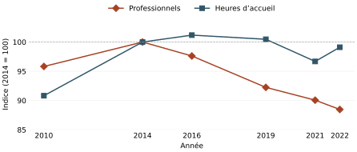
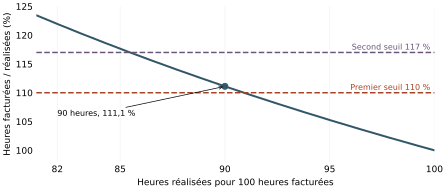

# BEL B/L · Épreuve orale commune d’économie 2025 · Un service de la petite enfance : pourquoi et comment ? · Corrigé brut

*Corrigé rédigé par IA, non officiel. Signalez toute erreur.*

**Rédaction** · GPT-6.2 Astra Ultra · vitesse non renseignée · 26 novembre 2026

## Introduction

Une place de crèche existe sur un plan de construction, puis dans un agrément. Pour qu’une famille puisse effectivement l’occuper, il faut encore une équipe qualifiée, présente à l’heure où le parent doit partir travailler. Dans l’enquête de la Caisse nationale des allocations familiales (Cnaf) reproduite au document 1, on compte près de 24 places fermées pour 1 000 places en crèche collective agréée au 1er avril 2022. Une aide qui réduirait le prix de la garde pour les familles suffirait-elle à rouvrir ces places ?

Le service de la petite enfance regroupe des modes collectifs et individuels qui permettent de faire garder les jeunes enfants et contribuent à leur éveil. Quel objectif justifie d’y consacrer des ressources publiques, et comment financer un accueil à la fois accessible, effectif et de qualité ? Le dossier associe les gains attendus pour les familles et les enfants à trois contraintes portant sur le personnel, les territoires et la rémunération des établissements. On examinera d’abord les bénéfices du service, ensuite la capacité à fournir des heures d’accueil, enfin les incitations créées par le financement.

## I. Le coût de la garde engage les possibilités d’emploi des parents et les apprentissages des enfants

Pour un parent qui envisage de reprendre une activité ou de travailler une heure de plus, comptent le revenu supplémentaire, le coût de garde et de déplacement, mais aussi la compatibilité des horaires. Quand la garde institutionnelle manque, l’un des parents peut réduire son activité. Si le salaire de l’un est initialement plus faible, le ménage renonce à moins de revenu immédiat en réduisant ses heures à lui. Cette décision pèse ensuite sur son expérience, ses augmentations et les droits sociaux liés à l’emploi. Elle peut renforcer durablement le premier écart et s’articule avec les normes relatives à la division du travail parental.

Le document 4 décompose l’écart de revenus du travail entre hommes et femmes en France à partir de l’enquête Emploi sur 1990–2020. En 1990, les femmes gagnent en moyenne environ 50 % de moins que les hommes. En 2020, l’écart dépasse encore 30 %. Selon la décomposition des auteurs, l’arrivée des enfants explique plus de la moitié de l’écart au début de la période et 88 % de l’écart subsistant en 2020. On peut donc observer simultanément un recul de l’écart total et un poids relatif accru de la pénalité parentale. Les 88 % se rapportent à l’écart entre les sexes, non au revenu perdu par chaque mère. Le document isole aussi une composante liée à la formation. Il n’estime pas quel pourcentage de l’écart disparaîtrait à l’ouverture d’une crèche supplémentaire. Pour mesurer l’effet de l’offre, il faudrait comparer des familles d’exposition différente à une extension du service en tenant compte de leurs trajectoires antérieures.

L’accueil a aussi une dimension éducative. Une famille peut valoriser l’éveil de son enfant tout en manquant d’information sur la qualité des structures ou de liquidités pour payer aujourd’hui un investissement dont les bénéfices apparaîtront plus tard. Si un meilleur développement produit également des gains pour d’autres personnes ou pour les finances publiques, une partie du rendement social échappe au calcul privé. Cette externalité, l’égalité des chances et la réduction des écarts d’accès constituent des motifs distincts d’intervention. Une place occupée est un service rival qui se prête au rationnement. Subventionner ce service n’en fait pas un bien public pur.

Le document 5 de l’OCDE compare les élèves de 15 ans n’ayant pas fréquenté l’enseignement pré-primaire à ceux qui l’ont fréquenté plus d’un an. Le résultat est le rapport des cotes d’être sous le niveau 2 en mathématiques à PISA 2012. Pour la moyenne OCDE, on lit environ 3,2 avant prise en compte de caractéristiques des élèves et environ 1,9 après. Milieu social, langue parlée en famille ou parcours scolaire expliquent une partie de l’association brute. En France, le point brut est à 7,13 et la barre ajustée est proche de 3,8. Sa couleur claire indique que le coefficient ajusté ne franchit pas le seuil de significativité retenu. On ne peut utiliser ce dernier chiffre comme effet causal. Le graphique traite de préscolarisation dans des pays différents. L’accueil en crèche d’un enfant de moins de trois ans constitue une intervention distincte dont l’effet dépend aussi du mode de garde qu’il remplace.

## II. Une politique de la demande se heurte aux limites de capacité et de qualification

Les deux cartes du document 1 donnent une photographie au 1er avril 2022. Le questionnaire de la Cnaf porte sur 15 986 crèches collectives offrant 411 959 places. Pour 1 000 places, les crèches interrogées comptent 23,9 places fermées et un manque de 21,6 postes en équivalent temps plein. À Paris, le premier indicateur atteint 100,3 places fermées pour 1 000, soit environ une sur dix. En Seine-Saint-Denis, le second atteint 37,2 équivalents temps plein manquants pour 1 000 places. Ces deux chiffres locaux concernent des territoires et des unités différents. On ne peut en tirer le nombre d’enfants accueillis par un professionnel. Les enfants sans demande enregistrée, les horaires des parents et les besoins des assistantes maternelles échappent à ces cartes.

Le document 2 étend le champ aux modes d’accueil formels et à la garde à domicile, hors préscolarisation. Entre 2014 et 2022, la Cour des comptes donne 503 000 puis 445 000 professionnels dans son graphique. Les heures d’accueil, en revanche, passent de 1 689 à 1 674 millions. Autrement dit, les effectifs ont reculé d’environ 11,5 % et le volume d’heures d’environ 0,9 %. Les heures par professionnel sont passées de 3 358 à 3 762. Une même heure de travail d’une assistante maternelle qui accueille trois enfants représente trois heures d’accueil. Une augmentation de cet indicateur peut traduire davantage d’enfants simultanément, des journées plus longues ou une composition différente des modes de garde. Elle ne suffit pas à établir une amélioration de la productivité à qualité constante.

Le diagnostic diffère selon le métier. Les assistantes maternelles sont passées de 334 000 en 2012 à 236 000 en 2022, avec environ 16 000 départs pour 7 000 arrivées par an. La Cour évoque de nombreux départs à la retraite à venir et, sous hypothèse de remplacement identique à la décennie précédente, un recul possible de l’offre théorique d’environ 10 % à l’horizon 2030. Dans les crèches, les effectifs ont au contraire augmenté, de 93 000 en 2010 à 135 000 en 2022. Ils restent insuffisants au regard des places autorisées. Le rapport chiffre le manque à environ 10 000 professionnels et les places gelées à plus de 14 000. Les postes vacants concernent inégalement les qualifications. La pénibilité, les rémunérations concurrentes et les abandons de formation limitent l’offre de travail.

Si le personnel et les locaux sont fixes à court terme, subventionner uniquement les familles peut allonger les files d’attente à prix administré. L’ouverture durable d’une place demande alors de fidéliser du personnel, de former de nouveaux professionnels, de rapprocher horaires et besoins locaux et de financer les coûts récurrents. Assouplir systématiquement les ratios d’encadrement augmente la capacité théorique à court terme, au risque d’aggraver les conditions de travail et les départs. À plus long terme, la qualité de l’emploi peut donc être une condition de l’élargissement de l’offre. Il importe enfin d’articuler crèches, assistantes maternelles et garde à domicile, car la situation d’un mode ne résume pas l’évolution des autres.

## III. Un financement efficace doit rendre les heures utilisables sans sacrifier la qualité ni l’accès

Le document 3 décrit le modèle majoritaire de financement par prestation de service unique (PSU). La branche famille verse une dotation liée à l’activité, les familles versent une participation horaire au barème national et un tiers, souvent la commune ou une entreprise réservataire, complète le financement. La branche famille et les familles couvrent ensemble jusqu’à 66 % du coût de revient horaire dans la limite d’un plafond dans le mécanisme décrit. Entreprise ou commune qui réserve un berceau, famille qui l’utilise et organisme qui le finance prennent donc des décisions différentes. Une précision est nécessaire sur la parenthèse du dossier à propos du tarif. Le barème 2025 applique aux ressources mensuelles un taux dépendant notamment du nombre d’enfants. À composition identique, entre plancher et plafond, la contribution horaire en euros augmente avec les ressources. [Barème des participations familiales de la Caf pour 2025](https://www.caf.fr/sites/default/files/medias/661/Espace-Partenaires/Documents-Partenaires/Ressources/Baremes-Participations-Familiales-Eaje-2025.pdf)

L’Inspection générale des affaires sociales décrit en mars 2023 une incitation à rapprocher heures facturées et heures réalisées. Si une crèche facture 100 heures alors qu’un enfant est présent 90 heures, le taux est de 111,1 %. Il dépasse le seuil de première minoration de 110 % décrit par le rapport et reste sous le deuxième seuil de 117 %. Une heure inutilisée a un coût si le personnel était mobilisé et qu’aucun autre enfant ne peut immédiatement être accueilli. Mais une pression trop forte au remplissage peut décourager le départ anticipé d’un enfant ou inciter à concentrer les présences à l’heure du repas. Une autorisation de suroccupation à 115 % peut alors créer une congestion au moment où chaque enfant a besoin de davantage d’attention. Le taux de facturation et le taux d’occupation mesurent deux réalités différentes.

Des familles aux horaires irréguliers risquent de peser défavorablement sur l’indicateur. L’opérateur peut alors avoir intérêt à privilégier les demandes prévisibles. Les forfaits pour les situations de handicap, les territoires prioritaires ou la concertation peuvent corriger certains coûts peu visibles dans le nombre d’heures. S’y ajoute un problème de contrat. Les municipalités observent aisément le prix proposé à l’appel d’offres et plus difficilement la stabilité de l’équipe, la disponibilité des adultes ou la qualité du projet pédagogique. Selon l’IGAS, entre 2012 et 2021, le coût de revient des établissements marchands avec financement communal a crû de 0,9 %, contre 5,7 % dans les crèches d’entreprise et 15,8 % dans les structures associatives. Des groupes peuvent compenser de faibles marges sur des marchés communaux par celles de leurs autres établissements. Ces taux ne mesurent directement ni la qualité de l’accueil ni les marges elles-mêmes.

Un contrat peut combiner un financement stable couvrant les équipes nécessaires, une part liée à l’activité, des corrections selon les besoins et des contrôles de qualité. Une dotation entièrement fixe affaiblirait l’incitation à ouvrir réellement les places promises. Une rémunération entièrement à l’heure incite à négliger les activités non facturables, la formation ou l’adaptation à un nouvel enfant. Les délais d’accès, les fermetures faute de personnel, la stabilité des équipes et la compatibilité des horaires avec les emplois locaux permettent d’évaluer ces choix. Les résultats devraient aussi être examinés selon les ressources des familles pour repérer celles qui restent exclues.

## Conclusion

Un service de la petite enfance peut élargir les possibilités d’emploi des parents et contribuer aux apprentissages des enfants. Les bénéfices sont plausibles et inégalement répartis, leur réalisation dépend du mode de garde remplacé, du personnel disponible et de la qualité offerte. Les cinq documents conduisent à une même exigence économique. Compter les places autorisées ou les heures facturées ne suffit pas pour juger le service rendu. Il faut savoir quels enfants peuvent effectivement y accéder, à quels horaires et avec quel encadrement.
