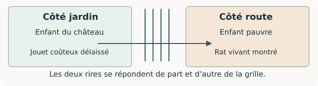

# BEL B/L — Explication d’un texte français, 18 juin 2025 · Corrigé brut

*Corrigé rédigé par IA, non officiel. Signalez toute erreur.*

**Rédaction** · GPT-6.2 Astra Ultra · vitesse non renseignée · 26 novembre 2026

**Autocontrôle** · GPT-6.2 Astra Ultra · vitesse non renseignée · 26 novembre 2026

## Le feuillet du 18 juin

Le fac-similé réunit onze billets à deux textes sur trois pages. Quatre cartouches de choix sont coupés dans le scan. Dans ces quatre cas, le second indice disponible est la rature nette d’une seule des deux propositions. Le numéro « billet » suit l’ordre vertical de la page puis l’ordre des pages. [Feuillet du jury](https://www.ens.psl.eu/sites/default/files/francais_18_juin.pdf)

## Billet 1 — Balzac et Corneille

Page 1 du PDF. La case de choix désigne le texte 1.

### Texte 1 — Balzac, Les Chouans

**Bornes** · p. 64–65, Folio, de « Ce jeune chef » à « que je te démolisse ».

Comment faire voir une guerre civile dans deux silhouettes ? Le jeune chef royaliste apparaît d’abord dans la lumière, par sa grâce et son maintien. La comparaison avec Hulot transforme le portrait en tableau à deux côtés. Les épaulettes usées et l’uniforme du soldat républicain font lire une autre histoire du pays dans le vêtement. La parole de Hulot interrompt la pose. En traitant l’adversaire en danseur, il traduit en raillerie la grâce que le narrateur vient de nous faire admirer.

[Lecture de référence](https://conseil-bibs.be/php/admin-tot/uploads/balzac_les_chouans.pdf)

### Texte 2 — Corneille, Cinna

**Bornes** · I, 1, p. 711–712, de « Impatients désirs » à « me venger ».

Émilie ouvre la tragédie en parlant à ses propres désirs de vengeance. Cette apostrophe donne plusieurs voix à un personnage seul. La dette envers son père lui commande d’agir contre Auguste, mais l’exécution du projet exposerait Cinna. Les adresses successives font donc changer la valeur de l’acte sans changer l’acte lui-même. À la borne finale, la reprise du verbe « venger » retourne la maxime contre elle-même. Perdre celui qu’elle aime annulerait pour Émilie le bénéfice même de la vengeance.

[Lecture de référence](https://fr.wikisource.org/wiki/Cinna_ou_la_Cl%C3%A9mence_d%E2%80%99Auguste/CINNA/Acte_I)

## Billet 2 — Chassignet et Claude Simon

Page 1 du PDF. La case de choix désigne le texte 1.

### Texte 1 — Chassignet, « L’eau change tous les jours »

**Bornes** · Anthologie de la poésie baroque française, t. I, p. 199, poème entier.

L’impératif initial installe le lecteur au bord de la rivière. L’accumulation des flots, les reprises de mots et le mouvement des verbes rendent sensible un cours qui reste reconnaissable alors que son eau ne cesse de changer. Le second quatrain fait surgir un problème de langage. On continue de donner le même nom à ce dont la matière s’est renouvelée. Dans les tercets, cette expérience devient une épreuve pour celui qui regarde. Le paradoxe de l’identité du fleuve vaut désormais pour son propre corps.

[Lecture de référence](https://eduscol.education.gouv.fr/media/89973/download?attachment=)

### Texte 2 — Claude Simon, La Route des Flandres

**Bornes** · p. 9–10, de l’ouverture à « reconnu le papier ».

Un homme tient une lettre, puis son regard va du papier au narrateur. Les premières reprises donnent la scène avant de livrer les raisons de la rencontre. À l’arrière-plan, les chevaux sont d’abord des touches de couleur. La boue et le souvenir de l’expression de Wack font surgir une autre heure et d’autres images dans la même phrase. Le lecteur doit garder en mémoire l’objet initial. Quand le narrateur reconnaît le papier, la situation se précise par une perception matérielle et une réaction affective.

[Lecture de référence](https://www.associationclaudesimon.org/Traduction-tcheque-d-un-extrait-de-La-Route-des-Flandres.html)

## Billet 3 — Zola et Montaigne

Page 1 du PDF. La case de choix désigne le texte 2.

### Texte 1 — Zola, Au Bonheur des Dames

**Bornes** · p. 159–160, de « Tenez-vous droite » à « murmura-t-il ».

Denise présente un manteau. L’ordre de se tenir droite commande à son corps de servir la vente. L’entrée de Mouret détourne un instant tous les regards vers le patron, puis ils reviennent sur la vendeuse. En parlant de la coupe devant elle, on glisse du prix du vêtement à un jugement sur sa silhouette. La distribution des voix mesure l’inégalité entre clientes, personnel et direction. Le passage de l’impératif initial au murmure final invite à écouter qui peut parler haut devant les autres.

[Lecture de référence](https://fr.wikisource.org/wiki/Au_bonheur_des_dames/Texte_entier)

### Texte 2 — Montaigne, Essais, « Des menteurs »

**Bornes** · I, IX, du début du chapitre, p. 155, à « mon humeur », p. 156.

Le titre annonce les menteurs, mais Montaigne commence par examiner sa mauvaise mémoire. L’autoportrait répond à une difficulté sociale très précise. Celui qui oublie un service rendu peut passer pour ingrat, de même que le récit d’un oubli peut faire soupçonner une intention. Le texte sépare mémoire, jugement et bonne volonté en racontant comment les autres les confondent. La protestation finale contre un vice étranger à son humeur éclaire le détour de l’ouverture. Parler de soi éprouve la fiabilité des jugements portés sur autrui.

[Lecture de référence](https://fr.wikisource.org/wiki/Essais/Livre_I/Chapitre_9)

## Billet 4 — Diderot et Hugo

Page 2 du PDF. Le texte 2 reste lisible sans rature. L’autre proposition est barrée dans le scan, le cartouche est tronqué.

### Texte 1 — Diderot, sur les tableaux de Vernet

**Bornes** · p. 226–227, de « Quelle immense variété » à « et reprend tous ses charmes ». Le billet porte Essais sur la peinture, « Vernet ». Le passage figure dans le Salon de 1763.

L’exclamation initiale promet un inventaire. Pourtant les tableaux semblent s’animer avant même que la description soit achevée. Le présent et les énumérations font passer d’un paysage à l’autre. Diderot donne ensuite à Vernet le rôle de celui qui déclenche l’orage et rétablit le calme. Le critique fait ainsi éprouver la puissance d’une peinture fixe par des verbes qui lui donnent du temps. Le retour de l’éclat après le chaos achève ce petit récit de création.

[Lecture de référence](https://fr.wikisource.org/wiki/Salon_de_1763)

### Texte 2 — Hugo, Les Châtiments, « L’Expiation »

**Bornes** · p. 234–235, du début du poème à « un immense linceul ».

L’impersonnel de la neige impose d’emblée une force qui échappe au commandement. Les reprises scandent la retraite de Russie. De l’aigle aux silhouettes isolées, la Grande Armée perd ses marques, son organisation et jusqu’aux sons de ses instruments. L’alexandrin porte encore la grandeur épique alors que les images la défont. À la fin de l’extrait, l’immensité dont l’armée tirait son prestige devient la mesure du linceul qui la recouvre.

[Lecture de référence](https://fr.wikisource.org/wiki/Page%3ALemerre_-_Anthologie_des_po%C3%A8tes_fran%C3%A7ais_du_XIX%C3%A8me_si%C3%A8cle%2C_t1%2C_1887.djvu/217)

## Billet 5 — Molière et Chateaubriand

Page 2 du PDF. La case de choix désigne le texte 1.

### Texte 1 — Molière, Les Femmes savantes

**Bornes** · I, 1, p. 684, vers 26–52.

Les deux sœurs discutent du mariage, mais leur désaccord engage surtout le droit de décider ce qui donne sa valeur à une vie. Armande oppose l’élévation de l’esprit aux travaux du ménage. Les images spatiales et les termes dépréciatifs transforment sa préférence en hiérarchie. Henriette reprend cette géographie pour se dire faite pour aller plus près de la terre. Sa repartie lui rend une liberté de choix dans le vocabulaire même qui devait la rabaisser. La scène installe ainsi le conflit familial par le rythme d’une dispute entre égales.

[Lecture de référence](https://fr.wikisource.org/wiki/Les_Femmes_savantes/Acte_I)

### Texte 2 — Chateaubriand, Mémoires d’outre-tombe

**Bornes** · livre 42, chapitre 18, p. 606–608 selon le billet.

Au terme des Mémoires, la longue durée de la vie permet de regarder l’ouvrage comme un monument achevé. La perspective change lorsque le narrateur quitte le bilan de sa carrière pour l’instant de l’écriture. À la fenêtre, la lune qui disparaît et le jour qui vient associent un paysage visible à la fin d’un monde. La dernière image de la tombe donne au lecteur une position impossible au mémorialiste vivant. Il nous fait déjà entendre une voix d’après sa propre mort.

[Lecture de référence](https://fr.wikisource.org/wiki/Page%3AChateaubriand_-_M%C3%A9moires_d%E2%80%99outre-tombe_t6.djvu/494)

## Billet 6 — Baudelaire et Diderot

Page 2 du PDF. La case de choix désigne le texte 1.

### Texte 1 — Baudelaire, Le Spleen de Paris, « Le Joujou du pauvre »

**Bornes** · p. 65–66, de « Sur une route » à « égale blancheur ».

La description place d’abord le lecteur devant un jardin, une grille et un enfant dont le vêtement répond au décor. Le déplacement de l’autre côté de la grille révèle un second enfant, puis le véritable objet du regard du premier. Le rat vivant déplace le prix du jouet du côté de la curiosité qu’il suscite. La blancheur, d’abord signe extérieur du château, devient celle des dents des deux enfants. Leur rire franchit pour un instant une frontière que la grille, elle, continue de matérialiser.

[Lecture de référence](https://formations.mer.gouv.fr/sites/default/files/2023-01/0714_B_E51.pdf)

### Texte 2 — Diderot, Jacques le Fataliste

**Bornes** · p. 3–4, du début de l’œuvre à « comme toujours » selon le billet.

La première série de questions réclame les renseignements auxquels une ouverture romanesque a habitué le lecteur. Les répliques éludent le lieu, le nom ou la destination, mais elles ont déjà commencé une conversation. Le rapport de Jacques à son maître et la formule de son capitaine introduisent ensuite une explication fataliste relayée par plusieurs voix. L’ordre de l’histoire se dérobe au moment même où chacun prétend en connaître la cause. Le lecteur découvre que son impatience fait partie du jeu narratif.

[Lecture de référence](https://fr.wikisource.org/wiki/Jacques_le_Fataliste_et_son_ma%C3%AEtre)

## Billet 7 — Voltaire et Lamartine

Page 2 du PDF. Le texte 2 reste lisible sans rature. L’autre proposition est barrée dans le scan, le cartouche est tronqué.

### Texte 1 — Voltaire, L’Ingénu

**Bornes** · p. 84–86, de « Mlle de St Yves était fort curieuse » à « cela ne m’a jamais consolé » selon la graphie du billet.

La curiosité de Mlle de Saint-Yves obtient un récit à la première personne. L’Ingénu évoque Abacaba par des comparaisons empruntées à son univers, puis raconte l’aventure du rival dont il fait finalement un ami. Dans la conversation mondaine, la franchise du récit a quelque chose de déconcertant. La disparition d’Abacaba rompt le ton d’aventure. La formule de consolation refusée, très brève après les péripéties, laisse entendre une fidélité réelle à la disparue.

[Lecture de référence](https://fr.wikisource.org/wiki/Page%3AVoltaire_-_%C5%92uvres_compl%C3%A8tes_Garnier_tome21.djvu/277)

### Texte 2 — Lamartine, Méditations poétiques, « Le Lac »

**Bornes** · p. 121–122, du début à « des plus beaux de nos jours ».

Le poème s’ouvre sur un « nous » emporté par le temps, avant de passer à la situation d’un homme revenu seul devant le lac. Les formes interrogatives demandent au paysage de rendre une durée vécue. La reprise d’une promenade fait alors entendre la voix de la femme absente. À la fin de l’extrait, la demande de suspendre le temps se formule à l’intérieur d’un discours rapporté. Le présent de cette voix naît donc du travail de mémoire de celui qui la cite.

[Lecture de référence](https://fr.wikisource.org/wiki/M%C3%A9ditations_po%C3%A9tiques/%C3%89dition_de_1860/Le_Lac)

## Billet 8 — La Fontaine et Genet

Page 3 du PDF. Le texte 1 reste lisible sans rature. L’autre proposition est barrée dans le scan, le cartouche est tronqué.

### Texte 1 — La Fontaine, Fables, « Le Loup et l’Agneau »

**Bornes** · p. 73, LP. La fiche porte « I, IX ». Le titre identifie la fable X du livre I dans la numérotation usuelle.

La sentence initiale livre l’issue avant le procès. L’agneau répond aux accusations en vérifiant les lieux, les dates et les personnes. Sa courtoisie et son exactitude allongent la discussion sans lui conférer le pouvoir de la clore. Le loup, au contraire, modifie l’objet de l’accusation chaque fois que l’argument échoue. Le dénouement abrège soudain le débat. L’ordre des prises de parole a suffi pour montrer de quelle « raison » dispose le plus fort.

[Lecture de référence](https://fr.wikisource.org/wiki/Fables_de_La_Fontaine_%28%C3%A9d._1874%29/Le_Loup_et_l%E2%80%99Agneau)

### Texte 2 — Genet, Les Paravents

**Bornes** · Xᵉ tableau, Folio, p. 107–109, du début de la scène à « vos enfants ».

Le dixième tableau installe plusieurs paravents sur scène. Le décor construit à vue invite à observer comment la société coloniale se donne elle aussi des rôles et des signes de rang. La dernière réplique du passage, identifiée par Caroline Daviron dans Elles, les femmes dans l’œuvre de Jean Genet, met aux prises Malik et Sir Harold, le propriétaire qui l’emploie. Malik concède à l’autre la figure de « notre père », puis lui dénie ce qui devrait logiquement en résulter pour « vos enfants ». Le renversement des possessifs fait entendre la contradiction du paternalisme. Le colon revendique l’autorité du père sans donner aux ouvriers les droits qu’emporterait la parenté. Le ton presque poli que permet le regret final rend la réplique d’autant plus mordante.

[Étude sur la scène](https://fr.scribd.com/document/981287337/Elles-Les-femmes-de-Genet)

## Billet 9 — Du Bellay et Giraudoux

Page 3 du PDF. Le texte 2 reste lisible sans rature. L’autre proposition est barrée dans le scan, le cartouche est tronqué.

### Texte 1 — Du Bellay, Les Regrets

**Bornes** · sonnet XLVIII entier, p. 84.

Le premier quatrain imagine, à la troisième personne, le bonheur de pouvoir écrire sans feindre. Le second fait entrer la première personne. Les questions changent la maxime en plainte contre une contrainte éprouvée. Les reprises verbales des tercets opposent l’intensité de la souffrance à l’impossibilité de la dire publiquement. Le sonnet réalise ainsi un geste délicat. Il publie la plainte tout en maintenant discrète l’identité de celui que le poète ne peut offenser.

[Lecture de référence](https://fr.wikisource.org/wiki/Les_Regrets_%28du_Bellay%29)

### Texte 2 — Giraudoux, La guerre de Troie n’aura pas lieu

**Bornes** · scène première, p. 9–11, du début à « Je ne te comprends pas ».

Andromaque énonce le titre comme une certitude, Cassandre répond par un pari. Cette entrée vive traite une catastrophe connue des spectateurs comme un avenir encore en discussion pour les personnages. À la confiance d’Andromaque dans les êtres et les décisions, Cassandre oppose une façon d’entendre le destin à travers ce qui paraît lointain. Les images et les échanges brefs donnent à chacune une manière de raisonner. La réplique finale suspend la communication au lieu de départager les interlocutrices.

[Lecture de référence](https://fr.wikisource.org/wiki/La_guerre_de_Troie_n%E2%80%99aura_pas_lieu/Acte_I)

## Billet 10 — Pascal et Rostand

Page 3 du PDF. La case de choix désigne le texte 1.

### Texte 1 — Pascal, Pensées

**Bornes** · p. 139–140, de « Que l’homme contemple » à « l’infini où il est englouti ».

Pascal donne un exercice à effectuer par la pensée. Le regard doit d’abord quitter les objets proches et parcourir des dimensions plus vastes. Chaque grandeur qui servait d’échelle devient à son tour minuscule dans un espace plus ample. Les impératifs et les changements de point de vue font éprouver cette perte de mesure avant de lui donner un nom. L’homme ne reçoit donc pas une définition abstraite de sa petitesse. Son imagination découvre ses propres limites au moment de vouloir embrasser l’infini.

[Lecture de référence](https://fr.wikisource.org/wiki/%C5%92uvres_compl%C3%A8tes_de_Blaise_Pascal_Hachette_1871%2C_vol1/Pens%C3%A9es/Article_01)

### Texte 2 — Rostand, Cyrano de Bergerac

**Bornes** · I, IV, p. 92–93, de « Ces grands airs » à « Bouffon ! ».

Valvert transforme la tenue de Cyrano en motif de mépris. Il énumère les signes extérieurs qui devraient distinguer un homme du monde. Cyrano déplace alors cette toilette du côté de l’âme et donne une forme vestimentaire à ses qualités morales. Les accessoires absents deviennent autant de métaphores dont il règle la cadence. L’insulte finale ne réussit plus à rétablir le rang du vicomte. Le public de théâtre vient de voir lequel des deux interlocuteurs sait donner de l’éclat à sa présence.

[Lecture de référence](https://www.gutenberg.org/cache/epub/1256/pg1256-images.html)

## Billet 11 — Montesquieu et Éluard

Page 3 du PDF. La case de choix désigne le texte 1.

### Texte 1 — Montesquieu, Lettres persanes

**Bornes** · p. 92–93, de « Le roi de France » à « de cette espèce ».

Le voyageur paraît louer le souverain français. Puis il explique sa richesse en termes de croyance, de signes et de confiance accordée par les sujets. En décrivant le monarque comme un magicien, Rica rapproche des pratiques habituellement dissociées. Un second magicien apparaît ensuite, dont le roi lui-même subit l’ascendant. La description du pape et des croyances chrétiennes décale une nouvelle fois le regard. Cette double surprise retourne sur les lecteurs français leur propre étonnement devant les coutumes étrangères.

[Lecture de référence](https://www.ut-capitole.fr/medias/fichier/textes-_1477587686368-pdf?ID_FICHE=96480&INLINE=FALSE)

### Texte 2 — Éluard, Capitale de la douleur, « Paris pendant la guerre »

**Bornes** · p. 108, poème entier.

Une notation d’amour pour une statue donne le point de départ. Bêtes, oiseaux et ciel envahissent ensuite l’espace urbain. Leur mouvement autour de la figure immobile transforme le monument en objet d’une célébration inquiétante. Les images opposent le sommeil et le feu, le silence et l’éclat. Le possessif collectif des derniers vers fait enfin passer le rêve de la statue aux hommes. Son glaive appartient encore à l’imaginaire de guerre, mais l’élan final envisage un monde délivré.

[Lecture de référence](https://www.unjourunpoeme.fr/poeme/paris-pendant-la-guerre)
