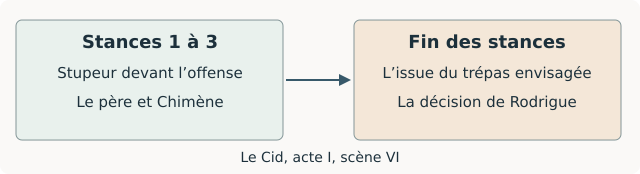

# BEL B/L — Explication d’un texte français, 19 juin 2025 · Corrigé brut

*Corrigé rédigé par IA, non officiel. Signalez toute erreur.*

**Rédaction** · GPT-6.2 Astra Ultra · vitesse non renseignée · 26 novembre 2026

**Relecture** · GPT-6.2 Astra Ultra · vitesse non renseignée · 26 novembre 2026

**Autocontrôle** · GPT-6.2 Astra Ultra · vitesse non renseignée · 26 novembre 2026

## Le feuillet du 19 juin

Les douze billets manuscrits proposent chacun deux textes. Les vingt-quatre passages sont expliqués. Les deux extraits du Cid se suivent dans la même scène. Les deux limites du passage de Boileau sont attestées dans la même édition. Le numéro « billet » suit l’ordre vertical de la page puis l’ordre des pages. [Feuillet du jury](https://www.ens.psl.eu/sites/default/files/francais_19_juin.pdf)

## Billet 1 — Corneille et Zola

Page 1 du PDF. La case de choix désigne le texte 1.

### Texte 1 — Corneille, Le Cid

**Bornes** · I, 6, p. 588, subdivisions 1–3 des stances selon la fiche. L’écriture manuscrite placée devant « 1–3 » n’indique pas un numéro de vers.

Seul après l’ordre de son père, Rodrigue commence par ressentir le coup comme s’il l’avait lui-même reçu. L’alternance des longueurs de vers rend audible la difficulté à développer la pensée. La deuxième stance nomme les termes du conflit. Venger l’honneur de sa maison le dresserait contre le père de Chimène. Dans la troisième, les apostrophes s’adressent jusqu’à l’épée. L’arme ne décide rien à sa place. Cette première moitié du monologue achève de formuler le dilemme.

[Lecture de référence](https://fr.wikisource.org/wiki/Le_Cid/%C3%89dition_Marty-Laveaux/Acte_I)

### Texte 2 — Zola, Au Bonheur des Dames

**Bornes** · p. 159–160, de « Tenez-vous droite » à « murmura-t-il ».

Denise présente un manteau. L’ordre de se tenir droite commande à son corps de servir la vente. L’entrée de Mouret détourne un instant tous les regards vers le patron, puis ils reviennent sur la vendeuse. Mme Desforges critique la coupe du manteau. Mme Aurélie déplace le blâme sur la silhouette de Denise, puis Mouret se joint aux moqueries en évoquant sa coiffure. La distribution des voix mesure l’inégalité entre clientes, personnel et direction. Le passage de l’impératif initial au murmure final invite à écouter qui peut parler haut devant les autres.

[Lecture de référence](https://fr.wikisource.org/wiki/Au_bonheur_des_dames/Texte_entier)

## Billet 2 — Du Bellay et Claude Simon

Page 1 du PDF. La case de choix désigne le texte 2.

### Texte 1 — Du Bellay, Les Regrets

**Bornes** · sonnet XLVIII entier, p. 84.

Le premier quatrain imagine, à la troisième personne, le bonheur de pouvoir écrire sans feindre. Le second fait entrer la première personne. Les questions changent la maxime en plainte contre une contrainte éprouvée. Les reprises verbales des tercets opposent l’intensité de la souffrance à l’impossibilité de la dire publiquement. Le sonnet réalise ainsi un geste délicat. Il publie la plainte tout en maintenant discrète l’identité de celui que le poète ne peut offenser.

[Lecture de référence](https://fr.wikisource.org/wiki/Les_Regrets_%28du_Bellay%29)

### Texte 2 — Claude Simon, La Route des Flandres

**Bornes** · p. 9–10, de l’ouverture à « reconnu le papier ».

Un homme tient une lettre, puis son regard va du papier au narrateur. Les premières reprises donnent la scène avant de livrer les raisons de la rencontre. À l’arrière-plan, les chevaux sont d’abord des touches de couleur. La boue et le souvenir de l’expression de Wack font surgir une autre heure et d’autres images dans la même phrase. Le lecteur doit garder en mémoire l’objet initial. Quand le narrateur reconnaît le papier, la situation se précise par une perception matérielle et une réaction affective.

[Lecture de référence](https://www.associationclaudesimon.org/Traduction-tcheque-d-un-extrait-de-La-Route-des-Flandres.html)

## Billet 3 — Rabelais et Éluard

Page 1 du PDF. La case de choix désigne le texte 1.

### Texte 1 — Rabelais, Gargantua

**Bornes** · prologue, p. 7–9, de « C’est pourquoi faut ouvrir » à « et vie économique ».

Le verbe ouvrir invite à dépasser l’apparence du livre. Puis le chien occupé à un os devient le modèle d’un lecteur attentif. Le détail de ses gestes donne à une activité intellectuelle une matière comique et concrète. Lorsque l’image aboutit à la moelle, le narrateur demande de recommencer l’expérience avec son texte. Le contraste entre l’animal appliqué et l’ambition religieuse, politique et domestique de l’interprétation maintient le sérieux dans le rire.

[Lecture de référence](https://renom.univ-tours.fr/fr/index/corpus/francois-rabelais/gargantua-1542-version-modernisee/prologue-de-l-auteur)

### Texte 2 — Éluard, Capitale de la douleur, « Paris pendant la guerre »

**Bornes** · p. 108, poème entier.

Une notation d’amour pour une statue donne le point de départ. Bêtes, oiseaux et ciel envahissent ensuite l’espace urbain. Leur mouvement autour de la figure immobile transforme le monument en objet d’une célébration inquiétante. Les images opposent le sommeil et le feu, le silence et l’éclat. Le possessif collectif des derniers vers fait enfin passer le rêve de la statue aux hommes. Son glaive appartient encore à l’imaginaire de guerre, mais l’élan final envisage un monde délivré.

[Lecture de référence](https://www.unjourunpoeme.fr/poeme/paris-pendant-la-guerre)

## Billet 4 — Molière et Hugo

Page 2 du PDF. La case de choix désigne le texte 1.

### Texte 1 — Molière, L’Avare

**Bornes** · IV, VII, p. 302, scène entière.

Après le vol de sa cassette, Harpagon cherche où fixer son accusation. Les appels, les impératifs, les questions qui se suivent sans réponse font d’une scène solitaire une poursuite peuplée d’interlocuteurs imaginaires. Il se saisit lui-même, puis traite son argent perdu comme un être dont la disparition menacerait sa propre existence. Les spectateurs finissent par entrer dans le cercle des suspects. La salle rit précisément de ce qu’Harpagon prend pour un indice de complicité.

[Lecture de référence](https://fr.wikisource.org/wiki/L%E2%80%99Avare_%28Moli%C3%A8re%29/%C3%89dition_Louandre%2C_1910/Acte_IV)

### Texte 2 — Hugo, Quatrevingt-treize

**Bornes** · II, 1 selon le billet, p. 161, de « Le premier » à « des papiers ».

La description suspend la conversation pour distribuer trois visages, trois corps et trois manières d’occuper la table. Les noms sont différés. Le lecteur est d’abord placé en position de comparer la froide retenue, la puissance physique et la silhouette inquiète, puis de rattacher les portraits à Robespierre, Danton et Marat. Le dernier inventaire recommence l’opération avec des objets. Le vin, le café et les papiers font entrer des modes de vie différents dans un même tableau politique.

[Lecture de référence](https://fr.wikisource.org/wiki/Quatre-vingt-treize_-_II%2C_2)

## Billet 5 — Diderot et Beckett

Page 2 du PDF. La case de choix désigne le texte 2.

### Texte 1 — Diderot, sur les tableaux de Vernet

**Bornes** · p. 226–227, de « Quelle immense variété » à « et reprend tous ses charmes ». Le billet porte Essais sur la peinture, « Vernet ». Le passage figure dans le Salon de 1763.

L’exclamation initiale promet un inventaire. Pourtant les tableaux semblent s’animer avant même que la description soit achevée. Le présent et les énumérations font passer d’un paysage à l’autre. Diderot donne ensuite à Vernet le rôle de celui qui déclenche l’orage et rétablit le calme. Le critique fait ainsi éprouver la puissance d’une peinture fixe par des verbes qui lui donnent du temps. Le retour de l’éclat après le chaos achève ce petit récit de création.

[Lecture de référence](https://fr.wikisource.org/wiki/Salon_de_1763)

### Texte 2 — Beckett, En attendant Godot

**Bornes** · p. 10–12, de « Peut-on savoir » à « Qui disait ça ? ».

Vladimir affecte une politesse froide pour demander où Estragon a dormi. Les réponses courtes et les silences transforment des retrouvailles ordinaires en enquête qui piétine. Vladimir rappelle ce qu’il aurait fait pour son compagnon, mais le corps douloureux d’Estragon et la chaussure à retirer imposent un autre rythme. La parole passe du besoin matériel à une formule dont on cherche finalement l’auteur. Les deux personnages restent ensemble parce qu’ils continuent à s’interroger, même quand aucune réponse ne suffit.

[Lecture de référence](https://www.kartable.fr/ressources/francais/expose-type-bac/en-attendant-godot-debut-de-la-piece/17142)

## Billet 6 — Mérimée et Marivaux

Page 2 du PDF. La case de choix désigne le texte 2.

### Texte 1 — Mérimée, Chronique du règne de Charles IX

**Bornes** · chapitre VIII, p. 133–134, du début du chapitre à « n° 98 ».

L’auteur interrompt l’intrigue par un dialogue avec son lecteur. Celui-ci attend une peinture des grands personnages et reconnaît les conventions du roman historique. En lui répondant, l’auteur affiche les limites du savoir qu’il pourrait prétendre posséder. À la demande d’un portrait physique, le narrateur conseille au lecteur d’aller voir le buste du roi au musée d’Angoulême. Le numéro d’inventaire donne à cette esquive une précision comique. L’anachronisme du lecteur visiteur devient ainsi une façon de demander de quelles images est faite notre connaissance du passé.

[Lecture de référence](https://fr.wikisource.org/wiki/Chronique_du_r%C3%A8gne_de_Charles_IX)

### Texte 2 — Marivaux, L’Île des esclaves

**Bornes** · scène III, p. 525–526, de « En quoi ? » à « En voilà assez pour à présent ».

Trivelin invite Cléanthis à donner le portrait de son ancienne maîtresse en présence de celle-ci. Au lieu d’une définition générale de la vanité, la servante rejoue des comportements, des mots et des attitudes qu’elle a observés dans l’intimité. Euphrosine doit entendre la voix qu’elle imposait auparavant aux autres. Ce petit théâtre inverse momentanément la distribution sociale du regard. La formule qui arrête l’exercice rappelle toutefois que Trivelin règle encore la durée et les limites de l’épreuve.

[Lecture de référence](https://www.theatralement.com/textes/pierre-de-marivaux-lile-des-esclaves.html)

## Billet 7 — Boileau et Zola

Page 3 du PDF. La case de choix désigne le texte 2.

### Texte 1 — Boileau, L’Art poétique

**Bornes** · p. 230–231, v. 131–154 du chant I. Le billet donne les pages et les numéros de vers. Les deux bornes concordent avec l’édition de Jean-Pierre Collinet, Poésie/Gallimard, 1985.

**Vers 131–140.** Comment un poète fait-il figure de législateur de la langue ? Le premier mot, « Enfin », fait attendre rétrospectivement la venue de Malherbe. Les verbes au passé simple placent à son actif trois conquêtes sensibles à l’oreille : la cadence, la place du mot et les règles auxquelles obéit la muse. La métaphore de la réparation transforme une réforme historique en retour à un bon ordre. Puis les stances apprennent et le vers lui-même « n’osa plus enjamber ». Ce petit drame des formes grammaticales prête à la poésie des gestes et des scrupules humains. Le passage au présent, « sert encor de modèle », fait du récit une leçon pour les contemporains de Boileau.

**Vers 141–146.** « Marchez », « aimez », « imitez » appellent les destinataires à reproduire la clarté de Malherbe. Le « donc » tire de l’histoire une conséquence pratique. L’exemple qui suit change de point de vue. Un lecteur dit « mon esprit » et décrit ce qui arrive quand le sens tarde à paraître. La patience s’épuise avant que le vers ait produit son effet. La clarté devient une exigence que le lecteur peut éprouver dans le temps même de la lecture.

**Vers 147–154.** Les pensées sombres sont prises dans un nuage que le jour de la raison peine à traverser. À cette image d’empêchement succède une consigne qui déplace le travail en amont de l’écriture. « Selon que » établit d’abord une relation graduelle entre idée et expression. Les deux derniers alexandrins la condensent en maxime. La rime des deux adverbes, « clairement » et « aisément », rend sensible l’accord promis entre pensée et parole. Cette facilité de l’arrivée des mots suppose tout le travail de jugement que le poème vient de demander.

**Concordance bibliographique.** Le premier vers du passage, « Enfin Malherbe vint », figure p. 230 de l’édition Poésie/Gallimard de 1985 selon la note 28 d’une thèse conservée à l’Université des arts de Tokyo. Arthur Houplain et Marion Bally citent le dernier vers, « Et les mots pour le dire arrivent aisément », et situent les v. 153–154 du chant I à la p. 231 de l’édition de Jean-Pierre Collinet, Gallimard, 1985. La note 32 commence en bas de leur p. 11 et se poursuit en bas de la p. 12. Les deux bornes imprimées correspondent aux pages et vers inscrits sur le billet. [Note 28, p. 147 de la thèse](https://geidai.repo.nii.ac.jp/record/622/files/hakuon246_full.pdf#page=149) · [Houplain et Bally, note 32, p. 11–12](https://s3.eu-west-3.amazonaws.com/nova-pur-production/upload/documents_1/26524b35-65c7-4494-85a5-4c9691586c78.pdf#page=5) · [Texte des v. 147–154, Université de la Colombie-Britannique](https://blogs.ubc.ca/fren320/files/2009/09/320-boileau.pdf#page=1)

[Édition de comparaison](https://fr.wikisource.org/wiki/Boileau_-_%C5%92uvres_po%C3%A9tiques/L%E2%80%99Art_po%C3%A9tique/Chant_I)

### Texte 2 — Zola, La Curée

**Bornes** · p. 219–220, de « D’habitude, les amants » à « d’une Messaline géante ».

L’adverbe initial présente les rencontres de Renée et Maxime dans la serre comme une habitude. Le vocabulaire précis des plantes semble d’abord en établir le décor. Peu à peu les gestes et les formes du couple se confondent avec les postures et la croissance des végétaux. Le lecteur distingue de moins en moins ce qui appartient aux plantes et ce qui naît du regard posé sur elles. Dans la dernière phrase, les baisers de Renée sont comparés aux fleurs de la grande mauve, et ces fleurs aux lèvres d’une Messaline géante. Une comparaison humaine donne ainsi aux plantes une vie qui semble s’affranchir de celle du couple. Le rapport du jury relève précisément la dimension fantastique et inquiétante de cette serre.

[Lecture de référence](https://fr.wikisource.org/wiki/La_Cur%C3%A9e/IV)

## Billet 8 — Corneille et Céline

Page 3 du PDF. La case de choix désigne le texte 2.

### Texte 1 — Corneille, Le Cid

**Bornes** · I, VI, p. 588–589, de « Il vaut mieux courir au trépas » à la fin de la scène.

Dans cette seconde moitié des stances, Rodrigue cherche d’abord une issue qui laisserait intact son amour pour Chimène. La proposition de mourir suspendrait le choix, mais l’examen de l’honneur familial rend cette issue à son tour honteuse. Les reprises d’une même conclusion, d’abord tentée puis révisée, font entendre la progression du jugement. Rodrigue s’adresse successivement à son âme, puis à son bras. L’impératif collectif de la dernière stance met fin au débat intérieur. Le père est la raison de la décision. Rodrigue continue à se parler à lui-même.

[Lecture de référence](https://fr.wikisource.org/wiki/Le_Cid/%C3%89dition_Marty-Laveaux/Acte_I)

### Texte 2 — Céline, Voyage au bout de la nuit

**Bornes** · p. 15–16, de « Ça a débuté comme ça » à « les dames du café ».

Un démonstratif abrupt donne l’impression que le conteur reprend une conversation déjà engagée. Pourtant il doit aussitôt présenter Arthur Ganate, le lieu et les circonstances. Les tours parlés, les reprises et la distribution très mobile des voix construisent minutieusement cet effet de spontanéité. En opposant les idées toutes faites et la perception de la rue, la dispute rend l’histoire publique audible dans un café. La borne de l’extrait ramène les grands discours à leur petit auditoire.

[Lecture de référence](https://bibliobabil.com/2019/02/03/temperature-et-incipit-voyage-au-bout-de-la-nuit-de-louis-ferdinand-celine-42/)

## Billet 9 — Mme de Sévigné et Chateaubriand

Page 3 du PDF. La case de choix désigne le texte 1.

### Texte 1 — Mme de Sévigné, Correspondance

**Bornes** · lettre 121, p. 139–140, du début à « sujet de discourir ».

La nouvelle est annoncée comme extraordinaire longtemps avant d’être donnée. L’accumulation de superlatifs, puis les injonctions à deviner font du destinataire absent un partenaire de jeu. L’annonce du mariage projeté de Lauzun avec la Grande Mademoiselle est retardée jusque dans le nom, suspendu et recommencé. L’énumération finale des titres rend sensible l’écart social qui explique le bruit de cour. La dernière phrase rend la nouvelle à la circulation des conversations qu’elle vient de mettre en scène.

[Lecture de référence](https://fr.wikisource.org/wiki/Lettre_121%2C_1670_%28S%C3%A9vign%C3%A9%29)

### Texte 2 — Chateaubriand, Mémoires d’outre-tombe

**Bornes** · Livre 42, chapitre 18, p. 606–608, de « Grâce à » à la fin du chapitre. La numérotation varie selon les éditions.

Au terme des Mémoires, la longue durée de la vie permet de regarder l’ouvrage comme un monument achevé. La perspective change lorsque le narrateur quitte le bilan de sa carrière pour l’instant de l’écriture. À la fenêtre, la lune qui disparaît et le jour qui vient associent un paysage visible à la fin d’un monde. La dernière image de la tombe donne au lecteur une position impossible au mémorialiste vivant. Il nous fait déjà entendre une voix d’après sa propre mort.

[Lecture de référence](https://chateaubriand-lenchanteur.fr/journal/conclusion-des-memoires/)

## Billet 10 — Racine et Ponge

Page 4 du PDF. La case de choix désigne le texte 2.

### Texte 1 — Racine, Phèdre

**Bornes** · V, VI, vers 1498–1540, p. 899–900. Le feuillet donne le début « À peine nous sortions » et le repère « flanc poudreux ». Les éditions consultées donnent « leur flanc poudreux ».

Théramène fait revivre à Thésée une scène qu’il n’a pas vue. Au départ, le groupe accompagne Hippolyte dans un silence accordé à sa tristesse. Un bruit venu de la mer rompt la marche. La description retarde l’identification du monstre, puis l’affrontement fait apparaître le courage du prince. La frayeur des chevaux dérègle enfin l’action humaine. L’extrait s’arrête sur l’intervention divine rapportée par la voix de témoins. Le récit change ainsi de degré de certitude avec les verbes de perception.

[Lecture de référence](https://fr.wikisource.org/wiki/Ph%C3%A8dre_%28Racine%29%2C_Didot%2C_1854/Acte_V)

### Texte 2 — Ponge, Le Parti pris des choses, « L’Orange »

**Bornes** · p. 41–42, repère donné par le billet.

Ponge essaie d’abord une comparaison avec l’éponge. La pression exercée sur les deux objets permet de préciser ce qui les distingue. L’écorce reprend partiellement sa forme tandis que les parties internes du fruit sont transformées. Les qualités de couleur, de parfum et de goût appellent ensuite l’attention sur la bouche qui goûte et prononce le nom. Le pépin, plus résistant, dément enfin l’impression d’un objet tout entier dissous en jus. Décrire exige de reprendre et de corriger sa première analogie.

[Lecture de référence](https://tiplanet.org/modules/archives/downloads2/1461671199/15a33d470dbd731a99972dfc37199e8e_sujet_epreuve_anticipee_francais_bac_s_pondichery_2016.pdf)

## Billet 11 — Voltaire et Rimbaud

Page 4 du PDF. Le texte 2 reste lisible sans rature. L’autre proposition est barrée dans le scan, la mention de choix est rognée.

### Texte 1 — Voltaire, Dictionnaire philosophique, « Torture »

**Bornes** · p. 369–370, de « Les Romains n’infligèrent » à « c’est dans le XVIIIᵉ ».

Une comparaison avec l’usage romain semble ouvrir un article historique. Elle conduit très vite au présent du magistrat français et à l’ordinaire d’une conversation domestique. Le ton de civilité crée un décalage avec l’injustice dont il est question. Le cas du chevalier de La Barre donne ensuite un nom à la victime et dément la prétention du siècle à la douceur des mœurs. La datation terminale retourne le regard du lecteur vers son propre temps.

[Lecture de référence](https://inspe.u-pec.fr/medias/fichier/corpus-l-horreur-est-humaine-sujet-bac-blanc-2016_1697641575000-pdf?ID_FICHE=197195&INLINE=FALSE)

### Texte 2 — Rimbaud, Poésies, « Le Dormeur du val »

**Bornes** · p. 53, sonnet entier.

Le premier quatrain compose un paysage vif et lumineux avant de laisser apparaître le jeune soldat. La répétition du sommeil invite à prendre la douceur du lieu pour une protection. Puis le regard se rapproche, les parfums n’obtiennent aucune réaction et la prière adressée à la nature se charge d’inquiétude. Le dernier vers donne une précision de couleur qui oblige à relire les signes précédents. Le sonnet rend ainsi le lecteur responsable de la première interprétation à laquelle il s’était abandonné.

[Lecture de référence](https://fr.wikisource.org/wiki/%C5%92uvres_%28Rimbaud%29/Po%C3%A9sies/Le_Dormeur_du_Val)

## Billet 12 — Hugo et Laclos

Page 4 du PDF. La case de choix désigne le texte 1.

### Texte 1 — Hugo, La Légende des siècles, « La Rose de l’Infante »

**Bornes** · p. 41–42, du début à « elle dédaigne ».

Une petite fille tient une rose et regarde. Le poème retarde l’identification du personnage en installant l’éclat du jardin et les signes de sa condition. La présence royale agrandit peu à peu les proportions de ce tableau d’enfance. Le pouvoir de Philippe II se lit jusque dans la façon dont la fillette est regardée et servie. Le resserrement final sur son âge, puis sur le verbe du dédain, rapproche brutalement l’apprentissage d’un geste et l’étendue d’un empire.

[Lecture de référence](https://fr.wikisource.org/wiki/La_Rose_de_l%E2%80%99Infante)

### Texte 2 — Laclos, Les Liaisons dangereuses

**Bornes** · lettre CXLI, p. 321–322, de « Tout ce que je peux faire » à « Ce n’est pas ma faute ».

Merteuil adresse à Valmont un modèle de lettre qui pourrait servir à rompre. L’emboîtement des voix transforme ce qui paraît une confession personnelle en texte prêt à copier. Au fil des alinéas, les justifications changent, mais le même refrain présente les décisions comme des fatalités. L’effet comique de répétition a un coût pour la destinataire visée. Plus le discours paraît automatique, plus se fait sentir le soin de celle qui en a réglé les effets.

[Lecture de référence](https://fr.wikisource.org/wiki/Les_Liaisons_dangereuses/Texte_complet)
