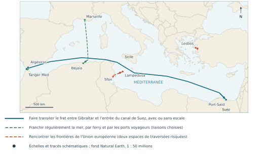

# Circuler en Méditerranée · Composition B/L 2025 · Corrigé guidé

*Corrigé rédigé par IA, non officiel. Signalez toute erreur.*

**Rédaction** · GPT-6.2 Astra Ultra · vitesse non renseignée

Le fascicule des épreuves à option donne le libellé en page physique 2 et le fond de carte en page 3. Le croquis proposé relie des lieux cités dans la composition. Ses tracés représentent des relations géographiques à l’échelle du bassin.

## Introduction

> [!INDICATION]
> Partir d’un lieu où le passage est rapide pour certains et soumis à l’attente pour d’autres.

#### Proposition de réponse

Dans le détroit de Gibraltar, les conteneurs qui empruntent la grande route maritime entre l’Asie et l’Europe du Nord côtoient les ferries reliant les rives marocaine et espagnole. La proximité des côtes ne donne pas à toutes les personnes ni à toutes les marchandises la même possibilité de traverser. Un camion franchit successivement des contrôles, puis change de mode de transport. Un citoyen européen et un ressortissant tenu d’obtenir un visa ne préparent pas le même voyage. À quelques kilomètres d’un port mondial, une frontière peut donc être à la fois un lieu de passage organisé et un obstacle durable.

« Circuler » désigne une pratique. Elle consiste à rejoindre des lieux, passer des seuils, organiser des retours ou des étapes et parfois attendre. Elle concerne la mer et ses détroits, les îles, les ports et les espaces terrestres nécessaires aux voyages. La Méditerranée forme en outre une voie entre Atlantique et océan Indien. Être traversé par un flux ne garantit pas d’y avoir accès. Comment l’équipement du bassin rend-il des trajets particulièrement rapides et réguliers, alors que des obstacles politiques, sociaux et environnementaux en rendent d’autres précaires ?

## I. Faire du bassin une voie de circulation exige des infrastructures et des intermédiaires

> [!INDICATION]
> Suivre une marchandise de la route océanique jusqu’à son éventuelle redistribution régionale.

#### Proposition de réponse

Entre Port-Saïd et Gibraltar, une part importante du trafic emprunte la mer pour relier des marchés dont les principaux destinataires sont situés hors du bassin. Le canal de Suez raccourcit la route entre l’Europe et l’Asie. Il concentre également les passages sur une infrastructure étroite. Son obstruction par l’Ever Given en mars 2021 a suspendu une partie des traversées et formé des files d’attente. Un navire pouvait patienter ou envisager un détour par le cap de Bonne-Espérance, avec une durée et un coût supplémentaires. La distance pertinente dépend donc d’une organisation technique et d’une voie susceptible d’être interrompue.

La route maritime s’articule à des équipements de rive. Tanger Med, ouvert en 2007 à l’est de Tanger, combine terminaux de transbordement, autoroutes, rail et zones industrielles. Un conteneur peut changer de navire sans entrer réellement dans l’arrière-pays marocain. Un véhicule produit près du port emprunte au contraire une chaîne d’exportation qui relie le littoral aux usines. Sur l’autre rive, Algésiras participe au même ensemble de lignes sans exercer les mêmes fonctions sur toutes les marchandises. L’efficacité du passage naît d’investissements et de décisions privées ou publiques, armateurs, opérateurs de terminaux, administrations et douanes.

Ces mécanismes s’appliquent différemment aux îles. Une grande ligne peut passer au large d’une île sans y faire escale, alors que la régularité du ferry local conditionne l’arrivée des biens courants, l’accès aux soins ou le retour des étudiants. La distance entre une île et le continent change de sens selon la fréquence du service, son coût et la saison. Il faut donc distinguer la centralité pour un réseau mondial et l’accessibilité ordinaire des habitants.

## II. Les mêmes rivages distribuent inégalement le droit et les moyens de passer

> [!INDICATION]
> Comparer deux usages d’une même liaison et identifier le point du parcours où intervient la sélection.

#### Proposition de réponse

Chaque été, des familles résidant en Europe rejoignent le Maroc par la route et le ferry. L’opération Marhaba accompagne ces déplacements saisonniers en organisant notamment accueil et transit. L’automobile permet de transporter bagages et objets destinés à la famille, mais impose de tenir compte de la congestion, des horaires et des formalités aux passages entre les rives. Le séjour temporaire et le retour vers l’Europe font de ce mouvement une circulation familiale transnationale. Déduire d’un passage observé un départ définitif serait donc trompeur. Dans le bassin occidental, des liaisons comme Marseille–Béjaïa entretiennent elles aussi des relations familiales et économiques qui ne dépendent pas seulement des courts séjours touristiques.

Sur les mêmes mers, l’accès à une traversée régulière dépend des titres de séjour, des visas, du revenu, des règles des compagnies et des contrôles portuaires. Les frontières extérieures de l’Union européenne donnent à certaines îles une fonction de premier accueil et de tri administratif. Lampedusa dans le canal de Sicile et Lesbos dans l’Égée n’ont ni les mêmes voisins ni les mêmes dispositifs. Elles illustrent toutefois le contraste entre la courte distance mesurée sur la carte et la durée d’un parcours soumis à l’attente, aux secours ou à une procédure d’asile. Les déplacements vulnérables ne s’expliquent pas par la seule attirance pour la rive nord. Sécurité, emploi, réseaux familiaux et règles migratoires pèsent diversement sur les trajectoires. Certaines personnes circulent entre pays de la rive sud ou trouvent refuge dans des pays voisins avant toute traversée.

Le tourisme révèle d’autres sélections. Les croisières font de certaines escales des séquences de quelques heures, solvables pour l’entreprise qui programme la rotation mais parfois encombrantes pour les résidents. À Venise, les restrictions adoptées en 2021 pour les grands paquebots dans les secteurs centraux de la lagune ont déplacé la question vers d’autres accès portuaires. La possibilité d’admirer une ville depuis un navire repose sur des choix collectifs concernant le patrimoine, le travail portuaire et l’usage d’un espace très limité.

## III. Faire durer les liaisons oblige à arbitrer leurs coûts et leurs effets sur les lieux

> [!INDICATION]
> Se demander qui bénéficie du passage, qui le rend possible et qui en supporte le coût.

#### Proposition de réponse

Des quais, des routes et des contrôles rapides réduisent les temps d’acheminement, mais leur coût ne disparaît pas. Le camion transféré sur un ferry utilise les routes à chaque extrémité. Un terminal peut bénéficier de la rapidité de manutention tout en reportant congestion et émissions atmosphériques sur les quartiers voisins. À Marseille, l’électrification à quai vise à réduire une partie des nuisances durant l’escale. Son efficacité dépend du nombre de navires pouvant se brancher, de l’équipement des postes et de l’origine de l’électricité. En mai 2025 entre en vigueur en Méditerranée la zone de contrôle des émissions d’oxydes de soufre des navires. Une norme commune à l’échelle du bassin modifie donc les conditions matérielles de la navigation, sans résoudre à elle seule le problème des émissions de gaz à effet de serre.

Les arbitrages portent aussi sur la pérennité des dessertes. Une liaison insulaire rentable l’été peut rester indispensable en hiver lorsque la clientèle est moindre. Garantir une fréquence minimale, coordonner les horaires du port et des transports terrestres ou adapter les tarifs aux résidents constituent des choix politiques sur le droit de circuler. Les conflits ne se réduisent pas à opposer écologie et mobilité. Le résident sans voiture, le salarié d’un terminal, le croisiériste et le voyageur en transit n’attendent pas la même chose de la même infrastructure.

Le croquis rapproche deux grandes longueurs de parcours, celle d’un transit entre Suez et Gibraltar et celle de liaisons entre rives voisines. Il distingue aussi les lieux où les frontières de l’Union transforment la durée et le risque du trajet. Aucune flèche ne représente une quantité de personnes ou de conteneurs. Ces tracés servent à comparer des pratiques, non à suggérer que tout mouvement du bassin emprunterait un axe unique.

## Conclusion

> [!INDICATION]
> Revenir au verbe du sujet et au paradoxe initial du détroit.

#### Proposition de réponse

Circuler en Méditerranée demande de pouvoir atteindre un port, obtenir une place et parfois un droit de passage, puis poursuivre le trajet sur la rive d’arrivée. Des liaisons globales accélèrent la traversée tout en concentrant les vulnérabilités dans quelques détroits et terminaux. Les usages familiaux, marchands, insulaires et touristiques se rencontrent sur ces mêmes infrastructures, mais les règles et les moyens de passage diffèrent fortement. L’unité du bassin se lit dans ces dépendances réciproques autant que dans les fractures qu’elles font apparaître.
