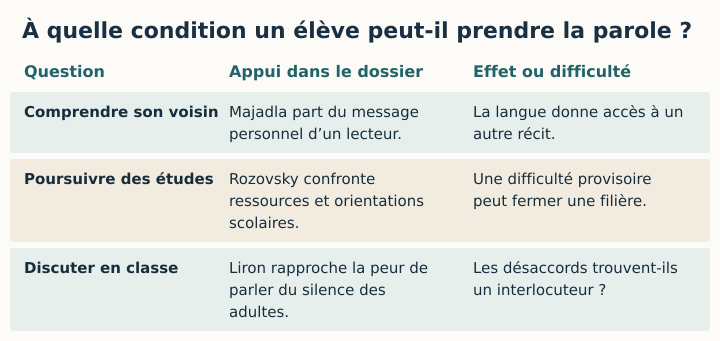

# BEL B/L — Hébreu 2025 · Corrigé brut

*Corrigé rédigé par IA, non officiel. Signalez toute erreur.*

**Rédaction** · GPT-6.2 Astra Ultra · vitesse non renseignée

**Révision (tour 1)** · GPT-6.2 Astra Ultra · vitesse non renseignée

[Sujet officiel](https://www.ens.psl.eu/sites/default/files/2025_blses_epreuve_a_option_sujet_hebreu.pdf)

## מי רשאי לדבר בכיתה, ובאיזו שפה

ילד בכיתה ה׳ אומר למורה לאנגלית שאינו יודע לדבר. את המשפט הזה הוא דווקא מצליח לומר, אלא שהוא אומר אותו בעברית, כדי להסביר למה אינו יכול להשיב באנגלית. הסתירה הקטנה מאירה שאלה שמשותפת לשלושה קטעים מעיתון הארץ: מה הופך ידיעה של מילים ליכולת לפנות לאדם אחר? חנין מג׳אדלה מציעה באפריל 2023 חינוך משותף ליהודים ולערבים; ליזה רוזובסקי בודקת בדצמבר 2024 את קליטת התלמידים העולים; ולירון, בספטמבר אותה שנה, כותבת מניסיונה כמורה. שלושתן פוגשות שתיקה בכיתה או מחוצה לה, אבל בכל מקרה מי ששותק משלם מחיר אחר.

**לשמוע את השכן בלי מתווך.** מג׳אדלה פותחת בהודעה פרטית של קורא. אדם שגדל במשפחה מזרחית ימנית מספר לה שהפוסטים שלה מערערים משהו בחינוך שקיבל. הפנייה הישירה עצמה כבר עושה דבר שמערכת החינוך לא הצליחה לעשות: היא מאפשרת לשני אנשים שחיים בסמיכות להכיר זה בניסיונו של זה. המרחק ביניהם אינו גאוגרפי. כששירה של מחמוד דרוויש מגיעה אל הקורא דרך שורה שנעשתה כלי בוויכוח פוליטי, הוא עשוי לזהות את שם המשורר בלי להכיר שום דבר מעולמו. גם הדוגמה המשעשעת של ספל הקפה מדויקת: אפשר לשאול מילה משפה אחרת ולחשוב שמבינים אותה בשעה שמתכוונים לכלי הלא נכון.

מכאן משמעות ההצעה ללמד מגיל צעיר שתי שפות ושני סיפורים היסטוריים. המטרה אינה רק לתרגם במהירות תוכן שנתפס מראש כאיום. הכותבת מזכירה שירים שסביו של הקורא אולי אהבו באלכסנדריה או בבגדאד. הערבית היא אפוא גם מפתח לעבר יהודי שהקורא עלול לאבד. לירון נותנת לשאלה הזאת ממד כיתתי: ילדים עשויים לקרוא מילה במהירות ולהיבהל ברגע שעליהם לנסות אותה בקול. בשני המאמרים הכישרון לזהות סימנים על הדף רחוק מן הנכונות להסתכן בתשובה שאולי תתברר כמוטעית.

**כאשר השפה היא תנאי להמשך הלימודים.** אצל רוזובסקי אין מדובר בבחירה אם להכיר ספרות שכנה. תלמידים שהגיעו לישראל זקוקים לעברית כדי שיכירו גם בידע שכבר רכשו. הכתבה מציינת שכמעט 19 אלף מתוך כ־23 אלף הילדים ובני הנוער בגיל בית הספר שנקלטו בתקופה המתוארת באו ממדינות ברית המועצות לשעבר. חלקם למדו קודם בבתי ספר מצוינים. כאשר מגבילים את בחירת המגמה של נער משום שהעברית שלו עדיין חלשה, קל להפוך קושי שניתן להתגבר עליו להחלטה שתשפיע על מסלול לימודיו. כיתות מיוחדות לעולים ממחישות את המתח: הן מספקות חברים ושפה משותפת, ובה בעת עלולות לצמצם את ההזדמנויות לפגוש תלמידים אחרים ולרכוש עברית מדוברת.

הכתבה מעמתת עדויות עם תגובת משרד החינוך. המשרד מפרט תוכניות, הכשרה ושיתוף פעולה עם הרשויות המקומיות. עצם קיומה של תוכנית אינו מעיד שמורה מתאימה ושעות הוראה יעמדו לרשותו של ילד מסוים; הכתבה אף מציינת תנאי תקציבי לגבי חלק מן המענים. כך מקבל המונח ״גישה לשפה״ משמעות מעשית: מי מלמד, במשך כמה זמן, ואילו אפשרויות עומדות בפני מי שטרם הצליח? גם כשהעיתון מביא את שני הצדדים, אין לקורא סיבה למחוק את הפער בין ההבטחה ובין החוויה.

**שתיקה שאינה נמדדת במבחן.** לירון מספרת שהחלה ללמד כמעט בלי הכשרה רלוונטית, ואינה פוטרת את עצמה מאחריות למבוכת תלמידיה. לירון מצטטת סקר משנת 2021 שבו רק 12 אחוזים מבוגרי מערכת החינוך הרגישו בנוח לדבר אנגלית עם מי שאינם דוברי עברית. אלה כבר בוגרים. לכן הסקר מעמיד בסימן שאלה את התוצאה של שנות לימוד שלמות, בעוד שהתלמיד בכיתה ה׳ עדיין לומד. מכאן היא עוברת מן הקושי לדבר אנגלית לשאלה מה מותר בכלל לומר בבית הספר. על לוח הכניסה אפשר לתלות כותרות על פגיעות בזכויות אדם במקומות רחוקים, בשעה שמה שמתרחש בקרבת הילדים נעדר ממנו. כשמורה מעלה בקבוצת עמיתים ידיעה על חופש הביטוי וננזפת על הכנסת פוליטיקה לדיון, השתיקה כבר איננה בעיה של אוצר מילים. האירוניה במשפט הסיום, שלפיו מקום מלא ילדים רועשים הוא מקום שקט עד מאוד, תלויה במעבר הזה ממשמעות אקוסטית למשמעות אזרחית.

הצעה לשני נרטיבים, בירור שעות ההוראה וניסיון ליצור שיחה אמיתית אינם אותו פתרון. הראשון מבקש לשנות את היחס בין שתי קהילות; השני בוחן את חובתו של מוסד לתלמיד שהגיע זה עתה; השלישי שואל אם המוסד עצמו מסוגל לשאת מחלוקת. יחד הם מציעים לבחון את הצלחת הלימוד ברגע שקשה לספור: האם תלמיד רשאי לומר דבר שלא היה צפוי מראש, והאם מישהו בכיתה מוכן להשיב לו?

