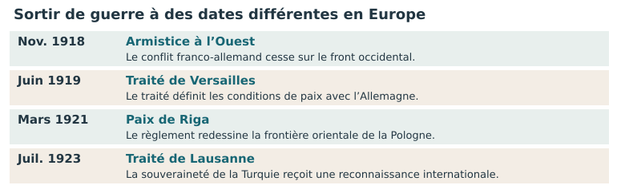
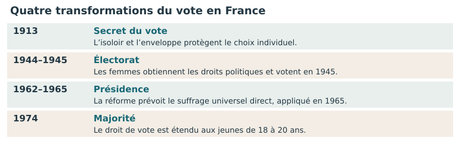

# BEL B/L — Histoire contemporaine, 16 juin 2025 · Corrigé brut

*Corrigé rédigé par IA, non officiel.*

**Rédaction** · GPT-6.2 Astra Ultra · vitesse non renseignée

Le jury propose deux sujets avant les 90 minutes de préparation. Le passage dure 20 minutes d’exposé et 10 minutes d’entretien. Les deux leçons de chaque tirage sont développées ici. La mention de choix restitue le gras du feuillet officiel. Les relances sont des propositions d’entraînement.

## Tirage 1

### L’immigration en France sous la IIIe République

*Sujet choisi, imprimé en gras sur le feuillet.*

En 1931, le recensement dénombre près de 2,7 millions d’étrangers en France. Ce nombre mesure une nationalité juridique à une date donnée. Un enfant d’immigrés peut être français, un réfugié peut changer de statut. Comment une République qui se pense comme une nation de citoyens devient-elle un pays d’immigration de masse, sans donner à tous ses habitants les mêmes droits ?

**Une immigration de voisinage devient une question nationale.** Dès les années 1870, des Belges travaillent dans le textile et les mines du Nord, des Italiens dans le bâtiment, l’agriculture et les industries du Sud-Est. Les bassins de recrutement débordent les frontières politiques. Les familles et les relations professionnelles orientent les nouveaux arrivants. Dans un pays à faible croissance démographique, l’État se préoccupe aussi du service militaire et de l’appartenance nationale. La loi de 1889 renforce l’acquisition de la nationalité pour les descendants d’étrangers nés en France. Entre les générations d’une même famille, le lien juridique à la France peut donc changer.

**La guerre et la reconstruction organisent les recrutements.** Pendant la Grande Guerre arrivent des travailleurs étrangers et coloniaux. Un sujet de l’empire a une situation juridique distincte de celle d’un étranger européen. Après les pertes humaines et les destructions, des accords comme la convention franco-polonaise de 1919 soutiennent des migrations de travail. Dans les cités minières, entreprises, associations, paroisses et écoles structurent des sociabilités parfois polonophones. Apprendre le français et maintenir des liens avec le pays de départ sont des pratiques qui coexistent.

**L’installation ne garantit ni sécurité ni égalité.** Les violences d’Aigues-Mortes contre des ouvriers italiens en 1893 rappellent l’ancienneté de la xénophobie. Dans la crise des années 1930, restrictions d’emploi et retours contraints touchent notamment des mineurs polonais. Les réfugiés fuyant les dictatures arrivent alors que l’accueil se durcit. En 1939, après la chute de la Catalogne, des républicains espagnols sont internés dans des camps du sud de la France. La République a ainsi construit simultanément des voies d’intégration et des instruments de classement et d’exclusion.

**Relance.** Le chiffre des étrangers mesure-t-il les immigrés ? Un immigré est né étranger à l’étranger et peut devenir français. Un étranger peut être né en France. Le recensement selon la nationalité change aussi avec les naturalisations.

### La Seconde Guerre mondiale hors d’Europe

*Autre proposition du même tirage.*

Prendre pour point de départ l’Europe de septembre 1939 ferait disparaître une partie des origines de la guerre mondiale. En Asie orientale, le Japon s’est emparé de la Mandchourie en 1931 et mène à partir de 1937 une guerre de grande ampleur contre la Chine. Comment des conflits régionaux et impériaux se transforment-ils en une guerre mondiale dont la sortie déplace les équilibres politiques ?

**Une guerre d’empires aux temporalités distinctes.** La conquête japonaise provoque destructions, déplacements et violences de masse contre les civils en Chine, notamment à Nankin en 1937. Nationalistes et communistes chinois participent à la résistance à l’occupation en conservant leurs projets politiques contradictoires. En Afrique, l’invasion italienne de l’Éthiopie en 1935 avait déjà mis en difficulté l’ordre international. La guerre élargit ensuite les contraintes imposées aux colonies européennes. La mobilisation des matières premières, du travail et de soldats concerne des régions éloignées de tout front.

**La mondialisation de la guerre relie des économies et des sociétés.** En décembre 1941, l’attaque japonaise contre Pearl Harbor fait entrer les États-Unis dans la guerre contre le Japon. Les Philippines et une grande partie de l’Asie du Sud-Est subissent l’occupation. La promesse japonaise d’émancipation asiatique se heurte à l’exploitation des territoires conquis. Les États-Unis mobilisent leur industrie à une échelle exceptionnelle, au prix de choix sociaux tels que l’internement de personnes d’ascendance japonaise. En Afrique du Nord, le débarquement allié de novembre 1942 bouleverse les rapports entre autorités françaises et Alliés. L’Afrique équatoriale française avait déjà fourni des territoires et des ressources à la France libre.

**La victoire ne restaure pas l’ordre d’avant-guerre.** Dans le Pacifique, les populations civiles portent une part considérable des pertes. En août 1945, les bombardements atomiques d’Hiroshima et Nagasaki et l’entrée en guerre soviétique contre le Japon précèdent l’annonce de sa reddition. Les États-Unis deviennent une puissance centrale de l’ordre du Pacifique. En Indonésie et au Vietnam, l’effondrement de la domination japonaise ouvre la voie à des proclamations d’indépendance dès 1945, bientôt contestées par les anciennes puissances coloniales. Hors d’Europe se jouent donc des processus mondiaux décisifs, y compris la fin de la légitimité des empires européens.

**Relance.** Pourquoi distinguer victoire militaire et fin des violences ? En Chine, la guerre civile reprend à grande échelle. En Asie du Sud-Est, indépendances proclamées et tentatives de restauration coloniale débouchent sur de nouveaux conflits.

## Tirage 2

### André Malraux

*Autre proposition du même tirage.*

En décembre 1964, Malraux prononce le discours qui accompagne l’entrée des cendres de Jean Moulin au Panthéon. Un écrivain engagé dans les combats du siècle parle comme ministre et met en récit la Résistance pour un public national. Comment son parcours éclaire-t-il la transformation de la fonction publique de l’intellectuel en France ?

**De l’aventure à la littérature politique.** Né en 1901, Malraux découvre l’Indochine coloniale dans les années 1920. L’affaire des sculptures de Banteay Srei, puis son activité de presse critique envers l’ordre colonial, interdisent d’en faire d’emblée un héros sans contradictions. Dans *La Condition humaine*, prix Goncourt 1933, l’insurrection de Shanghai sert à interroger l’action collective, la fraternité et la mort. Le roman donne à des lecteurs français accès à une révolution lointaine tout en construisant une œuvre de fiction.

**De l’antifascisme au gaullisme.** Compagnon de route de la gauche antifasciste, Malraux s’engage aux côtés des républicains espagnols et publie *L’Espoir* en 1937. Son engagement dans la Résistance française devient effectif en 1944. Après la Libération, il choisit de Gaulle, participe au RPF et s’inscrit dans une conception de la nation qui ne se confond plus avec celle des fronts antifascistes de sa jeunesse. Ses récits et discours donnent une unité héroïque à ces engagements successifs. L’historien distingue les actes attestés, leurs dates et la figure que Malraux contribue à construire.

**Une politique d’État pour les arts.** Ministre chargé des Affaires culturelles de 1959 à 1969, il porte l’objectif de rendre accessibles les œuvres majeures. Les maisons de la culture doivent organiser la rencontre entre un public et les œuvres au-delà de Paris. La loi de 1962 sur les secteurs sauvegardés élargit la protection du patrimoine à des ensembles urbains. Cette politique élève la culture au rang de responsabilité ministérielle. Elle suscite aussi un débat sur les apprentissages et les conditions sociales nécessaires pour que de nouveaux publics fréquentent ces institutions. Malraux, mort en 1976, laisse ainsi une question durable sur la capacité du prestige de l’art et de la parole d’État à démocratiser effectivement la culture.

**Relance.** Que montre le discours pour Jean Moulin ? L’État sélectionne une figure de l’unification résistante et propose une mémoire nationale dans une cérémonie retransmise. Le discours constitue lui-même une source sur les années de Gaulle.

### Sortir de la Grande Guerre en Europe

*Sujet choisi, imprimé en gras sur le feuillet.*

Le 11 novembre 1918, l’armistice interrompt les combats contre l’Allemagne sur le front occidental. Des familles recherchent toujours des disparus, des soldats restent mobilisés et des États se disputent leurs frontières. Pourquoi la paix se construit-elle à des vitesses aussi différentes en Europe ?

**Démobiliser des sociétés épuisées.** Le retour se fait par étapes. Il faut rapatrier les prisonniers, loger les déplacés et réinsérer dans l’emploi des millions d’anciens combattants, dont certains souffrent de blessures durables. Les veuves et les orphelins portent le coût familial des pertes. Dans les régions françaises ou belges dévastées, reconstruire les logements et les lieux de production demande plusieurs années. Les associations d’anciens combattants deviennent des interlocuteurs de l’État pour les pensions. Le travail des femmes pendant la guerre ne se traduit pas partout par les mêmes droits politiques ou possibilités professionnelles.

**Produire de nouvelles frontières prolonge certains conflits.** L’effondrement des empires allemand, austro-hongrois, russe et ottoman ouvre une lutte pour la définition de la souveraineté. En Europe centrale, la Tchécoslovaquie et la Pologne réunissent des populations diverses dans des États nouveaux ou rétablis. Les traités, dont Versailles en 1919, associent garanties de sécurité, réparations et reconnaissance des frontières. La guerre entre la Pologne et la Russie soviétique se poursuit jusqu’à la paix de Riga en 1921. En Méditerranée orientale, la guerre gréco-turque et le règlement de Lausanne en 1923 s’accompagnent de déplacements forcés. L’armistice de l’Ouest ne date donc pas la sortie de guerre de tout le continent.

**Donner un sens politique et intime aux pertes.** Dans de nombreux pays, cérémonies et monuments offrent un lieu de deuil collectif à des familles privées de sépulture identifiable. En France, le Soldat inconnu sous l’Arc de triomphe incarne en 1920-1921 cette reconnaissance. En Allemagne, conflits politiques et contestation du traité fragilisent les débuts de la République de Weimar. Les sociétés peuvent simultanément aspirer à la sécurité internationale et se diviser sur la responsabilité de la défaite ou la légitimité du nouvel ordre. Sortir de la guerre signifie donc aussi redéfinir les appartenances politiques et les obligations envers les survivants.

**Relance.** Comment interpréter la création de la Société des Nations ? Elle manifeste l’effort d’institutionnaliser le règlement des différends. Les guerres persistantes et les absences parmi ses membres limitent son champ d’action dès ses débuts.

## Tirage 3

### Vieillir en France (1870-années 1980)

*Sujet choisi, imprimé en gras sur le feuillet.*

Un pays peut compter davantage de personnes âgées avant même qu’une retraite soit garantie à tous. La France connaît tôt une baisse de la fécondité. Ses progrès sanitaires et la baisse ultérieure de la mortalité prolongent aussi les existences. Comment la vieillesse devient-elle, entre la fin du XIXe siècle et les années 1980, un temps de la vie organisé par des politiques publiques, tout en restant profondément inégal ?

**La vieillesse dépend d’abord de la position familiale et professionnelle.** Un propriétaire disposant d’un revenu ou un fonctionnaire couvert par un régime particulier ne vieillit pas comme un journalier obligé de travailler aussi longtemps que son corps le permet. Habiter chez un enfant ou transmettre une exploitation en échange d’une aide sont des solutions familiales possibles, sans être universelles. L’assistance publique aux vieillards sans ressources se structure notamment avec la loi de 1905. La loi de 1910 sur les retraites ouvrières et paysannes élargit le principe de prévoyance, avec une couverture et des montants encore limités.

**La retraite devient un droit social plus large.** Les assurances sociales de 1928-1930 puis la Sécurité sociale de 1945 consolident l’idée d’un revenu lié à la carrière. Des professions restent cependant couvertes selon des calendriers et par des régimes différents. Le minimum vieillesse instauré en 1956 répond à la situation des personnes aux droits insuffisants. Les carrières courtes ou discontinues et le faible salaire pèsent particulièrement sur les pensions féminines. Une retraitée âgée, devenue veuve, peut vivre beaucoup plus longtemps que son conjoint et avec moins de ressources.

**Les usages sociaux de l’âge se différencient.** Le rapport Laroque de 1962 invite à penser logement, services et maintien à domicile. L’amélioration moyenne des pensions et l’allongement de la vie rendent possible le développement des loisirs et des associations du « troisième âge ». À côté de cette image, l’isolement, la perte d’autonomie et le besoin d’aide quotidienne demeurent. L’ordonnance de 1982 permet sous conditions la retraite à soixante ans à partir de 1983. L’âge de cessation du travail se dissocie ainsi davantage de l’incapacité physique. L’histoire de la vieillesse relie trajectoires biologiques, solidarités familiales et choix collectifs sur la répartition des ressources.

**Relance.** Le vieillissement est-il seulement un effet de l’espérance de vie ? La baisse de la fécondité réduit la part des jeunes, et les migrations ou les guerres modifient aussi la pyramide des âges.

### Réfugiés et déplacés dans le monde au 20e siècle

*Autre proposition du même tirage.*

Une personne contrainte de quitter sa maison peut se retrouver de l’autre côté d’une frontière, ou dans une autre région du même État. Elle peut être secourue sans recevoir un statut de réfugié. Comment les déplacements forcés deviennent-ils au XXe siècle un problème international, alors que le pouvoir d’accueillir et de protéger reste très largement exercé par les États ?

**Un monde d’empires en crise crée des populations sans protection.** La Grande Guerre, les persécutions et le démembrement des empires déplacent notamment des Arméniens et des Russes. Le passeport Nansen, mis en place à partir de 1922 sous l’égide de la Société des Nations, fournit à certains réfugiés un document d’identité reconnu par des États. Il répond à l’absence de papiers nationaux sans conférer une nationalité. Dans les années 1930, les Juifs qui cherchent à quitter l’Allemagne nazie ou les républicains espagnols fuyant en 1939 rencontrent des politiques d’accueil restrictives. La possibilité de trouver refuge dépend donc aussi des pays de destination.

**La guerre mondiale transforme les échelles et le droit.** Occupations, génocide et déplacements de frontières laissent après 1945 des millions de personnes loin de chez elles. Pour les personnes déplacées en Europe, rapatriement et réinstallation constituent deux issues possibles, parfois conflictuelles. La partition de l’Inde britannique en 1947 provoque parallèlement des migrations massives entre l’Inde et le Pakistan. L’exode palestinien de 1948 conduit à la création d’une agence onusienne particulière, l’UNRWA. Ces situations invitent à décentrer une chronologie longtemps racontée depuis la seule Europe.

**Une protection internationale s’élargit de façon inégale.** Le Haut-Commissariat des Nations unies pour les réfugiés entre en fonctions en 1951. La convention de Genève de la même année définit le réfugié autour d’une crainte fondée de persécution hors du pays dont il a la nationalité. Le protocole de 1967 lève la restriction temporelle initiale. Les guerres en Afrique, en Indochine puis en Afghanistan mettent en évidence l’importance de l’accueil par les pays voisins. Les déplacés intérieurs demeurent sous la juridiction de leur État et hors de cette définition précise. Le siècle voit donc progresser des garanties juridiques alors que l’accès effectif à la sécurité reste fortement tributaire du lieu, de la date et des ressources disponibles.

**Relance.** Un réfugié est-il forcément apatride ? On peut conserver sa nationalité tout en ne pouvant obtenir la protection de son État. L’apatride ne possède la nationalité d’aucun État.

## Tirage 4

### Les intellectuels et l’Affaire Dreyfus

*Sujet choisi, imprimé en gras sur le feuillet.*

En janvier 1898, Émile Zola publie dans *L’Aurore* une lettre ouverte accusant les autorités d’avoir maintenu une injustice. Un romancier célèbre s’adresse au président de la République au sujet d’un jugement militaire. Comment l’affaire Dreyfus redéfinit-elle la légitimité d’une intervention publique au nom du savoir et de la conscience ?

**Une erreur judiciaire devient une cause.** En 1894, le capitaine Alfred Dreyfus, officier français juif, est condamné à tort pour trahison et déporté. L’antisémitisme, le prestige de l’armée et la protection accordée au secret militaire rendent la contestation difficile. Sa famille, en particulier son frère Mathieu, et des soutiens tels que Bernard Lazare contribuent à rassembler et faire circuler les arguments. Le lieutenant-colonel Picquart découvre des éléments mettant en cause Esterhazy. La cause naît donc d’un travail d’enquête et de relais successifs avant l’intervention de Zola.

**La presse et la pétition construisent un collectif.** Après l’acquittement d’Esterhazy en janvier 1898, « J’accuse… ! » donne une audience nationale à la dénonciation. Le procès de Zola transforme la salle d’audience en scène de débat public. Écrivains, universitaires, artistes et scientifiques signent des pétitions. En affichant noms et professions, ils engagent une compétence et une réputation acquises ailleurs. Les antidreyfusards comptent aussi des écrivains, dont Barrès, et opposent à l’universalisme juridique la défense de l’armée, de la nation ou de l’autorité. Le mot « intellectuels », alors polémique, désigne donc une position publique disputée.

**L’Affaire transforme durablement le répertoire de l’engagement.** La Ligue des droits de l’homme est fondée en 1898. Au procès de Rennes en 1899, Dreyfus est de nouveau condamné, puis gracié. La Cour de cassation le réhabilite en 1906, ce qui distingue la reconnaissance de l’innocence d’une mesure de clémence. Les lignes politiques se recomposent autour de la justice, de l’antisémitisme et du rôle des institutions. Les intellectuels n’ont pas seuls obtenu la réhabilitation. Ils ont contribué à rendre la révision publiquement défendable et créé des formes d’action réutilisables bien au-delà de cette affaire.

**Relance.** Pourquoi une pétition est-elle une source historique ? La liste des noms, métiers, absents et supports de publication permet de reconstituer un réseau et les formes de légitimité qu’il revendique.

### La dénazification de l’Europe

*Autre proposition du même tirage.*

En 1945, la défaite du Reich met fin au pouvoir nazi, mais laisse des administrations, des institutions et des sociétés marquées par la dictature et les collaborations. Qui doit répondre de quoi, et comment rendre possible une vie politique démocratique ? La dénazification désigne au sens strict le démantèlement des structures et de l’influence nazies, particulièrement dans l’Allemagne occupée. À l’échelle européenne, elle croise les politiques nationales d’épuration et la reconnaissance des victimes.

**Punir et rendre publiques les responsabilités.** Les Alliés dissolvent les institutions nazies et engagent des poursuites. Le procès de Nuremberg de 1945-1946 juge des dirigeants du régime et contribue à établir la responsabilité pénale individuelle pour des crimes internationaux. Les documents et les témoignages utilisés rendent les crimes publics. Le nombre des accusés à ce procès est toutefois infime au regard du nombre des participants aux persécutions et aux occupations. D’autres procès ont lieu dans les zones occupées et dans les pays libérés.

**Transformer les institutions pose la question des continuités.** Les autorités d’occupation cherchent à écarter du pouvoir des responsables compromis et à réorganiser enseignement, médias et administration. Les procédures de classement, questionnaires et sanctions varient selon les zones. Évaluer des parcours individuels, distinguer niveaux de responsabilité et recruter des personnels qualifiés crée des tensions. Les démocraties d’Europe occidentale sanctionnent aussi des collaborations selon leur propre droit. En France, l’épuration repose notamment sur les cours de justice et les chambres civiques. La dénazification de l’Allemagne et ces procédures françaises se recoupent par leurs enjeux mais gardent des bases juridiques différentes.

**La guerre froide et les mémoires déplacent les priorités.** En Allemagne de l’Ouest, la stabilisation et la reconstruction favorisent la réintégration de nombreux anciens membres du parti dans la société et parfois les institutions. La RDA revendique une identité antifasciste officielle et transforme profondément les structures de propriété et de pouvoir, tout en sélectionnant les responsabilités mises en avant. En Autriche, le récit national d’un pays victime de l’annexion a longtemps limité la reconnaissance de certaines participations. Les procès ultérieurs, notamment celui de Francfort sur Auschwitz à partir de 1963, et le travail historique des générations suivantes rouvrent les questions. Dénazifier relève donc de temporalités pénale, politique et mémorielle différentes.

**Relance.** Un procès peut-il mesurer l’ensemble de la participation sociale ? Il établit la culpabilité juridique de personnes déterminées. L’histoire peut aussi étudier des comportements collectifs, des structures et des continuités que le dossier pénal ne saisit pas.

## Tirage 5

### Voter en France des années 1870 aux années 1980

*Autre proposition du même tirage.*

Dans les années 1870, une partie des hommes appelés à élire les députés vote déjà depuis les débuts du suffrage universel masculin en 1848. Un siècle plus tard, les Françaises élisent elles aussi directement le président de la République. Comment le vote s’impose-t-il comme geste ordinaire de la citoyenneté tout en changeant de public, de technique et d’enjeu ?

**Un apprentissage républicain.** Les scrutins des années 1870, notamment la crise de 1877, contribuent à décider si le régime sera durablement parlementaire et républicain. Dans les communes, réunions, journaux, professions de foi et sociabilités locales donnent des significations concrètes aux candidatures. La pratique ne se résume pas à un choix individuel déjà constitué. Des réseaux de notables, des familles politiques puis des partis organisés concourent à former les préférences. En 1913, l’usage de l’isoloir et de l’enveloppe protège mieux le secret matériel du vote. Les électeurs peuvent plus facilement se soustraire au regard de leur employeur ou des autres membres de la commune.

**Le corps politique est progressivement redéfini.** Longtemps les femmes demeurent exclues, malgré les mobilisations suffragistes et plusieurs votes favorables de la Chambre. L’ordonnance d’avril 1944 reconnaît leur droit de vote et d’éligibilité. Elles l’exercent pour la première fois aux municipales d’avril 1945. Dans l’empire et particulièrement en Algérie, les statuts et les collèges électoraux maintiennent des inégalités politiques. La République proclamant l’universalité du suffrage a donc longtemps attribué des poids et des possibilités d’accès différents. Le régime de Vichy rompt par ailleurs avec le fonctionnement électoral de la République.

**La Ve République modifie les enjeux du scrutin.** Le référendum de 1962 établit l’élection présidentielle au suffrage universel direct, appliquée en 1965. La télévision, les sondages et la personnalisation des candidatures donnent à ce vote une place particulière, aux côtés des législatives et des élections locales. La majorité électorale abaissée à 18 ans en 1974 fait entrer de nouveaux électeurs. L’alternance de 1981 donne à voir la portée d’un changement de majorité, tandis que l’abstention variable selon les scrutins rappelle que le droit ne produit pas mécaniquement la participation. Voter est à la fois une règle de désignation et une pratique sociale historiquement construite.

**Relance.** Suffrage universel et mode de scrutin désignent-ils la même chose ? Le premier détermine qui peut voter. Le second convertit les suffrages en résultat, par exemple selon une règle majoritaire ou proportionnelle.

### Le terrorisme dans le monde après 1945

*Sujet choisi, imprimé en gras sur le feuillet.*

Après 1945, des États et des organisations internationales cherchent à qualifier des violences politiques qui visent, par la peur, à peser sur un public plus large que leurs victimes immédiates. Le mot « terrorisme » fait lui-même l’objet de conflits de définition. L’histoire doit restituer objectifs déclarés, victimes, cadres politiques et usages du terme. Comment des contextes très différents ont-ils transformé ce phénomène en question internationale majeure ?

**Des conflits de souveraineté aux années de contestation.** Décolonisation et conflits nationaux donnent lieu à des violences dirigées contre des civils, mais tous les acteurs ni tous les moyens d’un mouvement national ne relèvent de la même catégorie. Dans la guerre d’Algérie, l’examen des victimes civiles, des responsabilités et des réactions au FLN comme à l’OAS montre les enjeux politiques du vocabulaire. En Europe des années 1970, des organisations d’extrême gauche et d’extrême droite recourent à la violence politique tandis que les institutions démocratiques sont contestées. En Italie, l’assassinat d’Aldo Moro en 1978 par les Brigades rouges éprouve la démocratie parlementaire et la capacité de la justice à poursuivre les responsables.

**Internationalisation et publics multiples.** L’attentat contre les sportifs israéliens aux Jeux de Munich en 1972 illustre le retentissement international que peut prendre une violence politique dans un événement mondial. Les familles des victimes, les opinions nationales et les gouvernements ne donnent pas le même sens à l’événement. Le conflit nord-irlandais rappelle de son côté la nécessité de replacer la violence dans une histoire des discriminations, des appartenances nationales et des négociations. Les divisions sur le statut de l’Irlande du Nord traversent durablement la société britannique et l’île d’Irlande. Les issues politiques ne suivent donc pas toutes le même calendrier.

**Les réponses politiques et judiciaires se transforment.** Les années 1970 et 1980 voient se développer la coopération policière et judiciaire entre États européens. En France, les attentats qui touchent notamment Paris en 1986 provoquent un deuil public et relancent le débat sur la protection de la population. La loi de septembre 1986 spécialise certaines procédures judiciaires. Les démocraties doivent concilier la sécurité des personnes, les droits de la défense et la responsabilité des autorités devant la loi. En ouverture, les attentats du 11 septembre 2001 réorienteront encore les politiques de sécurité internationales. Sur toute la période, la protection des civils, les enquêtes judiciaires et le contrôle démocratique des mesures d’exception restent au cœur de la réponse des États. Une histoire mondiale doit ainsi expliquer les effets sociaux et politiques sans reprendre les mises en scène des auteurs.

**Relance.** Pourquoi faut-il distinguer objectifs et effets ? Le but revendiqué par un groupe ne dit ni comment réagit la population ni quelle décision prend l’État. Les conséquences peuvent contredire le projet des auteurs.
