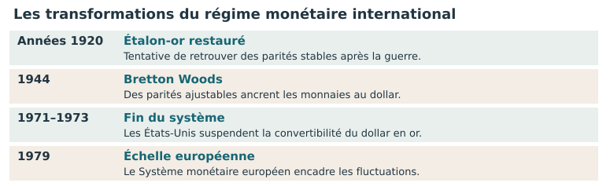
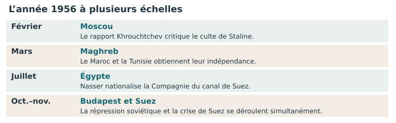

# BEL B/L — Histoire contemporaine, 17 juin 2025 · Corrigé guidé

*Corrigé rédigé par IA, non officiel.*

**Rédaction** · GPT-6.2 Astra Ultra · vitesse non renseignée

Le jury propose deux sujets avant les 90 minutes de préparation. Le passage dure 20 minutes d’exposé et 10 minutes d’entretien. Les deux leçons de chaque tirage sont développées ici. La mention de choix restitue le gras du feuillet officiel. Les relances sont des propositions d’entraînement.

## Tirage 1

### Les leaders politiques en France de 1870 à 1990

*Autre proposition du même tirage.*

> [!INDICATION]
> Comparer les ressources dont disposent Gambetta, Blum et de Gaulle. Pour chacun, préciser par quelle institution sa parole peut devenir une décision.

En 1877, Gambetta mobilise les électeurs pour que le résultat des législatives s’impose au président Mac-Mahon. En 1965, les électeurs départagent directement de Gaulle et Mitterrand à la présidentielle. Entre ces deux scènes, la fonction de chef se transforme. Comment devient-on un leader dans des régimes qui se réclament de la souveraineté populaire ?

**La République parlementaire apprend à se méfier du pouvoir personnel.** Le souvenir des Bonaparte pèse sur la naissance du régime. L’éloquence, les réseaux locaux, la presse et les alliances à la Chambre assoient l’influence de Gambetta puis de Clemenceau. La popularité du général Boulanger à la fin des années 1880 montre qu’une figure supposée incarner directement la nation peut aussi menacer les institutions. Un leader parlementaire dépend d’une majorité qui peut lui retirer sa confiance.

**Les organisations collectives produisent leurs chefs.** L’essor des partis transforme les mécanismes de sélection. Jaurès s’appuie sur la tribune, la presse et l’unification socialiste de 1905. Blum dirige en 1936 un gouvernement dont la légitimité provient d’une coalition électorale et dont l’action est aussi façonnée par les grèves. Les femmes restent longtemps exclues des mandats électifs, ce qui réduit leur visibilité au sommet malgré leur engagement militant. La crise de 1940 débouche sur le culte autoritaire de Pétain, auquel de Gaulle oppose depuis Londres une autre prétention à représenter la France.

**Présidentialisation et démocratie de partis se combinent.** Après le retour de de Gaulle en 1958, le pouvoir exécutif est renforcé. L’élection présidentielle au suffrage direct, mise en œuvre en 1965, et la télévision renouvellent le rapport au public. Pourtant Mitterrand doit aussi construire un parti à partir du congrès d’Épinay de 1971 et nouer des alliances pour gagner en 1981. La cohabitation de 1986 révèle la persistance du pouvoir des législatives. Le leader moderne combine donc une relation personnalisée aux citoyens et un travail d’organisation politique.

**Relance.** Un chef de parti est-il nécessairement chef de gouvernement ? Sous les républiques parlementaires, il doit pouvoir réunir une majorité au-delà de son parti. Sous la Ve République, les rapports avec la présidence modifient encore cette condition.

### Le commerce mondial des années 1930 aux années 1990

*Sujet choisi, imprimé en gras sur le feuillet.*

> [!INDICATION]
> Suivre successivement les produits, les règles des échanges et les territoires laissés en marge. Distinguer le volume des échanges de leur valeur pendant une déflation.

Dans les années 1930, les États protègent leurs marchés et recherchent des débouchés privilégiés. Dans les années 1990, une automobile peut incorporer des composants issus de plusieurs continents. Comment passe-t-on d’échanges fragmentés en blocs à une production organisée à l’échelle mondiale ?

**La dépression désorganise les échanges.** La chute de la demande et des prix après 1929 réduit la valeur du commerce mondial. Le protectionnisme, dont le tarif américain Smoot-Hawley de 1930 est un exemple, et les représailles aggravent la contraction. Les préférences impériales britanniques négociées à Ottawa en 1932 redirigent une partie des flux. Le contrôle des changes et les accords de compensation permettent aussi de commercer en économisant les devises. Les pays exportateurs de matières premières subissent fortement la baisse de leurs recettes.

**Après 1945, une ouverture négociée accompagne la reconstruction.** Le GATT de 1947 organise la réduction progressive de droits de douane entre ses parties contractantes. Des monnaies plus stables et la reconstruction favorisent le redémarrage. La CEE créée en 1957 développe le commerce entre ses membres, puis achève son union douanière en 1968. Les États socialistes organisent d’autres circuits, notamment dans le cadre du CAEM. Les États décolonisés contestent la division entre exportateurs de matières premières et producteurs industriels et cherchent un débouché institutionnel dans la CNUCED fondée en 1964.

**Les crises et la réorganisation productive transforment les hiérarchies.** Les chocs pétroliers renchérissent les importations énergétiques, tandis que conteneurisation, télécommunications et firmes multinationales facilitent la localisation de phases de production dans différents pays. Le Japon, puis plusieurs économies d’Asie orientale, gagnent une place importante dans les échanges manufacturés. L’ouverture de la Chine à partir de la fin des années 1970 participe à cette recomposition. L’OMC succède au GATT comme institution en 1995. Les règles multilatérales et les accords régionaux coexistent, tandis que des spécialisations peu rémunératrices persistent pour de nombreux territoires.

**Relance.** Une intégration régionale ferme-t-elle toujours le commerce mondial ? La suppression des droits internes peut créer des échanges. Le tarif extérieur commun peut aussi détourner des achats vers un producteur membre moins efficace qu’un fournisseur tiers.

## Tirage 2

### Lire en France de 1870 aux années 1980

*Sujet choisi, imprimé en gras sur le feuillet.*

> [!INDICATION]
> Identifier, pour chaque période, un support, un lieu de lecture et un groupe de lecteurs. Une loi scolaire renseigne sur l’offre d’apprentissage, un tirage sur la diffusion matérielle.

Lire un quotidien au café, un manuel en classe et un livre de poche dans le train mobilise une compétence commune dans des situations très différentes. Comment l’extension de l’alphabétisation et de l’édition a-t-elle transformé les manières de s’informer, de se distraire et de se distinguer ?

**Une culture de l’imprimé s’élargit.** Dans les années 1870, l’alphabétisation est déjà avancée mais reste inégale selon les générations, les régions et le sexe. Les lois scolaires de 1881-1882 généralisent un cadre d’apprentissage. Les chemins de fer, la baisse des coûts d’impression et la liberté de la presse de 1881 permettent la diffusion de journaux bon marché. Le feuilleton fidélise les lecteurs. Une même feuille peut circuler entre plusieurs personnes et sa lecture à haute voix élargit son audience au-delà des acheteurs.

**La lecture est un enjeu d’encadrement et d’émancipation.** Bibliothèques populaires, patronages catholiques et organisations ouvrières proposent des sélections de livres différentes. Le manuel scolaire et la presse militante contribuent à former des appartenances politiques. Dans les deux guerres mondiales, censure et pénuries rappellent combien l’accès à un texte dépend de conditions matérielles. Sous l’Occupation, lire ou diffuser une publication clandestine peut constituer un engagement. À côté de ces expériences, romans sentimentaux, policiers, bandes dessinées et magazines nourrissent des sociabilités ordinaires peu visibles dans les canons littéraires.

**La massification transforme les usages.** Après 1945, la prolongation de la scolarité et les bibliothèques publiques élargissent les publics. À partir de 1953, la collection Le Livre de poche rend des œuvres disponibles à prix réduit et dans d’autres circuits de vente. La radio puis la télévision concurrencent le temps consacré à l’imprimé tout en faisant connaître des auteurs. L’accès matériel aux livres n’efface pas les écarts d’habitudes, de légitimité ou de familiarité avec certaines œuvres. Lire est devenu plus commun, mais la question de qui lit quoi, où et pour quel usage reste entière.

**Relance.** Un chiffre de tirage suffit-il à connaître les lecteurs ? Il mesure les exemplaires imprimés. Correspondances, enquêtes, registres de prêt et récits personnels renseignent autrement sur les pratiques effectives.

### Le bloc de l’Est des années 1960 au début des années 1990

*Autre proposition du même tirage.*

> [!INDICATION]
> Mettre sur une même carte Prague, Varsovie, Berlin et Moscou. Distinguer trois échelles, le parti-État national, la tutelle soviétique et les circulations dissidentes.

Au début des années 1960, le mur de Berlin donne une expression matérielle à la séparation des deux Europe. Trente ans plus tard, l’Allemagne est réunifiée et l’URSS disparaît. Comment une alliance qui se présentait comme un ordre durable perd-elle ses instruments d’obéissance ?

**Une unité garantie et contestée.** Le bloc associe la prééminence soviétique, le pacte de Varsovie, le CAEM et des régimes de parti unique disposant de leurs propres cadres nationaux. La construction du mur en 1961 limite les départs par Berlin. Les dirigeants tentent aussi de consolider leur pouvoir par la sécurité de l’emploi, l’éducation et l’amélioration de la consommation. En 1968, les réformes du printemps de Prague cherchent à transformer le socialisme tchécoslovaque. L’intervention menée par l’URSS met fin à cet espoir et manifeste la limite de la souveraineté nationale.

**Des sociétés organisent leurs désaccords.** Dans les années 1970, l’endettement et les pénuries fragilisent les promesses matérielles. Les accords d’Helsinki de 1975 donnent aux défenseurs des libertés un langage que les États ont eux-mêmes approuvé. La Charte 77 en Tchécoslovaquie et le syndicat Solidarność en Pologne à partir de 1980 illustrent des formes différentes de mobilisation. La proclamation de l’état de guerre en Pologne en 1981 contient temporairement le mouvement. Les trajectoires nationales ne sont donc pas interchangeables.

**La fin de la contrainte soviétique rend possibles des ruptures multiples.** Les réformes de Gorbatchev à partir de 1985 et le refus croissant d’imposer partout le statu quo changent les calculs des gouvernements et des oppositions. En 1989, négociation en Pologne, manifestations en RDA et révolution violente en Roumanie illustrent la diversité des sorties. Le mur s’ouvre en novembre 1989. La réunification allemande en 1990 puis la dissolution du pacte de Varsovie et de l’URSS en 1991 achèvent la disparition du bloc. Les coûts sociaux du changement économique montrent que la sortie du communisme continuait après le changement de régime.

**Relance.** Tout État communiste européen appartenait-il au bloc soviétique ? La Yougoslavie rompt avec Staline dès 1948 et développe une voie propre. Le type de régime et l’alignement international doivent être distingués.

## Tirage 3

### Le travail indépendant en France (de 1870 aux années 1980)

*Autre proposition du même tirage.*

> [!INDICATION]
> Prendre trois exemples, agricultrice, artisan et médecin. Pour chacun, préciser qui possède les instruments de travail, auprès de qui se forment les revenus et qui supporte les risques.

À la fin du XIXe siècle, ferme familiale, atelier et petite boutique structurent une grande partie du travail en France. Dans les années 1980, le salariat domine largement et les indépendants restent pourtant présents dans les services, le bâtiment et les professions libérales. S’agit-il d’un simple recul ou d’une transformation de l’autonomie économique ?

**Des mondes d’indépendants fortement hiérarchisés.** Un exploitant agricole peut posséder ses terres ou les louer. L’artisan travaille à son compte tout en dépendant du crédit et de ses acheteurs. Le médecin et le juriste tirent une part de leur position d’un diplôme et d’organisations professionnelles. Les limites entre producteur indépendant, employeur et salarié peuvent être poreuses, par exemple pour des travailleurs à domicile recevant leurs commandes d’un donneur d’ordre. Le conjoint et les enfants contribuent souvent à l’activité sans statut distinct, particulièrement dans le commerce et l’agriculture.

**L’industrialisation et les protections collectives reconfigurent les statuts.** Concentration des entreprises, développement des grands magasins et migrations rurales réduisent certaines activités, mais l’urbanisation ouvre une clientèle aux détaillants et aux artisans du bâtiment. La crise des années 1930 frappe leurs revenus sans déboucher automatiquement sur les protections prévues pour les salariés. Après 1945, la généralisation de la protection sociale s’accompagne de régimes particuliers pour les non-salariés. La défense de l’indépendance vis-à-vis de l’administration nourrit notamment le mouvement poujadiste des années 1950 parmi des petits commerçants et artisans.

**Moderniser peut accroître l’autonomie technique et la dépendance économique.** La mécanisation agricole suppose capitaux, crédit et relations contractuelles avec coopératives et industries. Les grandes surfaces fragilisent le petit commerce sans le faire disparaître. Dans le même temps, professions de santé et services spécialisés se développent. La reconnaissance progressive du travail des conjointes révèle un enjeu longtemps masqué par les statistiques du chef d’entreprise. Le recul numérique de certains groupes indépendants accompagne donc la diversification des façons d’être exposé au marché et protégé collectivement.

**Relance.** L’indépendance juridique implique-t-elle une clientèle diversifiée ? Un artisan peut être propriétaire de son entreprise et dépendre d’un donneur d’ordre unique. Les deux dimensions doivent être étudiées séparément.

### Le système monétaire international au 20e s.

*Sujet choisi, imprimé en gras sur le feuillet.*

> [!INDICATION]
> Indiquer pour chaque régime ce qui sert de référence aux monnaies, qui peut fournir des liquidités et comment un pays règle un déficit extérieur durable.

À quoi vaut une promesse de paiement entre pays lorsque leurs monnaies diffèrent ? Un système monétaire international organise les taux de change, les réserves et les ajustements des déséquilibres extérieurs. Le XXe siècle voit alterner recherche de stabilité et préservation de la liberté des politiques nationales.

**L’étalon-or est fragilisé par la guerre et la dépression.** À la veille de 1914, de nombreuses monnaies ont une parité fixe liée à l’or. La confiance repose aussi sur les banques centrales et sur la place financière de Londres. La guerre suspend la convertibilité dans plusieurs pays et laisse des situations d’endettement et d’inflation inégales. Le Royaume-Uni revient à l’or en 1925 à sa parité d’avant-guerre au prix de fortes contraintes internes. Face à la dépression, il abandonne la convertibilité en 1931. Dévaluations et zones monétaires concurrentes manifestent l’échec d’une restauration à l’identique.

**Bretton Woods construit un compromis.** En 1944, les négociateurs organisent des parités fixes mais ajustables autour du dollar, lui-même convertible en or pour les autorités monétaires étrangères. Le FMI doit accompagner certains ajustements. Les restrictions aux mouvements de capitaux laissent davantage de place aux politiques d’emploi. Les dollars fournis par les États-Unis facilitent le commerce et la reconstruction. Mais l’accumulation de créances en dollars à l’étranger érode la confiance dans la possibilité de toutes les convertir en or. La monnaie de réserve est à la fois monnaie nationale et instrument collectif.

**La fin des parités fixes ouvre une pluralité de régimes.** Nixon suspend la convertibilité-or du dollar en 1971, et les principales monnaies flottent à partir de 1973. Les accords de la Jamaïque en 1976 entérinent le nouvel ordre. Les chocs de taux de change et de taux d’intérêt compliquent la gestion des dettes, notamment en Amérique latine dans les années 1980. Certains pays cherchent une stabilité régionale, comme les membres du Système monétaire européen créé en 1979. Le dollar conserve une fonction centrale malgré le flottement. Le système du siècle se caractérise ainsi par le déplacement des institutions de confiance et des coûts de l’ajustement.

**Relance.** Comment distinguer dévaluation et dépréciation ? La première est une décision sur une parité officielle. La seconde peut résulter d’une baisse du cours sur un marché des changes.

## Tirage 4

### Être catholique en France 1870s 1980s

*Sujet choisi, imprimé en gras sur le feuillet.*

> [!INDICATION]
> Séparer appartenance déclarée, pratique régulière et présence des institutions. Choisir un exemple régional, un mouvement de jeunesse et une controverse nationale.

Dans une même famille, baptême, mariage religieux et assistance dominicale peuvent évoluer différemment. Être catholique en France concerne à la fois des croyances, des rites, des réseaux et des positions dans la cité. Comment cette appartenance se transforme-t-elle dans une société dont les institutions se laïcisent ?

**Une Église puissante face à la construction républicaine.** Dans les années 1870, paroisses, congrégations et écoles confessionnelles inscrivent le catholicisme dans le quotidien. L’intensité de la pratique varie selon les régions, les sexes et les milieux. Les lois scolaires des années 1880 et la progression de l’anticléricalisme font de l’école et du contrôle des institutions des enjeux politiques majeurs. Le ralliement à la République encouragé par Léon XIII en 1892 marque l’infléchissement d’une partie des catholiques, sans effacer les divisions.

**De la séparation aux engagements collectifs.** La loi de 1905 garantit la liberté de conscience et met fin au régime de reconnaissance et de financement des cultes dans son champ d’application. L’expérience de la Grande Guerre rend visibles des appartenances patriotiques partagées. Dans l’entre-deux-guerres, l’Action catholique et la Jeunesse ouvrière chrétienne adaptent les formes de l’apostolat aux milieux sociaux. L’attitude des catholiques face à Vichy et à l’Occupation varie, de soutiens initiaux à la Résistance et au sauvetage de persécutés. On ne peut déduire un comportement individuel de la seule affiliation religieuse.

**Renouvellement et recul de la pratique régulière coexistent.** Le concile Vatican II, de 1962 à 1965, encourage notamment des évolutions liturgiques et une plus grande place des laïcs. Dans les décennies suivantes, baisse de la pratique dominicale et du recrutement sacerdotal, transformations familiales et pluralisation des valeurs réduisent la capacité du clergé à prescrire les conduites. Les mobilisations pour l’enseignement privé en 1984 manifestent cependant la persistance d’identités et de réseaux collectifs. L’histoire n’est donc pas celle d’une disparition uniforme, mais d’une modification du rapport entre religion héritée, engagement choisi et autorité institutionnelle.

**Relance.** Que manque-t-il si l’on ne compte que les pratiquants du dimanche ? Les rites familiaux, les associations, l’éducation et les engagements caritatifs peuvent entretenir une appartenance différente de l’assistance régulière à la messe.

### Les décolonisations africaines (1954-1990)

*Autre proposition du même tirage.*

> [!INDICATION]
> Comparer une indépendance négociée, une sortie de guerre et une indépendance tardive. Distinguer date juridique, construction nationale et transformation des dépendances économiques.

En 1954, l’insurrection en Algérie ouvre une guerre qui s’achève par l’indépendance en 1962. En 1990, la Namibie accède à son tour à la souveraineté. Entre ces deux dates, l’Afrique change de carte politique. Pourquoi les voies et les résultats de la décolonisation sont-ils si différents ?

**Les revendications nationales rencontrent un contexte international nouveau.** Syndicats, partis, anciens combattants et mouvements étudiants formulent des projets variés de réforme ou d’indépendance. Après 1945, la légitimité du régime colonial est de plus en plus contestée à l’ONU. Bandung en 1955 donne une visibilité internationale aux solidarités afro-asiatiques. Le Maroc et la Tunisie deviennent indépendants en 1956, le Ghana en 1957. En Afrique occidentale française, les réformes successives de représentation puis le référendum de 1958 ouvrent des trajectoires distinctes, dont l’indépendance immédiate de la Guinée.

**Autour de 1960, les transferts de souveraineté se multiplient.** De nombreux territoires français et le Congo belge deviennent indépendants en 1960. Le Congo connaît rapidement sécessions et ingérences internationales, montrant que souveraineté juridique et contrôle effectif du territoire ne coïncident pas nécessairement. En Algérie, l’importance du peuplement européen et la volonté de maintenir l’Algérie française contribuent à la longueur de la guerre. Les accords d’Évian en 1962 conduisent au cessez-le-feu puis à l’indépendance au milieu de violences et de départs massifs.

**L’Afrique australe et l’empire portugais prolongent les décolonisations.** Le changement de régime à Lisbonne en 1974 accélère l’indépendance de l’Angola et du Mozambique en 1975. Des guerres civiles inscrites dans la guerre froide suivent dans ces pays. Le Zimbabwe accède à l’indépendance reconnue en 1980 et la Namibie en 1990 après une longue administration sud-africaine. Les États africains cherchent aussi à peser collectivement via l’Organisation de l’unité africaine créée en 1963. À la fin de la période, le contrôle d’une économie dépendante des exportations, l’intégration de populations diverses et la construction d’institutions demeurent des enjeux ouverts.

**Relance.** Pourquoi éviter d’opposer simplement décolonisations pacifiques et violentes ? Une négociation peut succéder à une forte répression, et une indépendance officiellement négociée peut être suivie d’une crise majeure.

## Tirage 5

### Habiter en banlieue des années 1920 aux années 1980

*Sujet choisi, imprimé en gras sur le feuillet.*

> [!INDICATION]
> Mettre côte à côte une cité pavillonnaire, un grand ensemble et une banlieue aisée. Distinguer l’habitation, le trajet quotidien et l’action de la municipalité.

Quitter un logement parisien surpeuplé pour un pavillon en lotissement ou pour un appartement doté d’eau courante ne procure pas la même expérience. La banlieue désigne des communes en relation avec une ville-centre. Comment ces territoires diversement situés sont-ils devenus des lieux de promotion résidentielle mais aussi de ségrégation ?

**Entre les deux guerres, plusieurs banlieues coexistent.** L’industrie concentre autour de Paris ou de Lyon des ouvriers, des usines et des voies ferrées. Les employés et ouvriers qui accèdent à un petit lot peuvent construire progressivement une maison, parfois sur un terrain initialement dépourvu d’équipements. Les « mal-lotis » revendiquent l’assainissement, la voirie et les transports. La loi Loucheur de 1928 encourage le logement populaire. Les communes résidentielles aisées de l’Ouest parisien rappellent que l’éloignement du centre n’a pas une signification sociale unique.

**La crise du logement change l’échelle de l’intervention publique.** Croissance démographique et urbanisation après 1945 alimentent la demande. Les grands ensembles et les zones à urbaniser en priorité à partir de 1958 constituent une réponse rapide. Chauffage, salle de bains et espace représentent pour beaucoup de familles un progrès sensible. Dans le même temps, bidonvilles, foyers et cités de transit hébergent une partie des migrants et de leurs familles. L’accès au logement social reste sélectif et les commerces, écoles et liaisons de transport suivent parfois les constructions avec retard.

**Le peuplement et la réputation évoluent.** Dans les années 1970-1980, les politiques d’accession au pavillon et la désindustrialisation modifient certaines communes. Les familles qui peuvent partir le font plus facilement, tandis que chômage et difficultés d’accès aux services se concentrent ailleurs. Associations de locataires, clubs et mobilisation municipale construisent toutefois de véritables appartenances locales. L’histoire des banlieues ne se réduit ni à la crise ni à un seul type d’architecture. Elle articule marché foncier, politiques publiques et trajectoires des habitants.

**Relance.** Pourquoi parler au pluriel ? Une commune ouvrière de la première couronne, une banlieue bourgeoise et une ville nouvelle n’offrent ni les mêmes ressources ni les mêmes rapports au centre.

### Génocides et massacres de masse au 20e s.

*Autre proposition du même tirage.*

> [!INDICATION]
> Comparer les contextes et l’intention des persécuteurs tout en gardant le point de vue des victimes. Distinguer la qualification juridique de génocide de la catégorie historique plus large des massacres de masse.

En 1948, les Nations unies adoptent la convention pour la prévention et la répression du crime de génocide. Le terme forgé par Raphaël Lemkin en 1944 désigne une réalité que le droit international cherche désormais à définir. Comment comparer les violences collectives du siècle tout en respectant la singularité de chaque histoire ?

**Guerres, États et exclusion de populations.** Pendant la Première Guerre mondiale, les autorités jeunes-turques de l’Empire ottoman organisent à partir de 1915 la destruction des Arméniens d’Anatolie. Les familles sont persécutées en fonction de l’appartenance que leur assignent les autorités. En Europe nazie, les Juifs sont progressivement privés de droits, spoliés puis voués à la destruction à l’échelle du continent dans le contexte de la Seconde Guerre mondiale. Les Roms et les Sinti subissent eux aussi une persécution génocidaire. Dans chacun de ces cas, la guerre élargit les capacités de contrainte, mais c’est l’étude du projet dirigé contre un groupe qui éclaire la qualification de génocide.

**Qualifier sans confondre.** Un massacre de masse peut viser l’élimination d’opposants politiques ou le contrôle d’un territoire et relever juridiquement d’autres crimes internationaux. Au Cambodge, le régime khmer rouge entraîne la mort d’une part considérable de la population entre 1975 et 1979. Les juridictions ont distingué des crimes contre l’humanité et des actes génocidaires contre certains groupes, notamment les Vietnamiens et les Cham. En 1994, les Tutsi du Rwanda sont visés en tant que groupe, tandis que des Hutu opposés aux persécutions sont aussi assassinés. Comparer exige de documenter la désignation des victimes, les décisions politiques et les chronologies locales.

**L’après-violence engage conservation des traces, justice et transmission.** Archives, témoignages de survivants et recherches sur les absents donnent accès à des expériences autrement effacées. Nuremberg, puis les tribunaux internationaux pour l’ex-Yougoslavie et le Rwanda développent des modes différents de poursuite individuelle. Reconnaître les responsabilités et combattre la négation des faits demande parfois plusieurs générations. L’histoire comparée peut ainsi éclairer les conditions d’exclusion et les réponses internationales, sans transformer les expériences des victimes en classement des souffrances.

**Relance.** Un nombre élevé de victimes suffit-il à établir un génocide ? La définition juridique requiert notamment l’intention de détruire en tout ou en partie un groupe national, ethnique, racial ou religieux en tant que tel.

## Tirage 6

### Le chemin de fer en France des années 1870 aux années 1980

*Sujet choisi, imprimé en gras sur le feuillet.*

> [!INDICATION]
> Relier une ligne nationale, une gare locale et un emploi de cheminot. Expliquer pourquoi une innovation de transport peut simultanément rapprocher un territoire et en contourner un autre.

Dans les années 1870, les grandes compagnies relient déjà Paris aux principales villes. En 1981, le TGV Paris-Lyon inaugure une nouvelle perception des distances. Comment le chemin de fer a-t-il contribué à unifier le territoire tout en y produisant de nouvelles hiérarchies ?

**Un réseau national se ramifie.** Les concessions aux compagnies privées combinent capitaux privés et décisions publiques sur les tracés. Le plan Freycinet de 1879 souhaite mieux desservir les territoires par des lignes secondaires. Les gares facilitent l’expédition de produits agricoles, la circulation des journaux, des voyageurs et des migrants. Elles suscitent commerces et transformations urbaines. Les communes éloignées d’une ligne ou mal reliées aux horaires utiles profitent inégalement de cette intégration. Le réseau construit donc des centralités autant qu’il réduit les distances.

**Une infrastructure stratégique devient un grand service public.** La mobilisation pendant la Grande Guerre montre la dépendance nationale à cette organisation. Les cheminots forment une profession qualifiée, dotée de sociabilités et de syndicats structurés. La crise des compagnies, les déficits et les débats sur la coordination conduisent à la création de la SNCF en 1937, en activité en 1938. Sous l’Occupation, le fonctionnement du réseau se trouve pris dans la contrainte allemande et la politique de collaboration. Des trains participent aux déportations, tandis que des cheminots s’engagent dans la Résistance. Distinguer institution, décisions et trajectoires individuelles évite une mémoire univoque.

**Moderniser signifie aussi sélectionner.** Après 1945, reconstruction, électrification et renouvellement du matériel améliorent les performances. L’automobile et le camion concurrencent les dessertes locales, dont plusieurs ferment. En région parisienne, les transports ferroviaires de banlieue et le RER deviennent essentiels aux déplacements quotidiens. La grande vitesse privilégie les relations entre certaines métropoles. Du désenclavement recherché au XIXe siècle au TGV, l’histoire du rail est donc celle de choix de desserte et d’aménagement, et des groupes qui en bénéficient.

**Relance.** Comment mesurer un désenclavement ? Le kilométrage des voies doit être rapporté aux horaires, aux correspondances, au prix du billet et aux activités réellement accessibles.

### Auschwitz

*Autre proposition du même tirage.*

> [!INDICATION]
> Situer Oświęcim en Pologne occupée et distinguer camp de concentration, centre de mise à mort et travail forcé. Conclure par ce que le site permet de connaître et ce qu’il ne représente pas à lui seul.

Auschwitz désigne un ensemble de camps établi par l’Allemagne nazie près de la ville polonaise d’Oświęcim, dans un territoire annexé au Reich après l’invasion de la Pologne. Son nom est devenu un symbole mondial de la Shoah. Comment rendre compte de son histoire particulière et de la portée que le site a acquise après 1945 ?

**Un complexe se développe dans la guerre et l’occupation.** Le camp principal d’Auschwitz est créé en 1940, d’abord notamment pour des prisonniers politiques polonais. Birkenau, ou Auschwitz II, et le complexe industriel de Monowitz étendent ensuite ses fonctions. La détention concentrationnaire, le travail forcé pour plusieurs entreprises et l’entreprise d’extermination s’y croisent. Les détenus ont des origines et des statuts divers. Identifier ces fonctions permet de comprendre les trajectoires différentes des personnes déportées et l’absence de traces administratives pour beaucoup d’entre elles.

**Un lieu majeur du génocide des Juifs d’Europe.** Les déportations y conduisent des Juifs de nombreux pays occupés ou alliés au Reich. Une grande partie des arrivants juifs y sont assassinés sans être immatriculés comme détenus. La déportation des Juifs de Hongrie en 1944 manifeste l’ampleur européenne du processus. Environ 1,1 million de personnes sont mortes à Auschwitz, dont environ un million de Juifs. Polonais non juifs, Roms et Sinti, prisonniers de guerre soviétiques et autres détenus comptent aussi parmi les victimes. Les témoignages restituent des personnes, des familles et des situations que le nombre seul ne suffit pas à faire connaître.

**Du site au lieu de preuve et de mémoire.** À l’approche de l’Armée rouge, les autorités du camp évacuent de nombreux détenus. Les soldats soviétiques découvrent les survivants restés sur place le 27 janvier 1945. Le musée créé en Pologne en 1947 conserve le lieu et des traces des victimes. Témoignages, procès de Francfort à partir de 1963 et travaux historiques contribuent à documenter les responsabilités. Si Auschwitz est central dans la mémoire de la Shoah, d’autres centres, les ghettos et les massacres perpétrés notamment en Europe orientale sont indispensables pour comprendre l’ensemble du génocide.

**Relance.** Pourquoi les archives du camp ne suffisent-elles pas à établir le nombre des victimes ? Beaucoup de personnes assassinées à leur arrivée n’ont pas été enregistrées. Les historiens recoupent convois, archives nationales, témoignages et recherches démographiques.

## Tirage 7

### Les grandes grèves en France au 20e s.

*Sujet choisi, imprimé en gras sur le feuillet.*

> [!INDICATION]
> Choisir une grève de conquête sociale et une grève de défense de l’emploi. Montrer comment une revendication d’atelier peut devenir un enjeu national.

Lorsqu’en juin 1936 des ouvriers occupent leurs usines, la grève met en cause à la fois le niveau des salaires, la dignité au travail et le pouvoir dans l’entreprise. Qu’est-ce qui transforme une cessation du travail en événement national ?

**Les grèves s’appuient sur les concentrations ouvrières et les organisations.** Légalement possible depuis le XIXe siècle sous certaines conditions, la grève reste une épreuve matérielle pour des familles privées de salaire. Syndicats, caisses de solidarité et sociabilités de métier la rendent durable. En 1906, la catastrophe de Courrières provoque une forte mobilisation des mineurs et attire l’attention sur les conditions de sécurité et les relations entre État et employeurs. Après 1918, les conflits sociaux se nourrissent des sacrifices de guerre, de l’inflation et des aspirations politiques nouvelles.

**1936 et 1968 articulent mobilisations locales et débouchés politiques.** La victoire électorale du Front populaire est suivie d’une vague d’occupations. Les accords Matignon prévoient notamment des augmentations de salaires et la reconnaissance de droits syndicaux. Les lois sur les congés payés et la semaine de quarante heures relèvent du Parlement. En mai-juin 1968, le mouvement étudiant est rejoint par une grève massive et diversifiée. Les négociations de Grenelle aboutissent à des propositions, dont une forte hausse du salaire minimum. Les réactions varient selon les entreprises et la reprise s’échelonne.

**La grève change d’enjeu avec les restructurations.** Chez Lip en 1973, la défense de l’emploi s’accompagne d’une réflexion sur la production et le pouvoir de décision. Les conflits du secteur sidérurgique à la fin des années 1970 s’inscrivent dans une crise territoriale autant que professionnelle. Les services publics demeurent eux aussi des lieux de mobilisations importantes. Ni l’ampleur ni l’issue d’une grève ne se déduisent du seul nombre de journées perdues. Il faut examiner le rapport de forces, les médiations et les changements durables dans les relations de travail.

**Relance.** Quel rôle l’État joue-t-il ? Selon les cas, il réprime, arbitre, négocie comme employeur ou traduit certaines demandes dans la loi. Ces rôles peuvent entrer en tension.

### Planification et planificateurs en Europe au 20e s.

*Autre proposition du même tirage.*

> [!INDICATION]
> Comparer qui fixe l’objectif, qui possède les moyens de production et comment un écart au plan est corrigé. Ces questions rendent comparables des régimes politiquement différents.

Prévoir la construction d’une centrale et décider de la production de toutes les usines sont des interventions de portée différente. Au XXe siècle, plusieurs États européens voient dans le plan un moyen de faire face à la guerre, au retard économique ou à la reconstruction. Que recouvre cette ambition de gouverner l’avenir économique ?

**Guerre et révolution installent de nouveaux instruments.** La Première Guerre mondiale conduit des gouvernements à recenser les besoins, organiser les approvisionnements et coordonner l’industrie. En URSS, la planification centralisée se systématise avec le premier plan quinquennal lancé en 1928. Le Gosplan fixe des objectifs et privilégie l’industrie lourde. Le pouvoir politique associe cette transformation à la collectivisation forcée des campagnes, avec des conséquences humaines catastrophiques. Les statistiques et les objectifs chiffrés servent autant à gouverner les organisations qu’à décrire l’économie.

**Après 1945, les plans prennent plusieurs formes.** Dans les démocraties populaires, le modèle soviétique est largement transposé et les objectifs centraux s’imposent aux entreprises publiques. En France, le Commissariat général du Plan créé en 1946 et le premier plan associé à Jean Monnet orientent la modernisation de secteurs jugés prioritaires. Entreprises, administrations et représentants professionnels participent à des commissions. L’investissement public et le crédit donnent du poids aux orientations, sans supprimer le marché ni imposer des quotas à toutes les entreprises privées. L’expertise augmente ainsi le pouvoir des économistes, ingénieurs et hauts fonctionnaires.

**Les difficultés révèlent les limites du calcul central.** Une organisation peut privilégier l’objectif quantifié au détriment de la qualité ou dissimuler des pénuries. Les tentatives de réforme à l’Est cherchent à rendre les entreprises plus sensibles à la demande. À l’Ouest, les chocs des années 1970 et l’ouverture internationale fragilisent les prévisions nationales. Dans les années 1980-1990, privatisations et libéralisation réduisent le prestige du plan. Des politiques publiques de long terme continuent néanmoins d’exister. L’histoire des plans met en lumière une tension durable entre coordination collective, connaissance disponible et contrôle démocratique des priorités.

**Relance.** Un budget est-il un plan ? Le budget autorise des recettes et dépenses sur une période déterminée. Un plan peut fixer des objectifs économiques pluriannuels dont la portée dépasse les seules finances de l’État.

## Tirage 8

### La France des Trente Glorieuses

*Autre proposition du même tirage.*

> [!INDICATION]
> Expliquer les bornes 1945 et 1973 sans en faire des coupures instantanées. À un indicateur de croissance, associer une transformation domestique et une inégalité.

L’expression « Trente Glorieuses », popularisée par Jean Fourastié en 1979, relit après coup les décennies de forte croissance qui suivent la guerre. Comment une phase de reconstruction et d’expansion modifie-t-elle les conditions d’existence, et pourquoi son caractère « glorieux » est-il inégalement partagé ?

**Reconstruire puis produire davantage.** Au sortir de la guerre, destructions, rationnement et manque de logements pèsent. Nationalisations, création de la Sécurité sociale en 1945 et planification indicative renforcent l’action publique. L’aide américaine, l’investissement, la hausse de la productivité et l’intégration économique européenne concourent à la croissance. Le baby-boom et l’immigration accompagnent la hausse de la population active et de la demande, sans expliquer seuls les gains de productivité. Agriculture mécanisée, industrie et services évoluent à des rythmes différents.

**Le quotidien et le territoire se transforment.** L’automobile, le réfrigérateur et la télévision se diffusent. Les grandes surfaces et le crédit changent les achats. L’accès au logement équipé progresse avec la construction collective, tandis que les bidonvilles rappellent l’ampleur des pénuries. L’exode rural, l’urbanisation et la prolongation des études changent les trajectoires familiales. L’activité professionnelle féminine se transforme, mais la répartition des tâches domestiques demeure très inégale. Les gains matériels sont donc médiatisés par la classe, le sexe et le territoire.

**Les tensions sont contemporaines de l’expansion.** Les guerres coloniales, le coût humain de certains travaux industriels et les écarts entre régions démentent l’image d’une prospérité tranquille. Mai-juin 1968 traduit des aspirations relatives à l’autorité, aux salaires et à la participation. Pollution, encombrement automobile et grands aménagements suscitent des critiques. Le choc pétrolier de 1973 accélère une inflexion déjà perceptible dans certaines industries. La période constitue une transformation d’ampleur de la société française, dont l’interprétation varie selon les indicateurs et les groupes observés.

**Relance.** Croissance et développement sont-ils synonymes ? La hausse de la production par habitant renseigne sur les ressources disponibles. Santé, logement, protections, répartition et environnement conditionnent les améliorations effectives de vie.

### Coopérations et concurrences économiques en Europe au 20e s.

*Sujet choisi, imprimé en gras sur le feuillet.*

> [!INDICATION]
> Distinguer l’Europe, la CEE et les autres organisations régionales. Utiliser le charbon, l’acier ou la monnaie pour suivre les intérêts nationaux au sein d’une coopération.

Le traité créant la Communauté européenne du charbon et de l’acier en 1951 organise une gestion commune de secteurs longtemps associés à la rivalité franco-allemande. Il illustre une relation plus large. Comment les économies européennes alternent-elles et combinent-elles rivalités, intégrations régionales et négociations communes ?

**L’entre-deux-guerres révèle les limites d’une interdépendance sans institutions durables.** La Grande Guerre désorganise les réseaux financiers et commerciaux. Les réparations allemandes et les dettes interalliées nouent étroitement la politique et les paiements. L’occupation franco-belge de la Ruhr en 1923 manifeste la tension entre sécurité, approvisionnement et souverainetés. Des projets de concertation se développent, mais la crise des années 1930 renforce protections douanières, contrôles des changes et préférences impériales. Une coopération entre producteurs peut elle-même prendre une forme cartellaire qui limite la concurrence.

**Après 1945, les intégrations se développent de part et d’autre du rideau de fer.** L’OECE répartit l’aide Marshall et favorise une coordination occidentale. À l’Est, le CAEM organise des relations économiques asymétriques avec l’URSS. À l’Ouest, CECA puis CEE combinent ouverture de marchés, politiques communes et règles concurrentielles. La politique agricole commune soutient les revenus et la production tout en suscitant des discussions sur les prix et le partage des dépenses. L’intégration protège certains secteurs tout en accroissant la rivalité entre entreprises du marché commun.

**L’ouverture mondiale rend ces compromis plus nécessaires et plus contestés.** La crise industrielle des années 1970 attise les conflits sur les aides nationales et sur le devenir de la sidérurgie. Airbus illustre une réponse par la coopération industrielle face à la concurrence internationale. À partir de 1979, le Système monétaire européen limite certaines fluctuations monétaires, au prix de contraintes différentes selon les pays. L’Acte unique de 1986 et Maastricht en 1992 approfondissent le marché et l’ambition monétaire. La coopération européenne ne supprime donc pas les concurrences. Elle organise les règles dans lesquelles elles s’exercent et les compromis qui en répartissent les coûts.

**Relance.** Pourquoi une règle de concurrence est-elle une coopération ? Des États acceptent de contrôler ensemble les ententes et les aides qui pourraient fausser leurs échanges. Ils limitent certains instruments nationaux pour rendre crédible l’ouverture mutuelle.

## Tirage 9

### La propriété en France

*Autre proposition du même tirage.*

> [!INDICATION]
> Pour donner des bornes au sujet, partir de la IIIe République et aller jusqu’aux transformations des années 1980. Comparer la terre, le logement et l’entreprise, et identifier qui détient les droits dans chaque cas.

La propriété désigne un droit sur un bien, mais posséder sa maison, des terres louées à un fermier ou des actions ne confère ni les mêmes ressources ni le même pouvoir. Dans la France contemporaine, comment le statut de propriétaire évolue-t-il avec l’urbanisation et l’extension de l’intervention publique ?

**Une valeur civique et une répartition inégale.** La République hérite d’un droit de propriété fortement protégé, affirmé depuis la Révolution et le Code civil. La petite exploitation paysanne et la boutique incarnent pour une partie des républicains l’autonomie du citoyen. Le cadastre, les successions et le crédit organisent pourtant des patrimoines très distincts. Le fermier exploite une terre appartenant à autrui, tandis que le salarié industriel peut ne posséder ni logement ni outil de travail. Les droits dans la famille restent marqués par des inégalités de sexe, notamment pour les femmes mariées.

**L’État intervient sur le contenu même du droit.** Expropriation pour utilité publique, réglementation des loyers et fiscalité modifient le pouvoir du propriétaire. Les nationalisations de la Libération placent des secteurs stratégiques comme le crédit ou l’énergie sous contrôle public. La propriété économique devient ainsi aussi une question de choix collectif. Dans le monde agricole, le statut du fermage de 1946 renforce les garanties du preneur face au bailleur. On peut protéger l’usage du bien sans transférer son titre de propriété.

**Le logement et le patrimoine financier réorganisent les inégalités.** Après 1945, urbanisation, crédit et politiques d’accession permettent à davantage de ménages d’acheter leur logement, tandis que le parc social offre des solutions locatives. Détenir un bien dont la valeur augmente et le transmettre par héritage crée des différences durables entre ménages. Les nationalisations de 1982 puis les privatisations engagées en 1986 font à nouveau débattre des frontières entre intérêts publics et privés. L’histoire de la propriété associe donc diffusion de certains patrimoines et persistance de fortes concentrations.

**Relance.** Une hausse du taux de propriétaires efface-t-elle les inégalités ? La valeur des biens, les dettes à rembourser, la localisation et l’existence d’autres actifs peuvent varier considérablement à statut d’occupation identique.

### Les relations franco-allemandes de 1918 aux années 1980

*Sujet choisi, imprimé en gras sur le feuillet.*

> [!INDICATION]
> Suivre trois dossiers dans le temps, sécurité, charbon et jeunesse. Préciser de quelle Allemagne on parle après 1949.

En 1923, la France et la Belgique occupent la Ruhr dans un conflit sur les réparations. En 1984, François Mitterrand et Helmut Kohl se recueillent ensemble à Verdun. Par quels conflits, intérêts et médiations passe cette transformation des relations ?

**Une recherche de sécurité aux voies concurrentes.** En 1918, les pertes et les destructions françaises donnent une grande force à la demande de garanties. Le traité de Versailles organise réparations et limitation des moyens militaires allemands, tandis qu’en Allemagne une partie de l’opinion le rejette. L’occupation de la Ruhr manifeste le blocage. Les accords de Locarno en 1925 et le rapprochement Briand-Stresemann ouvrent une voie négociée, interrompue par la crise économique et l’arrivée au pouvoir de Hitler. La défaite française de 1940, l’Occupation, la collaboration d’État et les résistances creusent une rupture profonde entre les sociétés et en leur sein.

**La coopération se construit sur des intérêts précis.** Après 1945, l’occupation de l’Allemagne et le contrôle de son industrie restent des enjeux majeurs. La guerre froide et la reconstruction changent les priorités. Le plan Schuman de 1950 et la CECA créée en 1951 mettent en commun charbon et acier, transformant un domaine de contentieux en institution. La République fédérale d’Allemagne trouve dans cette intégration une voie de réhabilitation internationale. La France assure une coopération de sécurité et d’approvisionnement. La République démocratique allemande a une trajectoire distincte, et les diplomaties ne reconnaissent pas immédiatement les deux États de la même façon.

**La réconciliation devient une politique, jamais automatique.** Le traité de l’Élysée de 1963 entre de Gaulle et Adenauer organise des consultations régulières et favorise les échanges de jeunes. Les désaccords sur l’Alliance atlantique et les politiques économiques persistent. Giscard d’Estaing et Schmidt soutiennent la coopération monétaire ; Mitterrand et Kohl associent la mémoire de Verdun à la construction européenne. Dans les années 1980, la coopération repose donc à la fois sur des institutions, des intérêts renouvelés et un travail public de mémoire. Elle ne remplace pas la négociation entre États aux priorités parfois divergentes.

**Relance.** Pourquoi étudier les jumelages ? Ils rendent visibles des relations entre communes, écoles et familles qui ne se réduisent pas aux rencontres de chefs de gouvernement.

## Tirage 10

### Travailler à la campagne en France 1870-années 1980

*Sujet choisi, imprimé en gras sur le feuillet.*

> [!INDICATION]
> Distinguer travail agricole et travail en milieu rural. Prendre comme fil conducteur une exploitation dont changent les outils, la famille au travail et les acheteurs.

Un journalier, une exploitante, un ouvrier d’une petite usine et une institutrice travaillent tous à la campagne dans des situations très différentes. Comment le travail rural passe-t-il d’activités souvent imbriquées et familiales à des métiers plus spécialisés, sans que la campagne cesse d’être un espace de production ?

**À la fin du XIXe siècle, la pluriactivité est fréquente.** Propriétaires exploitants, fermiers, métayers, journaliers et domestiques agricoles occupent des positions inégales. Une même famille peut combiner culture, travail artisanal à domicile et migration saisonnière. Le travail des femmes et des enfants entre souvent dans le revenu ou l’autoconsommation familiale sans contrat distinct. Le chemin de fer ouvre des débouchés et renforce les spécialisations régionales. La concurrence des produits importés et les crises comme le phylloxéra bouleversent les revenus locaux.

**Les guerres et la lente mécanisation recomposent les besoins de main-d’œuvre.** Pendant la Grande Guerre, les départs au front accroissent les responsabilités des femmes et des plus âgés. Après les pertes, certains territoires font davantage appel à l’immigration ou à la mécanisation. Coopératives et syndicats prolongent l’action économique individuelle. Les campagnes abritent aussi des mines, des ateliers, des services et des petites entreprises industrielles. L’exode rural concerne donc des populations aux situations diverses et peut coexister avec la circulation saisonnière et les retours.

**Après 1945, produire davantage requiert moins d’actifs agricoles.** Tracteurs, engrais, remembrements, formation et crédit transforment les exploitations. Les lois d’orientation agricole du début des années 1960 et la politique agricole commune soutiennent modernisation et spécialisation. Certains exploitants s’agrandissent, d’autres quittent le métier ou se salarient. L’amélioration de la productivité peut s’accompagner d’endettement et d’une plus grande dépendance envers fournisseurs et industries agroalimentaires. Dans les années 1980, emplois de services, tourisme et navettes vers les villes diversifient le travail rural. La diminution des agriculteurs révèle ainsi une transformation du territoire et des rapports de travail autant qu’un déplacement de population.

**Relance.** L’exploitation familiale disparaît-elle avec le tracteur ? Elle peut conserver un travail et un capital familiaux tout en s’insérant plus étroitement dans le crédit, les coopératives et les marchés.

### L’année 1956 dans le monde

*Autre proposition du même tirage.*

> [!INDICATION]
> Relier trois lieux sans leur attribuer une cause unique, Moscou et Budapest, Le Caire et le canal, Tunis et Rabat. Repérer ce que l’ONU peut faire dans chaque crise.

En novembre 1956, la répression de l’insurrection hongroise et la crise de Suez occupent simultanément les opinions publiques. Cette simultanéité éclaire le fonctionnement de la guerre froide, mais aussi la capacité d’initiative de sociétés européennes et de pays nouvellement indépendants. En quoi 1956 éprouve-t-elle l’ordre mondial d’après-guerre ?

**La déstalinisation ouvre des attentes que Moscou ne maîtrise pas.** Au XXe congrès du Parti communiste soviétique en février, le rapport de Khrouchtchev critique le culte de Staline et certains crimes. Des espoirs de réforme se développent dans les démocraties populaires. En Pologne, la contestation et le retour de Gomułka aboutissent à un compromis avec Moscou. En Hongrie, le soulèvement d’octobre puis l’intervention soviétique en novembre montrent la limite imposée à l’autonomie d’un État du bloc. Les départs de réfugiés et la crise de confiance dans certains partis communistes occidentaux donnent à l’événement une portée internationale.

**La souveraineté change de mains dans les anciens empires.** Le Maroc et la Tunisie obtiennent leur indépendance au printemps, alors que la guerre se poursuit en Algérie. En juillet, Nasser nationalise la Compagnie du canal de Suez. La décision articule financement du développement, souveraineté économique et affirmation du nationalisme arabe. L’intervention israélienne puis franco-britannique provoque une pression américaine et soviétique en faveur de l’arrêt des opérations. Les Nations unies organisent une force d’urgence. L’issue limite la capacité des anciennes puissances impériales à imposer seules leur volonté, tout en renforçant le prestige régional de Nasser.

**Une année de recomposition plutôt que de simple bipolarité.** Les deux superpuissances pèsent sur la crise de Suez et leurs marges d’action demeurent très asymétriques en Europe orientale. Les dirigeants du monde décolonisé poursuivent néanmoins des objectifs propres. En Asie, les suites de Bandung et l’affirmation d’une diplomatie indépendante des blocs nourrissent ce mouvement. Les révélations sur le stalinisme ouvrent aussi des débats intellectuels bien au-delà du bloc de l’Est. L’année 1956 fait ainsi apparaître à la fois la solidité des zones de puissance et l’émergence d’acteurs cherchant à en redéfinir les règles.

**Relance.** Suez et Budapest sont-ils deux exemples identiques d’action de l’ONU ? Une force d’urgence est mise en place à la suite de Suez. En Hongrie, les rapports de puissance empêchent d’obtenir le retrait soviétique.

## Tirage 11

### Les monuments aux morts en France au 20e s.

*Sujet choisi, imprimé en gras sur le feuillet.*

> [!INDICATION]
> Choisir un monument communal et distinguer la commande, le choix des noms et les cérémonies successives. Ce sont trois moments historiques différents.

Sur la place d’une commune, un monument associe des noms individuels à une inscription collective. La présence presque générale de ces monuments après la Grande Guerre peut faire oublier leur diversité. Comment un deuil familial devient-il une mémoire civique, puis un lieu réutilisé au cours du siècle ?

**Le traumatisme de 1914-1918 change l’échelle de la commémoration.** Il existe des monuments antérieurs, notamment après 1870-1871. La Grande Guerre frappe cependant un très grand nombre de familles, dont certaines ne disposent d’aucune tombe proche. La loi de 1919 relative à la commémoration des morts pour la France accompagne les initiatives municipales et associatives. Conseils municipaux, anciens combattants, familles et artistes discutent financement, emplacement et iconographie. Les souscriptions et les choix de catalogue expliquent la diffusion de certains motifs, sans supprimer les différences locales.

**Les formes matérialisent des interprétations parfois divergentes.** Une figure de soldat, une allégorie de la République, une veuve ou une inscription pacifiste n’adressent pas le même message. L’ordre alphabétique des noms peut rapprocher publiquement des morts que leur position sociale séparait. La liste dépend pourtant des critères retenus, des statuts reconnus et des demandes des familles. Les cérémonies du 11 Novembre, jour férié depuis 1922, associent autorités, écoles et associations. Elles organisent la transmission d’un deuil et d’une appartenance locale dans un calendrier national.

**Les conflits ultérieurs superposent les mémoires.** Des noms de morts de 1939-1945, de résistants, parfois de déportés, puis des victimes de guerres de décolonisation sont ajoutés ou font l’objet de monuments distincts. Ces ajouts posent des questions de catégories et de reconnaissance, notamment pour des victimes civiles ou des soldats coloniaux. Les campagnes se transforment, les témoins disparaissent et les cérémonies changent de public. Le monument demeure une source à condition d’en lire les choix et les silences ainsi que ses usages dans le temps.

**Relance.** Peut-on déduire l’opinion de tous les villageois d’une statue guerrière ? Il faut connaître l’auteur de la commande, les variantes disponibles, les débats municipaux et la réception des familles.

### Berlin dans les relations internationales au 20e s.

*Autre proposition du même tirage.*

> [!INDICATION]
> Représenter les quatre secteurs de la ville à l’intérieur de la zone soviétique, puis dater les changements de statut. Relier une conséquence vécue par les Berlinois à chaque décision internationale.

Capitale impériale en 1914, siège du régime nazi, puis ville divisée au cœur de l’Europe, Berlin change à plusieurs reprises de statut. Comment une capitale devient-elle un lieu où se matérialisent les rapports de force internationaux et où des habitants peuvent à leur tour peser sur leur évolution ?

**Une capitale incarne les ruptures européennes.** En 1918, la fin de l’Empire et la proclamation de la République font de Berlin un lieu de révolution et de compétition politique. Sous le nazisme, elle devient le centre d’un État expansionniste et raciste. Les Jeux olympiques de 1936 offrent au régime une scène internationale de propagande. À la fin de la Seconde Guerre mondiale, les destructions et la prise de Berlin par l’Armée rouge symbolisent la défaite du Reich. Les Alliés administrent la ville en quatre secteurs, alors même qu’elle se situe dans la zone soviétique d’occupation.

**La division donne à un problème de circulation une portée mondiale.** Le blocus des secteurs occidentaux en 1948-1949 et leur approvisionnement par pont aérien montrent que le statut de Berlin engage la crédibilité des puissances occupantes. En 1949 naissent deux États allemands. Berlin-Est devient la capitale de la RDA tandis que Berlin-Ouest conserve un statut particulier et des liens étroits avec la RFA. Les départs de l’Est par la ville poussent les autorités est-allemandes à fermer la frontière en août 1961. Le mur sépare familles, lieux de travail et réseaux urbains et devient un symbole international des libertés entravées.

**Les aménagements de la détente précèdent la disparition de la frontière.** L’accord quadripartite de 1971 facilite notamment les relations de circulation autour de Berlin-Ouest. En 1989, les mobilisations en RDA, les départs par d’autres pays de l’Est et la transformation de la politique soviétique fragilisent le pouvoir. L’ouverture du mur le 9 novembre résulte de cette crise et de l’action des habitants. Le traité « deux plus quatre » en 1990 règle les aspects extérieurs de l’unification allemande. La trajectoire de la ville relie ainsi diplomatie des puissances, souveraineté allemande et initiatives des citadins.

**Relance.** Pourquoi la disparition du mur n’est-elle pas à elle seule la réunification ? L’ouverture de la frontière précède les décisions politiques et juridiques qui unifient les deux États en octobre 1990.

## Tirage 12

### Les symboles de la République (1870-années 1980)

*Sujet choisi, imprimé en gras sur le feuillet.*

> [!INDICATION]
> Choisir un symbole visuel, un son et un rituel. Pour chacun, relever l’institution qui le diffuse, le public qui le rencontre et une occasion où son sens est discuté.

Un buste de Marianne à la mairie, une Marseillaise chantée lors d’une cérémonie ou un défilé du 14 Juillet rendent la République sensible. Mais leur diffusion n’a rien d’automatique. Comment ces signes deviennent-ils une culture politique partagée et néanmoins disputée ?

**La IIIe République établit un répertoire.** Après la défaite de 1870 et face aux projets monarchistes, les républicains héritent de symboles de la Révolution. La Marseillaise est reconnue comme hymne national en 1879 et le 14 Juillet devient fête nationale en 1880. L’école, l’armée, les mairies et les cérémonies rendent ces signes familiers. Fêtes locales, bals et décorations permettent une appropriation qui n’est pas seulement scolaire. La figure féminine de Marianne incarne une citoyenneté dont les femmes n’ont pas encore tous les droits politiques.

**Les crises en révèlent les interprétations opposées.** Dans l’Affaire Dreyfus ou au moment de la séparation des Églises et de l’État, des acteurs concurrents invoquent la patrie, la loi et la liberté. La Grande Guerre associe fortement emblèmes républicains et deuil national. Vichy rompt avec le régime républicain et adopte la devise « Travail, Famille, Patrie ». Le drapeau tricolore demeure pourtant un emblème revendiqué par plusieurs camps. La France libre lui associe la croix de Lorraine. La signification ne réside donc pas dans l’objet isolé, mais dans ses usages et ses contextes.

**Les Républiques d’après-guerre réemploient et transforment cet héritage.** La Libération rétablit la légalité républicaine et les constitutions inscrivent les principaux signes dans le droit. Les panthéonisations, comme celle de Jean Moulin en 1964, font entrer de nouvelles figures dans le récit national. Télévision, cérémonies présidentielles et mobilisations de rue élargissent les scènes d’appropriation. Le bicentenaire de 1789, en 1989, montre que célébrer l’héritage révolutionnaire engage toujours des choix sur la nation et l’universalité des droits. La durée des symboles tient à la possibilité de les transmettre et d’en disputer la portée.

**Relance.** Le drapeau tricolore est-il exclusivement républicain ? Divers régimes et mouvements s’en sont réclamés. Son association durable à la République doit être expliquée historiquement.

### L’Europe et l’Afrique au sortir de la Seconde Guerre mondiale

*Autre proposition du même tirage.*

> [!INDICATION]
> Placer les dates de 1945 sur les deux rives de la Méditerranée et distinguer les empires français, britannique, belge et portugais. L’expression « au sortir » invite à expliquer un tournant sans considérer les indépendances comme déjà acquises.

En mai 1945, la victoire en Europe coïncide avec une répression sanglante en Algérie après les manifestations de Sétif et de sa région. La proximité des dates révèle une contradiction. Que devient le rapport impérial lorsque les puissances européennes victorieuses ou libérées ont elles-mêmes été fragilisées et que les populations africaines revendiquent les droits invoqués pendant la guerre ?

**L’effort de guerre a resserré les liens tout en modifiant les attentes.** Soldats, travailleurs, produits agricoles et matières premières africains ont contribué aux économies de guerre européennes. L’Afrique équatoriale française a fourni des territoires de ralliement à la France libre. Les anciens combattants et travailleurs espèrent reconnaissance, salaires et droits politiques. La répression des revendications de tirailleurs à Thiaroye en décembre 1944 puis les violences de 1945 en Algérie nourrissent une mémoire durable des inégalités impériales. Les situations varient selon les statuts coloniaux et les pays.

**Les métropoles veulent reconstruire leurs empires en les réformant.** La conférence de Brazzaville en 1944 envisage des changements tout en excluant alors l’indépendance des colonies françaises. En 1946, l’Union française et l’extension de droits civiques modifient la représentation, sans instaurer partout une égalité politique effective. Le Royaume-Uni combine projets de développement et évolutions institutionnelles différenciées selon les territoires. Les Européens voient aussi dans les productions africaines un moyen de soutenir leur reconstruction et leurs réserves de devises. Cette relance impériale peut accroître prélèvements et tensions.

**Les acteurs africains construisent d’autres horizons.** Syndicats, partis, associations et réseaux panafricains donnent à des revendications parfois locales une portée plus large. Le congrès panafricain de Manchester en 1945 et la fondation du Rassemblement démocratique africain en 1946 en sont des exemples distincts. En 1947, l’insurrection à Madagascar et sa répression manifestent les limites de la réforme impériale. L’ONU et un monde désormais dominé par les États-Unis et l’URSS donnent de nouveaux cadres diplomatiques. L’après-guerre n’est donc pas encore la fin de la colonisation. Il redéfinit cependant les conditions dans lesquelles des souverainetés africaines pourront être revendiquées et négociées.

**Relance.** Pourquoi ne pas parler d’une même décolonisation africaine dès 1945 ? Les autorités, les formes de peuplement, les forces politiques locales et les calendriers diffèrent. Réforme de la citoyenneté et indépendance territoriale correspondent à des seuils distincts.
