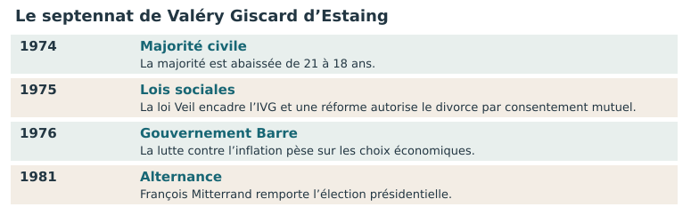
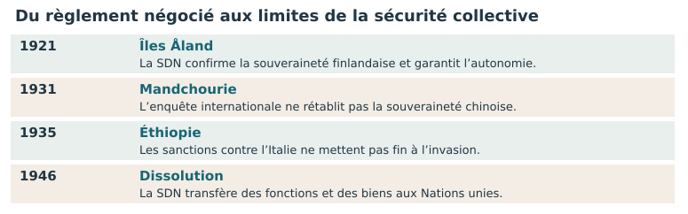

# BEL B/L — Histoire contemporaine, 19 juin 2025 · Corrigé guidé

*Corrigé rédigé par IA, non officiel.*

**Rédaction** · GPT-6.2 Astra Ultra · vitesse non renseignée

Le jury propose deux sujets avant les 90 minutes de préparation. Le passage dure 20 minutes d’exposé et 10 minutes d’entretien. Les deux leçons de chaque tirage sont développées ici. La mention de choix restitue le gras du feuillet officiel. Les relances sont des propositions d’entraînement.

## Tirage 1

### La guerre d’Algérie et ses mémoires

*Sujet choisi, imprimé en gras sur le feuillet.*

> [!INDICATION]
> Préciser le statut de l’Algérie avant 1954 et identifier plusieurs groupes d’acteurs. Pour la seconde partie du sujet, distinguer expérience vécue, mémoire publique et recherche historique.

Le 18 octobre 1999, la loi française reconnaît officiellement l’expression « guerre d’Algérie ». Les personnes qui avaient traversé le conflit n’avaient pas attendu cette date pour en porter les traces. Pourquoi la guerre de 1954-1962 laisse-t-elle des mémoires multiples, longtemps inégalement reconnues ?

**Une guerre de décolonisation bouleverse plusieurs sociétés.** L’Algérie est juridiquement intégrée à la France selon une organisation départementale dans une société coloniale marquée par des inégalités de droits et de ressources. L’insurrection lancée par le FLN en novembre 1954 ouvre une lutte pour l’indépendance. La population civile subit violences, déplacements et répression. En métropole, le rappel des réservistes et l’envoi du contingent font entrer le conflit dans la vie de nombreuses familles. Les divisions traversent les Français comme les Algériens. La crise de 1958 contribue au changement de République, puis le gouvernement de Gaulle s’oriente vers l’autodétermination.

**L’indépendance ne referme pas les blessures.** Les accords d’Évian de mars 1962 prévoient le cessez-le-feu, puis l’autodétermination. L’indépendance algérienne en juillet s’accompagne de violences et du départ massif de Français d’Algérie. Les harkis, Algériens ayant servi comme supplétifs de l’armée française, sont exposés à des représailles. Ceux arrivés en France connaissent souvent relégation et précarité. Les anciens appelés, les militants indépendantistes, les familles d’immigrés en France et les rapatriés portent d’autres expériences encore. L’État algérien construit un récit national de libération qui valorise le FLN et laisse au second plan des divisions et des expériences dissidentes.

**En France, les mémoires entrent progressivement dans l’espace public.** Les amnisties, le vocabulaire officiel des « événements » et la volonté de réconciliation nationale favorisent un silence institutionnel relatif, même si œuvres, associations et témoignages existent tôt. Les commémorations des victimes du 17 octobre 1961 à Paris et les mobilisations des descendants modifient la reconnaissance publique. L’historien confronte archives, témoignages et cadres politiques dans les deux pays. Il ne cherche pas à retenir une mémoire unique, mais à expliquer comment chaque expérience a pu être dite, tue ou transformée.

**Relance.** Pourquoi distinguer mémoire et histoire ? Une mémoire répond à une expérience et à des besoins de transmission. L’enquête historique en reconstitue les conditions et la compare à des sources indépendantes.

### Résister dans l’Europe occupée (1939-1945)

*Autre proposition du même tirage.*

> [!INDICATION]
> Commencer par la diversité des occupations, puis distinguer engagements individuels, organisations et gouvernements en exil. Garder les pratiques civiles et la protection des persécutés dans le champ.

Dès les occupations de 1939-1940, la soumission apparente d’une société ne dit pas tout de ses conduites. Résister suppose une opposition consciente à la domination imposée, mais cette opposition prend des formes très diverses. Comment se constituent des résistances dans des territoires soumis à des régimes d’occupation différents ?

**Les formes de l’occupation conditionnent les engagements.** En Pologne, la destruction des institutions nationales et la politique raciale nazie font naître une importante résistance liée à un État clandestin et au gouvernement en exil. En Europe occidentale, occupations militaires, administrations nationales et collaborations coexistent selon des configurations variables. Des militants politiques, syndicalistes, croyants, patriotes ou personnes directement persécutées peuvent entrer en résistance pour des raisons différentes. L’engagement n’est généralement pas un choix acquis pour toute la population dès la défaite.

**Résister engage des sociétés autant que des organisations.** Informer par une presse clandestine, refuser une contrainte, manifester une solidarité avec des persécutés ou maintenir un enseignement interdit peuvent avoir une portée politique majeure. Des femmes occupent des fonctions essentielles dont les catégories officielles de reconnaissance ne rendront qu’imparfaitement compte. Les résistances juives se développent dans des conditions extrêmes. Le soulèvement du ghetto de Varsovie en 1943 constitue un jalon distinct de l’insurrection de la ville de Varsovie en 1944. Répression et représailles pèsent lourdement sur les civils et sur les choix des organisations.

**La Libération pose la question du pouvoir.** Les liens avec les gouvernements en exil et les Alliés, la place des communistes après 1941 et les conflits entre projets politiques produisent des situations nationales contrastées. En France, le Conseil national de la Résistance réuni en 1943 contribue à unifier mouvements et organisations autour d’une légitimité politique. En Yougoslavie, la victoire des partisans de Tito favorise une transformation de régime, tandis que la Pologne passe sous influence soviétique malgré le rôle de la résistance liée à Londres. La résistance a aussi été une lutte pour définir l’après-guerre, ce qui explique des mémoires nationales parfois concurrentes.

**Relance.** Une population occupée se partage-t-elle en deux camps fixes ? Attentisme, adaptation, solidarité ponctuelle et engagement organisé dessinent des conduites diverses, susceptibles d’évoluer avec la guerre.

## Tirage 2

### Valéry Giscard d’Estaing : un président moderne ?

*Sujet choisi, imprimé en gras sur le feuillet.*

> [!INDICATION]
> Définir la modernité par des indicateurs précis, réformes sociales, communication et style de gouvernement. Chercher ensuite les groupes pour lesquels les promesses changent peu la vie quotidienne.

En 1974, Valéry Giscard d’Estaing se présente comme le candidat du changement dans la continuité de la Ve République. Plus jeune que ses prédécesseurs immédiats, il entend rapprocher l’exercice présidentiel d’une France urbanisée et transformée depuis 1945. Sa modernité tient-elle aux institutions, aux réformes ou au style ?

**Une image de renouvellement dans des institutions héritées.** Inspecteur des finances et ancien ministre de l’Économie, Giscard revendique compétence technique et expérience. Il remporte de peu l’élection de 1974 face à François Mitterrand et doit composer avec la force politique des gaullistes. Le débat télévisé de l’entre-deux-tours et la mise en scène de rencontres avec des Français ordinaires recherchent une relation plus directe avec le public. Cette communication peut aussi souligner la distance sociale d’un président issu des élites administratives et politiques.

**Les réformes déplacent des frontières de la citoyenneté et de la vie privée.** La majorité civile et électorale est abaissée à 18 ans en 1974. La réforme constitutionnelle de la même année permet à soixante députés ou soixante sénateurs de saisir le Conseil constitutionnel, élargissant les moyens de l’opposition. La loi Veil de 1975 autorise l’interruption volontaire de grossesse dans les conditions prévues et la réforme du divorce rétablit notamment le consentement mutuel. Ces mesures reprennent des revendications anciennes. Leur adoption implique ministres, parlementaires, associations et mobilisations féministes autant que l’impulsion présidentielle.

**La crise économique limite le projet.** Le premier choc pétrolier précède l’élection. Inflation, chômage et fragilisation industrielle remettent en question la promesse de progrès continu. Le gouvernement de Raymond Barre à partir de 1976 privilégie la lutte contre l’inflation. Les tensions avec Jacques Chirac et les critiques sociales fragilisent la majorité. La coopération avec le chancelier Schmidt et le Système monétaire européen témoignent néanmoins d’une modernité pensée à l’échelle européenne. Battu en 1981, Giscard laisse un bilan de transformations juridiques durables dont l’ampleur ne se confond pas avec l’adhésion à son style ni avec une réussite économique uniforme.

**Relance.** Pourquoi nuancer une explication par la seule personnalité ? Les mobilisations sociales précèdent l’élection et la mise en œuvre des lois dépend d’institutions et de majorités parlementaires.

### L’arme nucléaire dans le monde au XXe siècle

*Autre proposition du même tirage.*

> [!INDICATION]
> Construire l’exposé autour des civils, des institutions et des doctrines politiques publiques. Distinguer l’usage en 1945, la dissuasion proclamée et les efforts de limitation.

En août 1945, Hiroshima et Nagasaki font l’expérience d’une destruction dont les survivants subissent aussi des effets sanitaires à long terme. À la fin du siècle, des gouvernements fondent une part de leur sécurité sur la possession d’armes dont ils disent vouloir prévenir l’usage. Comment cette contradiction transforme-t-elle les relations internationales et les sociétés ?

**De la Seconde Guerre mondiale à la bipolarisation.** Le programme américain s’inscrit dans une mobilisation scientifique, industrielle et militaire exceptionnelle. Les bombardements d’août 1945, l’entrée en guerre de l’URSS contre le Japon et la capitulation japonaise mettent fin à la guerre du Pacifique. L’étude des décisions demeure débattue par les historiens, et la parole des hibakusha rappelle la centralité des conséquences humaines. L’essai soviétique de 1949 met fin au monopole américain. Le Royaume-Uni, la France et la Chine rejoignent ensuite le cercle des puissances déclarées, dans des contextes d’alliance et d’affirmation nationale différents.

**La dissuasion se double d’une inquiétude publique durable.** Les dirigeants invoquent le coût humain inacceptable d’un affrontement pour expliquer la retenue réciproque. Cette construction politique repose sur des anticipations et sur la crainte des erreurs de décision. La crise de Cuba en 1962 rend perceptible la proximité d’une catastrophe et favorise ensuite certains efforts de communication et de limitation. Les mobilisations pacifistes et les témoignages issus des territoires d’essais mettent en avant santé, environnement et inégalités de pouvoir entre métropoles et populations concernées.

**Maîtriser la prolifération et la course aux armements devient un enjeu international.** Le traité de non-prolifération ouvert à la signature en 1968 combine des engagements de non-prolifération, un objectif de désarmement et l’usage pacifique de l’énergie sous garanties. Son caractère asymétrique fait débat entre États reconnus comme dotés et autres États. Les accords américano-soviétiques, dont le traité de 1987 sur les forces nucléaires intermédiaires, montrent que la compétition peut s’accompagner d’accords vérifiables. La fin de la guerre froide réduit certaines tensions sans faire disparaître la question des arsenaux ni celle de leur légitimité. L’histoire nucléaire est donc autant une histoire de victimes, de normes et de mobilisations qu’une histoire d’États.

**Relance.** Désarmement et non-prolifération sont-ils deux mots pour la même politique ? Le premier concerne la réduction des arsenaux existants. La seconde cherche à empêcher l’extension du nombre d’États détenteurs et de certains transferts.

## Tirage 3

### Le front et l’arrière dans la Grande Guerre (France)

*Sujet choisi, imprimé en gras sur le feuillet.*

> [!INDICATION]
> Placer sur une carte la zone occupée, les départements de l’arrière et les lieux de soins. Demander pour chaque exemple quelles personnes ou quelles informations circulent entre ces espaces.

Les lettres échangées entre un soldat et sa famille disent tout à la fois la séparation des expériences et leur dépendance réciproque. Comment la France de 1914-1918 organise-t-elle une guerre industrielle de longue durée qui mobilise les civils, sans effacer la spécificité de ce que vivent les combattants ?

**La guerre produit des espaces et des temporalités différents.** La mobilisation d’août 1914 sépare de nombreux foyers. La stabilisation d’un front prolongé fait de l’attente, des permissions, des blessures et du deuil des expériences centrales. Dans le nord et l’est occupés, des civils connaissent les réquisitions, les déplacements et une autorité ennemie. La distinction binaire entre front militaire et arrière protégé est donc imparfaite. Les réfugiés et évacués déplacent dans d’autres régions les conséquences directes de l’invasion.

**L’effort économique et social relie les populations.** Les usines se réorganisent pour la production de guerre et emploient des femmes, des travailleurs venus des colonies et de l’étranger ainsi que certains ouvriers rappelés de l’armée pour leur qualification. Dans les campagnes, les familles adaptent les travaux au manque de main-d’œuvre. L’État réquisitionne, emprunte et organise le ravitaillement. Les soins et la correspondance relient les blessés aux infirmières et aux familles. Les lettres subissent le contrôle postal, et l’autocensure des soldats complique l’interprétation de ce qu’ils choisissent de raconter.

**Les consentements et les tensions évoluent.** L’Union sacrée ne supprime ni les différences sociales ni les difficultés matérielles. En 1917, grèves à l’arrière et indisciplines militaires témoignent de mécontentements dont les acteurs et les revendications diffèrent. La circulation de nouvelles, de permissionnaires et de deuils nourrit simultanément proximité et incompréhension. Après l’armistice, pensions, associations et monuments recréent un lien public entre sacrifices des combattants et mémoire des communes. L’histoire du front et de l’arrière est donc celle d’une mobilisation commune traversée de fortes inégalités d’exposition et de reconnaissance.

**Relance.** Le travail féminin a-t-il commencé en 1914 ? Les Françaises travaillaient déjà dans l’agriculture, l’industrie, le commerce et les services. La guerre change les effectifs et la visibilité de certaines tâches.

### La crise de 1929

*Autre proposition du même tirage.*

> [!INDICATION]
> Distinguer le krach boursier, la crise bancaire et la dépression de la production. Situer dans le temps les mécanismes qui relient les États-Unis aux économies européennes et exportatrices.

Le krach de Wall Street d’octobre 1929 donne son nom à une crise dont les conséquences durent une décennie et touchent des économies très différentes. Comment un retournement financier américain devient-il une dépression mondiale et un tournant dans les relations entre État et économie ?

**Des fragilités précèdent le krach.** Les années 1920 américaines combinent gains de productivité, consommation à crédit, difficultés agricoles et forte valorisation boursière. Une partie des achats d’actions est financée par emprunt. En Europe, les réparations, les dettes de guerre et les prêts américains créent une interdépendance financière fragile. Quand les cours s’effondrent à la fin d’octobre 1929, les patrimoines et la confiance sont atteints. Le krach ne suffit toutefois pas à expliquer seul l’ampleur de la chute de l’activité.

**Les mécanismes de contraction se renforcent.** Faillites bancaires et retraits de dépôts réduisent le crédit. Entreprises et ménages limitent investissements et achats, le chômage progresse et la baisse des prix augmente le poids réel des dettes. Le retrait de capitaux américains fragilise en particulier l’Europe centrale. En 1931, la crise bancaire s’étend et le Royaume-Uni renonce à la convertibilité-or. La baisse des prix des matières premières et du commerce transmet la crise aux économies exportatrices, notamment en Amérique latine. Les barrières douanières et les politiques déflationnistes peuvent renforcer la contraction au lieu de la corriger.

**Les réponses politiques divergent.** Aux États-Unis, le New Deal lancé en 1933 réorganise la banque, développe les travaux publics et élargit la protection sociale, sans rétablir immédiatement le plein emploi. Des États dévaluent leur monnaie ou réorientent leurs achats vers leur empire. En Allemagne, la crise aggrave les difficultés de Weimar et contribue à la progression électorale nazie, en interaction avec des choix politiques décisifs. En France, la dépression s’installe plus tardivement et durablement. La crise de 1929 transforme donc la réglementation financière et la légitimité de l’intervention économique tout en creusant les divisions internationales.

**Relance.** Pourquoi la déflation peut-elle aggraver les difficultés d’un débiteur ? Le montant nominal de sa dette reste dû tandis que ses recettes ou son salaire diminuent. Réduire encore ses dépenses pèse à son tour sur la demande.

## Tirage 4

### Avortement et contraception en France (1920-années 1980)

*Autre proposition du même tirage.*

> [!INDICATION]
> Inscrire sur deux lignes contraception et interruption volontaire de grossesse. Pour chaque réforme, distinguer l’adoption du texte, sa mise en œuvre et les inégalités d’accès.

En 1920, le législateur français réprime la propagande anticonceptionnelle et la provocation à l’avortement dans un pays marqué par les pertes de la guerre. Dans les années 1980, contraception et interruption volontaire de grossesse ont des cadres légaux distincts, et leur accès devient aussi une question de protection sociale. Comment ce renversement s’est-il construit ?

**L’ordre nataliste associe juridiquement des pratiques différentes.** La contraception vise à prévenir une grossesse, l’avortement consiste à l’interrompre. L’avortement était déjà réprimé ; la loi de 1920 renforce les interdictions autour de l’information et de l’incitation. Les préoccupations démographiques, des normes religieuses et des conceptions de la famille donnent un poids politique à cette répression. Sous Vichy, elle s’aggrave, avec des poursuites exemplaires. Les pratiques subsistent dans la clandestinité, dont les risques et les coûts sont très inégalement répartis selon les ressources, les réseaux et le lieu d’habitation.

**L’accès à la contraception devient un objet de mobilisation.** Des associations, des médecins, puis le Mouvement français pour le planning familial mettent en débat la maîtrise de la fécondité. La loi Neuwirth de 1967 autorise la contraception, dont l’application dépend de textes ultérieurs et de l’évolution des pratiques professionnelles. Les réformes de 1974 améliorent l’accès et le remboursement. La question touche à l’autonomie des femmes mais aussi aux responsabilités de la médecine, des familles et de la puissance publique.

**L’IVG entre dans la loi après une mobilisation distincte.** Le manifeste de 1971, le procès de Bobigny en 1972 et l’activité du MLAC rendent publiques les conséquences des poursuites et les inégalités sociales. Défendue par Simone Veil, la loi de janvier 1975 permet l’IVG dans certaines conditions. D’abord adoptée pour une durée limitée, elle est pérennisée en 1979. Le remboursement est voté en 1982. Ces changements déplacent une question du registre pénal vers celui de la santé et des droits, tout en laissant subsister des différences territoriales d’accès. L’histoire du droit doit donc être complétée par celle des mobilisations et de l’effectivité des services.

**Relance.** Pourquoi rappeler le caractère limité dans le temps de la loi de 1975 ? Il témoigne du compromis parlementaire et explique l’importance du vote de 1979 pour sa pérennité.

### Les Européens et leurs colonies de 1918 aux années 1970

*Sujet choisi, imprimé en gras sur le feuillet.*

> [!INDICATION]
> Varier les points de vue, colon européen sur place, électeur de métropole, administrateur et militant anticolonial. Un empire peut être omniprésent dans l’imagerie nationale tout en restant lointain pour nombre d’habitants.

Après la Grande Guerre, Français et Britanniques voient leurs empires s’étendre sous la forme nouvelle des mandats de la Société des Nations. Dans les années 1970, les indépendances des possessions portugaises marquent la fin des grands empires territoriaux européens en Afrique. Comment les sociétés européennes ont-elles adhéré à l’empire, vécu son fonctionnement et traversé sa disparition ?

**La domination se réorganise après 1918.** Les vainqueurs récupèrent sous mandat des territoires de l’ancien Empire allemand et de l’Empire ottoman. Écoles, presse, publicité et manifestations comme l’exposition coloniale parisienne de 1931 diffusent une vision hiérarchisée des peuples. Les bénéfices et les engagements impériaux sont pourtant inégalement partagés entre investisseurs, administrations, colons de peuplement et populations de métropole. Les violences de la conquête, la contrainte au travail et les inégalités de droit provoquent des résistances dans les colonies et des critiques politiques en Europe.

**La Seconde Guerre mondiale fragilise la légitimité impériale.** Des populations colonisées participent à la guerre et attendent des droits en retour. Les métropoles dépendent de ressources impériales alors même que leur puissance militaire et financière est ébranlée. En Asie, les défaites face au Japon altèrent le prestige des autorités européennes. Les indépendances de l’Inde et du Pakistan en 1947, puis le conflit d’Indochine et l’indépendance indonésienne reconnue en 1949 montrent des voies différentes. Partis, syndicats et mobilisations nationales des colonisés sont des acteurs centraux de ces transformations.

**Les décolonisations transforment aussi les métropoles.** Des opinions européennes se divisent sur le prix des guerres, le droit des peuples et la place des colons. En France, la guerre d’Algérie affecte les institutions, le contingent, les immigrés et les rapatriés. Au Portugal, les guerres africaines pèsent dans la crise du régime renversé en 1974. L’indépendance modifie les droits et la souveraineté sans mettre fin aux migrations, aux relations linguistiques et aux dépendances économiques. Dans les années 1970, les sociétés européennes portent donc encore, de façons contrastées, les traces de leur passé impérial.

**Relance.** Une exposition coloniale permet-elle de mesurer l’adhésion de tous ? Elle documente un projet de représentation et une fréquentation. Correspondances, contre-expositions et enquêtes renseignent sur des réceptions diverses.

## Tirage 5

### Banlieues rouges et terres communistes en France au 20e s.

*Autre proposition du même tirage.*

> [!INDICATION]
> Situer une banlieue industrielle et un bastion rural communiste. Demander comment des activités quotidiennes, une mémoire politique et une municipalité peuvent se renforcer mutuellement.

L’expression « banlieue rouge » évoque les municipalités communistes de la couronne parisienne, mais le vote communiste s’est aussi durablement implanté dans des villes minières et certains espaces ruraux. Comment une organisation nationale construit-elle des fidélités territoriales qui ne se déduisent pas automatiquement du métier ou de l’adresse ?

**L’implantation s’appuie sur des sociabilités et des héritages locaux.** Le Parti communiste français naît de la scission du congrès de Tours en 1920. Dans des territoires d’industrie concentrée, usines, quartiers et organisations syndicales rendent possible la rencontre régulière des militants. Des traditions anticléricales, de petite propriété ou de défense des ouvriers agricoles facilitent aussi des implantations rurales, notamment dans certains territoires du Limousin. Il existe pourtant des cités ouvrières d’autres orientations. Les réseaux, les élus et l’histoire des conflits comptent autant que la composition socioprofessionnelle.

**Le communisme municipal donne une forme concrète à l’appartenance.** Écoles, dispensaires, logements, colonies de vacances et équipements sportifs associent une action municipale à une promesse de dignité populaire. À Ivry-sur-Seine, par exemple, la longue durée du gouvernement communiste rend possibles des institutions et des mémoires locales. Les fêtes, journaux, syndicats et associations prolongent l’influence électorale. La Résistance et la forte audience nationale du PCF à la Libération renforcent certaines positions, sans effacer les tensions de la guerre froide et les désaccords sur la ligne du parti.

**La crise industrielle recompose les bastions.** À partir des années 1970, fermetures d’usines, mutations des emplois, mobilités résidentielles et concurrence de la gauche socialiste fragilisent la correspondance entre monde ouvrier organisé et électorat communiste. Les générations nouvelles n’héritent pas systématiquement des mêmes engagements. Cependant, l’action municipale et l’attachement à des services locaux peuvent survivre au recul du parti aux scrutins nationaux. Une « terre communiste » est donc une construction historique combinant organisation, institutions, réseaux et mémoire, susceptible de durer ou de se défaire.

**Relance.** Le vote municipal mesure-t-il exactement l’adhésion au programme national ? Une personnalité locale et le bilan des services municipaux peuvent attirer des électeurs qui votent autrement aux législatives.

### Les deux Europe de 1945 à 1989

*Sujet choisi, imprimé en gras sur le feuillet.*

> [!INDICATION]
> Distinguer les dates de libération, de constitution des alliances et de rupture. Placer Finlande, Autriche et Yougoslavie pour éprouver les limites du découpage en deux.

En 1945, l’Europe sort dévastée d’une guerre qui a bouleversé ses frontières et ses régimes. En 1989, les foules qui franchissent le mur de Berlin contestent une division devenue géographie ordinaire. Comment se construisent puis se transforment deux Europe politiques, économiques et sociales ?

**La bipolarisation est un processus.** Les occupations alliées et le poids de l’Armée rouge donnent aux puissances victorieuses une forte influence sur les gouvernements. À l’ouest, aide Marshall et alliances avec les États-Unis favorisent la reconstruction dans des économies mixtes. À l’est, les communistes imposent progressivement des démocraties populaires liées à Moscou ; le coup de Prague de 1948 manifeste le durcissement. Deux États allemands naissent en 1949. L’OTAN, le CAEM puis le pacte de Varsovie institutionnalisent des formes d’intégration distinctes.

**Les sociétés connaissent des trajectoires différentes et des expériences communes.** La CEE à l’ouest et le CAEM à l’est organisent des échanges selon des principes distincts. Le pluralisme politique occidental contraste avec la prééminence du parti unique à l’est, où emploi, logement et consommation obéissent également à d’autres institutions. Les deux Europe connaissent urbanisation, enseignement de masse et transformations des rôles familiaux. Les révoltes de 1956 en Hongrie et le printemps de Prague de 1968 montrent les divisions internes de l’Est. L’Autriche neutre et la Yougoslavie non alignée rappellent les limites géographiques du modèle binaire.

**Circulations et contestations entament la séparation.** L’Ostpolitik, les contacts familiaux, les échanges culturels et la conférence d’Helsinki en 1975 entretiennent des liens. Les droits proclamés à Helsinki deviennent un langage pour les dissidents de l’Est. Dans les années 1980, crises économiques, mobilisations sociales et changement de politique soviétique fragilisent les régimes. Les ruptures de 1989 associent négociation, manifestation et parfois violence. L’ouverture du mur symbolise la fin de la division garantie par l’URSS, sans effacer aussitôt les inégalités ni tous les héritages sociaux des deux ensembles.

**Relance.** Les frontières des organisations correspondent-elles exactement au rideau de fer ? Non. Des États occidentaux sont restés militairement neutres et certains États socialistes ont conservé une politique internationale autonome.

## Tirage 6

### Les migrations dans les campagnes françaises au 20e s.

*Autre proposition du même tirage.*

> [!INDICATION]
> Employer le pluriel du sujet pour suivre quatre mouvements, départ, arrivée, saison et retour. Pour chacun, préciser le métier, l’échelle géographique et l’effet sur le ménage.

Le départ vers la ville est une dimension majeure de l’histoire rurale française, mais il laisse de côté les saisonniers, les ouvriers agricoles étrangers, les réfugiés et les citadins qui s’installent au village. Comment les campagnes sont-elles à la fois lieux de départ, de passage et d’accueil ?

**Des mobilités anciennes accompagnent les rythmes agricoles.** Au début du siècle, les besoins de récolte créent des migrations temporaires entre régions ou de part et d’autre des frontières. La pluriactivité conduit certains membres d’un ménage à travailler en ville ou dans une industrie, tandis que d’autres restent sur l’exploitation. Le départ définitif de jeunes adultes vers les villes est déjà important et peut modifier l’âge au mariage, la transmission des terres et la composition par sexe des villages. L’exode rural recouvre des décisions familiales diverses.

**Les guerres et les besoins de main-d’œuvre redessinent les flux.** En 1914-1918, mobilisés, évacués et prisonniers donnent à certains territoires ruraux des populations inhabituelles. Les pertes et le manque de bras favorisent ensuite le recrutement de travailleurs étrangers. Des agriculteurs italiens, notamment dans le Sud-Ouest, contribuent à remettre des terres en culture et s’y établissent avec leurs familles. Dans les années 1930 et pendant la Seconde Guerre mondiale, réfugiés et évacués trouvent aussi dans les villages accueil ou contrôle. Les conditions d’établissement varient selon le statut juridique, l’accès au logement et la possibilité d’obtenir une terre.

**La modernisation accélère les départs, puis de nouveaux arrivants modifient la ruralité.** La mécanisation et la concentration des exploitations après 1945 réduisent le besoin de travail agricole. Les villes industrielles et tertiaires attirent les jeunes. Dans d’autres régions, les cultures spécialisées continuent de recourir à une main-d’œuvre saisonnière. À partir des années 1970, périurbanisation, résidences secondaires, retours de retraités et installations dites néorurales contribuent à la reprise de certaines communes, sans mettre fin au dépeuplement d’autres territoires. Les migrations transforment donc le travail et le logement, mais aussi la définition sociale de ceux que l’on considère comme habitants de la campagne.

**Relance.** Comment une commune peut-elle croître alors que le nombre d’agriculteurs baisse ? Elle peut attirer des retraités ou des actifs travaillant en ville. L’évolution de la population résidente et celle de l’emploi agricole sont distinctes.

### L’automobile au 20e siècle

*Sujet choisi, imprimé en gras sur le feuillet.*

> [!INDICATION]
> Changer d’échelle entre usine, ménage, voirie et planète. Comparer les calendriers américain, européen et asiatique afin de ne pas présenter la motorisation comme un phénomène uniforme.

Au début du siècle, l’automobile est un objet coûteux réservé à une minorité. À la fin, elle structure des marchés mondiaux, des emplois ouvriers et l’organisation même de territoires. Comment ce bien industriel est-il devenu un système de mobilité dont les avantages et les coûts sont très inégalement répartis ?

**La production de masse change les coûts et le travail.** Aux États-Unis, la Ford T et la chaîne d’assemblage mise en place chez Ford dans les années 1910 associent standardisation, volume et division des tâches. En Europe, Renault, Citroën, Fiat ou Volkswagen dessinent d’autres trajectoires, où marchés nationaux et politiques publiques comptent fortement. Acier, caoutchouc, verre et pétrole relient la voiture à de nombreux secteurs et à des espaces éloignés. Le travail répétitif en usine et les conflits sur les cadences accompagnent les progrès de productivité.

**La motorisation devient un projet social et territorial.** Après 1945, hausse du revenu, crédit et véhicules plus accessibles élargissent l’équipement des ménages dans plusieurs régions du monde. Le modèle américain de la banlieue pavillonnaire et des autoroutes a des équivalents partiels en Europe. En France, la 2 CV et la 4 CV illustrent le développement d’un usage familial distinct de l’automobile de luxe. La voiture ouvre des possibilités de travail, de vacances et de résidence mais accroît les distances nécessaires et les contraintes sur les personnes sans véhicule. Le genre, la classe et le lieu d’habitation influent sur l’accès à cette autonomie.

**Le système entre en crise et se mondialise davantage.** Les chocs pétroliers des années 1970 renchérissent l’énergie et favorisent la demande de véhicules plus économes. Les constructeurs japonais gagnent des parts de marché et les chaînes de production se réorganisent à l’échelle internationale. Accidents, pollution et encombrements imposent des réglementations et des débats sur la ville et les transports collectifs. Dans nombre de pays, la motorisation individuelle reste beaucoup plus faible qu’en Amérique du Nord ou en Europe occidentale. Le siècle automobile est ainsi une histoire de mobilités nouvelles, de dépendance énergétique et d’inégalités d’accès à l’espace.

**Relance.** Qu’apporte la distinction possession et usage ? Une voiture par ménage ne dit rien de qui peut la conduire, de la distance parcourue ni des solutions dont disposent les autres membres du foyer.

## Tirage 7

### La loi de séparation de l’Église et de l’État

*Autre proposition du même tirage.*

> [!INDICATION]
> Partir des deux premiers articles de la loi de 1905 et préciser son champ géographique. Relier les principes juridiques aux conflits politiques et à leur application concrète.

En 1905, la République proclame la liberté de conscience et garantit le libre exercice des cultes dans les conditions prévues par la loi. Elle cesse en même temps de reconnaître, salarier et subventionner les cultes. Comment cette rupture avec le régime concordataire est-elle préparée puis aménagée ?

**Le conflit sur la place des Églises accompagne la consolidation républicaine.** Le Concordat de 1801 et les textes associés organisaient des cultes reconnus avec une intervention de l’État dans les nominations et la rémunération. Au XIXe siècle, une partie du catholicisme reste attachée à des orientations monarchistes tandis que des républicains voient dans le cléricalisme un obstacle à l’autonomie civique. Les lois scolaires des années 1880 laïcisent l’école publique. L’Affaire Dreyfus et les conflits autour des congrégations durcissent les positions. Les catholiques et les républicains eux-mêmes demeurent partagés sur la forme à donner à la séparation.

**Le texte établit un équilibre entre liberté et neutralité.** Sous l’impulsion notamment du rapporteur Aristide Briand, la loi du 9 décembre 1905 met fin au système des cultes reconnus dans les territoires concernés. La liberté de conscience protège croyants et non-croyants. Le libre exercice s’articule au maintien de l’ordre public. La loi prévoit le règlement du sort des biens et le recours à des associations cultuelles. Les bâtiments appartenant aux collectivités et affectés au culte illustrent une articulation concrète entre propriété publique et usage religieux.

**L’application résulte de conflits et d’accommodements.** Les inventaires de 1906 suscitent des résistances et le pape refuse d’abord les associations prévues. Des aménagements permettent la continuité du culte ; les associations diocésaines seront reconnues dans le cadre d’un accord dans les années 1920. L’Alsace-Moselle, allemande en 1905, conserve après 1918 un droit local distinct. Les applications coloniales sont elles-mêmes différenciées. La séparation fonde donc un cadre juridique durable dont la mise en œuvre dépend d’histoires territoriales et de compromis pratiques.

**Relance.** La laïcité oblige-t-elle les citoyens à être sans religion ? La liberté de conscience protège leurs choix. La neutralité s’impose à la puissance publique dans l’exercice de ses fonctions.

### Le 8 mai 1945

*Sujet choisi, imprimé en gras sur le feuillet.*

> [!INDICATION]
> Distinguer capitulation allemande, fin du conflit mondial et événements en Afrique du Nord. Demander qui célèbre quoi et quel événement le calendrier public commémore ensuite.

Le 8 mai 1945, des foules célèbrent en Europe la défaite de l’Allemagne nazie. Le même jour à Sétif et dans sa région commence une crise dont la répression marquera la mémoire algérienne. Comment une date de victoire peut-elle signifier simultanément libération, deuil et contestation de l’ordre impérial ?

**La capitulation marque une fin européenne.** Après la prise de Berlin et la mort de Hitler, une capitulation est signée à Reims le 7 mai et entre en vigueur le 8. Une nouvelle signature a lieu à Berlin, et le décalage horaire explique la commémoration soviétique le 9 mai. Les Alliés sont à la fois associés dans la victoire et porteurs de projets politiques déjà différents. La date signifie la disparition du pouvoir nazi et l’ouverture d’une occupation alliée de l’Allemagne. La guerre contre le Japon se poursuit encore plusieurs mois.

**La libération révèle l’ampleur des destructions.** Civils déplacés, prisonniers, requis et déportés entament des retours difficiles. Les survivants de la persécution découvrent des familles et des communautés détruites. Le retour à la légalité, l’épuration et le jugement des responsables deviennent des tâches immédiates. Les manques alimentaires, la pénurie de logements et les déplacements de frontières empêchent de confondre la date politique avec un rétablissement instantané de la paix sociale. Pour l’Europe orientale, la fin de la domination nazie s’accompagne aussi de l’extension de la puissance soviétique.

**Le 8 mai n’a pas partout la même signification.** En Algérie, des manifestations associent célébration alliée et revendications nationales. Les violences à Sétif, Guelma et Kherrata et la répression massive par les autorités françaises et des milices européennes ouvrent un fossé durable. Les bilans précis des victimes algériennes restent discutés, sans mettre en doute l’ampleur et la disproportion de la répression. En France, le statut du 8 Mai comme fête et jour férié change au cours de l’après-guerre, avant son rétablissement comme jour férié en 1981. La date est ainsi un objet d’histoire des mémoires autant qu’un jalon diplomatique.

**Relance.** Pourquoi préciser les calendriers ? Une convention d’entrée en vigueur, l’heure à Moscou et les usages ultérieurs de la date expliquent les commémorations des 8 et 9 mai.

## Tirage 8

### Marie Skłodowska-Curie

*Autre proposition du même tirage.*

> [!INDICATION]
> Situer Varsovie et Paris, puis relier laboratoire, prix scientifiques et guerre. Distinguer la reconnaissance individuelle de l’organisation collective du travail savant.

Née en 1867 à Varsovie sous domination russe, Marie Skłodowska poursuit ses études à Paris où elle devient l’une des figures majeures de la recherche sur la radioactivité. Que révèle son parcours de la circulation des savoirs, des obstacles rencontrés par les femmes et de la construction de l’autorité scientifique ?

**La mobilité ouvre une carrière qui reste difficile d’accès.** Les possibilités d’études supérieures offertes aux femmes dans son milieu d’origine sont limitées. À Paris, elle suit une formation scientifique et rencontre Pierre Curie. Après les travaux de Becquerel sur les rayonnements de l’uranium, elle étudie méthodiquement des substances radioactives. En 1898, Marie et Pierre Curie annoncent le polonium, dont le nom rappelle la Pologne, puis le radium avec leurs collaborateurs pour cette dernière découverte. Des installations modestes, un travail expérimental prolongé et des réseaux savants rendent les découvertes possibles.

**La reconnaissance déplace les frontières sans abolir les préjugés.** Le prix Nobel de physique de 1903 est partagé avec Pierre Curie et Henri Becquerel. Après la mort de Pierre en 1906, Marie reprend son enseignement à la Sorbonne et devient la première femme à y occuper une chaire de cette nature. Elle reçoit le Nobel de chimie en 1911. La même année, les attaques de presse contre sa vie privée et sa nationalité d’origine montrent combien le genre et la xénophobie peuvent traverser les institutions de réputation. Ses récompenses ne témoignent donc pas d’un accès désormais égal des femmes aux carrières.

**Une activité scientifique s’institutionnalise et circule vers la médecine.** Pendant la Grande Guerre, Marie Curie organise des services de radiologie et la formation de personnels, contribuant à la prise en charge des blessés. L’Institut du radium devient un lieu de recherche et de transmission à de nouvelles générations. La mobilisation philanthropique internationale montre aussi le poids des ressources matérielles dans le travail scientifique. Sa mort en 1934 et les hommages ultérieurs, dont l’entrée au Panthéon en 1995, construisent une figure publique à côté de l’histoire du laboratoire et des équipes. Son parcours associe ainsi émancipation individuelle, travail collectif et redéfinition des rapports entre science et société.

**Relance.** Pourquoi garder les deux noms Skłodowska et Curie ? Ils rappellent l’histoire polonaise de sa formation et de ses engagements ainsi que son parcours professionnel en France.

### La guerre d’Espagne et l’Europe

*Sujet choisi, imprimé en gras sur le feuillet.*

> [!INDICATION]
> Relier Madrid, Rome, Berlin, Moscou, Paris et Londres à des décisions politiques distinctes. Donner aussi une place aux réfugiés et aux volontaires.

En juillet 1936, le soulèvement d’une partie de l’armée espagnole contre la République débouche sur une guerre civile qui divise bientôt les opinions de toute l’Europe. Comment le destin d’un régime espagnol devient-il une épreuve pour les démocraties et les dictatures du continent ?

**Des conflits espagnols se nouent dans un contexte européen.** La République instaurée en 1931 affronte des tensions sur la terre, le rôle de l’Église, l’armée et les autonomies régionales. La victoire du Front populaire en février 1936 précède le soulèvement de juillet. La guerre oppose une coalition républicaine elle-même divisée à des nationalistes dont Franco devient le chef. Les engagements européens s’appuient sur ces conflits internes et sur des lectures plus générales, antifascisme, anticommunisme ou défense du catholicisme. Réduire l’Espagne à un simple terrain d’affrontement extérieur ferait perdre la dynamique propre de sa société.

**L’internationalisation combine intervention et non-intervention.** L’Allemagne nazie et l’Italie fasciste soutiennent les nationalistes. L’URSS aide la République, et les Brigades internationales rassemblent des volontaires issus de nombreux pays. Le Royaume-Uni et la France choisissent une politique officielle de non-intervention par crainte d’un élargissement de la guerre et pour des motifs de politique intérieure. L’application très inégale de cette politique pèse sur les rapports de forces. Le bombardement de Guernica en 1937 et le tableau de Picasso donnent une visibilité internationale aux violences subies par les civils.

**La défaite républicaine laisse une Europe plus polarisée.** En 1939, la retraite vers la France entraîne l’exode de centaines de milliers de civils et de combattants. Beaucoup rencontrent des conditions d’accueil précaires et l’internement. La dictature franquiste se maintient bien au-delà de la Seconde Guerre mondiale. Certains exilés s’engagent dans les résistances européennes, d’autres reconstruisent des vies en Amérique. La guerre d’Espagne annonce plusieurs oppositions du conflit mondial sans s’y confondre, et sa mémoire continue de diviser les sociétés européennes après 1945.

**Relance.** La non-intervention signifie-t-elle l’indifférence des populations ? En France et en Grande-Bretagne, organisations, intellectuels et particuliers soutiennent les républicains ou les nationalistes malgré la position officielle de leur gouvernement.

## Tirage 9

### Les ligues en France dans les années 1930

*Sujet choisi, imprimé en gras sur le feuillet.*

> [!INDICATION]
> Dresser un tableau comparant recrutement, rapport au Parlement et projet politique de quelques organisations. Isoler la journée du 6 février sans lui attribuer l’unité d’une organisation unique.

Le 6 février 1934, plusieurs cortèges convergent vers le Palais-Bourbon dans un climat d’antiparlementarisme et la manifestation débouche sur des violences meurtrières. Quel rôle les ligues jouent-elles dans cette crise et que révèlent-elles de la contestation du régime républicain ?

**Un répertoire ancien renouvelé par la crise.** Les ligues sont des organisations politiques militantes qui agissent notamment par la propagande, les réunions et la rue, en marge ou en complément du jeu parlementaire. Certaines ont des origines antérieures aux années 1930. L’Action française défend un nationalisme intégral, monarchiste et antisémite. Les Jeunesses patriotes de Pierre Taittinger, puis les Croix-de-Feu dirigées par François de La Rocque ont d’autres histoires et d’autres recrutements. Le prestige des anciens combattants, l’exemple des dictatures et la crise économique nourrissent des formes de mobilisation dont le rapport au fascisme fait débat chez les historiens.

**Le 6 février fait éclater une crise de légitimité.** Le scandale Stavisky et les accusations de corruption alimentent la campagne antiparlementaire. Le 6 février, ligues, associations d’anciens combattants et autres manifestants agissent dans une situation confuse et se heurtent aux forces de l’ordre. La démission du gouvernement Daladier montre qu’une mobilisation de rue peut faire tomber un gouvernement disposant d’une majorité. Pour la gauche, l’événement prend la signification d’une menace fasciste et favorise le rapprochement antifasciste. Les objectifs et les décisions de chaque organisation doivent cependant être distingués avant de conclure à un projet commun de prise du pouvoir.

**La dissolution ne supprime pas les réseaux.** Le Front populaire arrive au pouvoir en 1936 et plusieurs ligues sont dissoutes sur le fondement de la législation de janvier. La Rocque crée alors le Parti social français, qui recherche une implantation de masse et un débouché électoral. Les trajectoires ultérieures des adhérents pendant l’Occupation sont diverses et ne peuvent être déduites d’une simple appartenance antérieure. Les ligues révèlent à la fois le rejet du parlementarisme et la capacité d’une République contestée à encadrer certaines formes d’organisation.

**Relance.** Peut-on employer « fasciste » comme synonyme de ligueur ? Il faut expliciter les critères, projet de régime, nationalisme, violence et rapport aux libertés, puis comparer les organisations et les débats historiques.

### Le pétrole dans les relations internationales au XXe siècle

*Autre proposition du même tirage.*

> [!INDICATION]
> Distinguer la localisation des ressources, la propriété des compagnies et le pouvoir des États producteurs. Relier chaque période à un exemple régional.

Le pétrole devient indispensable aux transports, à l’industrie et aux économies de guerre au cours du XXe siècle. Sa production est concentrée dans certains territoires alors que ses utilisateurs sont largement dispersés. Comment cette géographie construit-elle des dépendances et des instruments de souveraineté ?

**Les compagnies et les puissances industrielles structurent d’abord le marché.** Les États-Unis sont à la fois grands producteurs et consommateurs. Au Moyen-Orient, des concessions donnent à des compagnies occidentales un contrôle important sur l’extraction et les revenus. Les frontières, les mandats et les accords entre puissances après 1918 influent sur l’accès aux ressources. En Amérique latine, la nationalisation mexicaine de 1938 manifeste une revendication de souveraineté sur le sous-sol. Les enjeux derrière le baril concernent ainsi la fiscalité, les investissements, les débouchés et la légitimité des gouvernements.

**Les États producteurs cherchent une plus grande maîtrise.** La forte croissance et la motorisation après 1945 augmentent la demande d’énergie importée en Europe et au Japon. En Iran, la nationalisation du pétrole par Mossadegh en 1951 ouvre un conflit dont l’issue politique de 1953 révèle l’intervention de puissances extérieures. En 1960, la création de l’OPEP donne à des États exportateurs un cadre de coordination. Les nationalisations modifient ensuite les rapports de propriété, sans rendre les producteurs indépendants des technologies, des prix mondiaux et des marchés consommateurs.

**Les chocs pétroliers déplacent les rapports de force.** En 1973, dans le contexte de la guerre du Kippour, des pays arabes exportateurs utilisent l’embargo et les prix augmentent fortement. Il faut distinguer ces décisions arabes du rôle plus général de l’OPEP. En 1979, la révolution iranienne et les perturbations de l’offre contribuent à un nouveau choc. Les importateurs cherchent économies d’énergie, diversification et nouvelles zones de production. Les recettes des exportateurs alimentent investissements et flux financiers internationaux, mais la baisse des prix des années 1980 révèle leur vulnérabilité. La guerre du Golfe de 1990-1991 rappelle enfin l’importance stratégique de la région, sans que toutes les causes du conflit se réduisent au pétrole.

**Relance.** Un pays riche en pétrole possède-t-il un pouvoir illimité ? Le prix, la dépendance des finances publiques, les coûts techniques et les relations avec clients et voisins limitent sa marge de manœuvre.

## Tirage 10

### François Mitterrand

*Sujet choisi, imprimé en gras sur le feuillet.*

> [!INDICATION]
> Construire une biographie politique qui distingue carrière avant 1981, conquête de la présidence et exercice du pouvoir. Donner à chaque période une contradiction historique à expliquer.

En 1964, François Mitterrand dénonce la présidentialisation gaullienne dans *Le Coup d’État permanent*. Élu en 1981, il demeure quatorze ans à l’Élysée. Comment un adversaire des institutions de la Ve République en devient-il le premier président socialiste et l’un de leurs praticiens les plus durables ?

**Une trajectoire façonnée par les crises du milieu du siècle.** Né en 1916, prisonnier en 1940 puis évadé, Mitterrand travaille dans les structures de Vichy chargées des prisonniers avant de s’engager dans la Résistance. La chronologie de cet itinéraire, longtemps objet de récits sélectifs, importe. Élu dans la Nièvre à la Libération, il occupe plusieurs fonctions ministérielles sous la IVe République. Ministre de l’Intérieur puis de la Justice au temps de la guerre d’Algérie, il participe aux responsabilités de l’État français dans ce conflit. Son opposition au retour de de Gaulle en 1958 redéfinit sa position dans la gauche.

**Conquérir la présidence suppose la construction d’une majorité.** En 1965, il met de Gaulle en ballottage lors de la première présidentielle au suffrage universel direct de la Ve République. Le congrès d’Épinay de 1971 lui permet de prendre la tête du Parti socialiste. Le programme commun signé avec les communistes et les radicaux de gauche en 1972 ouvre une stratégie d’union et de concurrence. Après son échec serré de 1974, sa victoire en mai 1981 et la majorité législative obtenue en juin réalisent l’alternance sans changement de régime.

**L’exercice du pouvoir associe transformations et contraintes.** Abolition de la peine de mort, décentralisation et réformes économiques du début du premier mandat marquent une inflexion importante. Le tournant de rigueur de 1983 souligne les contraintes monétaires et européennes. Les cohabitations de 1986-1988 puis de 1993-1995 obligent le président à composer avec des gouvernements issus de majorités adverses. Sa coopération avec Helmut Kohl et son engagement pour Maastricht placent l’intégration européenne au cœur du second mandat. L’itinéraire de Mitterrand éclaire donc les transformations de la gauche et la souplesse comme les tensions de la présidence sous la Ve République.

**Relance.** L’alternance de 1981 et la cohabitation de 1986 ont-elles le même sens ? En 1981, présidence et majorité changent de camp. En 1986, la nouvelle majorité législative coexiste avec un président qui achève son mandat.

### L’État providence en Europe de l’Ouest au 20e s.

*Autre proposition du même tirage.*

> [!INDICATION]
> Comparer une prestation contributive et un service universel. Relier la question « qui finance ? » à la question « qui a droit ? » dans plusieurs pays.

Maladie, vieillesse, chômage et charges familiales menacent les ressources d’un ménage à différents moments de la vie. L’État providence organise une prise en charge collective d’une partie de ces risques. Comment les pays d’Europe occidentale construisent-ils des protections durables sans adopter un modèle unique ?

**Les réformes d’avant 1945 inscrivent la question sociale dans le droit.** Les assurances sociales allemandes héritées de l’époque de Bismarck associent couverture de certains travailleurs et cotisations. En Grande-Bretagne, les réformes libérales du début du XXe siècle mettent notamment en place pensions et assurance. En France, retraites ouvrières et paysannes de 1910 puis assurances sociales de l’entre-deux-guerres restent marquées par des limites de champ et des différences professionnelles. Syndicats, mutuelles, Églises et employeurs participent de façons diverses à ces constructions. Guerre et chômage de masse renforcent la demande de sécurité collective.

**Après 1945, les protections s’étendent selon des principes différents.** Le rapport Beveridge de 1942 alimente le projet britannique ; le National Health Service, créé en 1948, offre des soins principalement financés par l’impôt. En France, la Sécurité sociale instituée en 1945 repose largement sur les cotisations et les droits liés au travail, avec des régimes différents. Les États scandinaves développent des services et des prestations à large couverture. Croissance, emploi et hausse des ressources publiques permettent d’élargir les droits. Cependant la carrière masculine continue sert souvent de référence, et les travailleurs précaires, certaines femmes ainsi que des migrants n’accèdent pas partout aux mêmes garanties.

**À partir des années 1970, financement et légitimité sont rediscutés.** Chômage, vieillissement et augmentation des dépenses de santé exercent des pressions différentes selon les régimes. Réductions, réformes de cotisations, ciblage des prestations et maintien de services universels alimentent les conflits politiques. Au Royaume-Uni dans les années Thatcher, la critique de l’intervention publique est vive, mais les grandes institutions de protection sociale ne disparaissent pas. À la fin du siècle, l’État providence reste un ensemble de compromis nationaux évolutifs entre solidarité, assurance et redistribution.

**Relance.** Assurance et assistance s’excluent-elles ? Un même système peut assurer un revenu en fonction de cotisations antérieures et garantir sous condition de ressources un minimum à ceux dont les droits sont insuffisants.

## Tirage 11

### Le Front populaire

*Sujet choisi, imprimé en gras sur le feuillet.*

> [!INDICATION]
> Poser successivement trois dates, février 1934, mai-juin 1936 et 1938. Associer une mobilisation, une décision parlementaire et une limite politique à cette séquence.

En juin 1936, une vague d’occupations d’usines accompagne l’arrivée au pouvoir de Léon Blum. L’image des premiers congés payés a durablement marqué la mémoire française. Comment une coalition née de la défense de la République devient-elle le cadre d’une transformation sociale qui lui survit ?

**L’union répond à un danger politique et à une crise sociale.** Le 6 février 1934 est interprété par la gauche comme une menace pour la République parlementaire. Les mobilisations antifascistes, les rapprochements entre socialistes, communistes et radicaux, ainsi que l’évolution de la stratégie communiste internationale favorisent un rassemblement. Le programme adopté avant les élections recherche un compromis autour du pain, de la paix et de la liberté. Les élections législatives d’avril-mai 1936 donnent une majorité à la coalition. Le PCF soutient le gouvernement Blum sans y entrer.

**La mobilisation ouvrière modifie le calendrier et l’ampleur des réformes.** Grèves et occupations traduisent des revendications de salaire, de dignité et de représentation dans l’entreprise. Les accords Matignon de juin négociés avec le patronat et la CGT concernent salaires, droits syndicaux et représentants du personnel. Les lois sur les congés payés, la semaine de quarante heures et les conventions collectives relèvent du vote parlementaire. Le Front populaire donne ainsi des institutions à des aspirations qui avaient leur dynamique propre dans les ateliers.

**L’expérience se heurte aux contraintes économiques et aux divisions.** Fuites de capitaux, inflation et difficultés de production pèsent sur le gouvernement. La guerre d’Espagne divise sa majorité sur la non-intervention. Blum annonce une pause dans les réformes et quitte le pouvoir en 1937. La coalition se défait progressivement, et en 1938 les mesures du gouvernement Daladier remettent en cause une partie des acquis sur le temps de travail. La brièveté du gouvernement contraste donc avec la durée de la mémoire des droits sociaux, qui ont transformé l’idée de ce que le salariat pouvait collectivement obtenir.

**Relance.** Les congés payés ont-ils été décidés à Matignon ? Les négociations sociales et la législation de juin s’inscrivent dans le même mouvement, mais les congés payés sont créés par une loi.

### Les grands bassins miniers européens au 20e s.

*Autre proposition du même tirage.*

> [!INDICATION]
> Comparer Ruhr, Nord-Pas-de-Calais et Silésie, sans les réduire à leur production. Pour chaque bassin, relier frontière, main-d’œuvre et reconversion.

Un bassin minier est un territoire de ressources, d’infrastructures et de communautés de travail. Au début du siècle, le charbon alimente l’industrie et conditionne les rapports de puissance en Europe. À la fin, la fermeture de nombreux puits laisse des paysages et des sociétés en reconversion. Comment se transforme cette géographie de la puissance industrielle ?

**Des systèmes industriels et sociaux se constituent autour du sous-sol.** La Ruhr, le Nord-Pas-de-Calais, le sud du pays de Galles ou la Haute-Silésie associent mines, transports, sidérurgie et habitat ouvrier. Le recrutement mobilise des travailleurs locaux et migrants, notamment polonais dans plusieurs bassins. Logements d’entreprise, écoles et secours miniers lient parfois protection sociale et contrôle patronal. Les catastrophes, dont Courrières en 1906, donnent une visibilité publique aux risques professionnels. Les solidarités syndicales et politiques font du bassin un territoire de mobilisation.

**Les conflits européens donnent une portée stratégique aux gisements.** Après 1918, la Sarre et la Haute-Silésie deviennent des enjeux territoriaux et frontaliers. L’occupation de la Ruhr en 1923 associe réparations et sécurité industrielle. Après 1945, plusieurs États nationalisent le charbon, comme la France et le Royaume-Uni, pour reconstruire et organiser l’approvisionnement. La CECA créée en 1951 marque une rupture en instituant une gestion commune franco-allemande et plus largement européenne de secteurs longtemps disputés. À l’est, la Pologne socialiste fait du charbon un pilier de sa production et de ses exportations.

**Le déclin énergétique n’a ni une date ni une issue uniques.** Pétrole, autres sources d’énergie, coûts d’extraction et restructurations de l’industrie réduisent la demande de certains charbons. La grève des mineurs britanniques de 1984-1985 exprime une opposition aux fermetures et à leurs effets territoriaux. Reconversions industrielles, formation, mise en patrimoine et dépollution doivent répondre à des pertes cumulées d’emplois, de revenus et d’identité collective. Certains bassins européens restent producteurs plus longtemps que d’autres. Leur histoire éclaire donc la relation entre changement énergétique, décisions publiques et inégalités régionales.

**Relance.** Pourquoi la fermeture d’une mine touche-t-elle une ville entière ? Les sous-traitants, les commerces, la mobilité des familles et les recettes municipales dépendent souvent de la même activité.

## Tirage 12

### Être juif en France (1870-années 1980)

*Sujet choisi, imprimé en gras sur le feuillet.*

> [!INDICATION]
> Distinguer appartenance religieuse, identification familiale ou personnelle et classement imposé par des autorités antisémites. Faire une place aux formes ordinaires de la vie juive avant et après la persécution.

La citoyenneté reconnue aux Juifs de France depuis la Révolution n’efface ni les différences de trajectoire ni l’antisémitisme. De 1870 aux années 1980, des familles établies de longue date côtoient plusieurs générations de migrants. Comment ces appartenances sont-elles vécues, contestées puis reconstruites après la Shoah ?

**Entre émancipation, pluralité et mise à l’épreuve.** Les institutions consistoriales encadrent une partie de la vie religieuse, tandis que l’intégration sociale et la sécularisation produisent des expériences très diverses. En Algérie, le décret Crémieux de 1870 accorde collectivement la citoyenneté française à une grande partie des Juifs indigènes dans un cadre colonial inégalitaire. L’arrivée de migrants d’Europe centrale et orientale enrichit les langues, pratiques religieuses, métiers et engagements politiques. L’Affaire Dreyfus à partir de 1894 montre qu’un officier français peut être publiquement exclu de la nation par l’antisémitisme, mais aussi défendu au nom de la justice républicaine.

**Les persécutions interrompent brutalement ces vies.** Sous l’Occupation, Vichy adopte de sa propre initiative un statut des Juifs en octobre 1940 et participe à des exclusions, spoliations, arrestations et déportations dans le cadre de la persécution nazie. La rafle du Vélodrome d’Hiver en juillet 1942 illustre le rôle de la police française. Les risques varient notamment avec la nationalité, l’âge, les réseaux familiaux et le lieu. Les Juifs ne sont pas uniquement des victimes passives. Entraide, secours aux enfants, refus et engagements dans diverses résistances font partie de leur histoire. La persécution frappe des personnes selon des catégories imposées, quelle que soit leur pratique religieuse.

**Reconstruire implique des mémoires et des transformations nouvelles.** Après 1945, il faut retrouver des proches, reconstruire des institutions, faire valoir des droits et transmettre des expériences souvent très difficiles à dire. L’arrivée de Juifs d’Afrique du Nord, notamment au moment de l’indépendance algérienne, transforme les pratiques, les institutions et la géographie de la vie juive. Les évolutions d’Israël suscitent des rapports divers sans déterminer une position politique unique. Dans les années 1970-1980, enquêtes, procès et mobilisations donnent davantage de place à la spécificité de la Shoah dans la mémoire publique, tandis que des attentats antisémites rappellent la persistance de la menace. L’appartenance juive en France se déploie donc entre citoyens, croyants ou non, familles et institutions aux parcours multiples.

**Relance.** Pourquoi faut-il confronter les archives administratives aux témoignages ? Un formulaire peut imposer une identité et enregistrer une mesure de persécution. Les récits des personnes permettent de retrouver leurs propres appartenances, leurs décisions et leurs liens.

### La SDN et la résolution des conflits dans l’entre-deux-guerres

*Autre proposition du même tirage.*

> [!INDICATION]
> Comparer un différend arbitré et une crise impliquant une grande puissance. Expliquer les conditions de l’accord dans le premier cas et suivre les décisions réellement prises dans le second.

Créée par le pacte de 1919, la Société des Nations entend substituer des procédures collectives au recours immédiat à la guerre. Son échec face aux agressions des années 1930 est connu. Quelles conditions ont pourtant permis certains règlements, et pourquoi ces conditions disparaissent-elles lors des crises majeures ?

**Une sécurité collective fondée sur la coopération des États.** Assemblée, Conseil et secrétariat fournissent un lieu permanent de discussion. Le pacte prévoit examen des différends et sanctions dans certaines circonstances, mais l’organisation dépend des moyens et de la volonté de ses membres. Le refus américain de ratifier le traité de Versailles prive la SDN d’un acteur central. Les vaincus et l’URSS n’en font initialement pas partie. L’universalité proclamée se heurte aussi au maintien des empires et au système des mandats.

**Des succès localisés reposent sur l’acceptation des parties.** Dans le différend relatif aux îles Åland, le Conseil reconnaît en 1921 la souveraineté finlandaise tout en garantissant l’autonomie et des droits à une population suédophone. La SDN intervient aussi dans des questions frontalières et contribue à l’apaisement de la crise gréco-bulgare de 1925. Ces règlements combinent enquête, publicité, compromis et appui de puissances influentes. Les efforts humanitaires en faveur des réfugiés enrichissent les instruments de coopération, même lorsque les relations politiques se tendent.

**Les agressions des années 1930 révèlent la faiblesse de l’exécution collective.** Après l’occupation de la Mandchourie par le Japon en 1931, l’enquête de la commission Lytton documente la situation sans restaurer la souveraineté chinoise. Le Japon annonce son retrait en 1933. Face à l’invasion italienne de l’Éthiopie en 1935, les sanctions demeurent partielles et les principales puissances hésitent à s’engager davantage. Les intérêts stratégiques nationaux, l’absence de certains États et la montée des régimes expansionnistes rendent la contrainte collective peu crédible. La SDN montre donc que l’existence de règles et d’une opinion internationale ouvre des possibilités de médiation, mais que leur efficacité dépend de rapports politiques et de moyens consentis.

**Relance.** L’ONU naît-elle de rien après 1945 ? Elle conserve des acquis de coopération du système genevois tout en modifiant l’articulation entre grandes puissances, sécurité collective et décisions internationales.
