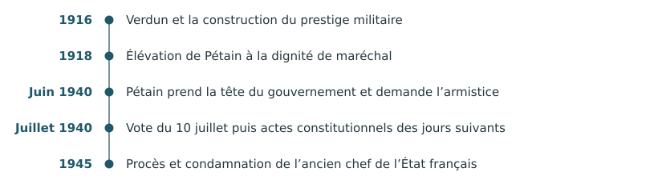
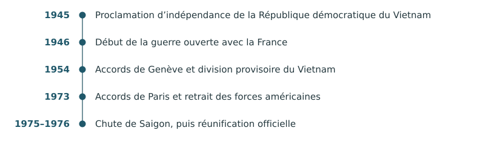

# Histoire contemporaine · Billets du 24 juin 2025 · Corrigé guidé

*Corrigé rédigé par IA, non officiel. Signalez toute erreur.*

**Rédaction** · GPT-6.2 Astra Ultra · vitesse non renseignée · 26 novembre 2026

ENS, filière B/L · Oral commun d’histoire contemporaine. La feuille présente 10 billets. Pour chaque billet, la personne interrogée choisit entre un sujet français et un sujet portant sur le monde. Les deux propositions sont traitées ici dans l’ordre des colonnes du jury.

Le choix en gras des dix billets de la feuille est corroboré par la page 5 du rapport.

## Préparer un sujet en une heure trente

Le choix se fait avant de rejoindre la salle de préparation. Commencer par définir les termes, les bornes et l’espace, puis bâtir une chronologie courte. Pour chaque mouvement du plan, retenir une institution, un groupe d’acteurs et un exemple daté dont on peut expliquer les conséquences. Les chronologies et l’atlas indiqués par le jury servent à vérifier un lieu ou une date. L’atlas peut être utilisé pendant le passage.

L’exposé dure vingt minutes et l’entretien dix. Une répartition possible réserve deux minutes à l’introduction, cinq minutes à chacun de trois mouvements et trois minutes aux transitions et à la conclusion. Les plans et les relances ci-dessous sont proposés pour développer oralement les commentaires.

## Billet 1

### France · Pétain, une figure française

**Plan proposé** · Verdun et la construction d’un prestige militaire · Du protecteur invoqué à l’État français · Procès et usages concurrents de la figure du maréchal.

Comment le prestige acquis en 1916 a-t-il pu être invoqué pour légitimer, en 1940, une rupture avec la République ? À Verdun, Pétain commande pendant une partie de la bataille. La presse et les commémorations transforment une responsabilité partagée en réputation personnelle de protecteur des soldats. Maréchal en 1918, il conserve après la guerre une autorité militaire et entre au gouvernement en 1934. Son crédit ne provient donc pas du seul souvenir des tranchées.

En juin 1940, la défaite et l’exode donnent une force politique nouvelle à la promesse de protection. Président du Conseil, Pétain demande l’armistice. Le vote du 10 juillet lui accorde les pleins pouvoirs constituants et ses actes des jours suivants fondent un État autoritaire. La Révolution nationale, le statut des Juifs d’octobre 1940 et la collaboration engagent la responsabilité du régime français. Condamné en 1945, Pétain devient une figure disputée. La mémoire du chef militaire est mobilisée pour défendre ou contester la mémoire du chef de l’État. Une biographie historique doit expliquer cet usage changeant du prestige.

**À l’entretien.** *Pourquoi distinguer le vote du 10 juillet et les actes du 11 ?* Le premier habilite le gouvernement sous l’autorité de Pétain à promulguer une constitution. Les seconds concentrent les pouvoirs et donnent au régime sa forme immédiate.

### Monde · Les catastrophes écologiques dans le monde au XXe siècle

**Plan proposé** · Les sociétés transforment leur exposition · De l’alerte locale à la reconnaissance des victimes · Responsabilités industrielles et frontières de la protection.

Quand un dommage environnemental devient-il une catastrophe publique ? L’industrialisation, les monocultures et l’urbanisation modifient les expositions. Dans les Grandes Plaines américaines des années 1930, sécheresse et pratiques agricoles concourent au *Dust Bowl*. Les migrations de familles et l’action fédérale sur la conservation des sols font apparaître ses dimensions économiques et sociales. Une explication limitée à la météo laisserait échapper l’usage des terres.

À Minamata, au Japon, la maladie officiellement signalée en 1956 révèle une pollution industrielle au mercure transmise par l’alimentation. L’enquête et la reconnaissance des victimes s’étendent sur des années. Bhopal en 1984, en Inde, met en cause la sécurité industrielle et la responsabilité d’une entreprise multinationale. Tchernobyl en 1986 rend visibles les effets transfrontaliers et les difficultés d’information d’un État. La conférence de Stockholm en 1972 témoigne de la mise à l’agenda internationale de l’environnement, sans effacer les différences de protection et d’indemnisation. Les conséquences se comprennent en examinant les milieux exposés, les autorités qui alertent et les ressources des populations.

**À l’entretien.** *Pourquoi comparer Minamata et Tchernobyl ?* L’une révèle une contamination lente dans une chaîne alimentaire, l’autre une crise dont l’événement est datable. Dans les deux cas, la reconnaissance des dommages dure bien plus longtemps.

**Choix indiqué par le jury.** Le fascicule et le rapport signalent en gras le sujet de la colonne france.

## Billet 2

### France · La mémoire de Vichy en France

**Plan proposé** · Reconstruire la légalité et juger après 1944 · Les mémoires concurrentes de l’Occupation · Enquêtes, procès et parole publique de l’État.

Comment les Français ont-ils attribué des responsabilités à l’État français après sa disparition ? En 1944–1945, le rétablissement de la légalité républicaine, les procès des dirigeants et les récits résistants répondent à des besoins distincts de justice et de reconstruction politique. Les familles endeuillées, les rescapés juifs et les anciens résistants conservent des expériences différentes. Il serait faux de confondre la visibilité réduite de certaines mémoires avec leur disparition.

Dans les années 1950, les amnisties et les récits gaulliste ou communiste valorisent des formes différentes de résistance nationale. Les années 1970 déplacent le débat. *Le Chagrin et la Pitié* et les travaux de Robert Paxton sur l’initiative de Vichy rendent plus difficile l’image d’une collaboration seulement imposée. Les associations de victimes, les recherches sur les rafles et les procédures judiciaires inscrivent la persécution des Juifs au centre du débat. Le procès Barbie en 1987 puis la reconnaissance par Jacques Chirac en 1995 de la responsabilité de la France dans la rafle du Vél’ d’Hiv marquent deux étapes différentes, judiciaire et politique.

**À l’entretien.** *La mémoire est-elle une source ou un objet pour l’historien ?* Les témoignages renseignent sur l’expérience vécue. Le moment où ils sont recueillis, diffusés ou ignorés permet aussi d’étudier la société qui les reçoit.

### Monde · L’Amérique latine dans la guerre froide

**Plan proposé** · Des conflits sociaux antérieurs à la guerre froide · Cuba et l’internationalisation du continent · Dictatures, solidarités et transitions démocratiques.

Pourquoi la guerre froide intensifie-t-elle des conflits latino-américains dont les origines sont souvent locales ? Réformes agraires, inégalités foncières et dépendance commerciale préexistent à la division des blocs. Au Guatemala, la chute de Jacobo Árbenz en 1954, soutenue par les États-Unis, relie la défense d’intérêts économiques à l’anticommunisme. La révolution cubaine de 1959 a d’abord une dynamique nationale. Son rapprochement avec Moscou et la crise des missiles d’octobre 1962 donnent ensuite à Cuba une place dans la confrontation mondiale.

Dans les années 1960–1970, projets révolutionnaires, réformismes électoraux et dictatures militaires suivent des trajectoires différentes. Au Chili, l’élection d’Allende en 1970 puis le coup d’État de 1973 s’expliquent par des oppositions internes autant que par les pressions internationales. En Amérique centrale, le Nicaragua sandiniste après 1979 illustre la persistance des affrontements malgré la transition démocratique engagée ailleurs. Dette, mouvements sociaux et défense des droits humains contribuent aux sorties des dictatures. La notion de terrain d’affrontement entre grandes puissances doit laisser une place aux gouvernements, organisations populaires et citoyens du continent.

**À l’entretien.** *Pourquoi ne pas faire de Cuba un simple relais soviétique ?* La révolution repose sur une histoire politique cubaine et ses dirigeants développent des initiatives internationales propres, même au temps de leur dépendance économique envers Moscou.

**Choix indiqué par le jury.** Le fascicule et le rapport signalent en gras le sujet de la colonne france.

## Billet 3

### France · Les Français et les partis politique en France (de 1870 aux années 1980)

**Plan proposé** · Des comités de notables aux organisations permanentes · Le parti de masse et les crises de la représentation · Des électeurs et militants à la présidentielle.

Comment les partis ont-ils relié les citoyens aux institutions, et pourquoi cette médiation est-elle contestée ? Sous la IIIe République, le vote masculin, la presse, les comités et les réseaux d’élus précèdent souvent l’organisation permanente. La création du Parti radical en 1901 et de la SFIO en 1905 associe des élus locaux, des militants et des programmes nationaux selon des modalités différentes. Le congrès de Tours en 1920 divise les socialistes sur le rapport à l’Internationale communiste.

Le Front populaire de 1936 associe coalition électorale, mobilisations populaires et gouvernement. Vichy supprime le libre jeu des partis, tandis que la Résistance prépare de nouvelles légitimités. Après 1944, le suffrage des femmes et l’implantation du PCF, de la SFIO et du MRP donnent une ampleur nouvelle à la représentation. La Ve République et l’élection présidentielle au suffrage universel direct, adoptée en 1962, renforcent les logiques de coalition et la personnalisation. L’alternance de 1981 manifeste la capacité des partis à organiser l’accès au pouvoir. Adhésion militante, fidélité électorale et confiance dans les appareils restent trois rapports distincts.

**À l’entretien.** *Pourquoi ne pas chercher les partis modernes auprès des seuls groupes parlementaires de 1875 ?* Un groupe rassemble des élus. La permanence des organisations, l’encadrement militant et les réseaux de candidature se développent progressivement.

### Monde · Les Jeux olympiques au 20e s.

**Plan proposé** · Institutionnaliser les rencontres et sélectionner les athlètes · Faire des Jeux une scène internationale · Boycotts, protestations et télévision mondiale.

Comment une compétition internationale devient-elle une scène d’affirmation nationale et de contestation ? Les Jeux modernes rétablis à Athènes en 1896 prennent au XXe siècle la forme d’un rendez-vous régulier. Fédérations, critères d’amateurisme et accès longtemps restreint des femmes définissent qui peut représenter une nation. Les annulations liées aux guerres mondiales rappellent la dépendance du mouvement olympique à l’ordre politique.

Berlin en 1936 illustre la mise en scène du régime nazi, sans que toutes les performances, notamment celles de Jesse Owens, confirment son discours racial. Après 1945, décolonisation et guerre froide augmentent le nombre d’États représentés. Mexico en 1968 rend visibles les luttes afro-américaines. Les boycotts de Moscou en 1980 et de Los Angeles en 1984 montrent les coûts de la rivalité interétatique pour les athlètes. La télévision et les recettes commerciales élargissent le public et modifient l’organisation, tandis que l’exclusion puis le retour de l’Afrique du Sud marquent l’incidence des luttes contre l’apartheid. L’olympisme fabrique donc un langage commun dont les usages restent conflictuels.

**À l’entretien.** *Comment passer des États aux athlètes ?* L’exemple de Mexico montre que les sportifs utilisent parfois la visibilité acquise comme représentants nationaux pour contester une hiérarchie dans leur propre pays.

**Choix indiqué par le jury.** Le fascicule et le rapport signalent en gras le sujet de la colonne france.

## Billet 4

### France · Les femmes et le monde du travail en France (de 1870 aux années 1980)

**Plan proposé** · Compter les travailleuses et reconnaître le salaire · Recomposer les métiers entre les guerres · Étendre les droits, mesurer les inégalités de carrière.

Comment la présence ancienne des femmes au travail a-t-elle acquis des statuts, des droits et une visibilité nouveaux ? À la fin du XIXe siècle, ouvrières du textile, domestiques, commerçantes et agricultrices travaillent déjà. Le recensement sous-estime le travail familial et à domicile. Le mariage rend difficile l’autonomie juridique, même si la loi de 1907 autorise les femmes mariées à disposer de leur salaire. Une histoire qui commencerait avec les ouvrières des usines de guerre manquerait ces activités.

La mobilisation de 1914–1918 ouvre certains postes aux femmes sans abolir la division sexuée du travail. La démobilisation et les politiques familiales réaffirment ensuite les assignations domestiques. Après 1945, scolarité prolongée, tertiarisation et salariat étendent les possibilités d’emploi. La loi de 1965 permet à une femme mariée d’exercer une profession sans l’autorisation de son mari. L’égalité salariale inscrite en 1972 et la loi Roudy de 1983 se heurtent à la ségrégation professionnelle, aux écarts de carrière et à la répartition du travail domestique. Le changement s’observe dans la durée des carrières autant que dans le taux d’activité.

**À l’entretien.** *Pourquoi compter séparément aide familiale et salariée ?* Une agricultrice peut changer de statut statistique ou juridique sans commencer à travailler à cette date. Cela transforme ses droits et la visibilité de son activité.

### Monde · Les populations et les guerres dans le monde de 1918 à 1991

**Plan proposé** · Vivre les déplacements imposés par la paix · La Seconde Guerre mondiale et les persécutions spécifiques · Décolonisations, exils et nouveaux droits.

Comment les conflits du XXe siècle brouillent-ils la distinction entre combattants et populations civiles ? Après 1918, déplacements forcés, tracés de frontières et échanges de populations prolongent la guerre dans les vies ordinaires. L’échange gréco-turc organisé en 1923 montre qu’un traité de paix peut lui-même imposer un enracinement nouveau. Les guerres civiles, comme celle d’Espagne, suscitent des départs dont les effets dépassent le cadre national.

La Seconde Guerre mondiale mobilise la production et expose les civils aux occupations, aux bombardements et aux persécutions. Le génocide des Juifs d’Europe et celui des Roms procèdent de politiques raciales spécifiques. Le droit international tirera des conséquences différentes des crimes de guerre, des génocides et de la situation des réfugiés. La convention de Genève sur les réfugiés de 1951 répond à une histoire précise de déplacements. Les indépendances négociées ou guerrières, par exemple la partition des Indes en 1947 ou la fin de la guerre d’Algérie en 1962, entraînent à leur tour exils et recompositions familiales. Aide humanitaire, mémoire, retour ou installation durable appartiennent pleinement à l’histoire des guerres jusqu’en 1991.

**À l’entretien.** *Faut-il traiter toutes les populations comme des victimes passives ?* Certaines fuient ou sont déportées, d’autres réorganisent des solidarités et négocient leur survie. Leurs possibilités d’action dépendent fortement des contraintes et des persécutions subies.

**Choix indiqué par le jury.** Le fascicule et le rapport signalent en gras le sujet de la colonne france.

## Billet 5

### France · L'Etat et les territoires en France de 1870 à la fin des années 1980

**Plan proposé** · Équiper le territoire et administrer les différences · Planifier la reconstruction et l’équilibre régional · Transférer des compétences aux collectivités.

L’unité de l’État républicain a-t-elle effacé les différences territoriales ? À partir de 1870, préfets, école, armée et chemins de fer diffusent normes et services dans des territoires diversement équipés. La loi municipale de 1884 consolide l’administration communale et, en règle générale, l’élection du maire par le conseil municipal. Centralisation et apprentissage local de la politique progressent donc ensemble. Les frontières changent aussi, notamment avec le retour de l’Alsace-Moselle après 1918 et le maintien de son droit local.

Les destructions de guerre puis la croissance d’après 1945 posent le problème des inégalités d’équipement et du poids de Paris. La DATAR, créée en 1963, coordonne l’aménagement du territoire. Les métropoles d’équilibre et les politiques industrielles cherchent à redistribuer activités et services. Les collectivités participent à ces choix avec des moyens inégaux. À partir de 1982, les lois de décentralisation transfèrent des compétences et réforment la tutelle préfectorale. La région devient une collectivité territoriale, avec premières élections régionales au suffrage universel direct en 1986. L’État se transforme en partenaire et en arbitre tout en maintenant des services nationaux.

**À l’entretien.** *Déconcentration et décentralisation sont-elles synonymes ?* La première confie des décisions à des représentants locaux de l’État. La seconde attribue des compétences à des collectivités gouvernées par des élus.

### Monde · Reconstruire l'Europe aux lendemains de la Seconde Guerre mondiale

**Plan proposé** · Refaire vivre des territoires bouleversés · Financer deux modèles de reconstruction · Diviser l’Allemagne, coopérer autour du charbon et de l’acier.

Que faut-il reconstruire en Europe après 1945, et selon quel projet politique ? Destructions, pénuries et déplacements de population imposent de rétablir logement, transport et ravitaillement. Les destructions et pertes humaines frappent particulièrement l’Europe orientale. Le sort des personnes déplacées, le retour difficile des rescapés et les expulsions d’Allemands montrent que la reconstruction est aussi une recomposition démographique et territoriale.

Les gouvernements réorganisent monnaies, production et droits sociaux. Le plan Marshall annoncé en 1947 et l’OECE fondée en 1948 encadrent l’aide américaine à l’Ouest. À l’Est, les pouvoirs communistes consolident nationalisations et planification sous influence soviétique, puis se coordonnent au sein du CAEM en 1949. L’Allemagne occupée devient l’épicentre de la division avec la création de deux États en 1949. À l’Ouest, la CECA instituée en 1951 transforme le charbon et l’acier en objets de coopération entre anciens adversaires. La reconstruction n’efface ni les disparités régionales ni la domination des superpuissances. Elle fixe pour plusieurs décennies des institutions économiques et sociales divergentes.

**À l’entretien.** *Pourquoi inclure les logements et les réfugiés dans une histoire de la reconstruction ?* La remise en route des usines dépend aussi d’une population logée et ravitaillée. Les nouveaux tracés des frontières modifient qui peut rentrer et où.

**Choix indiqué par le jury.** Le fascicule et le rapport signalent en gras le sujet de la colonne monde.

## Billet 6

### France · Les intellectuels français et l'URSS

**Plan proposé** · Des espoirs révolutionnaires aux voyages en URSS · Antifascisme, fidélités et premières ruptures · Déstalinisation et engagements pour les dissidents.

Pourquoi l’URSS a-t-elle suscité chez des intellectuels français des fidélités durables et des ruptures retentissantes ? Après 1917, la révolution bolchevique semble offrir une issue aux injustices du capitalisme et à la guerre. Le PCF, la presse militante, les voyages et les associations de sympathisants organisent la circulation des représentations. L’engagement antifasciste renforce certains rapprochements dans les années 1930. Le *Retour de l’URSS* de Gide en 1936 révèle cependant le coût politique d’une critique formulée par un ancien sympathisant.

Après 1945, le rôle soviétique dans la victoire et l’influence du PCF donnent une audience nouvelle au modèle. Des témoignages sur les camps, le rapport Khrouchtchev puis la répression de Budapest en 1956 imposent des choix à des écrivains et universitaires souvent déjà divisés. Prague en 1968, les mobilisations en faveur des dissidents et la réception de *L’Archipel du Goulag* dans les années 1970 élargissent les critiques. Il faut distinguer adhésion partisane, compagnonnage, anticommunisme conservateur et critique du stalinisme au nom du socialisme. Le rapport à l’URSS structure ainsi les conflits du champ intellectuel français.

**À l’entretien.** *Que révèle le livre de Gide au-delà du témoignage de voyage ?* Sa réception montre comment la solidarité antifasciste et la fidélité à un espoir révolutionnaire ont pu rendre coûteuse une critique publique.

### Monde · Le pape dans les relations internationales, de Benoît XV à Jean-Paul II

**Plan proposé** · Une autorité religieuse transnationale après 1914 · Souveraineté, concordats et épreuve des dictatures · Diplomatie de paix et trajectoire polonaise.

Comment le Saint-Siège exerce-t-il une influence internationale avec des ressources principalement diplomatiques et morales ? Benoît XV, pape de 1914 à 1922, propose en 1917 une démarche de paix dont les belligérants limitent la portée. Sa capacité à parler aux fidèles traverse les frontières. Les accords du Latran conclus sous Pie XI en 1929 règlent la question romaine et reconnaissent la souveraineté de la Cité du Vatican, distincte de l’autorité diplomatique du Saint-Siège.

Face aux régimes autoritaires et à la persécution des Juifs, concordats, négociations secrètes et prises de parole publiques soulèvent des dilemmes. L’attitude de Pie XII pendant la Seconde Guerre mondiale demeure un débat historique qui demande de distinguer action diplomatique, silences publics et initiatives locales. Jean XXIII publie *Pacem in terris* en 1963 et le concile Vatican II redéfinit le rapport de l’Église au monde. Paul VI prend la parole à l’ONU en 1965. L’élection du Polonais Jean-Paul II en 1978 et son voyage de 1979 en Pologne donnent une portée internationale aux aspirations locales. La fin des régimes communistes ne saurait toutefois s’expliquer par l’action d’un seul pape.

**À l’entretien.** *Pourquoi distinguer Église, Vatican et Saint-Siège ?* L’Église est une communauté mondiale, la Cité du Vatican un territoire souverain, le Saint-Siège l’institution qui conduit notamment la diplomatie pontificale.

**Choix indiqué par le jury.** Le fascicule et le rapport signalent en gras le sujet de la colonne france.

## Billet 7

### France · Se marier et divorcer en France (1870-1990)

**Plan proposé** · Les conditions familiales et civiles du mariage · Guerre, natalité et normes conjugales · Réformer l’autorité familiale et les formes de rupture.

Comment le mariage passe-t-il d’une institution encadrant fortement les rôles de sexe et de famille à une union dont les conditions et la dissolution sont davantage négociées ? Vers 1870, le mariage civil régit l’état des personnes et le Code civil place l’épouse dans une situation d’infériorité. Choix du conjoint, patrimoines, religions et réputations familiales comptent différemment selon les milieux. La loi Naquet de 1884 rétablit le divorce pour faute, aboli en 1816. Une possibilité légale reste souvent difficile à exercer faute de ressources et d’autonomie.

De la Grande Guerre aux années 1950, veuvage, déséquilibres démographiques, politique familiale et pénurie de logements pèsent sur la formation des couples. Le mariage demeure central, y compris dans le baby-boom. Les réformes de 1965 sur les droits de l’épouse et de 1970 sur l’autorité parentale réduisent les hiérarchies conjugales. En 1975, le divorce par consentement mutuel est réintroduit. Vie en couple non marié et naissances hors mariage gagnent en visibilité dans les années 1970–1980. La progression du divorce traduit aussi la possibilité accrue de quitter une union.

**À l’entretien.** *Pourquoi distinguer droit et pratique ?* Une loi peut rendre le divorce juridiquement possible des décennies avant que les revenus, le logement et l’acceptation familiale permettent effectivement de se séparer.

### Monde · Les guerres d'Indochine et du Vietnam

**Plan proposé** · Le refus de la restauration coloniale · Deux constructions étatiques et une intervention internationale · Fin de l’engagement américain et réunification.

Comment une lutte d’indépendance s’articule-t-elle à des guerres civiles, régionales et mondiales ? En 1945, le Viet Minh proclame l’indépendance de la République démocratique du Vietnam. Le retour français et l’échec de la négociation conduisent à la guerre ouverte en 1946. La victoire communiste en Chine en 1949 et le soutien américain croissant à la France inscrivent la guerre d’Indochine dans la guerre froide. La défaite française de Diên Biên Phu et les accords de Genève de 1954 mettent fin à la guerre coloniale tout en laissant le Vietnam temporairement divisé. Laos et Cambodge ont leurs propres trajectoires.

Au Sud, le régime de Ngo Dinh Diem puis ses successeurs affrontent une contestation interne et le Front national de libération, soutenu par le Nord. L’engagement américain change d’échelle dans les années 1960. Le conflit bouleverse les campagnes, entraîne des déplacements et divise l’opinion américaine. Les accords de Paris de 1973 organisent le retrait américain. La chute de Saigon en 1975 précède la réunification officielle de 1976. Les destructions et les exils prolongent la guerre pour les populations. Les combattants et les gouvernants vietnamiens gardent des objectifs propres dans les deux conflits.

**À l’entretien.** *Pourquoi ne pas commencer la seconde guerre au seul débarquement américain de 1965 ?* La division de 1954, la construction de deux États et les oppositions politiques au Sud en conditionnent déjà la dynamique.

**Choix indiqué par le jury.** Le fascicule et le rapport signalent en gras le sujet de la colonne monde.

## Billet 8

### France · La presse et ses lecteurs en France (1870-1990)

**Plan proposé** · Créer les conditions d’une diffusion populaire · Lire et s’informer sous la guerre et la censure · Concurrence des écrans et segmentation du lectorat.

Comment le journal devient-il un produit de masse, puis un média parmi d’autres ? La loi du 29 juillet 1881 élargit la liberté de publier. Scolarisation, urbanisation, transports et publicité permettent de diffuser des quotidiens à bas prix. Feuilletons, faits divers et sport fidélisent des lecteurs que les journaux d’opinion ne suffisent pas à décrire. Pendant l’affaire Dreyfus, *J’accuse…!* de Zola paraît en 1898 dans *L’Aurore*. Il montre comment une intervention éditoriale peut constituer des publics antagonistes.

La guerre de 1914–1918 expose la presse à la censure et aux impératifs patriotiques. La radio concurrence ensuite les quotidiens, sans faire disparaître les titres régionaux ou spécialisés. Sous l’Occupation, presse autorisée et journaux clandestins n’ont ni les mêmes ressources ni les mêmes libertés. La Libération recompose les entreprises et les équipes. Après 1945, magazines illustrés, télévision et transformations publicitaires diversifient les pratiques. Lire un quotidien militant, partager un hebdomadaire ou suivre les résultats sportifs ne produit pas le même rapport à l’information. L’histoire des lecteurs demande donc de combiner tirages, prix, usages et témoignages.

**À l’entretien.** *Un chiffre de tirage donne-t-il le nombre de lecteurs ?* Il compte des exemplaires imprimés. Un exemplaire peut rester invendu ou passer entre plusieurs lecteurs.

### Monde · Lutter contre le fascisme en Europe dans l’entre-deux guerres

**Plan proposé** · Résister à l’installation des dictatures · Des mobilisations nationales aux fronts antifascistes · L’Espagne et les divisions internationales.

Quelles forces ont combattu les fascismes, et pourquoi leurs alliances ont-elles varié ? Dans l’Italie des années 1920, opposition parlementaire, syndicats et exilés affrontent une violence politique puis une dictature. L’assassinat de Matteotti en 1924 révèle la fragilité des institutions. En Allemagne, la division entre sociaux-démocrates et communistes et la stratégie des élites conservatrices contribuent à l’échec des résistances à la prise du pouvoir par Hitler en 1933. Les obstacles sont aussi institutionnels et répressifs.

Dans les démocraties, associations, intellectuels et partis construisent des fronts plus larges. En France, les mobilisations qui suivent le 6 février 1934 favorisent le rapprochement à l’origine du Front populaire. En Espagne à partir de 1936, la guerre civile internationalise les engagements tandis que les démocraties occidentales choisissent la non-intervention. Les réfugiés antifascistes, les organisations de secours et les réseaux culturels entretiennent une solidarité transnationale. Les intérêts des États, les objectifs sociaux et les divisions entre courants de gauche limitent cette solidarité. Le pacte germano-soviétique d’août 1939 approfondit les déchirements. L’antifascisme désigne une famille de pratiques et d’alliances, aux résultats très inégaux.

**À l’entretien.** *Pourquoi distinguer le Front populaire français et la guerre d’Espagne ?* Le premier agit dans un cadre électoral et gouvernemental. En Espagne, coup d’État, guerre civile et interventions étrangères bouleversent les conditions mêmes de l’action politique.

**Choix indiqué par le jury.** Le fascicule et le rapport signalent en gras le sujet de la colonne monde.

## Billet 9

### France · Villes et campagnes en France de 1870 aux années 1980

**Plan proposé** · Les marchés et mobilités relient les territoires · Mesurer le basculement démographique et industriel · Navettes, résidences et campagnes plurielles.

Comment les rapports entre villes et campagnes se transforment-ils au-delà d’une simple opposition entre tradition et modernité ? Sous la IIIe République, les campagnes peuplées fournissent denrées, travailleurs et électeurs. Chemin de fer, marchés urbains et presse resserrent des liens déjà anciens. Une petite ville de marché appartient à la fois à des réseaux ruraux et à une hiérarchie urbaine. Des migrations saisonnières et des retours précèdent l’installation définitive en ville.

Le recensement de 1931 marque le passage d’une majorité statistiquement rurale à une majorité urbaine en France. La coupure retenue pour les communes ne suffit pas à saisir la diversité des pratiques. Après 1945, mécanisation et spécialisation réduisent les besoins de main-d’œuvre agricole. La croissance industrielle et tertiaire, les grands ensembles et l’automobile transforment l’habitat. Dès les années 1970, le périurbain associe résidence dans des communes autrefois rurales, emplois et services urbains. Certaines campagnes perdent habitants et équipements, d’autres accueillent résidences, tourisme et nouvelles activités. Le rapport ville-campagne se réorganise selon l’accès aux transports, à l’emploi et au foncier.

**À l’entretien.** *Pourquoi 1931 est-il un repère et non une rupture vécue par chacun ?* Une majorité statistique dépend de définitions et agrège des transformations lentes, très inégales selon les régions.

### Monde · Les Etats-Unis et l'Asie de 1945 à 1991

**Plan proposé** · Rebâtir le Japon et endiguer en Asie orientale · Le Vietnam à l’épreuve d’un conflit national · Diplomatie triangulaire et puissance économique des alliés.

Comment les États-Unis sont-ils devenus à la fois puissance militaire, partenaire économique et acteur contesté en Asie ? En 1945, l’occupation du Japon ouvre une période de réformes institutionnelles sous direction américaine. La victoire communiste en Chine en 1949 et la guerre de Corée en 1950–1953 réorientent les priorités vers l’endiguement. Le traité de sécurité avec le Japon et les alliances nouées avec des partenaires asiatiques dessinent un réseau dont les membres poursuivent leurs intérêts.

Au Vietnam, le soutien aux autorités du Sud puis l’intervention militaire directe mettent en évidence le coût politique et humain de cette politique. L’opposition vietnamienne a une dimension nationale que la seule grille de la guerre froide explique mal. La visite de Nixon en Chine en 1972 tire parti de la rupture sino-soviétique et précède l’établissement de relations diplomatiques complètes en 1979. Pendant ce temps, le développement économique japonais puis celui d’autres économies d’Asie orientale intensifie les échanges et les rivalités commerciales. En 1991, l’alliance sécuritaire avec le Japon coexiste ainsi avec une forte concurrence industrielle. Cette histoire doit laisser une place aux choix coréens, chinois, vietnamiens et japonais.

**À l’entretien.** *Pourquoi l’ouverture à Pékin n’équivaut-elle pas à l’abandon des alliances asiatiques ?* Washington recherche un nouvel équilibre entre puissances tout en maintenant des traités et des partenaires régionaux.

**Choix indiqué par le jury.** Le fascicule et le rapport signalent en gras le sujet de la colonne monde.

## Billet 10

### France · Les politiques économiques en France de 1870 au début des années 1990

**Plan proposé** · Monnaie, protection et économie de guerre · De la crise des années trente à la planification · Chômage, contrainte extérieure et choix européens.

À quelles crises les gouvernements français ont-ils cherché à répondre en transformant les instruments économiques de l’État ? À la fin du XIXe siècle, monnaie stable, protections douanières et grands travaux coexistent. Le tarif Méline de 1892 protège notamment des producteurs agricoles. La Grande Guerre impose commandes militaires, emprunts et interventions dans la production. La stabilisation du franc sous Poincaré et les débats budgétaires des années 1930 montrent le poids des créanciers, de l’emploi et des contraintes internationales.

En 1936, les réformes sociales accompagnent une tentative de relance dans le cadre du Front populaire. Après 1944, nationalisations, Sécurité sociale, planification indicative et modernisation du crédit créent des capacités d’action nouvelles. Le premier plan Monnet donne priorité aux secteurs de base. L’intégration européenne change progressivement l’échelle des choix. Après les chocs pétroliers des années 1970, chômage et inflation fragilisent les recettes antérieures. La relance de 1981, les nationalisations de 1982 puis la politique de rigueur de 1983 révèlent l’arbitrage entre soutien interne, contrainte extérieure et maintien dans le système monétaire européen. Privatisations et marché unique ne font pas disparaître le rôle régulateur de l’État.

**À l’entretien.** *Quel rôle distinguer entre plan et nationalisation ?* La nationalisation change la propriété d’une entreprise. Un plan indicatif fixe des priorités et coordonne des investissements dans une économie qui reste mixte.

### Monde · Nationalismes et guerres au 20e s.

**Plan proposé** · Mobiliser et redessiner des frontières · Expansion raciale et résistance aux empires · Construire des États et affronter les conflits d’appartenance.

Comment les projets nationaux font-ils la guerre et comment la guerre refaçonne-t-elle les nations ? En 1914, les rivalités impériales et les choix des gouvernements s’ajoutent aux nationalismes. Les sociétés ne sont pas toutes unanimement belliqueuses. La mobilisation, les deuils et les récits du sacrifice renforcent pourtant des cadres nationaux. Les traités d’après 1918 font naître ou agrandissent des États tout en créant de nouvelles minorités. La revendication d’autodétermination ne règle pas des frontières où populations et langues sont mêlées.

Dans l’entre-deux-guerres, le nazisme associe expansion territoriale et hiérarchie raciale. Ce projet ne se confond pas avec les nationalismes anticoloniaux, même lorsque tous invoquent la nation. Après 1945, les guerres d’Indochine et d’Algérie manifestent les affrontements entre souveraineté impériale et indépendance nationale. Les États issus de la décolonisation doivent ensuite faire vivre des cadres politiques hérités ou disputés. En Europe, la désintégration de la fédération yougoslave au seuil des années 1990 montre comment des acteurs politiques exploitent des appartenances et des institutions dans une crise. Le nationalisme peut légitimer mobilisation, résistance à une domination ou exclusion, sans être la cause suffisante de chaque guerre.

**À l’entretien.** *Comment éviter de présenter toute guerre comme un conflit de peuples homogènes ?* Chercher les divergences internes, les choix gouvernementaux, les alliances et les minorités qui ne se reconnaissent pas dans une revendication territoriale.

**Choix indiqué par le jury.** Le fascicule et le rapport signalent en gras le sujet de la colonne monde.

## Sources

Feuille officielle du 24 juin 2025. Les intitulés et les éventuelles irrégularités orthographiques sont conservés dans les en-têtes. [Fascicule du jury](<https://www.ens.psl.eu/sites/default/files/histoire_24_juin.pdf>)

Anne-Sophie Bruno, Antonin Durand, Charles-François Mathis et Judith Rainhorn présentent les modalités et les attentes aux pages 1 à 3. La liste des billets s’achève page 6. Les commentaires et plans sont proposés pour l’entraînement. [Rapport d’histoire contemporaine B/L](<https://www.ens.psl.eu/sites/default/files/2025_bl_rapport_oral_histoire.pdf>)

Pour prolonger les billets sur la France, Henry Rousso, *Le Syndrome de Vichy* (1987), étudie les usages changeants du passé, et Michel Winock, *Le Siècle des intellectuels* (1997), restitue les engagements et leurs ruptures.
