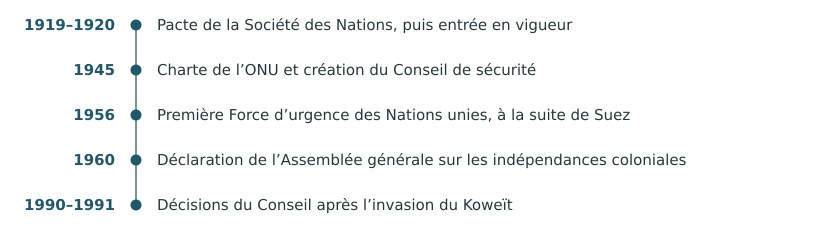

# Histoire contemporaine · Billets du 26 juin 2025 · Corrigé guidé

*Corrigé rédigé par IA, non officiel. Signalez toute erreur.*

**Rédaction** · GPT-6.2 Astra Ultra · vitesse non renseignée · 26 novembre 2026

ENS, filière B/L · Oral commun d’histoire contemporaine. La feuille présente 10 billets. Pour chaque billet, la personne interrogée choisit entre un sujet français et un sujet portant sur le monde. Les deux propositions sont traitées ici dans l’ordre des colonnes du jury.

Le choix en gras des dix billets de la feuille est corroboré par la page 5 du rapport.

## Préparer un sujet en une heure trente

Le choix se fait avant de rejoindre la salle de préparation. Commencer par définir les termes, les bornes et l’espace, puis bâtir une chronologie courte. Pour chaque mouvement du plan, retenir une institution, un groupe d’acteurs et un exemple daté dont on peut expliquer les conséquences. Les chronologies et l’atlas indiqués par le jury servent à vérifier un lieu ou une date. L’atlas peut être utilisé pendant le passage.

L’exposé dure vingt minutes et l’entretien dix. Une répartition possible réserve deux minutes à l’introduction, cinq minutes à chacun de trois mouvements et trois minutes aux transitions et à la conclusion. Les plans et les relances ci-dessous sont proposés pour développer oralement les commentaires.

## Billet 1

### France · Clemenceau

**Plan proposé** · L’opposition radicale et les droits du citoyen · Le gouvernement et les conflits du travail · Direction de la guerre et négociations de paix.

Comment un républicain radical, longtemps identifié à l’opposition, devient-il le chef d’un gouvernement de guerre ? Médecin, élu de Montmartre en 1870 puis député, Georges Clemenceau défend l’amnistie des communards. Il conteste la politique coloniale de Jules Ferry, au nom de priorités républicaines et nationales. Son journal *L’Aurore* publie en 1898 le *J’accuse…!* de Zola. Ces engagements éclairent le radicalisme comme culture politique faite de libertés publiques, d’anticléricalisme et de contrôle du pouvoir.

Ministre de l’Intérieur puis président du Conseil en 1906–1909, Clemenceau défend l’ordre public face aux grèves. La critique des socialistes révèle les tensions entre radicalisme politique et attentes du mouvement ouvrier. Revenu à la tête du gouvernement en novembre 1917, il entend poursuivre la guerre en maintenant l’autorité du pouvoir civil. En 1919, la négociation du traité de Versailles l’oblige à concilier sécurité française et partenaires alliés. Son échec dans la course présidentielle en 1920 rappelle l’écart entre prestige de la victoire et équilibre parlementaire. Le personnage permet d’interroger les tensions de la République jusque dans son gouvernement.

**À l’entretien.** *Pourquoi articuler ses positions sur les grèves et sur l’affaire Dreyfus ?* Elles montrent qu’une défense résolue des libertés et de la légalité ne débouche pas nécessairement sur une politique favorable aux revendications sociales.

### Monde · La SDN et l'ONU

**Plan proposé** · La sécurité collective de Genève à l’épreuve · Organiser à San Francisco la présence des puissances · Élargissement, blocages et marges d’action de l’ONU.

Comment deux organisations de sécurité collective ont-elles tenté de concilier l’égalité des États et le pouvoir des grandes puissances ? Créée dans le cadre des traités de 1919, la Société des Nations mise sur la négociation et la pression collective. L’absence des États-Unis, les règles de décision et les divisions des membres limitent sa capacité de contrainte. Son action ne se résume pas aux crises des années 1930. Elle contribue aussi au règlement de différends et à la coopération sur les réfugiés ou la santé.

La Charte des Nations unies de 1945 maintient une assemblée de tous les États et confie au Conseil de sécurité des pouvoirs renforcés. Le veto des cinq permanents inscrit la hiérarchie des puissances dans l’organisation. La guerre froide freine l’action collective, sans supprimer les espaces de médiation et les opérations de maintien de la paix, notamment après Suez en 1956. La décolonisation élargit fortement l’Assemblée générale et transforme ses priorités. Aux compétences de sécurité s’ajoutent le développement et les droits humains. L’ONU tire des leçons de la SDN tout en acceptant un compromis permanent entre souveraineté, efficacité et représentativité.

**À l’entretien.** *Pourquoi la présence des grandes puissances a-t-elle un prix à l’ONU ?* Leur participation rend l’organisation plus représentative des rapports de force, mais leur droit de veto empêche certaines décisions contre leur volonté.

**Choix indiqué par le jury.** Le fascicule et le rapport signalent en gras le sujet de la colonne monde.

## Billet 2

### France · Paris (1870-années 1980)

**Plan proposé** · Une capitale politique façonnée par la métropole industrielle · Des mondes sociaux séparés au sein du Grand Paris · Refaire les circulations et le gouvernement parisien.

Comment Paris demeure-t-elle capitale alors que la ville vécue déborde de plus en plus la commune ? Le siège de 1870–1871 et la Commune mettent en évidence opposition politique et divisions sociales. Les transformations haussmanniennes héritées du Second Empire modifient circulations et répartition de l’habitat. Les expositions universelles de 1889 et de 1900 affirment une vitrine nationale. Métro, gares et grands magasins permettent d’étudier la capitale à travers les usages de ses habitants et visiteurs.

Au XXe siècle, l’industrie et la population se déploient en banlieue. Banlieues ouvrières, lotissements pavillonnaires et quartiers aisés constituent des espaces très différents. Pendant l’Occupation, Paris concentre sièges du pouvoir, persécutions, ravitaillement difficile et réseaux de résistance. Après 1945, grands ensembles, périphérique et RER transforment les trajets et les frontières sociales. La réorganisation administrative des années 1960 distingue Paris et les départements de proche banlieue, tandis que les villes nouvelles cherchent à orienter la croissance. L’élection d’un maire de Paris en 1977 modifie le rapport entre ville et État. Centralité nationale et fragmentation métropolitaine progressent ainsi de concert.

**À l’entretien.** *Que change le choix entre Paris et l’agglomération parisienne ?* Une histoire limitée aux vingt arrondissements laisse hors champ une partie majeure des ouvriers, des immigrés, des logements et des déplacements de la capitale.

### Monde · L'impérialisme américain de Truman à Reagan

**Plan proposé** · Institutions, monnaie et alliances de l’après-guerre · Interventions, résistances et contestations · Recomposer la politique de puissance jusqu’à Reagan.

Le terme d’impérialisme américain désigne-t-il une domination territoriale, une hégémonie économique ou des interventions politiques ? Sous Truman, le plan Marshall, l’OTAN et les alliances asiatiques font des États-Unis le principal organisateur du camp occidental. Le dollar et les institutions de Bretton Woods renforcent leur influence, tandis que l’aide répond aussi à des demandes européennes. La domination emprunte donc des formes distinctes de l’administration coloniale directe.

Dans les années 1950–1960, le Guatemala, Cuba et la guerre du Vietnam révèlent l’intensité des interventions américaines mais aussi leurs limites. Les États et sociétés concernés défendent des projets propres. La guerre du Vietnam provoque une contestation internationale et intérieure qui atteint la légitimité du leadership. La détente et le rapprochement avec Pékin sous Nixon traduisent une adaptation à un système plus complexe. Reagan réaffirme ensuite la confrontation avec Moscou et privilégie des alliances anticommunistes, notamment en Amérique centrale, avant de négocier la réduction des armements avec Gorbatchev. Il faut ainsi distinguer puissance, capacité de persuasion et contrôle effectif des décisions locales.

**À l’entretien.** *Quand faut-il employer « alliance » plutôt que « domination » ?* Examiner les pressions exercées, la marge de négociation du partenaire et les bénéfices que celui-ci recherche, en acceptant qu’une alliance puisse aussi être asymétrique.

**Choix indiqué par le jury.** Le fascicule et le rapport signalent en gras le sujet de la colonne france.

## Billet 3

### France · Exploitation des ressources et protection de la nature en France (1870 aux années 1980)

**Plan proposé** · Administrer les ressources et préserver les paysages · Moderniser au prix de transformations territoriales · Rendre collectives les décisions sur l’eau et les milieux.

Comment passe-t-on d’une administration des ressources à une protection de l’environnement comme question publique ? Sous la IIIe République, charbon, bois, eau et terres sont des supports de production. Les forestiers organisent la conservation de certains massifs pour assurer la ressource et limiter l’érosion. Les associations de protection des paysages et la loi de 1906 sur les sites défendent d’autres valeurs, parfois dans des espaces habités où les usages locaux entrent en conflit avec la protection.

Après 1945, barrages, mines et agriculture intensive servent la reconstruction et l’indépendance énergétique. À Tignes, la mise en eau du barrage en 1952 transforme le territoire au prix du déplacement d’habitants. La croissance des pollutions industrielles et agricoles rend visibles des coûts qui s’étendent au-delà des lieux de production. La loi de 1960 sur les parcs nationaux, la création du parc de la Vanoise en 1963, les agences de bassin issues de la loi sur l’eau de 1964 et le ministère chargé de l’environnement en 1971 institutionnalisent des protections différentes. La loi de 1976 sur la nature renforce cette évolution. Exploiter et protéger demeurent des arbitrages politiques entre usages concurrents.

**À l’entretien.** *Pourquoi comparer un parc national et une agence de bassin ?* Le premier protège un espace délimité. La seconde organise la gestion de l’eau selon des flux qui traversent les frontières administratives.

### Monde · 1973 dans le monde

**Plan proposé** · La détente et les limites de la puissance américaine · Chili et Proche-Orient dans leurs contextes propres · Une rupture énergétique aux effets économiques différenciés.

Pourquoi faire de 1973 un observatoire mondial sans lui attribuer toutes les ruptures de la décennie ? En janvier, les accords de Paris préparent le retrait américain du Vietnam. Ils marquent une limite de la puissance américaine, mais la guerre vietnamienne dure encore deux ans. En Europe, Royaume-Uni, Irlande et Danemark rejoignent les Communautés européennes. Cet élargissement prend place dans un contexte de détente et de recomposition monétaire engagé avant 1973.

Le renversement d’Allende au Chili le 11 septembre illustre l’enchevêtrement entre oppositions intérieures et guerre froide. La guerre d’octobre au Proche-Orient et les décisions de pays exportateurs de pétrole provoquent un choc énergétique mondial. Les États importateurs connaissent des coûts accrus, les exportateurs voient leurs recettes augmenter et les pays pauvres importateurs subissent une contrainte particulièrement lourde. Les effets s’étalent sur plusieurs années et se combinent à l’inflation antérieure et aux transformations industrielles. 1973 articule ainsi fin de certaines certitudes de croissance, affirmation de pouvoirs du Sud et persistance des rivalités politiques. La chronologie de chacun de ces processus reste distincte.

**À l’entretien.** *Pourquoi le premier choc pétrolier ne suffit-il pas à expliquer toute la crise économique ?* Les tensions monétaires et inflationnistes lui sont antérieures, et les possibilités d’adaptation diffèrent selon les économies et les branches.

**Choix indiqué par le jury.** Le fascicule et le rapport signalent en gras le sujet de la colonne france.

## Billet 4

### France · Les campagnes françaises et la modernité (1870-1980)

**Plan proposé** · Relier savoirs, capitaux et populations rurales · Les exploitations et les politiques de modernisation · Du village agricole aux modes de vie différenciés.

Comment les campagnes françaises ont-elles produit leurs propres modernités ? Vers 1870, agriculture familiale, salariat et artisanat coexistent avec de fortes inégalités régionales. Chemin de fer, école, service militaire et suffrage favorisent la circulation des personnes et des connaissances. Coopératives, syndicats agricoles et mutualité permettent à des exploitants de négocier crédits, achats et débouchés. La modernisation commence donc bien avant le tracteur.

Les pertes de la Grande Guerre et les mobilités vers les villes transforment familles et main-d’œuvre. Après 1945, mécanisation, remembrement, engrais et politique agricole commune à partir de 1962 accélèrent la spécialisation. Les lois d’orientation agricole de 1960 et 1962 favorisent des exploitations familiales modernisées, au prix de départs et d’endettements inégalement supportés. L’électricité, l’automobile et la scolarisation modifient aussi les loisirs et la vie domestique. À la fin de la période, des espaces périurbains attirent des résidents tandis que d’autres campagnes perdent des services. L’exploitation spécialisée performante, l’ouvrier rural et la maison de résidence secondaire illustrent des modernités simultanées.

**À l’entretien.** *Pourquoi l’exploitation agricole ne représente-t-elle pas toute la campagne ?* Les villages abritent aussi artisans, salariés non agricoles, retraités et nouveaux résidents, dont les besoins peuvent diverger de ceux des exploitants.

### Monde · Chine et URSS dans les relations internationales (1949-1991)

**Plan proposé** · Construire une alliance économique et stratégique · La rupture et ses effets dans les mouvements communistes · Le triangle Washington-Pékin-Moscou et la normalisation.

Comment l’alliance conclue par deux révolutions communistes s’est-elle muée en rivalité ? Après la fondation de la République populaire de Chine en 1949, le traité d’amitié sino-soviétique de 1950 s’accompagne d’aide économique et technique. La guerre de Corée rapproche les deux États contre les États-Unis tout en révélant des intérêts nationaux distincts. Pékin recherche sécurité et industrialisation sans renoncer à son autonomie.

La déstalinisation et la coexistence pacifique promue par Khrouchtchev alimentent les différends idéologiques et stratégiques. Le retrait des experts soviétiques en 1960 donne une réalité concrète à la rupture, que les affrontements frontaliers de 1969 aggravent. Les deux puissances cherchent aussi une influence auprès de mouvements du tiers-monde. La visite de Nixon à Pékin en 1972 transforme la relation en un jeu à trois. Après Mao, les réformes économiques de Deng Xiaoping et l’évolution soviétique sous Gorbatchev modifient les priorités. Le sommet de Pékin de 1989 normalise les relations avant la disparition de l’URSS en 1991. La référence commune au communisme n’a donc jamais supprimé les contraintes de puissance ni les débats sur le développement.

**À l’entretien.** *Pourquoi la déstalinisation devient-elle un enjeu international ?* Critiquer l’héritage de Staline modifie la légitimité des dirigeants communistes et la place de Moscou comme centre de référence, jusque dans les relations avec Pékin.

**Choix indiqué par le jury.** Le fascicule et le rapport signalent en gras le sujet de la colonne monde.

## Billet 5

### France · La figure de l'homme providentiel en France

**Plan proposé** · Les ressorts sociaux d’un appel au sauveur · Des crises comparables, des constructions de pouvoir opposées · Le chef à l’épreuve des institutions et du consentement.

Dans quelles crises des Français investissent-ils un individu de la mission de sauver la collectivité ? L’expression « homme providentiel » désigne une attente sociale et une mise en scène politique. À la fin des années 1880, Boulanger fédère des mécontentements de républicains révisionnistes, nationalistes et monarchistes. Son succès électoral très personnalisé reste fragile et ne débouche pas sur la prise du pouvoir. L’étude des images, de la presse et des comités compte autant que la carrière militaire.

En 1940, le prestige acquis par Pétain pendant la Grande Guerre est invoqué dans une défaite militaire et une crise de régime. Il sert la construction d’un pouvoir autoritaire, la collaboration et une politique d’exclusion. De Gaulle, dans la même crise, devient une figure concurrente en affirmant la poursuite du combat depuis Londres. Son retour aux affaires en 1958, dans la crise algérienne, débouche sur une Constitution soumise au référendum et un exécutif renforcé. Ces expériences ne sont pas interchangeables. Il faut comparer les institutions, les relais et les issues, y compris l’échec et la contestation du chef.

**À l’entretien.** *Le charisme suffit-il pour expliquer 1958 ?* La crise en Algérie, les décisions parlementaires et la préparation constitutionnelle expliquent comment le prestige de De Gaulle se traduit en changement de régime.

### Monde · L'ordre international au 20e s., entre universalisme et régionalisme

**Plan proposé** · Une sécurité universelle aux engagements inégaux · Structures universelles et alliances de la guerre froide · Le Sud et les nouvelles organisations régionales.

Comment organisations universelles et regroupements régionaux ont-ils coexisté et parfois rivalisé ? Après 1918, la Société des Nations propose un cadre de sécurité collective auquel tous les grands États ne participent pas durablement. Les arrangements européens comme Locarno en 1925 cherchent une garantie régionale mais leurs engagements restent géographiquement inégaux. Les agressions des années 1930 exposent les limites de la solidarité collective.

En 1945, la Charte de l’ONU affirme des principes universels et reconnaît un rôle aux arrangements régionaux. La guerre froide fait ensuite des alliances atlantiques et soviétiques des instruments de sécurité centrés sur des blocs. Dans le même temps, l’intégration européenne de la CECA à la CEE engage une coopération économique plus poussée que les accords mondiaux. La décolonisation transforme l’Assemblée générale en tribune de revendications universelles tout en favorisant l’Organisation de l’unité africaine en 1963 et l’ASEAN en 1967. Ces régions ne poursuivent pas les mêmes objectifs. Protection des souverainetés, intégration et représentation collective peuvent se renforcer ou se contredire. À la fin du siècle, le régionalisme permet tantôt d’appliquer des règles communes, tantôt d’en contester la définition par les grandes puissances.

**À l’entretien.** *Pourquoi une alliance militaire et une communauté économique ne sont-elles pas deux exemples équivalents ?* Elles n’engagent pas les mêmes compétences, les mêmes procédures ni la même part de souveraineté des adhérents.

**Choix indiqué par le jury.** Le fascicule et le rapport signalent en gras le sujet de la colonne france.

## Billet 6

### France · Grandir en France de 1870 aux années 1980

**Plan proposé** · Protéger, instruire et employer les enfants · Guerres et responsabilité envers les familles · Longues scolarités, nouvelles jeunesses et inégalités.

Comment l’enfance est-elle devenue un temps plus long d’apprentissage et de protection ? Vers 1870, grandir dépend fortement de la profession familiale, du sexe et de la résidence. Les lois Ferry de 1881–1882 instituent la gratuité de l’enseignement primaire public puis l’instruction obligatoire et laïque, favorisant une expérience commune. Les restrictions au travail des enfants se heurtent aux besoins des exploitations et des ateliers. La IIIe République développe aussi l’assistance et la protection de l’enfance en danger.

Les guerres produisent orphelins et déplacements. Le statut de pupille de la Nation créé en 1917 engage la collectivité envers des enfants dont le parent est mort ou atteint au service de la nation. Après 1945, protection maternelle et infantile, baby-boom et amélioration du logement transforment les premières années. La scolarité obligatoire portée à seize ans en 1959 et le collège unique de 1975 allongent les trajectoires scolaires. Jeunesse, loisirs et cultures de pairs acquièrent une visibilité nouvelle. Les inégalités familiales et scolaires persistent néanmoins dans les orientations, les espaces de vie et les possibilités de prolonger ses études.

**À l’entretien.** *Pourquoi distinguer enfance et jeunesse ?* Les seuils d’entrée au travail, de fin de scolarité et de majorité légale changent à des dates différentes. L’allongement des études contribue à faire de l’adolescence une expérience plus commune.

### Monde · Les exils politiques au 20e s.

**Plan proposé** · Devenir réfugié après la disparition des empires · Les régimes d’asile face aux dictatures · Agir depuis l’étranger et envisager le retour.

En quoi l’exil politique transforme-t-il à la fois les sociétés de départ, d’accueil et l’action des exilés ? Les révolutions et les changements de frontières après 1917 provoquent des départs massifs. Le passeport Nansen créé en 1922 pour des réfugiés apatrides facilite certains déplacements sans rendre aux exilés leur citoyenneté. Être opposant à un régime, être réfugié et perdre sa nationalité sont des situations qui peuvent se recouper sans être identiques.

Dans les années 1930, opposants au nazisme et républicains espagnols cherchent refuge dans des États aux politiques d’admission variables. La *Retirada* de 1939 conduit en France des centaines de milliers de personnes et révèle les limites de l’accueil. Après 1945, la convention de Genève de 1951 définit la protection des réfugiés dans un cadre progressivement élargi. La répression de Budapest en 1956 et les dictatures du Cône Sud dans les années 1970 engendrent d’autres départs. Journaux, universités, associations de solidarité et témoignages font des exilés des acteurs transnationaux. Le retour, quand il devient possible, dépend d’une famille, d’une carrière et d’un pays désormais transformés.

**À l’entretien.** *La cause d’un départ détermine-t-elle automatiquement le statut obtenu ?* Le statut dépend aussi des règles et décisions du pays d’accueil, des preuves exigées et de la manière dont l’époque définit le réfugié.

**Choix indiqué par le jury.** Le fascicule et le rapport signalent en gras le sujet de la colonne france.

## Billet 7

### France · Industrie et environnement en France (de 1870 aux années 1980)

**Plan proposé** · Industrialiser et concentrer les nuisances · Modernisation nationale et territoires d’exposition · Réglementation, réparation et friches industrielles.

Comment relier création de richesses industrielles, distribution des nuisances et invention de protections ? Vers 1870, bassins charbonniers, sidérurgie et chimie transforment air, eau et paysages. L’emploi lie les riverains à des établissements qui les exposent aussi aux fumées, poussières ou rejets. Le régime des établissements classés hérité de 1810, réformé en 1917, encadre l’implantation et la surveillance des activités. Autoriser une usine, indemniser un voisin et protéger durablement un bassin versant sont des interventions différentes.

Après 1945, le charbon, les grands barrages puis les raffineries accompagnent une modernisation que soutiennent pouvoirs publics et syndicats. Les nuisances se concentrent dans des bassins dont l’emploi est souvent peu diversifié. La loi sur l’eau de 1964, le ministère de l’environnement en 1971 et la loi de 1976 sur les installations classées renforcent la prise en compte collective des pollutions. La désindustrialisation des années 1970–1980 laisse des friches et des sols pollués. Fermer un site ne supprime donc ni les atteintes passées ni les conflits sur leur réparation. L’environnement est une dimension de l’histoire de l’industrie depuis son implantation.

**À l’entretien.** *Comment expliquer des mobilisations locales apparemment contradictoires ?* Les mêmes ménages peuvent vivre du salaire industriel et demander la réduction d’une pollution. Leurs intérêts portent simultanément sur la santé, l’emploi et l’avenir du territoire.

### Monde · Le Royaume-Uni et l'Europe

**Plan proposé** · Équilibre continental et horizons impériaux · Coopérer en Europe en restant hors du marché commun · Entrer, confirmer l’adhésion et négocier ses conditions.

Comment un État européen à vocation mondiale a-t-il négocié son rôle sur le continent ? Au début du XXe siècle, le Royaume-Uni participe à l’Entente cordiale de 1904 puis aux guerres mondiales et à la définition des paix européennes. Insularité et empire lui donnent d’autres horizons économiques et stratégiques. La politique d’apaisement des années 1930 et l’engagement de 1939 montrent que ces priorités extérieures se redéfinissent dans des crises précises.

Après 1945, Londres soutient la coopération occidentale, l’OTAN et le Conseil de l’Europe mais reste hors de la CECA et de la CEE initiales. Les liens avec les États-Unis et le Commonwealth ainsi que la défense de la souveraineté parlementaire comptent dans ce choix. Face aux performances de la CEE, les gouvernements britanniques demandent l’adhésion, retardée par les vetos de De Gaulle dans les années 1960. L’entrée en 1973 puis le référendum de maintien de 1975 ancrent le pays dans la Communauté. Les négociations budgétaires de Thatcher, notamment le compromis de 1984, illustrent une participation faite d’engagement et de contestation. L’Europe institutionnelle ne résume pas toute la relation britannique au continent.

**À l’entretien.** *Pourquoi distinguer le Conseil de l’Europe et la CEE ?* Le premier, créé en 1949, organise une coopération et la protection des droits. La seconde, instituée en 1957, construit un marché commun et des politiques partagées.

**Choix indiqué par le jury.** Le fascicule et le rapport signalent en gras le sujet de la colonne france.

## Billet 8

### France · La Belle-Epoque en France

**Plan proposé** · Une mémoire rétrospective de la prospérité · Innovations et conflictualité de la République · Des expériences inégales en métropole et dans l’empire.

Qui a vécu la « Belle Époque », et quand l’expression acquiert-elle son sens ? Le nom, diffusé rétrospectivement, compare les décennies d’avant 1914 à la rupture de la Grande Guerre. La croissance des années 1890–1914, l’Exposition universelle de Paris en 1900, l’électricité et l’automobile nourrissent l’image d’une modernité conquérante. Les cafés-concerts, le cinéma et le sport de masse renouvellent les loisirs sans se diffuser partout au même rythme.

La République traverse l’affaire Dreyfus puis adopte en 1905 la séparation des Églises et de l’État. L’extension du suffrage et des libertés concerne inégalement les femmes et les populations colonisées. Les conditions de l’ouvrier, du paysan, du domestique ou de la couturière nuancent le souvenir d’aisance. Les grèves, la catastrophe de Courrières en 1906 et les tensions sur les retraites révèlent les coûts humains du développement industriel. L’empire colonial donne des ressources et un imaginaire à la puissance française tout en reposant sur des dominations. Employer l’expression comme objet de mémoire permet ainsi d’articuler progrès techniques, antagonismes sociaux et nostalgie d’après-guerre.

**À l’entretien.** *Pourquoi éviter une conclusion qui annonce mécaniquement 1914 ?* Les acteurs perçoivent des tensions mais ne vivent pas tous dans l’attente certaine d’une guerre mondiale. Le caractère « d’avant-guerre » appartient au regard rétrospectif.

### Monde · Le cinéma au 20e s.

**Plan proposé** · Du spectacle forain à l’industrie des studios · Cinéma parlant, propagande et publics · Nouvelles vagues, indépendances et diffusion domestique.

Comment un spectacle né à la fin du XIXe siècle devient-il à la fois industrie, art et pratique collective mondiale ? Les premières projections commerciales des années 1890 donnent lieu à des expérimentations dans plusieurs pays. L’essor de salles, de sociétés de production et de réseaux de distribution stabilise le cinéma comme spectacle populaire. La puissance financière d’Hollywood et le système des studios accompagnent l’internationalisation des films, sans éliminer les cinémas européens, indiens ou japonais.

Le passage au parlant à la fin des années 1920 transforme le travail des acteurs, des salles et des exportateurs. En URSS, en Allemagne et dans les démocraties, le film participe à l’information et à la propagande, mais l’expérience du public ne se déduit pas des intentions des producteurs. Après 1945, néoréalisme italien, Nouvelle Vague française et cinémas issus des indépendances renouvellent la création et la représentation du quotidien. Télévision et vidéo modifient ensuite la fréquentation des salles et les modes de réception, tandis que les superproductions dominent une partie du marché. Censure, festivals et critiques contribuent aussi à donner une valeur artistique aux œuvres.

**À l’entretien.** *Pourquoi inclure Bombay dans une histoire mondiale du cinéma ?* Les cinémas indiens constituent des industries de production et des publics de masse dotés de langues et de circuits propres. Un récit réduit à Hollywood et Paris les invisibiliserait.

**Choix indiqué par le jury.** Le fascicule et le rapport signalent en gras le sujet de la colonne france.

## Billet 9

### France · Le charbon en France de 1870 aux années 1980

**Plan proposé** · Une énergie qui organise des bassins de vie · De Courrières aux nationalisations de la Libération · Concurrence énergétique et reconversion régionale.

Comment le charbon, d’abord pilier de l’industrialisation, est-il devenu l’objet d’un retrait économique et social ? La France de 1870 dispose de bassins importants mais inégalement situés, notamment le Nord–Pas-de-Calais, la Loire et la Lorraine dont le tracé politique change. Le charbon alimente chemins de fer, usines et chauffages. Les compagnies organisent l’extraction et parfois l’habitat des mineurs. Grèves et solidarités de métier répondent aux risques et à la discipline. Courrières en 1906 révèle le coût humain et suscite un débat national.

Les destructions de la Première Guerre mondiale rendent la remise en état des puits essentielle. Après la Libération, la nationalisation de 1946 crée Charbonnages de France. La « bataille du charbon » fait du mineur une figure de la reconstruction, tandis que les grèves montrent les désaccords sur les conditions de travail et la politique économique. La CECA organise à partir des années 1950 un marché européen du charbon et de l’acier. Pétrole, gaz, importations et transformations industrielles réduisent ensuite la compétitivité de plusieurs bassins. Les fermetures et reconversions des années 1960–1980 remettent en question logements, identités et économies locales. La fin du charbon comme énergie dominante précède sa disparition minière.

**À l’entretien.** *Pourquoi une histoire sociale du charbon dépasse-t-elle les mineurs ?* Elle comprend aussi les familles, les travailleurs immigrés, les collectivités et les consommateurs dont l’activité et les ressources dépendent du bassin.

### Monde · La crise des années 1930

**Plan proposé** · Passer du crédit à la dépression mondiale · Comparer les victimes et les calendriers · Réponses publiques, réformes et crises politiques.

Comment une crise financière américaine devient-elle une crise mondiale des économies et des sociétés ? Le krach de Wall Street d’octobre 1929 révèle les fragilités d’une expansion dépendante du crédit. Faillites bancaires, contraction de la demande et baisse des prix se renforcent. L’étalon-or et les mouvements internationaux de capitaux transmettent les difficultés. En 1931, les crises bancaires européennes et la sortie britannique de l’or montrent que le phénomène dépasse largement la seule bourse américaine.

Chômage, files d’attente et chute des cours agricoles touchent ouvriers, agriculteurs et économies exportatrices de matières premières. Les calendriers varient, la France étant atteinte plus tardivement que les États-Unis ou l’Allemagne. Aux États-Unis, Roosevelt lance le New Deal en 1933, qui combine secours, réglementation et réformes. D’autres gouvernements dévaluent ou recourent à des protections commerciales, au risque d’aggraver la fragmentation des échanges. En Allemagne, la dépression fragilise la République de Weimar, mais les choix des élites et les institutions sont indispensables pour comprendre la nomination d’Hitler. La crise encourage des transformations contrastées du rôle de l’État et n’entraîne pas partout une dictature.

**À l’entretien.** *En quoi la déflation aggrave-t-elle certaines difficultés ?* La baisse des prix et des revenus alourdit en termes réels les dettes fixées en monnaie nominale et peut entraîner de nouveaux défauts.

**Choix indiqué par le jury.** Le fascicule et le rapport signalent en gras le sujet de la colonne monde.

## Billet 10

### France · Les extrêmismes politiques en France de 1870 à la fin des années 1980

**Plan proposé** · Des oppositions hétérogènes à la jeune République · Mobilisations de l’entre-deux-guerres et gouvernement de Vichy · Reconfigurations électorales et militantes sous la Ve.

Comment étudier les extrémismes sans réunir artificiellement des courants opposés ? La qualification dépend de l’époque, du rapport au pluralisme et des pratiques. Le boulangisme rassemble à la fin des années 1880 des aspirations contradictoires. L’antidreyfusisme et l’Action française structurent ensuite une partie de la droite nationaliste et antirépublicaine. À gauche, anarchistes, syndicalistes révolutionnaires et socialistes se divisent sur la conquête de l’État et l’usage des élections.

Les années 1930 voient se mobiliser des ligues dont les programmes et les formes d’action diffèrent. La crise du 6 février 1934 renforce en retour l’antifascisme. La Révolution nationale de Vichy donne à des courants autoritaires et antisémites des moyens d’État. Sous la IVe puis la Ve République, poujadisme, oppositions violentes à l’indépendance algérienne et organisations d’extrême gauche après 1968 ont des bases et des objectifs différents. À partir des années 1980, les succès électoraux du Front national signalent une nouvelle visibilité de l’extrême droite. Le fil directeur est la transformation du rapport aux institutions, de la composition sociale et des modes de mobilisation, avec des différences décisives entre les projets.

**À l’entretien.** *Pourquoi éviter une simple symétrie entre extrême gauche et extrême droite ?* Les désaccords sur l’égalité, la nation, la race ou la propriété sont fondamentaux. La comparaison doit porter sur des dimensions explicites et datées.

### Monde · Le Tiers-Monde et le communisme

**Plan proposé** · Anticolonialisme et réappropriation des références marxistes · Révolutions, non-alignement et rivalités de modèles · Dépendances, réformes et fin du bloc soviétique.

Le communisme a-t-il été une tutelle extérieure, un outil de libération ou une voie de développement pour le tiers-monde ? L’expression « tiers-monde » forgée en 1952 désigne des sociétés très diverses dont beaucoup contestent la domination coloniale. L’Internationale communiste avait déjà formé des militants, mais les mouvements d’indépendance adaptent leurs références à des problèmes nationaux. En Chine en 1949 et au Vietnam, réforme agraire, mobilisations paysannes et construction d’un État se combinent au marxisme.

Bandung en 1955 et le non-alignement manifestent la volonté de ne pas choisir automatiquement un camp. Des dirigeants sollicitent aide économique ou militaire soviétique sans établir un régime communiste. La révolution cubaine de 1959 et les conflits d’indépendance en Afrique australe illustrent d’autres formes de circulation des militants, de l’aide et des modèles. La rupture sino-soviétique offre des partenaires rivaux. Les réformes économiques chinoises après 1978, les crises de régimes et la fin de l’URSS en 1991 modifient ces relations. L’autonomie des acteurs locaux et l’écart entre promesses d’émancipation et pratiques de gouvernement expliquent la diversité des trajectoires.

**À l’entretien.** *Tous les non-alignés sont-ils équidistants des deux blocs ?* L’autonomie revendiquée autorise des coopérations ponctuelles et parfois des dépendances fortes. Il faut examiner les accords et les choix de chaque gouvernement.

**Choix indiqué par le jury.** Le fascicule et le rapport signalent en gras le sujet de la colonne monde.

## Sources

Feuille officielle du 26 juin 2025. Les intitulés et les éventuelles irrégularités orthographiques sont conservés dans les en-têtes. [Fascicule du jury](<https://www.ens.psl.eu/sites/default/files/histoire_26_juin.pdf>)

Anne-Sophie Bruno, Antonin Durand, Charles-François Mathis et Judith Rainhorn présentent les modalités et les attentes aux pages 1 à 3. La liste des billets s’achève page 6. Les commentaires et plans sont proposés pour l’entraînement. [Rapport d’histoire contemporaine B/L](<https://www.ens.psl.eu/sites/default/files/2025_bl_rapport_oral_histoire.pdf>)

Pour approfondir les enjeux sociaux et politiques, on pourra confronter Gérard Noiriel, *Les Ouvriers dans la société française, XIXe–XXe siècle* (1986), et Michelle Zancarini-Fournel, *Les Luttes et les rêves* (2016), en distinguant la question et l’échelle de chacun de ces travaux.
