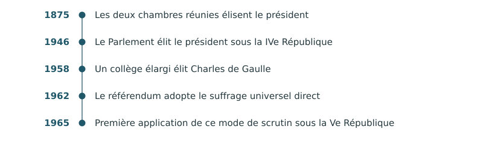
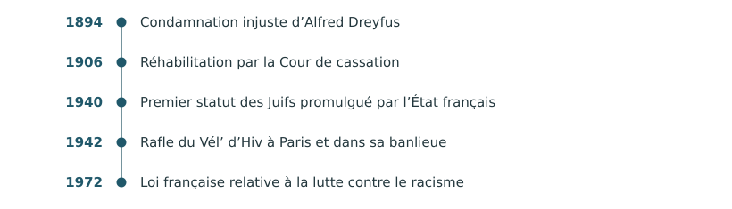

# Histoire contemporaine · Billets du 28 juin 2025 · Corrigé brut

*Corrigé rédigé par IA, non officiel. Signalez toute erreur.*

**Rédaction** · GPT-6.2 Astra Ultra · vitesse non renseignée · 26 novembre 2026

ENS, filière B/L · Oral commun d’histoire contemporaine. La feuille présente 12 billets. Pour chaque billet, la personne interrogée choisit entre un sujet français et un sujet portant sur le monde. Les deux propositions sont traitées ici dans l’ordre des colonnes du jury.

Le fascicule ne marque aucun choix au billet 10. La page 6 du rapport met le sujet français en gras. Le billet 3 est marqué dans le fascicule et n’apparaît pas dans la liste finale du rapport. Les dates et la typographie de la feuille font foi.

## Billet 1

### France · Installer la République en France

Comment la République proclamée le 4 septembre 1870 a-t-elle survécu alors que sa forme et ses soutiens étaient encore incertains ? La défaite, l’occupation d’une partie du territoire et la répression de la Commune divisent profondément les Français. En 1871, l’Assemblée élue est majoritairement monarchiste. Les divisions dynastiques et les succès électoraux républicains ouvrent la voie au compromis des lois constitutionnelles de 1875. La crise du 16 mai 1877 oppose Mac-Mahon à la majorité républicaine de la Chambre. La victoire électorale de celle-ci puis l’installation de républicains à la présidence en 1879 affermissent le régime parlementaire.

Installer un régime exige aussi de rendre ses institutions familières. Libertés de la presse et de réunion, municipalités élues, école primaire, fêtes du 14 juillet et symboles municipaux donnent aux citoyens des lieux d’apprentissage. L’armée, les réseaux associatifs et les partis jouent également un rôle. Le boulangisme et l’affaire Dreyfus prouvent la persistance des oppositions et des divisions sur les valeurs du régime. Les femmes sont exclues du suffrage politique et les droits restent très inégaux dans l’empire. L’installation républicaine associe ainsi consolidation institutionnelle et appropriation sociale incomplète.

### Monde · Les matières premières dans le monde de la fin de la Première Guerre mondiale aux années 1980

Comment la maîtrise des ressources a-t-elle redistribué richesse et pouvoir depuis la Première Guerre mondiale ? Les économies industrielles dépendent de ressources dont la production est concentrée géographiquement, avec des conditions très différentes pour le charbon, le pétrole, le caoutchouc ou les métaux. Dans l’entre-deux-guerres, empires coloniaux, concessions privées et marchés mondiaux organisent extraction et transport. La chute des cours après 1929 fragilise des régions exportatrices dont les recettes reposent sur quelques produits, tandis que leurs travailleurs supportent une part importante des ajustements.

Après 1945, la croissance, la motorisation et la pétrochimie augmentent la place du pétrole. La décolonisation permet à des gouvernements de revendiquer une souveraineté accrue sur les ressources. La création de l’OPEP en 1960 puis le choc de 1973 illustrent un changement du partage des revenus, sans donner aux exportateurs de toutes les matières premières un pouvoir comparable. La volatilité des années 1980 et le contre-choc pétrolier de 1986 révèlent les limites de ces gains. L’histoire doit relier producteurs, travailleurs, entreprises et consommateurs, y compris les conséquences écologiques locales qui échappent au seul prix mondial.

**Choix indiqué par le jury.** Le fascicule et le rapport signalent en gras le sujet de la colonne france.

## Billet 2

### France · Les Expositions universelles de Paris

Pourquoi Paris s’est-elle plusieurs fois transformée en exposition de la modernité ? Les expositions de 1855 et 1867, sous le Second Empire, utilisent la compétition entre nations et entreprises pour affirmer le rang international de la France et remodeler les espaces urbains. Celle de 1878 manifeste la capacité de la jeune République à organiser une rencontre mondiale après la défaite de 1870. Les pavillons et machines exposent des hiérarchies entre nations, classes sociales et territoires colonisés.

L’Exposition de 1889, centenaire de la Révolution, associe célébration républicaine et prouesse industrielle avec la tour Eiffel. Celle de 1900 accompagne l’ouverture du métro et laisse notamment le Grand et le Petit Palais. L’événement est aussi une expérience payante de loisirs, d’éducation visuelle et de consommation dont les publics diffèrent. En 1937, l’Exposition internationale des arts et techniques, héritière de ces rendez-vous sous une autre dénomination, reflète les rivalités politiques de l’entre-deux-guerres. Il faut la distinguer de l’Exposition coloniale de 1931. Ces manifestations temporaires laissent ainsi des équipements durables et des représentations contestables du monde.

### Monde · Les démocraties libérales face aux crises des années trente

Pourquoi la dépression des années trente conduit-elle certaines démocraties à réformer leurs institutions et d’autres à les perdre ? Le choc financier puis bancaire réduit crédit, emploi et recettes publiques. Chômage et paupérisation fragilisent la confiance dans les gouvernants. En Allemagne, le recours aux décrets d’urgence et les choix de responsables conservateurs affaiblissent la République de Weimar. La nomination d’Hitler en janvier 1933 précède la destruction des libertés. La crise économique ouvre des possibilités politiques dont l’issue dépend encore des acteurs.

Aux États-Unis, l’élection de Roosevelt en 1932 conduit au New Deal, à des secours publics et à des réformes dans un cadre constitutionnel disputé. Au Royaume-Uni, le gouvernement national et la sortie de l’étalon-or en 1931 constituent une réponse différente. En France, la crise politique de février 1934 stimule à la fois la contestation des institutions et l’union antifasciste. Le Front populaire de 1936 mène des réformes sociales avant de se diviser sous l’effet de contraintes économiques et internationales. L’attitude des démocraties face aux régimes expansionnistes et à la guerre d’Espagne montre que la crise porte enfin sur la capacité de défendre collectivement un ordre international.

**Choix indiqué par le jury.** Le fascicule et le rapport signalent en gras le sujet de la colonne monde.

## Billet 3

### France · Les élections présidentielles en France des années 1870 aux années 1980

Que révèle le mode d’élection du président sur la place du chef de l’État ? Sous les IIIe et IVe Républiques, l’élection par les parlementaires fait de la présidence le produit d’un compromis. En 1873, l’élection de Mac-Mahon intervient avant les lois constitutionnelles de 1875. Après la crise du 16 mai 1877, l’effacement relatif de la présidence tient à la pratique de la responsabilité politique et aux rapports de force. L’élection de René Coty en 1953, au treizième tour, illustre la logique parlementaire de la IVe République.

En 1958, de Gaulle est élu par un collège élargi dans le cadre de la nouvelle Constitution. La réforme approuvée par référendum en 1962 établit le suffrage universel direct. En 1965, le ballottage du général face à François Mitterrand montre que la nouvelle légitimité personnelle reste soumise à une compétition réelle. La télévision, les partis et les alliances du second tour structurent ensuite les campagnes. En 1974, Giscard d’Estaing l’emporte de peu. L’alternance de 1981 puis la réélection de Mitterrand en 1988 après une cohabitation montrent comment la présidence s’articule désormais à des majorités parlementaires parfois distinctes.

### Monde · Les loisirs en Europe occidentale au 20e s.

Qui dispose de temps libre et de quels moyens pour en faire un loisir ? Au début du XXe siècle, le dimanche, les fêtes et les sociabilités locales organisent déjà des temps hors travail. Le droit au repos hebdomadaire en France en 1906 et les revendications ouvrières sur la journée de travail contribuent à séparer davantage temps salarié et temps personnel. Cinéma, stade, vélo et excursions sont portés par des associations, des entreprises et parfois des mouvements politiques.

Dans l’entre-deux-guerres, les congés payés de 1936 en France donnent une valeur politique nouvelle aux vacances, sans permettre à toutes les familles de partir. Après 1945, la croissance des revenus, l’automobile, le chemin de fer, puis les vols touristiques construisent des marchés européens du tourisme. Les littoraux méditerranéens et les stations alpines sont réaménagés pour des clientèles nationales et étrangères. Télévision et loisirs domestiques se développent parallèlement aux voyages. Les tâches familiales, les différences de revenu et l’offre locale maintiennent des inégalités de temps et d’accès. La démocratisation porte donc sur les droits, les équipements et les pratiques, à des rythmes différents.

**Choix indiqué par le jury.** Le fascicule signale en gras le sujet « Les loisirs en Europe occidentale au 20e s. ». Ce billet n’est pas repris dans la liste finale du rapport.

## Billet 4

### France · Le mouvement ouvrier en France des années 1870 aux années 1980

Comment les ouvriers français sont-ils devenus des acteurs collectifs sans former un groupe uniforme ? Après la Commune, sociétés de secours et chambres syndicales reconstruisent des solidarités. La loi de 1884 autorise les syndicats professionnels, la CGT est créée en 1895 et la SFIO en 1905. La charte d’Amiens de 1906 affirme l’indépendance syndicale à l’égard des partis. Mineurs, métallurgistes, ouvrières du textile ou travailleurs immigrés connaissent pourtant des conditions d’organisation différentes.

La guerre de 1914–1918 et la révolution russe divisent les militants. En 1936, grèves avec occupations, accords Matignon et réformes du Front populaire montrent la force des mobilisations tout en distinguant syndicats, patronat et gouvernement. À la Libération, Sécurité sociale, comités d’entreprise et nationalisations donnent une place institutionnelle nouvelle aux représentants du travail. La guerre froide suscite de nouvelles divisions, dont la création de Force ouvrière. Les grèves de mai-juin 1968 et les négociations de Grenelle associent salaires et reconnaissance syndicale dans l’entreprise. Dans les années 1970–1980, fermetures, chômage et recompositions industrielles transforment les bases du mouvement ouvrier. Celui-ci ne se réduit ni aux syndicats ni au seul PCF.

### Monde · L'Europe et la démocratie au 20e s.

Comment la démocratie est-elle passée en Europe par des phases d’extension, de destruction et de réinvention ? Avant 1914, élargissement du suffrage, parlementarisme et organisations de masse connaissent des rythmes inégaux, tandis que les femmes et les populations impériales sont largement exclues. En 1918–1919, chute d’empires et nouvelles constitutions font naître des républiques, mais aussi des tensions sur les frontières et les appartenances nationales. Suffrage, droits des minorités et capacité à changer de gouvernement doivent être distingués.

Dans l’entre-deux-guerres, fascismes, nazisme et autres autoritarismes détruisent des institutions démocratiques. Toutes les sociétés européennes ne suivent pas le même chemin. Après 1945, l’Europe occidentale associe souvent pluralisme politique, État social et intégration régionale. Les « démocraties populaires » à l’Est invoquent une autre légitimité mais restreignent durablement le pluralisme. Les transitions en Grèce, au Portugal et en Espagne dans les années 1970, puis les révolutions de 1989 à l’Est, élargissent l’espace des régimes pluralistes. Leur consolidation dépend d’institutions, de mobilisations et de compromis. L’histoire du siècle n’est donc pas une progression continue vers un modèle unique.

**Choix indiqué par le jury.** Le fascicule et le rapport signalent en gras le sujet de la colonne france.

## Billet 5

### France · Les Français et l'école en France des années 1870 aux années 1980

Comment l’école devient-elle une expérience commune tout en maintenant des parcours socialement distincts ? Les lois Ferry de 1881–1882 instaurent gratuité du primaire public et obligation d’instruction. Les instituteurs, les familles et les municipalités mettent concrètement en œuvre une réforme qui s’appuie sur des écoles déjà existantes. La laïcité suscite des conflits locaux et le développement de l’enseignement public laisse subsister l’enseignement privé. Le certificat d’études et le lycée ne concernent pas les mêmes milieux.

Au XXe siècle, les guerres troublent les scolarités tandis que l’enseignement féminin et les filières techniques se développent. Sous Vichy, antisémitisme d’État et idéologie de la Révolution nationale touchent élèves et personnels. Après 1945, croissance démographique et besoin de qualifications entraînent la construction de collèges et de lycées. L’obligation scolaire jusqu’à seize ans est décidée en 1959. La loi Haby de 1975 institue le collège unique, et le baccalauréat professionnel créé en 1985 diversifie l’accès au second cycle. La massification augmente le nombre de jeunes poursuivant des études. Les choix d’orientation, le lieu de résidence et les ressources familiales maintiennent néanmoins des écarts de réussite.

### Monde · L'ONU, acteur de l'ordre international (de 1945 au début des années 1990)

Que peut faire l’ONU dans un ordre international où les États conservent leur souveraineté ? La Charte de 1945 institue une Assemblée générale et un Conseil de sécurité disposant de responsabilités particulières. Le droit de veto des cinq permanents protège leur participation tout en limitant la capacité d’action quand leurs intérêts divergent. La Déclaration universelle des droits de l’homme de 1948 établit une référence normative dont l’application dépend de processus juridiques et politiques ultérieurs.

Durant la guerre froide, les blocages n’empêchent pas toute intervention. En Corée en 1950, l’absence temporaire du représentant soviétique au Conseil permet l’adoption de résolutions. Après Suez en 1956, une force d’urgence illustre le maintien de la paix. La crise congolaise des années 1960 montre les risques d’opérations dans une décolonisation violente. L’arrivée de nouveaux membres donne à l’Assemblée une voix anticoloniale, notamment avec la résolution de 1960 sur l’indépendance des peuples coloniaux. En 1990–1991, les décisions du Conseil après l’invasion du Koweït signalent une coopération nouvelle mais conditionnelle entre grandes puissances. Institutions spécialisées, médiations et forums comptent aussi dans l’action internationale de l’organisation.

**Choix indiqué par le jury.** Le fascicule et le rapport signalent en gras le sujet de la colonne france.

## Billet 6

### France · Travailler à l'usine en France des années 1870 aux années 1980

Que signifie « travailler à l’usine » au-delà de la croissance de la production ? À la fin du XIXe siècle, usines textiles, ateliers métallurgiques et grandes installations sidérurgiques organisent des gestes, des horaires et des hiérarchies différents. Travailleurs qualifiés, manœuvres, femmes et travailleurs étrangers ne disposent pas des mêmes salaires ni des mêmes protections. La concentration de la main-d’œuvre favorise des solidarités, mais une partie de la production reste dispersée ou sous-traitée.

La Grande Guerre développe la production en série et bouleverse la répartition des postes. L’entre-deux-guerres voit progresser la rationalisation et le travail à la chaîne, notamment dans l’automobile. Les occupations d’usines de 1936 font du lieu de travail un espace de revendication et de sociabilité. Après 1945, l’essor des grandes entreprises et le recours à une main-d’œuvre immigrée restent marqués par la distinction entre ouvriers spécialisés et ouvriers professionnels. Les conflits de 1968 et des années 1970 portent aussi sur la cadence, la dignité et la parole au travail. Automatisation et fermetures transforment ensuite les carrières et les territoires. La mémoire industrielle conserve les gestes comme les conflits de l’atelier.

### Monde · Médias et politique dans le monde au 20e s.

Comment les médias ont-ils modifié les conditions d’exercice et de contestation du pouvoir ? Les quotidiens populaires et les agences de presse font circuler l’information au-delà des frontières dès le début du XXe siècle. Les guerres mondiales renforcent censure, propagande et mobilisation des opinions. La radio permet à des chefs d’État, mais aussi à des voix d’opposition et d’exil, de s’adresser à de vastes publics. Émissions, propriété des appareils et conditions d’écoute doivent être étudiées ensemble.

Après 1945, la télévision modifie les campagnes électorales et les représentations de la guerre. Le débat Kennedy-Nixon de 1960 aux États-Unis ou les images du Vietnam illustrent des usages distincts, sans prouver un effet automatique de l’écran sur l’opinion. Dans les États à parti unique, contrôle des informations et écoutes transfrontalières coexistent. Les mouvements d’indépendance emploient aussi radios et journaux pour construire des publics politiques. Satellites, chaînes internationales et premières formes d’Internet changent les rythmes en fin de siècle. Les médias disposent d’un pouvoir de sélection, mais publics, journalistes, entreprises et États négocient ou contestent le sens des images et des mots.

**Choix indiqué par le jury.** Le fascicule et le rapport signalent en gras le sujet de la colonne france.

## Billet 7

### France · Les crises politiques de la IIIe République

Quelles crises mettent en jeu l’existence du régime et lesquelles relèvent du fonctionnement courant du parlementarisme ? De 1870 à 1879, défaite, Commune et conflits avec la majorité monarchiste menacent la consolidation de la République. La dissolution décidée pendant la crise du 16 mai 1877 puis la victoire électorale des républicains tranchent en faveur de la prépondérance parlementaire. Dans les années 1880, la popularité de Boulanger donne une expression personnelle à des revendications très diverses de révision du régime.

L’affaire Dreyfus divise ensuite la société sur la justice, l’armée, l’antisémitisme et la nation. Elle favorise des engagements civiques et une recomposition des forces républicaines. Les scandales, les oppositions au parlementarisme et la dépression des années 1930 alimentent la crise du 6 février 1934. La riposte antifasciste contribue au rapprochement des gauches. L’instabilité ministérielle est fréquente, mais l’administration et les majorités continuent souvent de fonctionner. En revanche, la défaite de 1940, le vote du 10 juillet et les actes constitutionnels de Pétain mettent fin aux institutions républicaines en métropole. La chute du régime réclame donc une explication de la conjoncture de guerre autant que de ses fragilités antérieures.

### Monde · Le Royaume-Uni, puissance mondiale

Sur quels fondements le Royaume-Uni a-t-il exercé une puissance mondiale, et comment les a-t-il recomposés ? Au tournant du XXe siècle, flotte, empire, City de Londres et livre sterling composent un réseau militaire, commercial et financier. Dominions de peuplement et colonies ne sont pas administrés de façon uniforme. La Première Guerre mondiale mobilise massivement les ressources impériales, accroît les dettes et renforce les demandes d’autonomie. Le statut de Westminster en 1931 reconnaît une large autonomie législative aux dominions concernés.

La victoire de 1945 laisse le Royaume-Uni financièrement affaibli et dépendant de liens étroits avec les États-Unis. L’indépendance de l’Inde et du Pakistan en 1947 et la crise de Suez en 1956 montrent que ses capacités d’imposition ont changé. La décolonisation ne suit pas partout une voie négociée et pacifique, comme en témoignent les violences au Kenya. Le Commonwealth, la place financière de Londres, le siège permanent au Conseil de sécurité, l’alliance atlantique et la diplomatie culturelle offrent d’autres ressources. L’adhésion aux Communautés européennes en 1973 réorganise ses priorités. Le recul territorial de l’empire ne fait donc pas disparaître toute puissance mondiale.

**Choix indiqué par le jury.** Le fascicule et le rapport signalent en gras le sujet de la colonne france.

## Billet 8

### France · Les figures de la nation sous la IIIe République

Comment la IIIe République a-t-elle représenté la nation et qui ces représentations ont-elles inclus ou laissé à distance ? Marianne, le drapeau tricolore, la Marseillaise et le 14 juillet institué fête nationale en 1880 donnent à voir et à entendre la communauté politique dans les mairies, les écoles et les cérémonies. Le Panthéon républicain célèbre avec les funérailles de Victor Hugo en 1885 une nation de lettres et de citoyens. Les maîtres d’école, les maires et les sociétés locales font vivre ces figures.

Elles sont appropriées par des projets rivaux. Jeanne d’Arc peut incarner une nation catholique, monarchiste ou républicaine selon le contexte. L’affaire Dreyfus oppose des conceptions de l’appartenance nationale et des droits individuels. La Grande Guerre donne au poilu et au soldat inconnu, inhumé sous l’Arc de triomphe en 1921, une portée collective qui traverse les clivages sans les abolir. Les monuments communaux inscrivent les morts dans la vie locale. Marianne personnifie la République alors que les femmes ne votent pas encore aux élections nationales. La participation des soldats coloniaux pose également la question des frontières inégales de la citoyenneté.

### Monde · Un monde bipolaire? 1946-1991

La division en deux pôles suffit-elle à décrire le monde de 1946 à 1991 ? Après la guerre, les États-Unis et l’URSS disposent de ressources militaires, idéologiques et économiques exceptionnelles. La doctrine Truman, le plan Marshall et les réponses soviétiques en 1947 structurent l’affrontement. Berlin, les deux Allemagnes et les alliances de 1949 et 1955 donnent à la bipolarité une inscription territoriale. La Corée et Cuba révèlent à la fois la gravité du risque et l’autonomie relative des protagonistes locaux.

Cette organisation rencontre rapidement des limites. La Chine communiste rompt avec Moscou, des États nouvellement indépendants cherchent leur autonomie et le mouvement des non-alignés se structure à Belgrade en 1961. L’intégration économique de l’Europe occidentale et l’essor du Japon multiplient les centres de puissance économique. La détente ouvre des négociations sans abolir les conflits en Afrique ou en Asie. La révolution iranienne de 1979 suit une logique difficile à réduire à l’opposition des blocs. Les révolutions européennes de 1989 et la disparition de l’URSS en 1991 mettent fin à la rivalité structurante. Bipolarité stratégique et multiplicité des acteurs sont deux dimensions simultanées de la période.

**Choix indiqué par le jury.** Le fascicule et le rapport signalent en gras le sujet de la colonne france.

## Billet 9

### France · Le boulangisme en France

Comment un général peut-il cristalliser à la fin des années 1880 des mécontentements si différents ? Ministre de la Guerre en 1886, Georges Boulanger gagne une popularité de réformateur et de patriote dans une France marquée par la défaite de 1870. La déception à l’égard du parlementarisme, la nationalisation de la vie électorale et la presse de masse favorisent la personnalisation. Des radicaux révisionnistes, des nationalistes et des monarchistes peuvent soutenir le même nom sans partager le même régime souhaité.

Les campagnes électorales et les portraits du général font de cette coalition une mobilisation moderne. Son élection à Paris en janvier 1889 manifeste une force réelle mais ne produit pas un pouvoir institutionnel. La réaction des républicains, les divisions de ses soutiens et son départ à l’étranger entament l’élan du mouvement. Sa mort en 1891 ne fait pas disparaître l’antiparlementarisme ni les répertoires de campagne expérimentés. Interpréter le boulangisme comme simple préfiguration d’un mouvement ultérieur ferait perdre ses références spécifiques à la revanche, à la révision constitutionnelle et aux divisions de la jeune République.

### Monde · Le nucléaire dans le monde

Comment une découverte scientifique devient-elle un enjeu mondial de souveraineté, d’énergie et de responsabilité ? Les découvertes de la radioactivité à la fin du XIXe siècle et de la fission en 1938 s’inscrivent dans des réseaux scientifiques transnationaux. La Seconde Guerre mondiale change l’échelle des financements et met la recherche sous contrôle étatique. Les bombardements d’Hiroshima et de Nagasaki en août 1945 ont des conséquences humaines durables et ouvrent une ère de débats sur le pouvoir politique de destruction.

Pendant la guerre froide, la dissuasion, les mobilisations pacifistes et les négociations de limitation structurent les relations internationales. L’AIEA fondée en 1957 et le traité de non-prolifération ouvert à la signature en 1968 mettent en jeu la tension entre diffusion des usages civils et contrôle international. Le développement de centrales électriques répond à des choix nationaux distincts, notamment en France après le choc pétrolier. Three Mile Island en 1979 et Tchernobyl en 1986 font entrer sûreté, information du public et effets transfrontaliers dans le débat. Médecine, énergie et armement renvoient à des institutions et des usages qu’il faut distinguer. L’histoire du nucléaire demeure celle de décisions collectives prises au nom de la sécurité ou de la modernité.

**Choix indiqué par le jury.** Le fascicule et le rapport signalent en gras le sujet de la colonne monde.

## Billet 10

### France · L’antisémitisme en France (1870-1980)

Comment l’antisémitisme a-t-il pris des formes successives en France entre 1870 et 1980, et comment lui a-t-on résisté ? À la fin du XIXe siècle, des héritages religieux se recomposent dans un nationalisme et un racisme modernes. *La France juive* de Drumont en 1886 et la presse antisémite donnent une audience politique à des préjugés. La condamnation injuste de Dreyfus en 1894 et sa réhabilitation en 1906 montrent comment la question engage armée, justice et définition de la citoyenneté. Associations, presse et intellectuels s’opposent aux persécutions.

Les crises des années 1930 et la xénophobie contre les réfugiés renforcent les exclusions. Après 1940, Vichy instaure de sa propre initiative des statuts antijuifs et participe aux arrestations et déportations dans le contexte de l’occupation nazie. La rafle du Vél’ d’Hiv en juillet 1942 illustre la responsabilité d’institutions françaises. Les parcours de persécution, d’entraide, de résistance et de survie varient selon les ressources et les circonstances. La Libération restaure la légalité républicaine sans faire disparaître les préjugés. La loi de 1972 contre le racisme et les mobilisations suscitées par l’attentat de la rue Copernic en 1980 montrent la persistance du problème et l’évolution des réponses.

### Monde · Télévision et culture dans le monde après 1945

Comment la télévision est-elle devenue à la fois un foyer de cultures nationales et un moyen de circulation mondiale ? Après 1945, la diffusion du récepteur progresse à des rythmes très différents selon le revenu, l’électrification et les infrastructures. Aux États-Unis, les réseaux commerciaux financés par la publicité occupent une place déterminante. En Europe occidentale, les services publics ont souvent une mission d’information, de divertissement et d’éducation. Le contrôle d’État dans les pays communistes organise encore d’autres rapports entre programmation et public.

Le poste installé dans le salon réorganise les rythmes familiaux et les expériences partagées. Le couronnement d’Élisabeth II en 1953 et la retransmission de l’alunissage de 1969 montrent le pouvoir de rassemblement d’événements en direct. Les téléspectateurs ne réagissent pas tous de même et l’accès demeure inégal. Séries américaines, telenovelas latino-américaines, sports et adaptations locales font circuler des genres au-delà des frontières. Satellites, chaînes privées et câble fragmentent progressivement les audiences. L’existence de programmes mondialement diffusés ne crée pas une culture unique. Traductions, grilles nationales et usages domestiques en modifient la réception.

**Choix indiqué par le jury.** Le fascicule imprime les deux sujets en caractères ordinaires. Le rapport, page 6, marque en gras le sujet « L’antisémitisme en France (1870-1980) ».

## Billet 11

### France · Vivre à la campagne en France (1870-années 1980)

Comment décrire la vie à la campagne au-delà du seul travail agricole ? À la fin du XIXe siècle, les habitants combinent souvent agriculture, artisanat et travaux saisonniers. L’habitat, la famille, les relations de voisinage et les hiérarchies foncières organisent le quotidien. Église, école, mairie et marché sont des lieux de sociabilité et parfois de conflit. La desserte ferroviaire et la presse relient déjà les villages à des réseaux plus larges.

La guerre de 1914–1918 marque les familles par les pertes et les monuments communaux. L’électrification, les routes et l’accès progressif aux équipements domestiques transforment le travail des femmes comme les loisirs, avec de grands écarts régionaux. Après 1945, la mécanisation, les départs vers les villes et la concentration des exploitations modifient la densité humaine et le commerce local. L’automobile facilite certaines mobilités mais rend d’autres habitants dépendants d’un proche pour accéder aux services. À partir des années 1970, arrivée de résidents périurbains, résidences secondaires et tourisme coexistent avec la dépopulation de territoires plus isolés. La campagne habitée n’est plus assimilable à une communauté de paysans.

### Monde · Pacifismes et pacifistes en Europe au 20e s.

Comment défendre la paix lorsque les États, les guerres et les formes de menace changent ? Avant 1914, internationalisme socialiste, pacifismes religieux, féministes et juridiques ne donnent pas le même sens à l’arbitrage ou au désarmement. L’assassinat de Jaurès en 1914 puis le ralliement de nombreux socialistes à la défense nationale révèlent la fragilité des solidarités transnationales. Le coût humain de la guerre donne ensuite une place centrale aux anciens combattants, aux associations et à l’éducation à la paix.

La SDN et le pacte Briand-Kellogg de 1928 nourrissent l’espoir de sécurité collective. Face à Hitler, les accords de Munich en 1938 divisent ceux qui privilégient la prévention immédiate de la guerre et ceux qui jugent indispensable de contenir l’agression. Après 1945, la menace nucléaire et la division des blocs recomposent les mouvements. Au Royaume-Uni, la Campaign for Nuclear Disarmament fondée en 1958 en est un exemple. Les mobilisations européennes autour des euromissiles dans les années 1980 associent réseaux anciens et nouvelles générations. Pacifisme absolu, refus d’une guerre particulière et défense d’institutions collectives ne sont donc pas des positions identiques.

**Choix indiqué par le jury.** Le fascicule et le rapport signalent en gras le sujet de la colonne france.

## Billet 12

### France · Chanson et politique en France (1870-annnées 1980)

Dans quelles conditions une chanson devient-elle un acte politique ? À partir de 1870, cabarets, goguettes, réunions et fêtes diffusent des textes dont le sens dépend des chanteurs et du public. *Le Temps des cerises*, écrit avant la Commune, acquiert ensuite une forte signification communarde. *L’Internationale*, dont Pottier rédige le texte en 1871, devient avec la musique de Degeyter un chant du mouvement ouvrier. L’appropriation et les circonstances font autant que l’intention première.

Pendant la Grande Guerre, la chanson peut soutenir la mobilisation ou exprimer la lassitude, comme dans les versions de la *Chanson de Craonne*. Sous l’Occupation, *Le Chant des partisans* circule en lien avec la Résistance et la radio. Après 1945, disques, radio et télévision élargissent l’audience mais rendent visibles les décisions de censure ou de programmation. *Le Déserteur* de Boris Vian en 1954 place le refus de la guerre au centre d’une controverse. Les années 1960–1980 multiplient les usages militants, syndicaux et humanitaires de la scène musicale. L’historien doit distinguer paroles, interprétation, diffusion effective et réemplois ultérieurs.

### Monde · Les causes de la Seconde Guerre mondiale

Comment expliquer la transformation de crises internationales en guerre mondiale sans faire du traité de Versailles une cause suffisante ? Les traités de 1919–1920 laissent des différends territoriaux et des contestations. Les crises économiques, les fragilités de la SDN et la divergence des intérêts des grandes puissances rendent l’ordre international vulnérable. Ces conditions ouvrent des possibilités sans déterminer mécaniquement la guerre. Les décisions des régimes expansionnistes comptent.

En Asie, l’occupation japonaise de la Mandchourie en 1931 puis la guerre contre la Chine à partir de 1937 imposent d’élargir la chronologie européenne. En Europe et en Afrique, la conquête italienne de l’Éthiopie en 1935–1936 et la remilitarisation allemande de la Rhénanie en 1936 exposent les limites de la sécurité collective. L’idéologie nazie donne à l’expansion à l’Est une dimension raciale et impériale. L’Anschluss, Munich en 1938, puis l’occupation de Prague en mars 1939 réduisent progressivement l’espace de négociation. Le pacte germano-soviétique d’août puis l’invasion allemande de la Pologne le 1er septembre déclenchent les déclarations de guerre française et britannique. En 1941, l’entrée de l’URSS puis des États-Unis dans le conflit en étend encore l’échelle. Il faut donc distinguer structures, choix et moments de bascule.

**Choix indiqué par le jury.** Le fascicule et le rapport signalent en gras le sujet de la colonne monde.

## Sources

Feuille officielle du 28 juin 2025. Les intitulés et les éventuelles irrégularités orthographiques sont conservés dans les en-têtes. [Fascicule du jury](<https://www.ens.psl.eu/sites/default/files/histoire_28_juin.pdf>)

Anne-Sophie Bruno, Antonin Durand, Charles-François Mathis et Judith Rainhorn présentent les modalités et les attentes aux pages 1 à 3. La liste des billets s’achève page 6. Les commentaires et plans sont proposés pour l’entraînement. [Rapport d’histoire contemporaine B/L](<https://www.ens.psl.eu/sites/default/files/2025_bl_rapport_oral_histoire.pdf>)

Pour approfondir la construction des appartenances et des représentations, Maurice Agulhon, *Marianne au pouvoir* (1989), et Annette Wieviorka, *Déportation et génocide. Entre la mémoire et l’oubli* (1992), permettent de confronter symboles publics, institutions et expériences vécues.
