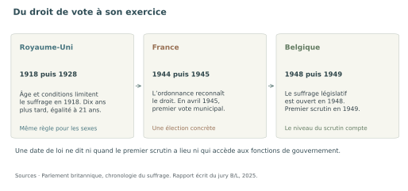
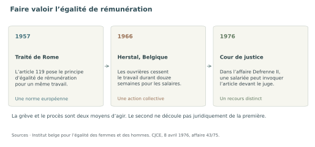

# BEL B/L — Histoire contemporaine 2025 · Corrigé guidé

*Corrigé rédigé par IA, non officiel. Signalez toute erreur.*

**Rédaction** · Claude Opus 4.8 High standard

**Révision (tour 1)** · Claude Opus 4.8 · effort non renseigné · vitesse non renseignée

**Révision (tour 2)** · GPT-6 · effort non renseigné · vitesse non renseignée

**Révision (tour 3)** · GPT-6.2 Astra Ultra · vitesse non renseignée

## Présentation du sujet

« Les femmes dans les sociétés européennes de 1918 au début des années 1980. » L’épreuve commune dure six heures. Le rapport explique que les copies ont été départagées sur leur capacité à faire d’un exemple localisé et daté une preuve. Plusieurs plans étaient recevables. Partir des seuls droits politiques laisserait hors champ le travail, les relations familiales et le contrôle de la fécondité.

## Préparer la démonstration

1. Se donner plusieurs espaces européens, dont l’Europe de l’Est, et chercher pour chacun une pratique précise. Une réforme française peut servir à comparer si l’on définit aussi l’institution, le calendrier et les conditions matérielles du second pays.
2. Préparer trois séries de dates. Les guerres et les régimes changent le droit et les emplois. Les trajectoires des femmes dépendent aussi des cycles de vie et des relations de travail. Les associer évite de présenter toutes les Européennes comme un groupe uniforme.
3. Choisir un document qui éclaire le pouvoir d’agir des intéressées. Un procès indique quelles revendications peuvent atteindre le juge. Une grève renseigne sur les formes d’organisation et leur coût. Une loi donne la règle applicable, dont il reste à observer l’exercice.

**Problématique** — Comment les femmes ont-elles transformé leur place dans les sociétés européennes entre 1918 et le début des années 1980, alors que les droits, les conditions matérielles et les normes de genre y évoluaient à des rythmes différents ?

## Introduction

En 1973, Michelle Perrot, Fabienne Bock et Pauline Schmitt posent à l’université Paris-VII la question « Les femmes ont-elles une histoire ? ». Une génération plus tard, le colloque dirigé par Anne-Marie Sohn et Françoise Thelamon renversait la formule en demandant : « L'Histoire sans les femmes est-elle possible ? » Ce déplacement d'une interrogation sur l'existence même d'une histoire des femmes vers l'affirmation de leur caractère incontournable dit l'ampleur d'un chantier historiographique récent, mais il signale aussi un enjeu de méthode : les femmes ont longtemps été les grandes absentes du récit historique, parce que les sociétés qui les produisaient comme groupe les reléguaient hors des lieux visibles du pouvoir et des archives. Prendre pour objet « les femmes dans les sociétés européennes » revient donc d'abord à interroger la manière dont ces sociétés ont construit, nommé et situé la moitié de leur population.

Dire « les femmes » n’implique ni une même expérience ni une parole commune. Une agricultrice, une ouvrière et une ministre peuvent être soumises à des normes de féminité comparables tout en ayant des ressources très différentes pour les infléchir. Le genre désigne ici des rôles et des hiérarchies construits dans des relations sociales. Une enquête doit donc observer à la fois l’école, la famille, l’usine, les institutions politiques et l’action de celles qui y travaillent ou en contestent les règles.

Le cadre « européennes » est entendu largement, de l'Atlantique à l'Oural, et inclut explicitement l'Europe de l'Est, dont il serait impossible de faire l'économie : la condition féminine y constitue un enjeu central des modèles de société que le bloc socialiste oppose à l'Ouest. On n'oubliera pas les marges (cas turc, prolongements coloniaux) lorsqu'elles éclairent la comparaison. La borne de 1918 est imposée par le programme ; elle possède une légitimité propre, la Première Guerre mondiale ayant partout bousculé la distribution des rôles. Il faut toutefois se garder d'un effet de seuil trompeur : les femmes n'ont pas « attendu » 1918 pour travailler — « les femmes ont toujours travaillé », rappelle le titre de Sylvie Schweitzer — ni pour agir dans la vie sociale. Le terminus « début des années 1980 » est volontairement flou : on le fixera autour de 1979-1982, moment d'un premier bilan des luttes des années 1970, où des femmes accèdent au sommet du pouvoir (Margaret Thatcher au 10 Downing Street en 1979, Simone Veil à la présidence du Parlement européen la même année) tandis que s'achève en France un cycle législatif (loi du 23 décembre 1980 relative à la répression du viol, remboursement de l'IVG en 1982).

L’Europe étudiée traverse des révolutions, des dictatures, des occupations puis une division durable en blocs. Tous les régimes ne revendiquent pas la même forme d’égalité. Les distinctions entre classes, générations et lieux de résidence comptent aussi pour comprendre comment un droit nouveau peut modifier une vie quotidienne.

**Comment les femmes ont-elles transformé leur place dans les sociétés européennes entre 1918 et le début des années 1980, alors que les droits, les conditions matérielles et les normes de genre y évoluaient à des rythmes différents ?**

On montrera d'abord que la conquête des droits politiques, inégale et réversible, inaugure l'inclusion des femmes dans la cité sans la garantir (I) ; que la persistance d'un ordre genré, fabriqué par l'école, la famille et le travail, en limite durablement la portée tout en suscitant ses propres contestations (II) ; enfin que c'est autour du corps — apparence, sexualité, reproduction, violences — que se joue, à la fin de la période, la radicalisation des luttes et l'affirmation d'un sujet féminin (III).

## I. Les femmes et leurs droits politiques : voter, représenter

### 1) À la conquête du droit de vote

> [!INDICATION]
> Distinguer dans chaque pays la reconnaissance d’un droit, les conditions qui le limitent et le premier scrutin auquel les nouvelles électrices participent.

#### Solution

L'immédiat après-guerre marque une première vague d'ouverture du suffrage, directement liée à la mobilisation des femmes pendant le conflit et aux recompositions politiques de 1917-1919. Au Royaume-Uni, sous la pression ancienne des suffragettes, le *Representation of the People Act* du 6 février 1918 accorde le vote aux femmes de plus de trente ans remplissant une condition de cens : un droit à la fois réel et bridé, qui place les électrices en situation d'infériorité jusqu'à l'égalisation de 1928. L'Allemagne de Weimar, l'Autriche, la Hongrie, la Pologne, la Lettonie et la Lituanie inaugurent elles aussi la période en ouvrant le vote aux femmes. Cette première vague prolonge un mouvement né au nord et à l'est de l'Europe : la Finlande dès 1906, la Norvège entre 1907 et 1913, le Danemark et l'Islande en 1915.

En Russie, le gouvernement provisoire reconnaît en 1917 le vote des femmes, qui participent aux élections de l’Assemblée constituante. Cette précocité nourrit l'argumentaire émancipateur du jeune pouvoir soviétique — l'égalité des sexes comme vitrine de la révolution. Mais l'ambiguïté est entière : à mesure que le suffrage est vidé de sa substance dans le régime de parti unique, les femmes demeurent écartées des véritables instances de décision. Le droit de vote y éclaire ainsi moins une émancipation effective qu'un usage politique de la cause des femmes.

La France, enfin, fait figure de retardataire parmi les grandes démocraties. La Chambre des députés vote une loi favorable dès mai 1919, mais le Sénat tarde à l'inscrire à son ordre du jour, la rejette en 1922, puis de nouveau en 1925. Il faut attendre l'ordonnance du 21 avril 1944 pour que les Françaises obtiennent le droit de vote. Elles l’exercent pour la première fois aux municipales du printemps 1945, puis lors du scrutin national d’octobre. En Italie, le décret du 1er février 1945 reconnaît le suffrage féminin. Les Italiennes votent au niveau national en juin 1946. La fin de la Seconde Guerre mondiale clôt ainsi un cycle électoral ouvert au lendemain de la Première. **Le suffrage féminin se diffuse donc à des rythmes très inégaux, et sa conquête juridique ne préjuge ni de son effectivité politique ni de la place réservée aux femmes dans l'exercice du pouvoir.**

### 2) Le droit à la représentation

> [!INDICATION]
> Comparer l’éligibilité de Clara Campoamor en 1931 avec l’expérience des trois sous-secrétaires d’État françaises en 1936. Un mandat électif, une nomination et le droit de suffrage sont trois situations différentes.

#### Solution

L'accès aux fonctions électives suit une chronologie décalée, parfois paradoxale : dans plusieurs pays, les femmes peuvent être élues avant de pouvoir voter. En Belgique, elles sont éligibles à la Chambre dès 1920 et au Sénat dès 1921. Le vote communal est déjà ouvert à la plupart des femmes. La loi de 1948 généralise le suffrage législatif et le premier vote à ce niveau a lieu en 1949. En Espagne, les Cortès constituantes de 1931 autorisent les candidatures féminines — l'avocate féministe Clara Campoamor y est élue — alors que les femmes n'étaient pas encore électrices. En France, trois femmes, Irène Joliot-Curie, Cécile Brunschvicg et Suzanne Lacore, entrent au gouvernement du Front populaire en 1936 comme sous-secrétaires d'État, huit ans avant d'obtenir le droit de vote.

Les premières élues apparaissent donc tôt : la conservatrice Nancy Astor, première femme à siéger à la Chambre des communes en 1919 ; Clara Zetkin, députée communiste au Reichstag de 1920 à 1933 ; Alexandra Kollontai, première femme ministre de la Russie révolutionnaire en 1917-1918. Mais la présence effective des femmes dans les lieux de décision reste marginale pendant des décennies. Il faut attendre la toute fin de la période pour voir des femmes atteindre le sommet de l'État — Margaret Thatcher devenant Premier ministre britannique en 1979 — et des institutions européennes, Simone Veil accédant la même année à la présidence du Parlement européen. **La citoyenneté politique des femmes se construit ainsi en deux temps longuement disjoints : l'ouverture formelle des droits, puis, bien plus tardive et encore très partielle, l'accès réel au pouvoir.**

## II. L'ordre patriarcal et ses contestations

### 1) La fabrique du genre féminin

> [!INDICATION]
> Une école mixte suffit-elle à ouvrir les mêmes filières ? Comparer organisation des classes, matières enseignées et débouchés.

#### Solution

Au-delà des différences biologiques, l'être-femme en société est modelé par la socialisation. Il convient ici de déconstruire — c'est-à-dire d'analyser la production sociale des rôles, non de les détruire ni même, à ce stade, de les contester. L'école en est l'agent majeur. La coéducation, puis la mixité, progressent lentement et selon des logiques opposées : possibilité ouverte en France à partir de 1933, elle est au contraire généralisée en Russie soviétique dès 1918 avec le dessein affiché de combattre les inégalités. Or la séparation des sexes se doublait de programmes différenciés, orientant les filles vers les arts ménagers au détriment des disciplines scientifiques : la construction des aptitudes genrées passe d'abord par le curriculum. La mixité, pourtant, ne suffit pas à égaliser les conditions. Les travaux de sociologie de l'éducation développés à partir des années 1970 — Marie Duru-Bellat (*L'École des filles*, 1990), Christian Baudelot et Roger Establet (*Allez les filles !*, 1992) — montrent que la réussite scolaire croissante des filles s'accompagne d'une féminisation beaucoup plus lente des filières d'excellence. En témoigne, jusque dans les années 1980, le maintien d'écoles normales supérieures séparées pour les hommes et pour les femmes.

D'autres instances concourent à cette fabrique, qu'on ne peut qu'évoquer : les institutions religieuses, qui diffusent un modèle de féminité dévouée, et les organisations de jeunesse, qui socialisent séparément garçons et filles. **L'ordre genré n'est donc pas un donné mais un produit, continûment reconduit par les appareils de socialisation.**

### 2) Les femmes dans la famille

> [!INDICATION]
> Identifier le régime, le texte et son objet. En Roumanie, que réglemente exactement le décret no 770 de 1966 ?

#### Solution

La famille nucléaire, modèle dominant, assigne aux femmes le foyer, l'éducation des enfants et le travail de soin (*care*). Cet idéal est au centre des imaginaires conservateurs, mais aussi des politiques démographiques d'une large partie de l'Europe. L'entre-deux-guerres voit fleurir partout des mesures natalistes, symboliques ou financières : en France, le Code de la famille et de la natalité de 1939, bientôt relayé par la fête des mères instituée dans le calendrier de Vichy ; en Italie, la « bataille des naissances » lancée par Mussolini ; dans l'Espagne franquiste, la valorisation de la « vitalité démographique ». L'incitation se fait parfois coercition : l'URSS établit en 1941 un impôt frappant l'absence d'enfant, et certains États entravent l'accès des femmes à l'emploi pour les reconduire au foyer.

Les politiques natalistes ne sont pas interchangeables. En Allemagne nazie, les incitations à la maternité jugée souhaitable par le régime coexistent avec la stérilisation forcée de personnes désignées au nom d’une classification raciste et eugéniste. En Roumanie socialiste, l’État encourage le travail salarié des femmes tout en resserrant son contrôle sur la fécondité. Le décret no 770 du 1er octobre 1966 interdit l’interruption de grossesse sauf dans des cas limitativement prévus. Les restrictions au divorce relèvent d’autres mesures de politique familiale. Attribuer indifféremment l’ensemble de cette politique au décret sur l’avortement ferait disparaître les instruments distincts de cette contrainte. [Décret roumain no 770 du 1er octobre 1966](https://pdf.bjt.ro/data/Colectie_de_legi_Decrete_Hotariri_si_Dispozitii_1952-1988/Colectie_de_legi_Decrete_Hotariri_si_Dispozitii_1966_septembrie-octombie_39.686.pdf)

L'assignation domestique pèse enfin sur toute l'organisation de la vie des femmes. On peut légitimement voir dans l'équipement électroménager des foyers un facteur d'allègement des tâches — mais sans naïveté : le slogan « Moulinex libère la femme », lancé en 1961, est autant un instrument d'assignation de la femme au ménage qu'un vecteur d'émancipation. **La famille apparaît ainsi comme le lieu où l'ordre genré se fait politique d'État, selon des modalités que l'échelle européenne oblige à différencier.**

### 3) Les femmes au travail

> [!INDICATION]
> Comparer un livret de paie, une classification d’emploi et une fiche de recensement agricole. Que montre chaque document et quel travail reste difficile à mesurer ?

#### Solution

Au lendemain de 1918, les ateliers convertis au travail de guerre rendent certaines ouvrières très visibles. La démobilisation supprime nombre de ces postes. Elle n’efface pas le travail dans les champs, les commerces familiaux, le service domestique ou les bureaux. Dans une exploitation agricole, l’activité de l’épouse peut être enregistrée comme aide familiale ou rester peu visible dans un recensement, alors que son travail est indispensable à la production. Il faut donc demander ce que l’indicateur compte, une activité, une profession déclarée, un salaire individuel ou des droits à pension. En France, Vichy cherche en 1940 à restreindre certaines possibilités d’emploi public des femmes mariées. Ces politiques connaissent des aménagements et ne peuvent être assimilées à une interdiction uniforme de tout travail féminin.

Les mobilisations pour l’égalité de salaire montrent comment une norme devient un instrument d’action. À Herstal, près de Liège, les ouvrières de la Fabrique nationale arrêtent le travail en février 1966. La grève dure douze semaines. Les classifications et les salaires font alors apparaître les inégalités que la présence de nombreuses ouvrières pouvait masquer. Une procédure belge distincte donne à une autre salariée, Gabrielle Defrenne, hôtesse à la Sabena, un moyen de contester une différence de rémunération. Le 8 avril 1976, saisi par la juridiction bruxelloise, le juge communautaire admet que l’article 119 du traité de Rome peut être invoqué devant les juridictions nationales, notamment pour une discrimination directe de rémunération. La décision n’instaure pas instantanément l’égalité à l’usine ou dans les services. Elle change les ressources dont dispose une salariée face à son employeur. [Grève de Herstal, Institut pour l’égalité des femmes et des hommes](https://igvm-iefh.belgium.be/sites/default/files/downloads/71%20-%20Biographie%20Marijke%20Van%20Hemeldonck_FR.pdf) · [Arrêt Defrenne, 8 avril 1976](https://eur-lex.europa.eu/legal-content/FR/TXT/?uri=CELEX:61975CJ0043)

## III. Les femmes et leur corps

### 1) Une libération des corps

> [!INDICATION]
> Pour une œuvre littéraire ou cinématographique, distinguer ce que le public voit, le dénouement de l’œuvre et les pratiques sociales dont on possède une trace.

#### Solution

L'après-guerre voit émerger de nouvelles représentations du corps féminin, dont la littérature se fait l'écho. *La Garçonne* de Victor Margueritte (1922) met en scène une fascination pour une sexualité affranchie du mariage ; la silhouette de la garçonne, cheveux courts et vêtements amples, exprime le refus des carcans imposés au corps des femmes. Mais la transgression n'est pas sans ambivalence : l'héroïne de Margueritte finit par rentrer dans l'ordre en épousant Georges Blanchet — la figure subversive servant alors à restaurer la norme qu'elle paraissait défier. Le cinéma prolonge ce travail des imaginaires : Marlène Dietrich, Arletty, Jeanne Moreau ou Claudia Cardinale popularisent, par leurs rôles et le traitement médiatique de leur vie privée, des figures de femmes émancipées.

Les enjeux attachés au corps se lisent aussi dans le vêtement — l'interdiction faite aux Françaises de porter le pantalon, édictée en 1800, ne sera formellement abrogée qu'en 2013, alors même qu'elle avait perdu tout effet depuis longtemps — et dans la tolérance croissante au dénudement, dont la diffusion du bikini, d'abord prohibé dans de nombreux pays, offre un bon indice. Le sport, enfin, est un front de la visibilité : contre un monde olympique qui les écarte, Alice Milliat et la Fédération sportive féminine internationale organisent en 1922 des Jeux féminins, tandis que persistent de fortes discriminations médiatiques et financières. **Le corps des femmes devient ainsi un lieu d'affirmation, mais d'une affirmation toujours disputée, où chaque conquête s'accompagne de résistances.**

### 2) Contrôler sa sexualité et sa reproduction

> [!INDICATION]
> Comparer des territoires précis. La date d’une loi, le périmètre dans lequel elle s’applique et les possibilités d’accès au soin modifient l’analyse.

#### Solution

La maîtrise de la fécondité constitue l'enjeu décisif de la fin de la période. En France, la loi du 31 juillet 1920 réprime la provocation à l'avortement et la propagande anticonceptionnelle : l'État inscrit le corps des femmes dans une logique nataliste. Il faut attendre la loi Neuwirth du 28 décembre 1967 pour autoriser la contraception, puis le remboursement de la pilule en 1974 et, quelques semaines plus tard, la loi Veil de 1975 dépénalisant l'interruption volontaire de grossesse — prise en charge par la Sécurité sociale en 1982. Ces avancées ne tombent pas du ciel : elles sont arrachées par des mobilisations, tel le manifeste de 1971 dans lequel 343 femmes déclarent avoir avorté (on se gardera de reprendre la formule « des 343 salopes », qui relève de l'ironie militante et non de la désignation historienne). La culture populaire accompagne ces luttes, d'Agnès Varda retraçant dans *L'une chante, l'autre pas* le combat pour l'avortement aux chansons qui réclament la vente libre de la pilule.

La chronologie française gagne à être resituée à l'échelle européenne. La contraception orale est commercialisée plus tôt au Royaume-Uni puis en Allemagne, dans la première moitié des années 1960. La loi Veil de 1975 s'inscrit dans un mouvement européen inégal : la Grande-Bretagne, Écosse comprise, autorise l'avortement sous conditions dès 1967 ; la RFA adopte en 1976 un régime d'indications après la décision constitutionnelle de 1975. En Irlande et en Irlande du Nord, les restrictions demeurent beaucoup plus durables. **Il n'existe donc pas une chronologie unique de l'émancipation, mais des temporalités distinctes selon les droits et les pays.**

### 3) Lutter contre les violences sexistes et sexuelles

> [!INDICATION]
> Ne pas confondre les objets des procès de Bobigny et d’Aix-en-Provence. Quel changement peut-on attribuer à une mobilisation et lequel relève du législateur ?

#### Solution

Dernière dimension, longtemps restée dans l'ombre des copies comme des archives, celle des violences faites aux femmes. On se gardera d'en exagérer la normalisation au premier XXe siècle — les travaux de Victoria Vanneau montrent que la violence conjugale était loin d'être universellement tolérée —, mais le nombre élevé de meurtres de conjointes dans tous les pays considérés rappelle une réalité massive, qu'Hubertine Auclert désignait dès la fin du XIXe siècle du mot de féminicides. Le regard porté sur les grands hommes s'en trouve rétrospectivement transformé : la trajectoire de Pablo Picasso se relit à la lumière des violences qu'il infligea aux femmes de sa vie, à commencer par Dora Maar.

Les procès mettent en discussion des formes distinctes de contrainte. À Bobigny en 1972, le procès concerne l’avortement. À Aix-en-Provence en 1978, le procès consécutif au viol d’Anne Tonglet et d’Araceli Castellano attire l’attention sur le traitement judiciaire des violences sexuelles. Les deux combats peuvent mobiliser les mêmes avocates ou associations sans avoir le même objet. La loi française du 23 décembre 1980 donne une définition légale du viol. En Sicile, le refus de Franca Viola d’épouser son agresseur en 1965 expose un autre dispositif. En Italie, la disposition dite du mariage réparateur est abrogée en 1981. Une action individuelle peut rendre visible une contrainte sociale bien avant que le législateur ne la supprime.

## Conclusion

> [!INDICATION]
> Rassembler une évolution durable et une réversibilité attestée dans deux pays. Revenir au début des années 1980 et indiquer ce que les jalons de 1979–1982 permettent effectivement de conclure.

#### Solution

De 1918 au début des années 1980, les sociétés européennes ont bien reconnu des droits aux femmes — suffrage, éligibilité, accès encadré au travail, maîtrise de la fécondité —, mais cette inclusion juridique s'est constamment heurtée à la persistance d'un ordre genré fabriqué par l'école, la famille et le marché du travail, et au maintien d'inégalités socio-économiques tenaces que les seules lois ne suffisaient pas à défaire. L'évolution d'ensemble, incontestablement émancipatrice dans ses grandes lignes, ne saurait pour autant se lire comme un progrès linéaire : elle est traversée de retours en arrière — des politiques natalistes coercitives de l'entre-deux-guerres à la Roumanie de Ceaușescu, des lois d'exclusion des années 1930 aux reculs idéologiques des dictatures — qui interdisent d'y voir la simple résorption progressive d'une oppression. L'Europe, qui se pensait comme le cœur du monde démocratique, a ainsi exclu puis inégalement intégré la moitié de sa population, et c'est cette contradiction entre ses principes et ses pratiques qui a nourri, à l'Ouest comme à l'Est, la critique féministe.

Le fait historique majeur de la période n'est peut-être pas tant l'amélioration de la « condition » des femmes — notion normative et trompeuse — que la constitution des femmes en groupe social conscient de lui-même. Cette unification s'est faite moins par l'homogénéisation de conditions sociales restées profondément diverses que par la prise de conscience d'une place commune : soit pour la dénoncer, comme le firent les mouvements féministes, soit pour la justifier, comme le firent les représentations conservatrices assignant les femmes à leur supposée nature. Analyser la place des femmes dans les sociétés européennes, c'est finalement observer ces sociétés se définir elles-mêmes à travers le partage qu'elles opèrent entre les sexes.

Les situations comparées font surtout apparaître plusieurs temporalités. Une élection peut ouvrir des fonctions publiques avant que les responsabilités familiales soient redistribuées. Une décision judiciaire peut donner prise sur un barème de salaire, alors que la ségrégation des emplois perdure. À l’inverse, une politique de natalité peut resserrer la contrainte corporelle dans une société qui a depuis longtemps ouvert le travail salarié aux femmes.

[Sujet officiel](https://www.ens.psl.eu/sites/default/files/2025_blses_sujet_composition_histoire.pdf) · [Rapport officiel du jury](https://www.ens.psl.eu/sites/default/files/2025_bl_rapport_ecrit_histoire.pdf) · [Grève de Herstal, Institut pour l’égalité des femmes et des hommes](https://igvm-iefh.belgium.be/sites/default/files/downloads/71%20-%20Biographie%20Marijke%20Van%20Hemeldonck_FR.pdf) · [Arrêt Defrenne, 8 avril 1976](https://eur-lex.europa.eu/legal-content/FR/TXT/?uri=CELEX:61975CJ0043) · [Décret roumain no 770 du 1er octobre 1966](https://pdf.bjt.ro/data/Colectie_de_legi_Decrete_Hotariri_si_Dispozitii_1952-1988/Colectie_de_legi_Decrete_Hotariri_si_Dispozitii_1966_septembrie-octombie_39.686.pdf) · [Chronologie électorale britannique, Parlement](https://www.parliament.uk/about/living-heritage/transformingsociety/electionsvoting/womenvote/keydates/)
