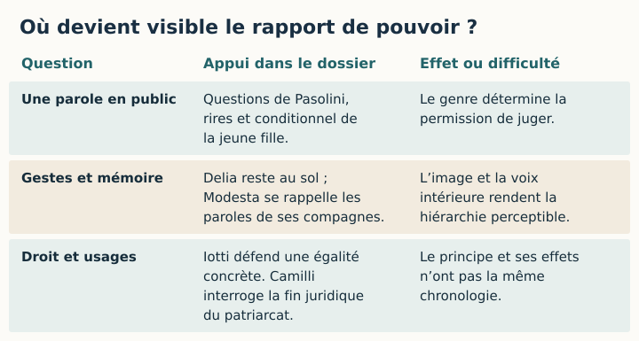

# BEL B/L — Italien 2025 · Corrigé brut

*Corrigé rédigé par IA, non officiel. Signalez toute erreur.*

**Rédaction** · GPT-6.2 Astra Ultra · vitesse non renseignée

**Révision (tour 1)** · GPT-6.2 Astra Ultra · vitesse non renseignée

[Sujet officiel](https://www.ens.psl.eu/sites/default/files/2025_blses_epreuve_a_option_sujet_italien.pdf) · [Rapport du jury](https://www.ens.psl.eu/sites/default/files/2025_bl_rapport_ecrit_italien_option.pdf)

## Chi ha il diritto di dire che cosa è cambiato per le donne?

In un fotogramma di *C'è ancora domani* gli invitati sono seduti, mentre Delia si china a raccogliere da terra un piatto e ciò che è caduto. Nessuna didascalia deve dichiararla inferiore: l'altezza dei corpi rende leggibile la gerarchia prima ancora che qualcuno parli. Come si riconosce un rapporto di potere quando la legge lo ha ripudiato o quando persino chi lo subisce ha imparato a considerarlo naturale? Fra una testimonianza su Nilde Iotti, due opere cinematografiche, il romanzo di Goliarda Sapienza e l'inchiesta di Annalisa Camilli non passa una semplice linea di progresso. Cambiano gli strumenti con cui si può nominare la disuguaglianza e cambia la posizione di chi è autorizzato a raccontarla.

**Imparare a vedersi con gli occhi degli altri.** Nel documentario di Pasolini la spiaggia sembra offrire un'occasione di parola libera. Eppure il giovanotto che racconta la sua visita a uno spettacolo erotico è sostenuto dalle risate dei compagni; un gesto della mano basta dove una frase esplicita sarebbe forse più difficile. Alla ragazza viene posta anzitutto una domanda su quel giovane. Quando arriva a dire ciò che pensa lei, distingue tra quello che, da donna, dovrebbe approvare e quello che approverebbe se fosse uomo. La piccola distanza fra il condizionale e un desiderio proprio fa sentire una regola in azione. La signora più anziana separa ancora il tollerare dall'andare a vedere. Pasolini non ha raccolto tre risposte intercambiabili a una domanda neutrale: i suoi rilanci e le reazioni del pubblico contribuiscono alla scena.

Nel film di Cortellesi il mezzo cambia. Alle spalle di Delia quasi tutti guardano verso di lei, ma un posto a tavola e uno sguardo non diventano gesti di aiuto. Il marito resta seduto, il suo corpo e la sua sedia segnano un confine nello spazio. Dal solo fotogramma non possiamo ricostruire l'azione che ha fatto cadere il piatto; possiamo vedere, invece, chi si assume il compito e l'umiliazione di raccoglierlo. È una scena del dopoguerra realizzata nel 2023. Il bianco e nero mette lo spettatore contemporaneo davanti a un passato ricostruito e gli chiede di riconoscerne la logica anche dove non coincida più con una norma scritta.

**Che cosa consente una conquista giuridica?** Giorgio Frasca Polara racconta di Iotti presidente della Camera nel 1979, abbracciata da alcune suore con stupore di un compagno. La sua battuta, che ricorda al compagno come anche loro siano donne, interrompe la divisione apparentemente ovvia fra comuniste e cattoliche. Lo stesso principio trova un banco di prova più esigente nel dibattito della Costituente. Se l'uguaglianza vale davvero, l'accesso delle donne ai gradi più alti della magistratura non può dipendere da pregiudizi sulla pretesa fragilità del loro corpo. Qui la testimone è una protagonista che argomenta con le parole della futura Costituzione; altrove è il biografo a precisare che preferiva parlare di emancipazione piuttosto che di liberazione. Il ritratto non va appiattito sull'etichetta che Iotti non rivendicava. E tra il riconoscimento del principio e l'ingresso effettivo delle donne nella magistratura, nel 1963, passa un tempo che racconta quanto lavoro rimane dopo un voto.

La discussione riportata da Camilli nel novembre 2024 illumina quel divario da un altro lato. Alla presentazione della fondazione dedicata a Giulia Cecchettin, il ministro Valditara invoca la riforma del diritto di famiglia del 1975 per datare la fine del patriarcato come fenomeno giuridico. Non nega che esistano comportamenti maschilisti. La giornalista, però, interroga ciò che questa definizione lascia fuori. La famiglia di Giulia ha trasformato una perdita in un impegno collettivo. Camilli riferisce le cifre disponibili il 25 novembre 2024. I femminicidi sono 98 secondo il ministero e 104 secondo l’osservatorio di Non una di meno. Sommare i due numeri significherebbe contare due volte casi che le rilevazioni cercano entrambe di registrare. Il testo non spiega quali casi producano lo scarto. Una cerimonia alla Camera può accogliere istanze politiche e insieme offrire una tribuna a chi ne ridimensiona il significato.

**Chi può parlare a nome di altre donne?** Nel romanzo di Sapienza Modesta cerca volti concreti per resistere alle parole di Joyce sulle donne. La memoria non le offre un'immagine consolante di solidarietà spontanea: riaffiorano anche giudizi che svalutano le compagne. L'apostrofe alle donne che dispongono di cultura e libertà denuncia la possibilità che un'avanzata individuale si paghi accettando i criteri del potere esistente. Le mani segnate dalla varecchina e quelle di chi lavora in fabbrica legano la differenza di genere alla divisione sociale dei lavori. A queste figure risponde da lontano la mano che Delia tende verso il piatto. Ma nel romanzo è una voce interiore travagliata a mettere in guardia contro l'oblio; nel film è chi guarda a dover interpretare il silenzio.

Fra queste forme si apre uno spazio per l'azione. Le suore possono riconoscersi in una parlamentare senza condividere il suo partito. Una ragazza sulla spiaggia può anche far udire, proprio nella sua esitazione, la distanza fra un giudizio imposto e un'opinione possibile. Il diritto rende contestabili alcune esclusioni; il cinema, il romanzo e il giornalismo mostrano a chi spetti la parola quando l'eguaglianza, già proclamata, è ancora da far valere.

