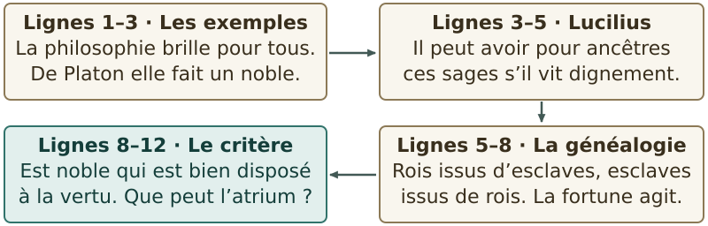
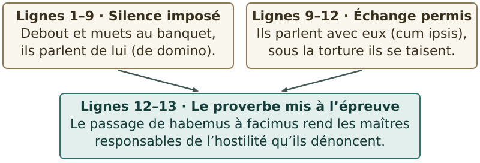
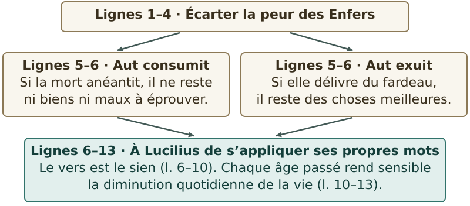

# ENS · B/L · Latin à option · 23 juin 2025 · Corrigé brut

*Corrigé rédigé par IA, non officiel. Signalez toute erreur.*

**Rédaction** · GPT-6.2 Astra Ultra · vitesse non renseignée · 26 novembre 2026

**Révision** · GPT-6.2 Astra Ultra · vitesse non renseignée · 26 novembre 2026

Le fascicule daté du 23 juin comporte trois extraits de Sénèque, chacun suivi du vocabulaire fourni par le jury. Le candidat tire l’un de deux sujets cachés, prépare pendant 1 h 30, puis dispose de 15 minutes pour présenter, lire, traduire et commenter le passage et de 15 minutes pour répondre au jury. Les pages 1–2, 3–4 et 5–6 correspondent respectivement aux trois explications. [Fascicule du 23 juin](https://www.ens.psl.eu/sites/default/files/latin_23_juin.pdf) · [Rapport du jury](https://www.ens.psl.eu/sites/default/files/2025_bl_rapport_latin_oral_option.pdf)

## Philosophie pour tous !

### Présenter et lire le passage

Dans la lettre 44 (livre V, §§ 2–5), Sénèque répond à Lucilius, que la pensée de sa naissance pourrait décourager. En choisissant des philosophes grecs comme ancêtres possibles d’un Romain, il transforme la relation du lecteur à ses propres origines. À la lecture, détacher les deux négations de la première phrase, laisser tomber la voix sur *omnibus lucet*, puis marquer les questions de la ligne 3 et de la ligne 8. Elles sollicitent Lucilius à deux moments différents de la démonstration.

### Traduction par groupes de sens

**Lignes 1–3.** La philosophie ne repousse personne et ne choisit personne. Elle brille pour tous. Socrate ne fut pas patricien. Cléanthe puisa de l’eau et loua ses bras pour arroser un jardin. Quant à Platon, la philosophie ne le reçut pas noble, elle le fit tel.

**Lignes 3–5.** Quelle raison as-tu de désespérer de pouvoir devenir leur égal ? Tous ces hommes sont tes ancêtres, si tu te conduis d’une manière digne d’eux. Et tu le feras si, dès maintenant, tu te persuades toi-même de ceci, que personne ne te surpasse en noblesse.

**Lignes 5–8.** Nous avons tous autant de prédécesseurs derrière nous. Il n’est personne dont l’origine ne se perde au-delà de la mémoire. Platon dit qu’il n’est aucun roi qui ne descende d’esclaves, aucun esclave qui ne descende de rois. La longue succession des vicissitudes a tout mêlé, et la fortune a tout retourné sens dessus dessous.

**Lignes 8–12.** Qui est de noble naissance ? Celui que la nature a heureusement disposé à la vertu. Voilà le seul point à considérer. Car si tu remontes aux temps anciens, il n’est personne qui ne provienne de cette origine avant laquelle il n’y a rien. Depuis le premier commencement du monde jusqu’à notre époque, une chaîne où alternent les hommes illustres et les gens de basse condition nous a conduits jusqu’ici. Un atrium rempli de portraits d’ancêtres noircis par la fumée ne fait pas un noble […]

### Commentaire

Le statut social a ses procédures d’admission, ses exclusions et ses preuves visibles. Comment la lettre donne-t-elle à Lucilius des ancêtres qu’il n’a jamais eus au sens civil ? Les deux verbes initiaux, *reicit* et *eligit*, supposent une instance qui trierait les candidats. Leur double négation laisse place à un phénomène que chacun peut éprouver, la lumière. Tout le monde peut recevoir son éclat, mais il reste à vivre en accord avec elle. Les exemples donnent une histoire à cette image. Le mot romain *patricius* appliqué à Socrate traduit le prestige grec dans les catégories de Lucilius. Les mains de Cléanthe évoquent un véritable travail salarié. Avec Platon, le verbe *fecit* attribue à la philosophie le pouvoir de produire la noblesse dont la naissance était censée être la condition.

Le second mouvement repose sur une proposition adressée à la deuxième personne. Ces philosophes sont déjà *tui*, « les tiens », pourvu que Lucilius s’en rende digne. La lettre ne lui fabrique pas un arbre généalogique. Elle lui donne des devanciers dont il peut, à son tour, prolonger la conduite. Le présent *geris* pose la condition, puis le futur *geres* engage Lucilius à la remplir. Puis le passage de *tui* à *nobis* déplace la preuve. Si chacun remonte dans le temps, la mémoire manque à tous également. La formule empruntée à Platon inverse la place de *regem* et de *seruis*, puis de *seruum* et de *regibus*. La symétrie fait perdre à chaque rang la prétention à s’être transmis sans mélange.

La question *Quis est generosus ?* reprend un adjectif qui évoque précisément la naissance. La réponse déplace son sens vers une disposition à la *uirtus*. Une disposition se vérifie dans l’exercice, comme le montrait déjà la condition *si te illis geris dignum*. Le développement se termine dans l’atrium d’une demeure romaine. Les images familiales, supports visibles de mémoire et de prestige, portent les traces du temps. La phrase leur refuse le pouvoir de « faire » quelqu’un noble. Ce verbe fait entendre à nouveau le *fecit* réservé à la philosophie au début. La lettre elle-même propose à son lecteur une autre galerie de portraits. Ce sont cette fois des figures que l’on rejoint en agissant.

## Savoir considérer les esclaves

### Présenter et lire le passage

La lettre 47 (livre V, §§ 2–5) part d’un repas romain. Sénèque y examine la manière dont un maître traite les personnes réduites en esclavage. La disposition des corps dans la salle et la permission de parler éclairent la fabrication d’une prétendue hostilité naturelle. À voix haute, opposer *cenanti domino* à *stantium seruorum*, puis lier fortement *in conuiuiis* à *in tormentis*. Le dernier *facimus* porte la responsabilité sur le locuteur et son public.

### Traduction par groupes de sens

**Lignes 1–4.** Aussi me moqué-je de ces gens qui jugent honteux de dîner avec leur esclave. Pour quelle raison, sinon parce qu’une coutume pleine d’arrogance a entouré le maître qui dîne d’une foule d’esclaves debout ? Lui mange plus qu’il ne peut contenir. Avec une avidité immense il surcharge un ventre déjà distendu, qui a désormais perdu l’habitude de remplir son rôle de ventre, au point qu’il lui faut plus de peine pour tout rejeter qu’il n’en a pris pour l’avaler.

**Lignes 4–8.** Mais les malheureux esclaves n’ont pas même le droit de remuer les lèvres pour parler. La baguette réprime le moindre murmure. Même les bruits involontaires ne sont pas exemptés de coups, qu’il s’agisse d’une toux, d’un éternuement ou d’un hoquet. Une voix, quelle qu’elle soit, a-t-elle interrompu le silence, on le paie d’une lourde peine. La nuit entière ils restent debout, à jeun et muets.

**Lignes 8–12.** Voilà comment ceux à qui il est interdit de parler devant leur maître en viennent à parler de lui. Au contraire, ceux qui pouvaient converser non seulement en présence des maîtres mais avec eux, et dont on ne cousait pas la bouche, étaient prêts à tendre le cou pour leur maître, à détourner sur leur propre tête le danger qui le menaçait. Aux banquets ils parlaient, mais sous la torture ils se taisaient.

**Lignes 12–13.** Et puis on lance ce proverbe qui relève de la même arrogance, « autant d’esclaves, autant d’ennemis ». Nous ne les avons pas pour ennemis, nous faisons d’eux des ennemis.

### Commentaire

Qu’apprend-on de la relation entre maître et esclave en observant les bruits d’un dîner ? Le *rideo* initial annonce le ridicule d’un jugement de bonne société. Ceux qui estiment le repas partagé *turpe* se croient juges de la dignité. Sénèque les fait comparaître à leur tour. Le maître attablé est un seul homme, mais son confort requiert une foule qui reste debout. La disproportion se retrouve à l’intérieur de son corps. Le couple *egerat / ingessit* fait durer en sens inverse l’acte de manger. La charge satirique vise précisément la personne qui pensait pouvoir fixer les bonnes manières.

Chez les esclaves, le pouvoir va jusqu’à réglementer des bruits que le corps produit malgré lui. L’accumulation *tussis, sternumenta, singultus* fait entendre ce qu’on voudrait supprimer. Les passifs effacent celui qui frappe ou fait punir. Le retour à *ieiuni mutique* rassemble pourtant les conséquences de ce système dans la même image, des hommes privés du repas aussi bien que de la parole. L’ordre de la salle ne manifeste aucune harmonie entre ses occupants. Pour le maintenir, il faut continuellement punir.

Le retournement décisif tient à trois prépositions. Parler *de domino*, c’est faire du maître absent l’objet du discours. Parler *coram domino*, c’est prendre la parole en sa présence. Parler *cum ipsis*, c’est parler ensemble. Le récit de la fidélité ancienne va jusqu’à prêter aux esclaves le courage de garder le silence quand le maître court un danger. Le même silence, imposé d’abord au banquet, devient alors le signe d’un choix. Ce tableau dessine un idéal de réciprocité depuis la position de l’homme libre. Sénèque enjoint d’humaniser une relation dont il conserve ici l’existence. La dernière opposition entre *habemus* et *facimus* a donc une portée précise. Le proverbe se donnait pour une observation du monde. Le changement de verbe et le « nous » final en rendent les maîtres responsables.

## Il ne faut pas craindre la mort

### Présenter et lire le passage

La lettre 24 (livre III, §§ 18–20) est un exercice sur la peur. Sénèque, philosophe stoïcien, évoque d’abord un argument épicurien. Il rapporte ensuite à son correspondant un thème que celui-ci a lui-même traité. À la lecture, grouper les négations des lignes 2–4, opposer les deux membres de *aut consumit aut exuit*, puis ralentir sur *minutatim* et sur l’anaphore de *cotidie*.

### Traduction par groupes de sens

**Lignes 1–4.** Je ne suis pas assez sot pour reprendre ici la rengaine épicurienne et dire que les craintes inspirées par les Enfers sont vaines, qu’Ixion ne tourne pas sur sa roue, que le rocher n’est pas poussé à contrepente par les épaules de Sisyphe, et que les entrailles de personne ne peuvent tout ensemble renaître chaque jour et être déchirées. Personne n’est assez enfant pour avoir peur de Cerbère, des ténèbres et de l’aspect spectral de ceux qui ne tiennent ensemble que par leurs os décharnés.

**Lignes 5–6.** La mort ou bien nous anéantit ou bien nous délivre. Si nous sommes libérés, des choses meilleures nous attendent une fois le fardeau enlevé. Si nous sommes anéantis, il ne reste rien, les biens comme les maux sont pareillement écartés.

**Lignes 6–10.** Permets-moi de citer à cet endroit un de tes vers, si je puis d’abord t’engager à reconnaître que tu as écrit ces mots non seulement pour les autres, mais aussi pour toi. Il est honteux de dire une chose et d’en penser une autre. Combien il est plus honteux encore d’écrire une chose et d’en penser une autre ! Je me souviens que tu as un jour traité cette idée, que nous ne tombons pas soudain dans la mort mais que nous y avançons petit à petit.

**Lignes 10–13.** Chaque jour nous mourons. Chaque jour, en effet, une partie de notre vie nous est retirée, et même au temps où nous grandissons, notre vie diminue. Nous avons perdu la petite enfance, puis l’enfance, puis l’adolescence. Jusqu’à la journée d’hier, tout ce qui s’est écoulé de notre temps est perdu […]

### Commentaire

Pourquoi Sénèque réduit-il au rang de *cantilena* un argument qu’il prend pourtant le temps de développer ? Il prête à son lecteur la maturité de quelqu’un qui n’aurait plus peur des histoires infernales. En faisant défiler Ixion, Sisyphe, la figure au supplice perpétuel et Cerbère, il affaiblit leur pouvoir d’effrayer, puis il écarte une réponse qui serait trop facile pour ce destinataire. Le texte garde anonyme celui dont les entrailles se renouvellent. L’essentiel, pour l’argument, est la répétition inconcevable du supplice. Le stoïcien peut tirer parti d’une critique épicurienne des peurs sans souscrire à chacune des propositions de cette école.

Le dilemme *consumit / exuit* dispense précisément de trancher le sort de l’âme. Dans une hypothèse, la mort ôte un fardeau. Dans l’autre, aucun sujet ne subsiste qui puisse éprouver un mal. La construction conserve les conséquences affectives des deux hypothèses. Puis le ton change avec *Permitte mihi*. Sénèque demande la permission de rappeler à Lucilius ses propres paroles. La citation annoncée devient l’occasion de lui demander ce que vaut un écrit pour celui qui l’a composé. La reprise d’*aliud* et le passage de *loqui* à *scribere* soulignent la force de cet engagement. Une phrase fixée par l’écriture revient maintenant demander des comptes à son auteur.

*Repente* et *minutatim* proposent enfin deux images concurrentes du temps. Dans la première on tomberait tout d’un coup, dans la seconde on avance déjà. Le paradoxe *cum crescimus, uita decrescit* s’éprouve dans une expérience ordinaire. À mesure qu’un enfant grandit, son enfance fait déjà partie du passé. *Infantiam*, *pueritiam*, *adulescentiam* sont mises sous la dépendance du même parfait, *amisimus*. Le texte effectue ce changement d’échelle jusque dans le « nous » du dernier mouvement. Lucilius n’est plus seul à devoir s’appliquer un principe. L’auteur et celui qui l’écoute partagent l’exercice consistant à reconnaître dans le passé écoulé ce qu’ils imaginaient seulement au terme de la vie.
