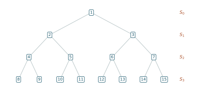
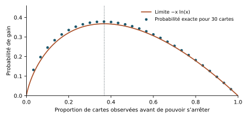
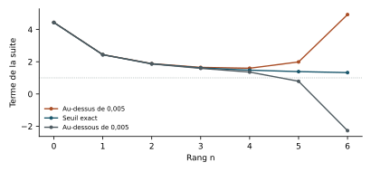

# BEL B/L — Mathématiques (oral) 2025 · Corrigé brut

*Corrigé rédigé par IA, non officiel. Signalez toute erreur.*

**Attribution archivée** · « IA (gpt-6), relue et révisée par IA »

**Révision (tour 1)** · GPT-6.2 Astra Ultra · vitesse non renseignée

## Planche 1 du 16/06/2025 — Exercice 1 (loi de Fréchet)

$X_1,\ldots,X_n$ sont indépendantes, de fonction de répartition $F(t)=e^{-1/t^2}$ pour $t>0$, et $F(t)=0$ sinon.

On pose $M_n=\max_{1\le i\le n}X_i$.

### Question (1)

Posons $U=1/X_1^2$.

Pour $u>0$,
$$
\begin{aligned}
P(U\le u) &=P\!\left(X_1\ge u^{-1/2}\right) \\
&=1-F(u^{-1/2}) \\
&=1-\exp\!\left(-\tfrac{1}{(u^{-1/2})^2}\right) \\
&=1-e^{-u},
\end{aligned}
$$
et $P(U\le u)=0$ pour $u\le 0$.

On reconnaît la fonction de répartition d'une loi **exponentielle de paramètre $1$** : $\boxed{1/X_1^2\sim\mathcal E(1)}$.

### Question (2)

Posons $U=1/X_1^2$.

D’après (1), $U$ a pour densité $u\mapsto e^{-u}$ sur $]0,+\infty[$.

Le théorème de transfert donne
$$
E(X_1)=\int_0^{+\infty}\frac{e^{-u}}{\sqrt u}\,du.
$$
L’intégrale converge : près de $0$, l’intégrande est équivalent à $u^{-1/2}$ ; sur $[1,+\infty[$ il est majoré par $e^{-u}$.

Par $u=v^2$,
$$
E(X_1)=2\int_0^{+\infty}e^{-v^2}\,dv.
$$
La normalisation de la densité de la loi $\mathcal N(0,1)$, puis le changement de variable $z=\sqrt2v$, donnent
$$
\int_0^{+\infty}e^{-v^2}\,dv=\frac{\sqrt\pi}{2}.
$$
Ainsi $\boxed{E(X_1)=\sqrt\pi}$.

### Question (3)

$E[X_1^2]=E[U^{-1}]=\int_0^{+\infty}u^{-1}e^{-u}\,du$.

Au voisinage de $0^+$, $u^{-1}e^{-u}\sim 1/u$, non intégrable.

L'intégrale diverge : $\boxed{E[X_1^2]=+\infty}$.

### Question (4)

Par indépendance, pour $x>0$, $P(M_n\le x)=F(x)^n=\exp(-n/x^2)$.

Alors pour $t>0$,
$$
\begin{aligned}
P\!\left(\tfrac{M_n}{a_n}\le t\right) &=P(M_n\le a_n t) \\
&=\exp\!\left(-\tfrac{n}{a_n^2 t^2}\right).
\end{aligned}
$$
Ceci égale $F(t)=\exp(-1/t^2)$ pour tout $t>0$ si et seulement si $n/a_n^2=1$, soit $\boxed{a_n=\sqrt n}$.

## Planche 1 du 16/06/2025 — Exercice 2 (série dyadique)

On suppose $c>0$ et $0<a_n\le c(a_{2n}+a_{2n+1})$ pour tout $n\ge1$.

On note $S_k=\sum_{n=2^k}^{2^{k+1}-1}a_n$.

### Question (1)

$S_k=\sum_{n=2^k}^{2^{k+1}-1}a_n\le c\sum_{n=2^k}^{2^{k+1}-1}(a_{2n}+a_{2n+1})$.

Lorsque $n$ parcourt $\{2^k,\dots,2^{k+1}-1\}$, les entiers $2n$ (pairs) et $2n+1$ (impairs) parcourent, chacun une fois, $\{2^{k+1},\dots,2^{k+2}-1\}$.

Donc $\sum_{n=2^k}^{2^{k+1}-1}(a_{2n}+a_{2n+1})=\sum_{m=2^{k+1}}^{2^{k+2}-1}a_m=S_{k+1}$, d'où $\boxed{S_k\le cS_{k+1}}$.

### Question (2)

De (1), $S_k\le cS_{k+1}\le S_{k+1}$ (car $c\le1$), donc $(S_k)$ croissante : $S_k\ge S_0=a_1>0$.

Les blocs partitionnent $\mathbb N^*$, donc
$$
\begin{aligned}
\sum_{n=1}^{2^{K+1}-1}a_n &=\sum_{k=0}^{K}S_k \\
&\ge (K+1)\,a_1\xrightarrow[K\to\infty]{}+\infty.
\end{aligned}
$$
Les sommes partielles tendent vers $+\infty$ : la série $\sum a_n$ **diverge**.

### Question (3)

Posons $a_n=1$.

Alors $0<1=a_n$ et $c(a_{2n}+a_{2n+1})=2c>1$ (car $c>1$), donc $(\star)$ est vérifiée.

La série $\sum 1$ diverge.

### Question (4)

Posons $r=\tfrac1{2c}$ et $a_n=r^{\lfloor \log_2 n\rfloor}$, c’est-à-dire $a_n=r^k$ pour $n\in\{2^k,\dots,2^{k+1}-1\}$.

Alors $a_n>0$.

Pour $n$ dans le bloc $k$, $2n,2n+1$ sont dans le bloc $k+1$, donc $a_{2n}=a_{2n+1}=r^{k+1}$ et
$$
\begin{aligned}
c(a_{2n}+a_{2n+1}) &=2c\,r^{k+1} \\
&=2c\cdot\tfrac1{2c}\cdot r^{k} \\
&=r^{k} \\
&=a_n,
\end{aligned}
$$
donc $(\star)$ vaut (avec égalité).

Enfin $\sum_{n\ge1}a_n=\sum_{k\ge0}2^k r^k=\sum_{k\ge0}(2r)^k$ avec $2r=1/c<1$ : la série **converge** (géométrique).

## Planche 2 du 16/06/2025 — Exercice 1 (matrice de Hilbert)

$A$ est la matrice réelle de taille $n\ge2$ de coefficients $a_{ij}=1/(i+j-1)$.

Pour $X=(x_1,\ldots,x_n)^T$, on note $P(t)=\sum_{k=1}^n x_k t^{k-1}$.

### Question (1)

Pour $n=2$, on a
$$
A=\begin{pmatrix}1&1/2\\1/2&1/3\end{pmatrix}.
$$
Le polynôme caractéristique est $\lambda^2-\frac43\lambda+\frac1{12}$.

Ses deux racines distinctes sont
$$
\lambda_\pm=\frac{4\pm\sqrt{13}}6.
$$
La première ligne de $(A-\lambda I)X=0$ donne $y=2(\lambda-1)x$.

La seconde est alors satisfaite puisque le déterminant est nul.

Les deux sous-espaces propres, de dimension un, sont donc
$$
\begin{aligned}
E_{\lambda_+}&=\operatorname{Vect}\big((3,\sqrt{13}-2)\big),\\
E_{\lambda_-}&=\operatorname{Vect}\big((3,-\sqrt{13}-2)\big).
\end{aligned}
$$

### Question (2)

$X^TAX=\sum_i x_i\big(\sum_j a_{ij}x_j\big)=\sum_{i,j}\dfrac{x_ix_j}{i+j-1}$.

Comme $\int_0^1 t^{i+j-2}\,dt=\tfrac1{i+j-1}$, et les sommes étant finies (linéarité de l'intégrale) :
$$
\begin{aligned}
X^TAX &=\sum_{i,j}x_ix_j\int_0^1 t^{i-1}t^{j-1}\,dt \\
&=\int_0^1\Big(\sum_{k=1}^n x_k t^{k-1}\Big)^2 dt.
\end{aligned}
$$

### Question (3a)

Si $X^TAX=0$, alors $\int_0^1 P(t)^2\,dt=0$ avec $P(t)=\sum_k x_k t^{k-1}$.

La fonction $P^2$ est continue, positive, d'intégrale nulle sur $[0,1]$, donc $P\equiv 0$ sur $[0,1]$.

Un polynôme nul sur un segment a tous ses coefficients nuls : $x_k=0$ pour tout $k$, soit $X=0$.

### Question (3b)

Si $AX=0$, alors $X^TAX=0$, donc $X=0$ par (3a).

Donc $\ker A=\{0\}$ : $A$, carrée et injective, est **inversible**.

### Question (4)

Soit $\lambda$ valeur propre (réelle, $A$ symétrique) et $X\neq0$ tel que $AX=\lambda X$.

Alors $X^TAX=\lambda\|X\|^2$.

Par (2), $X^TAX=\int_0^1 P^2\ge0$, et par (3a) cette quantité est $>0$ (sinon $X=0$).

Donc $\lambda=\dfrac{X^TAX}{\|X\|^2}>0$ : **toutes les valeurs propres sont strictement positives**.

## Planche 2 du 16/06/2025 — Exercice 2 (motifs pile/face)

Les lancers sont indépendants, de probabilité $p\in]0,1[$ de donner pile, et $q=1-p$ de donner face.

Les motifs désignent des paires de lancers consécutifs.

### Question (1)

Un motif (paire) $PP$ ou $FP$ se complète à la position $k\ge2$ si et seulement si $X_k=P$, et vaut $X_{k-1}X_k$.
- Si le premier lancer donne face, le premier pile est précédé de face. Le motif $FP$ apparaît donc avant $PP$, et $P(A\mid X_1=F)=0$.
- Si le premier lancer donne pile, un deuxième pile donne immédiatement $PP$. Un deuxième lancer face impose au contraire $FP$ avant tout $PP$. La probabilité conditionnelle de succès vaut donc $p$.

Donc $P(A\mid X_1=P)=p$.

Ainsi $P(A)=p\cdot p+q\cdot 0=\boxed{p^2}$.

### Question (2)

$B_n$ impose $X_{n-1}=P,\ X_n=F$ (première $PF$ en $(n-1,n)$) et aucune $FP$ avant, ni aucune $PF$ avant.

Interdire $FP$ et $PF$ parmi les paires $(1,2),\dots,(n-2,n-1)$ signifie **aucun changement** de lettre : $X_1=\cdots=X_{n-1}$.

La condition $X_{n-1}=P$ force $X_1=\cdots=X_{n-1}=P$, puis $X_n=F$.

Donc
$$
P(B_n)=p^{\,n-1}q.
$$
Les $B_n$ ($n\ge2$) sont disjoints et $B=\bigsqcup_{n\ge2}B_n$, d'où
$$
\begin{aligned}
P(B) &=\sum_{n\ge2}p^{\,n-1}q \\
&=q\sum_{m\ge1}p^m \\
&=q\cdot\frac{p}{1-p} \\
&=\boxed{p}.
\end{aligned}
$$

### Question (3a)

- Si le premier lancer donne pile, le premier face qui suit produit $PF$ avant tout $FF$ ; la probabilité conditionnelle de succès est $1$.

- Si le premier lancer donne face, un deuxième face donne immédiatement $FF$. Un deuxième lancer pile assure en revanche que le prochain face produira $PF$ en premier. La probabilité conditionnelle de succès est donc $p$.

Donc $P(C\mid X_1=F)=p$.

$P(C)=p\cdot1+q\cdot p=p(2-p)=\boxed{2p-p^2}$.

### Question (3b)

Une paire égale à $PP$ ou à $FF$ finit presque sûrement par apparaître.

En effet, parmi les paires disjointes $(1,2),(3,4),\ldots$, chacune est décisive avec probabilité $p^2+q^2>0$, indépendamment des autres.

La probabilité qu’aucune des $m$ premières ne le soit vaut $(2pq)^m$, qui tend vers $0$.

Notons $u$ la probabilité d’obtenir $PP$ avant $FF$ lorsqu’un dernier pile vient d’être observé, sans paire décisive antérieure ; notons $v$ la même probabilité lorsque le dernier résultat est face.

En conditionnant sur le lancer suivant, indépendant des précédents,
$$
\begin{aligned}
u&=p+qv,\\
v&=pu.
\end{aligned}
$$
La résolution donne
$$
\begin{aligned}
u&=\frac{p}{1-pq},\\
v&=\frac{p^2}{1-pq}.
\end{aligned}
$$
Le premier lancer donne pile avec probabilité $p$ et face avec probabilité $q$.

Par conséquent,
$$
\boxed{P(D)=\frac{p^2(2-p)}{1-p+p^2}}.
$$

## Planche 1 du 17/06/2025 — Exercice 1 (dimensions)

$F$ et $G$ sont deux sous-espaces d’un espace vectoriel de dimension finie.

On note $a=d_F$, $b=d_G$ et $c=d_{F\cap G}$.

### Question (1)

$u(x,y)=x+y$ est linéaire, et surjective sur $F+G$ par définition.

Son noyau est
$$
\begin{aligned}
\ker u &=\{(x,y)\in F\times G:\ x+y=0\} \\
&=\{(x,-x):\ x\in F,\ -x\in G\} \\
&=\{(x,-x):\ x\in F\cap G\}.
\end{aligned}
$$
L'application $x\mapsto(x,-x)$ est un **isomorphisme** de $F\cap G$ sur $\ker u$, donc $\dim\ker u=d_{F\cap G}$.

Le théorème du rang sur $F\times G$ (de dimension $d_F+d_G$) donne $\dim\operatorname{Im}u+\dim\ker u=d_F+d_G$, soit
$$
\begin{aligned}
\boxed{d_{F+G}+d_{F\cap G}=d_F+d_G} \\
(\text{formule de Grassmann}).
\end{aligned}
$$

### Question (2)

Avec $s=a+b-c$,
$$
\begin{aligned}
s^2+c^2-a^2-b^2 &=(a+b-c)^2+c^2-a^2-b^2 \\
&=2c^2+2ab-2ac-2bc \\
&=2\big(c^2-ac-bc+ab\big).
\end{aligned}
$$
Or $c^2-ac-bc+ab=(c-a)(c-b)=(a-c)(b-c)$.

Donc
$$
\boxed{d_{F+G}^2+d_{F\cap G}^2-d_F^2-d_G^2=2(d_G-d_{F\cap G})(d_F-d_{F\cap G})}.
$$

### Question (3)

Comme $F\cap G\subseteq F$ et $F\cap G\subseteq G$, on a $c\le a$ et $c\le b$, donc $(a-c)(b-c)\ge0$ : par (2), $d_{F+G}^2+d_{F\cap G}^2\ge d_F^2+d_G^2$.

L'**égalité** a lieu si et seulement si $a=c$ ou $b=c$, c’est-à-dire $F\cap G=F$ ou $F\cap G=G$, soit $\boxed{F\subseteq G\ \text{ou}\ G\subseteq F}$.

### Question (4)

Soit $f(x)=(x+b-c)^\alpha+c^\alpha-x^\alpha-b^\alpha$ pour $x\ge c\ (\ge0)$.

Alors
$$
\begin{aligned}
f(c) &=b^\alpha+c^\alpha-c^\alpha-b^\alpha \\
&=0 \\
f'(x) &=\alpha\big[(x+b-c)^{\alpha-1}-x^{\alpha-1}\big].
\end{aligned}
$$
Comme $b-c\ge0$, on a $x+b-c\ge x\ge0$. La fonction puissance d’exposant $\alpha-1>0$ est croissante. Ainsi $f'\ge0$, et $f$ est croissante sur $[c,+\infty[$.

Puisque $a\ge c$,
$$
\begin{aligned}
0 &=f(c) \\
&\le f(a) \\
&=(a+b-c)^\alpha+c^\alpha-a^\alpha-b^\alpha \\
&=d_{F+G}^\alpha+d_{F\cap G}^\alpha-d_F^\alpha-d_G^\alpha,
\end{aligned}
$$
d'où l'inégalité.

**Égalité** : si $b=c$ ($G\subseteq F$), $f\equiv0$.

Si $b>c$, $f'(x)>0$ pour $x>0$, donc $f(a)=0$ force $a=c$ ($F\subseteq G$).

L'égalité équivaut à $\boxed{F\subseteq G\ \text{ou}\ G\subseteq F}$.

## Planche 1 du 17/06/2025 — Exercice 2 (urnes vides)

$T$ boules sont placées indépendamment et uniformément dans $n$ urnes.

$Y_i$ est l’indicatrice de l’événement « urne $i$ vide », et $M_T=\sum_{i=1}^nY_i$.

### Question (1)

Chaque boule évite l'urne $i$ avec probabilité $\tfrac{n-1}{n}$, indépendamment.

Donc $P(Y_i=1)=\big(1-\tfrac1n\big)^T$.

### Question (2)

Par linéarité, $E[M_T]=\sum_{i=1}^n E[Y_i]=n\big(1-\tfrac1n\big)^T$.

### Question (3)

$M_T\ge0$ à valeurs entières, donc $P(M_T>0)=P(M_T\ge1)\le E[M_T]=n(1-\tfrac1n)^T\le n\,e^{-T/n}=e^{\ln n-T/n}$.

Posons $c_n=\tfrac{T(n)}{n\ln n}\to+\infty$.

Alors $\ln n-T/n=\ln n(1-c_n)\to-\infty$, donc $E[M_{T(n)}]\to0$, d'où $P(M_{T(n)}>0)\to0$.

### Question (4a)

Formule de la variance d'une somme : $V(M_T)=V\big(\sum_i Y_i\big)=\sum_i V(Y_i)+\sum_{i\ne j}\operatorname{Cov}(Y_i,Y_j)=\sum_i V(Y_i)+2\sum_{i<j}\operatorname{Cov}(Y_i,Y_j)$.

### Question (4b)

Pour $i\ne j$, $E[Y_iY_j]=\big(\tfrac{n-2}{n}\big)^T=(1-\tfrac2n)^T$ et $E[Y_i]E[Y_j]=(1-\tfrac1n)^{2T}$.

Comme $1-\tfrac2n\le\big(1-\tfrac1n\big)^2=1-\tfrac2n+\tfrac1{n^2}$, on a $(1-\tfrac2n)^T\le(1-\tfrac1n)^{2T}$, donc $\operatorname{Cov}(Y_i,Y_j)\le0$ : $Y_i,Y_j$ sont **négativement corrélées**.

### Question (4c)

Par (4a)–(4b), $V(M_T)\le\sum_i V(Y_i)$.

Comme $Y_i\in\{0,1\}$, $V(Y_i)=E[Y_i]-E[Y_i]^2\le E[Y_i]$, d'où $V(M_T)\le\sum_i E[Y_i]=E[M_T]$.

Supposons $\tfrac{T(n)}{n\ln n}\to0$.

Avec $\ln(1-\tfrac1n)\ge-\tfrac1{n-1}$ : $\ln E[M_T]=\ln n+T\ln(1-\tfrac1n)\ge\ln n-\tfrac{T}{n-1}$.

Or $\tfrac{T}{n-1}=\tfrac{n}{n-1}\cdot\tfrac{T}{n\ln n}\cdot\ln n=o(\ln n)$, donc $\ln E[M_T]\ge\ln n(1-o(1))\to+\infty$, c’est-à-dire $E[M_T]\to+\infty$.

Enfin, par Tchebytchev,
$$
\begin{aligned}
P(M_T=0) &\le P\big(|M_T-E[M_T]|\ge E[M_T]\big) \\
&\le\frac{V(M_T)}{E[M_T]^2} \\
&\le\frac{E[M_T]}{E[M_T]^2} \\
&=\frac1{E[M_T]}\to0,
\end{aligned}
$$
donc $P(M_{T(n)}>0)\to1$.

## Planche 2 du 17/06/2025 — Exercice 1 ($x^n=2x+1$)

Pour $n\ge2$, on étudie l’équation $x^n=2x+1$ pour $x>0$ et sa solution $u_n$.

### Question (1)

Pour chaque entier $n\ge2$, posons $g_n(x)=x^n-2x-1$ pour $x\ge0$. Dans cette question, on écrit $g=g_n$.

$g$ est de classe $\mathcal C^\infty$, $g''(x)=n(n-1)x^{n-2}\ge0$ sur $[0,+\infty[$ : $g$ convexe.

$g(0)=-1<0$, $g'(0)=-2<0$, $g(x)\to+\infty$.

Posons $x^\ast=(2/n)^{1/(n-1)}$. La fonction $g$ décroît jusqu’à ce point, puis croît strictement. Sur $[0,x^\ast]$, elle reste inférieure ou égale à $g(0)<0$. Sur $[x^\ast,+\infty[$, elle croît continûment d’une valeur négative vers $+\infty$ : elle s’y annule exactement une fois.

D'où un **unique** $u_n>0$.

### Question (2)

$g(1)=-2<0$ et la racine est au-delà de $x^\ast$ dans la zone croissante, donc $u_n>1$.

On calcule, avec $u_n^n=2u_n+1$ :
$$
\begin{aligned}
g_{n+1}(u_n) &=u_n^{n+1}-2u_n-1 \\
&=u_n(2u_n+1)-2u_n-1 \\
&=2u_n^2-u_n-1 \\
&=(2u_n+1)(u_n-1)>0.
\end{aligned}
$$
Comme $g_{n+1}<0$ sur $[0,u_{n+1})$ et $g_{n+1}(u_n)>0$, on a $u_n>u_{n+1}$ : $(u_n)$ est **décroissante**.

Minorée par $1$, elle converge vers $\ell\ge1$.

### Question (3)

Supposons $\ell>1$.

Alors $u_n\ge\ell>1$ donc $u_n^n\ge\ell^n\to+\infty$.

Or $u_n^n=2u_n+1\le 2u_2+1$ (car $(u_n)$ décroissante), borné : contradiction.

Donc $\ell=1$.

### Question (4a)

De $u_n^n=2u_n+1$ et $u_n=1+\varepsilon_n$ : $n\ln u_n=\ln(2u_n+1)$, soit $n\ln(1+\varepsilon_n)=\ln(3+2\varepsilon_n)$.

### Question (4b)

$u_n\to1$ donne $\varepsilon_n\to0$.

De (4a), $n\ln(1+\varepsilon_n)=\ln(3+2\varepsilon_n)\to\ln3$.

Comme $\varepsilon_n\to0$, $\dfrac{\varepsilon_n}{\ln(1+\varepsilon_n)}\to1$, donc
$$
\begin{aligned}
n\varepsilon_n &=n\ln(1+\varepsilon_n)\cdot\frac{\varepsilon_n}{\ln(1+\varepsilon_n)}\xrightarrow[n\to\infty]{}\ln3\cdot1 \\
&=\boxed{\ln3}.
\end{aligned}
$$

## Planche 2 du 17/06/2025 — Exercice 2 (produits de signes)

Les variables $X_1,\ldots,X_n$, où $n\ge2$, sont indépendantes, de même loi, et bornées par un réel $M>0$.

On pose $Y_k=X_1\cdots X_k$.

Dans la question (1), les $X_i$ prennent leurs valeurs dans $\{-1,1\}$ et $p=P(X_1=1)$, $q=1-p$.

### Question (1a)

Comme $p=1/2$, $(X_1,\dots,X_n)$ est **uniforme** sur $\{\pm1\}^n$.

L'application $\Phi:(x_k)\mapsto(y_k)$ avec $y_k=x_1\cdots x_k$ est bijective (inverse : $x_1=y_1$, $x_k=y_ky_{k-1}$ pour $k\ge2$).

L'image d'une loi uniforme par une bijection d'un ensemble fini est uniforme : $(Y_1,\dots,Y_n)$ est uniforme sur $\{\pm1\}^n$.

Une loi uniforme sur un produit $\{\pm1\}^n$ rend ses coordonnées **mutuellement indépendantes** (et chacune uniforme).

Donc $Y_1,\dots,Y_n$ sont indépendantes.

### Question (1b)

$P(Y_1=1)=p$, $P(Y_2=1)=P(X_1X_2=1)=p^2+q^2$, et $P(Y_1=1,Y_2=1)=P(X_1=1,X_2=1)=p^2$.

L’indépendance de $Y_1,Y_2$ exigerait $p^2=p(p^2+q^2)$. Comme $p\ne0$, cela impose
$$
\begin{aligned}
p&=p^2+(1-p)^2,\\
0&=(2p-1)(p-1).
\end{aligned}
$$
Il faudrait donc $p=1/2$ ou $p=1$.

Comme $p\notin\{0,\tfrac12,1\}$, $Y_1,Y_2$ sont dépendantes, donc la suite n'est **pas** mutuellement indépendante.

### Question (2a)

L'indépendance (mutuelle) implique celle de $Y_1=X_1$ et $Y_2=X_1X_2$, donc pour tout $k\ge1$, $E[Y_1^kY_2^k]=E[Y_1^k]E[Y_2^k]$.

Or $Y_1^kY_2^k=X_1^{2k}X_2^k$ et, par indépendance de $X_1,X_2$, $E[X_1^{2k}X_2^k]=E[X_1^{2k}]E[X_2^k]$ ; de même $E[Y_2^k]=E[X_1^k]E[X_2^k]$ et $E[Y_1^k]=E[X_1^k]$.

On obtient
$$
\begin{aligned}
E[X_1^{2k}]E[X_2^k] &=E[X_1^k]\cdot E[X_1^k]E[X_2^k] \\
&=E[X_1^k]^2E[X_2^k].
\end{aligned}
$$

### Question (2b)

(2a) s'écrit $E[X_2^k]\big(E[X_1^{2k}]-E[X_1^k]^2\big)=0$, soit $E[X^k]\,V(X^k)=0$ (loi commune $X$).

Pour $k=2$ : $E[X^2]=0$ ou $V(X^2)=0$.
- Si $E[X^2]=0$ : $X=0$ presque sûrement ($X^2\ge0$), $X$ est **constante**.
- Si $V(X^2)=0$ : $X^2=E[X^2]=:c^2$ presque sûrement. Si $c=0$, $X=0$ constante.

Si $c>0$, $X\in\{-c,c\}$ presque sûrement. Posons $p=P(X=c)$.

La suite $(Y_k)$ pour $X$ s'écrit $c^k$ fois celle pour $X/c\in\{\pm1\}$ (facteur constant, l'indépendance est inchangée).

Par (1b), si $p\notin\{0,\tfrac12,1\}$ les produits ne sont pas indépendants : contradiction.

Donc $p\in\{0,1\}$ ($X$ constante) ou $p=\tfrac12$.

Dans tous les cas, soit $X$ est constante, soit $P(X=-c)=P(X=c)=\tfrac12$ pour un $c>0$.

## Planche 1 du 19/06/2025 — Exercice 1 (projection)

$p$ a pour matrice $A=\frac13\begin{pmatrix}2&1&-1\\1&2&1\\-1&1&2\end{pmatrix}$ dans la base canonique de $\mathbb R^3$.

On pose $B=3A$.

### Question (1)

On vérifie $B^2=3B$ (calcul direct : chaque coefficient de $B^2$ vaut $3b_{ij}$).

Donc $A^2=B^2/9=3B/9=B/3=A$ : $p$ est un **projecteur**.

### Question (2)

$\ker p=\ker B$ : le système $Bx=0$ donne $y=-x,\ z=x$, donc $\ker p=\operatorname{Vect}(1,-1,1)$.

$\operatorname{Im}p=\ker(B-3I)$ ; $B-3I$ a toutes ses lignes colinéaires à $(-1,1,-1)$, d'où l'équation $x-y+z=0$ et $\operatorname{Im}p=\operatorname{Vect}\big((1,1,0),(0,1,1)\big)$.

### Question (3)

$A$ est symétrique, donc $p$ est une **projection orthogonale**.

Son image est le plan $\mathscr P:\ x-y+z=0$, et $\ker p=\operatorname{Vect}(1,-1,1)$ est la droite normale à $\mathscr P$ ; l'orthogonalité se vérifie : $(1,-1,1)\cdot(1,1,0)=0$, $(1,-1,1)\cdot(0,1,1)=0$.

Donc $p$ est la projection orthogonale sur $\boxed{\mathscr P:\ x-y+z=0}$.

### Question (4a)

Le vecteur $u-p(u)$ est la projection de $u$ sur la droite normale au plan. En appliquant la matrice donnée, $u-p(u)=\frac{x-y+z}{3}(1,-1,1)$. Ce vecteur normal a pour longueur la distance au plan. Avec $n=(1,-1,1)$, on retrouve
$$
\begin{aligned}
d(u,\mathscr P) &=\frac{|\langle u,n\rangle|}{\|n\|} \\
&=\frac{|x-y+z|}{\sqrt3}.
\end{aligned}
$$

### Question (4b)

Comme $0\in\mathscr P$, $d(u,\mathscr P)\le\|u-0\|=\|u\|$.

Avec (4a) et $|-x+y-z|=|x-y+z|$ :
$$
\begin{aligned}
\frac{|-x+y-z|}{\sqrt3} &=d(u,\mathscr P) \\
&\le\|u\| \\
&=\sqrt{x^2+y^2+z^2}.
\end{aligned}
$$

## Planche 1 du 19/06/2025 — Exercice 2 (trigonométrie et espérance)

On relie l’intégrale de $(1-\cos(at))/t^2$ à $|a|$, puis on l’applique à deux variables $X$ et $Y$ indépendantes, de même loi et à support fini.

### Question (1)

$e^{ix}-e^{iy}=e^{i(x+y)/2}\big(e^{i(x-y)/2}-e^{-i(x-y)/2}\big)=2i\sin\tfrac{x-y}2\,e^{i(x+y)/2}$.

En prenant la partie réelle :
$$
\begin{aligned}
\cos x-\cos y &=\operatorname{Re}(e^{ix}-e^{iy}) \\
&=-2\sin\tfrac{x-y}2\sin\tfrac{x+y}2 \\
&=2\sin\tfrac{x+y}2\sin\tfrac{y-x}2.
\end{aligned}
$$

### Question (2)

Si $a=0$, l’intégrande est nulle. Sinon, $1-\cos(at)\sim a^2t^2/2$ quand $t\to0$. La fonction $g_a(t)=(1-\cos(at))/t^2$ se prolonge donc continûment par $a^2/2$ en zéro. À l’infini, la majoration $|g_a(t)|\le2/t^2$ assure l’intégrabilité.

L'intégrale **converge** pour tout $a$.

Pour $a>0$, le changement $u=at$ donne
$$
\begin{aligned}
\int_{-\infty}^{+\infty}\frac{1-\cos(at)}{t^2}\,dt &=a\int_{-\infty}^{+\infty}\frac{1-\cos u}{u^2}\,du \\
&=c\,a \\
c: &=\int_{-\infty}^{+\infty}\frac{1-\cos u}{u^2}\,du>0.
\end{aligned}
$$
Comme $\cos(at)=\cos(|a|t)$, l'intégrale ne dépend que de $|a|$ : elle vaut $c|a|$ (et $0$ pour $a=0$).

### Question (3)

$Z$ prend les valeurs $z_1,\dots,z_m$ avec probabilités $\pi_i$.

Alors $E[\cos(Zt)]=\sum_i\pi_i\cos(z_it)$, donc $1-E[\cos(Zt)]=\sum_i\pi_i(1-\cos(z_it))$.

La somme étant finie, on intervertit avec l'intégrale :
$$
\begin{aligned}
\int_{-\infty}^{+\infty}\frac{1-E[\cos(Zt)]}{t^2}\,dt &=\sum_i\pi_i\int_{-\infty}^{+\infty}\frac{1-\cos(z_it)}{t^2}\,dt \\
&=\sum_i\pi_i\,c|z_i| \\
&=c\,E[|Z|].
\end{aligned}
$$

### Question (4)

Pour $t\in\mathbb R$, posons $C(t)=E(\cos(tX))$ et $S(t)=E(\sin(tX))$.

Les formules d’addition du cosinus, l’indépendance et l’égalité des lois donnent
$$
\begin{aligned}
E(\cos(t(X-Y)))&=C(t)^2+S(t)^2,\\
E(\cos(t(X+Y)))&=C(t)^2-S(t)^2.
\end{aligned}
$$
La différence du premier membre de la première ligne et de celui de la seconde vaut $2S(t)^2\ge0$.

Ainsi
$$
1-E(\cos(t(X-Y)))\le1-E(\cos(t(X+Y))).
$$
Les variables $X-Y$ et $X+Y$ ont un support fini : la question (3) leur est applicable, et les deux intégrales correspondantes convergent.

On divise par $t^2$ pour $t\ne0$, puis on intègre.

Il vient
$$
cE(|X-Y|)\le cE(|X+Y|).
$$
Puisque $c>0$, on conclut : $\boxed{E(|X-Y|)\le E(|X+Y|)}$.

## Planche 1 du 20/06/2025 — Exercice 1 ($M\,{}^tM\,M=I_n$)

$M$ est une matrice réelle carrée telle que $MM^TM=I_n$.

La diagonalisabilité des matrices symétriques est admise dans l’énoncé.

La dernière question porte sur $A^TA^2=I_n$.

### Question (1)

Si $Mx=0$, l'identité $MM^TM=I_n$ donne $x=MM^TMx=0$. Le noyau de $M$ est donc nul. Par le théorème du rang, l'endomorphisme de $\mathbb R^n$ associé est bijectif : **$M$ est inversible**.

### Question (2)

De $M({}^tM\,M)=I_n$, on tire ${}^tM\,M=M^{-1}$.

La matrice ${}^tM\,M$ est symétrique. Il en est donc de même de $M^{-1}$. En transposant puis en inversant cette dernière égalité, on obtient ${}^tM=M$ : **$M$ est symétrique**.

### Question (3)

$M$ symétrique : l'équation devient $M\cdot M\cdot M=M^3=I_n$.

$M$ est diagonalisable (admis) à valeurs propres réelles ; chacune vérifie $\lambda^3=1$ et $\lambda\in\mathbb R$, donc $\lambda=1$.

Diagonalisable avec unique valeur propre $1$ : $M=I_n$.

### Question (4)

Si $Ax=0$, alors $A^2x=0$ et l'identité $A^TA^2=I_n$ donne $x=A^TA^2x=0$. Le noyau de $A$ est nul ; le théorème du rang en dimension finie montre donc que **$A$ est inversible**.

De ${}^tA\,A^2=I_n$ : ${}^tA=A^{-2}$.

En transposant, $A=({}^tA)^{-2}=(A^{-2})^{-2}=A^{4}$, donc $A^4=A$, et $A$ inversible donne $A^3=I_n$.

Alors $A^{-2}=A$ (car $A^{-2}=A\cdot A^{-3}=A$), d'où ${}^tA=A$ : $A$ **symétrique** avec $A^3=I_n$.

Comme en (3), $A=I_n$.

L'unique solution est $\boxed{A=I_n}$.

## Planche 1 du 20/06/2025 — Exercice 2 (problème du secrétariat)

Un paquet de $n\ge2$ cartes portant des nombres distincts est mélangé uniformément.

Antiope observe $p$ cartes, où $1\le p\le n-1$, puis s’arrête au premier nombre qui dépasse tous les précédents.

$E_{n,p,k}$ signifie qu’elle gagne en s’arrêtant à la carte $k+1$, et $G_{n,p}$ qu’elle gagne.

### Question (1a)

Antiope s'arrête en $p+1$ et gagne si et seulement si la carte $p+1$ est le maximum $M$ (elle est alors un record et c'est $M$).

Donc $P(E_{n,p,p})=P(M\text{ en position }p+1)=\dfrac1n$.

### Question (1b)

Pour gagner à la carte $k+1$, il faut d’abord qu’elle porte le maximum global. Il faut aussi qu’aucun record n’apparaisse entre les positions $p+1$ et $k$. Cela signifie exactement que le maximum des $k$ premières cartes figure parmi les $p$ premières.

Conditionnons à la fois par la position $k+1$ de $M$ et par l’ensemble des $k$ premières cartes. Leurs $k!$ ordres sont équiprobables. Pour chacune des $k$ positions possibles de leur maximum, il y a $(k-1)!$ ordres. La probabilité que ce maximum se trouve parmi les $p$ premières cartes vaut donc $p/k$, quel que soit l’ensemble tiré.

Donc
$$
\begin{aligned}
P(E_{n,p,k}) &=\frac1n\cdot\frac pk \\
&=\frac{p}{kn}.
\end{aligned}
$$

### Question (1c)

Les $E_{n,p,k}$ ($k=p,\dots,n-1$) sont disjoints et leur union est $G_{n,p}$, donc
$$
\begin{aligned}
P(G_{n,p}) &=\sum_{k=p}^{n-1}\frac{p}{kn} \\
&=\frac pn\sum_{k=p}^{n-1}\frac1k.
\end{aligned}
$$

### Question (2a)

$\dfrac1k\ge\displaystyle\int_k^{k+1}\frac{dt}t$ donne $\sum_{k=p}^{n-1}\frac1k\ge\int_p^{n}\frac{dt}t=\ln\frac np$.

Et $\dfrac1k\le\displaystyle\int_{k-1}^{k}\frac{dt}t$ pour $k\ge p+1$ donne $\sum_{k=p}^{n-1}\frac1k=\frac1p+\sum_{k=p+1}^{n-1}\frac1k\le\frac1p+\ln\frac{n-1}p\le\ln\frac np+\frac1p$.

D'où, en multipliant par $p/n$,
$$
\begin{aligned}
\frac pn\ln\frac np\ &\le\ P(G_{n,p})\ \\
&\le\ \frac pn\ln\frac np+\frac1n.
\end{aligned}
$$

### Question (2b)

Pour $n$ grand, $P(G_{n,p})\approx\frac pn\ln\frac np=-x\ln x$ avec $x=p/n$.

La fonction $x\mapsto-x\ln x$ sur $(0,1)$ a pour dérivée $-(\ln x+1)$, nulle en $x=1/e$ (maximum).

Choisissons par exemple l’entier le plus proche de $n/e$ pour $n$ assez grand. Alors $p/n\to1/e$, donc le rapport $n/p$ demandé tend vers $\boxed e$. La majoration de (2a) est uniforme en $p$ et donne $P(G_{n,p})\le 1/e+1/n$ pour toute stratégie de cette famille. Notre choix atteint donc asymptotiquement la probabilité optimale $\boxed{1/e\approx0{,}368}$. À taille finie, la formule exacte de (1c) donne les points du graphique.

## Planche 1 du 23/06/2025 — Exercice 1 (matrices de rang 1)

$K=XY^T$, où $X,Y$ sont deux colonnes non nulles de $\mathbb R^n$ représentant $x,y$.

On note $\tau=\operatorname{Tr}(K)$.

### Question (1)

$K_{ij}=x_iy_j$, donc $\operatorname{Tr}(K)=\sum_i x_iy_i=\langle x,y\rangle$.

### Question (2)

$K^2=X({}^tY\,X){}^tY$.

Or ${}^tY\,X=\sum_i y_ix_i=\langle x,y\rangle=\operatorname{Tr}(K)$ est un **scalaire**, donc $K^2=\operatorname{Tr}(K)\,X\,{}^tY=\operatorname{Tr}(K)\,K$.

### Question (3)

$K\ne0$ (un coefficient $x_iy_j\ne0$ car $x,y\ne0$).

Si $\operatorname{Tr}(K)=0$, par (2) $K^2=0$.

Si $K$ était diagonalisable, $K=PDP^{-1}$ avec $D^2=0$, donc $D=0$ puis $K=0$ : contradiction.

$K$ n'est **pas diagonalisable**.

### Question (4a)

$K=X\,{}^tY$ avec $X,Y\ne0$ est de rang $1$, donc $\dim\ker K=n-1$.

Posons $\tau=\operatorname{Tr}(K)\ne0$.

$KX=X({}^tY\,X)=\tau X$, donc $X\in\ker(K-\tau I_n)\setminus\{0\}$, $\dim\ker(K-\tau I_n)\ge1$.

Si $v\in\ker K\cap\ker(K-\tau I_n)$, alors $Kv=0=\tau v$ donc $v=0$ ($\tau\ne0$) : somme directe.

Comme $(n-1)+1=n$, $\mathbb R^n=\ker K\oplus\ker(K-\tau I_n)$.

### Question (4b)

Une base de $\ker K$, complétée par $X$ qui vérifie $KX=\tau X$, est une base de vecteurs propres par (4a). Ainsi $K$ est **diagonalisable**. Cette construction vaut aussi en dimension un, où la première base est vide.

### Question (5)

$\operatorname{rg}M=1$ : $\operatorname{Im}M=\operatorname{Vect}(U)$ pour un $U\ne0$.

La colonne $j$ de $M$ s'écrit $v_jU$ pour un scalaire $v_j$.

Posons $V=(v_1,\dots,v_n)^t\ne0$ (sinon $M=0$).

Alors $M=U\,{}^tV$, car $(U\,{}^tV)_{ij}=U_iv_j$.

## Planche 1 du 23/06/2025 — Exercice 2 (sauts de l'athlète)

À la longueur $j$, chaque saut réussit avec probabilité $1/j$, indépendamment des autres sauts.

L’athlète recommence jusqu’à réussir puis passe à $j+1$.

$X$ est la longueur du premier échec.

$T_n$ compte les sauts effectués jusqu’à la première réussite à la longueur $n$, avec $T_0=0$.

### Question (1a)

La longueur $j$ réussit au premier essai avec probabilité $1/j$, indépendamment.

$X>n$ (premier échec à une longueur $>n$) équivaut à : aucune longueur $1,\dots,n$ n'a échoué, c’est-à-dire chacune a réussi au premier essai.

Donc $P(X>n)=\prod_{j=1}^n\frac1j=\dfrac1{n!}$.

### Question (1b)

La question (1a) et la continuité décroissante des probabilités donnent $P(X=\infty)=0$.

Pour $m\ge2$,
$$
\begin{aligned}
P(X=m)&=P(X>m-1)-P(X>m),\\
&=\frac1{(m-1)!}-\frac1{m!}.
\end{aligned}
$$
On a aussi $P(X=1)=0$, puisque le saut de longueur $1$ réussit sûrement.

Par transfert et simplification des factorielles,
$$
\begin{aligned}
E(X)&=\sum_{m=2}^{\infty}\frac{m(m-1)}{m!},\\
&=\sum_{m=2}^{\infty}\frac1{(m-2)!},\\
&=e.
\end{aligned}
$$
De même,
$$
\begin{aligned}
E(X^2)&=\sum_{m=2}^{\infty}\frac{m^2(m-1)}{m!},\\
&=\sum_{r=0}^{\infty}\frac{r+2}{r!},\\
&=3e.
\end{aligned}
$$
Ces séries convergent par comparaison avec la série exponentielle.

Ainsi $\boxed{V(X)=3e-e^2}$.

### Question (2a)

À la longueur $n$, les essais sont indépendants et la probabilité de succès vaut $1/n$.

Le temps d’attente jusqu’au premier succès suit donc une **loi géométrique de paramètre $1/n$**, sur $\{1,2,\ldots\}$.

Son espérance est $n$ et sa variance $n(n-1)$ ; pour $n=1$, il est identiquement égal à $1$.

### Question (2b)

$E[T_n]=\sum_{k=1}^n E[T_k-T_{k-1}]=\sum_{k=1}^n k=\dfrac{n(n+1)}2$.

Par indépendance,
$$
\begin{aligned}
V(T_n) &=\sum_{k=1}^n k(k-1) \\
&=\frac{n(n+1)(2n+1)}6-\frac{n(n+1)}2 \\
&=\frac{n(n+1)(n-1)}3 \\
&=\frac{n(n^2-1)}3 \\
&\le n^3.
\end{aligned}
$$

### Question (2c)

Par Tchebytchev,
$$
\begin{aligned}
P\!\left(\left|\tfrac{T_n}{E[T_n]}-1\right|\ge\varepsilon\right) &=P\big(|T_n-E[T_n]|\ge\varepsilon E[T_n]\big) \\
&\le\frac{V(T_n)}{\varepsilon^2E[T_n]^2} \\
&\le\frac{n^3}{\varepsilon^2\big(\tfrac{n(n+1)}2\big)^2} \\
&=\frac{4n}{\varepsilon^2(n+1)^2} \\
&\le\frac4{\varepsilon^2(n+1)},
\end{aligned}
$$
la dernière majoration car $n/(n+1)\le1$.

## Planche 1 du 24/06/2025 — Exercice 1 (puissances et maximum)

$f$ est continue sur $[a,b]$, avec $a<b$.

On note $I_n=\left(\int_a^b|f(t)|^n\,dt\right)^{1/n}$.

### Question (1)

$|f|$ est continue sur le **compact** $[a,b]$, donc y atteint son maximum (théorème des bornes atteintes) : il existe $x_0\in[a,b]$ avec $|f(x_0)|=M=\max_{[a,b]}|f|$.

### Question (2)

Pour tout $t$, $|f(t)|^n\le M^n$, donc $\int_a^b|f|^n\le M^n(b-a)$, et en élevant à la puissance $1/n$ : $\big(\int_a^b|f|^n\big)^{1/n}\le(b-a)^{1/n}M$.

### Question (3)

Si $\varepsilon\ge M$, l’inégalité $|f|\ge M-\varepsilon$ est vraie sur tout $[a,b]$, et $I_n\ge0$ suffit.

Supposons $0<\varepsilon<M$.

Par continuité de $|f|$ au point $x_0$, il existe $\delta>0$ tel que $|f(t)|>M-\varepsilon$ pour tout $t\in[a,b]$ vérifiant $|t-x_0|<\delta$.

Puisque $a<b$, ce voisinage relatif contient un segment $[x_1,x_2]$ de longueur strictement positive, même si $x_0$ est une extrémité.

D’où
$$
\int_a^b|f(t)|^n\,dt\ge(M-\varepsilon)^n(x_2-x_1).
$$
On obtient alors $\boxed{I_n\ge(M-\varepsilon)(x_2-x_1)^{1/n}}$.

### Question (4)

Si $M=0$, la fonction $f$ est nulle et $I_n=0$ pour tout $n$.

Supposons $M>0$ et fixons $\eta>0$.

Choisissons $0<\varepsilon<\min(M,\eta/2)$.

Les questions (2) et (3) donnent
$$
\begin{aligned}
(M-\varepsilon)(x_2-x_1)^{1/n} &\le I_n \\
&\le M(b-a)^{1/n}.
\end{aligned}
$$
Les deux longueurs sont strictement positives, donc leur puissance $1/n$ tend vers $1$.

Pour $n$ assez grand, le membre de gauche est supérieur à $M-\eta$ et celui de droite inférieur à $M+\eta$.

Ainsi $|I_n-M|<\eta$ pour $n$ assez grand.

Par définition de la convergence,
$$
\boxed{I_n\longrightarrow\max_{[a,b]}|f|}.
$$

## Planche 1 du 24/06/2025 — Exercice 2 (scores, $k$ joueurs)

$k\ge2$ joueurs lancent chacun au plus $n\ge2$ fois une pièce, avec probabilité $p\in]0,1[$ de pile et $q=1-p$.

Le score $S$ est le nombre de faces avant le premier pile, plafonné à $n$.

Le plus petit score gagne ; les ex æquo sont tous gagnants.

Tous les lancers sont indépendants.

### Question (1)

$P(S=i)=pq^i$ pour $i\in\{0,\dots,n-1\}$ (i faces puis pile) et $P(S=n)=q^n$.

Vérification : $\sum_{i=0}^{n-1}pq^i+q^n=p\frac{1-q^n}{1-q}+q^n=1$.

### Question (2)

Pour $i\le n-1$, $P(S>i)=\sum_{j=i+1}^{n-1}pq^j+q^n=q^{i+1}$, et $P(S>n)=0$.

L'unique gagnant a un score $i$ strictement inférieur à ceux des $k-1$ autres :
$$
\begin{aligned}
P(\text{unique}) &=\sum_{i=0}^{n-1}k\,pq^i\,(q^{i+1})^{k-1} \\
&=kp\,q^{k-1}\sum_{i=0}^{n-1}(q^k)^i \\
&=kp\,q^{k-1}\,\frac{1-q^{nk}}{1-q^k}.
\end{aligned}
$$
Quand $n\to\infty$, $q^{nk}\to0$, donc la limite est $\boxed{\dfrac{kp\,q^{k-1}}{1-q^k}}$.

### Question (3)

$\ell\binom k\ell=k\binom{k-1}{\ell-1}$, donc
$$
\begin{aligned}
\sum_{\ell=1}^k\ell\binom k\ell p^\ell q^{k-\ell} &=kp\sum_{\ell=1}^k\binom{k-1}{\ell-1}p^{\ell-1}q^{k-\ell} \\
&=kp(p+q)^{k-1} \\
&=pk.
\end{aligned}
$$
(C'est l'espérance d'une loi binomiale $\mathcal B(k,p)$.)

### Question (4)

Notons $W$ le nombre de gagnants. En décomposant selon le nombre $\ell$ de joueurs atteignant le minimum $i$ :
$$
\begin{aligned}
E[W] &=\sum_{i=0}^n\sum_{\ell=1}^k\ell\binom k\ell P(S=i)^\ell P(S>i)^{k-\ell} \\
&=k\sum_{i=0}^n P(S=i)\big(P(S=i)+P(S>i)\big)^{k-1} \\
&=k\sum_{i=0}^n P(S=i)\,P(S\ge i)^{k-1},
\end{aligned}
$$
par l'identité (3) avec $a=P(S=i),\ b=P(S>i)$.

Or $P(S\ge0)=1$ et $P(S\ge i)=q^i$ pour $1\le i\le n$.

Donc
$$
\begin{aligned}
E[W] &=k\Big(p+p\sum_{i=1}^{n-1}q^{ik}+q^{nk}\Big) \\
&=k\Big(p+p\,\frac{q^k(1-q^{k(n-1)})}{1-q^k}+q^{nk}\Big).
\end{aligned}
$$
Quand $n\to\infty$, $E[W]\to k\Big(p+\dfrac{pq^k}{1-q^k}\Big)=\boxed{\dfrac{kp}{1-q^k}}$.

## Planche 2 du 24/06/2025 — Exercice 1 (matrices sous-stochastiques)

$\mathcal E$ est l’ensemble des matrices réelles à coefficients positifs ou nuls dont chaque somme de ligne $s(A,i)=\sum_ja_{ij}$ est strictement inférieure à $1$.

Dans (3), $X_0=0$ et $X_{p+1}=AX_p+C$.

### Question (1)

$(AB)_{ij}=\sum_k a_{ik}b_{kj}\ge0$.

Posons $\mu_B=\max_k s(B,k)<1$.

Alors
$$
\begin{aligned}
s(AB,i) &=\sum_k a_{ik}\,s(B,k) \\
&\le\mu_B\sum_k a_{ik} \\
&=\mu_B\,s(A,i)<1.
\end{aligned}
$$
Donc $AB\in\mathcal E$.

### Question (2)

Les coefficients de $A^p$ sont positifs ou nuls, y compris pour $p=0$ puisque $A^0=I_n$.

Pour tout $p\ge0$,
$$
\begin{aligned}
s(A^{p+1},i)&=\sum_{k=1}^n(A^p)_{ik}s(A,k),\\
&\le\mu\,s(A^p,i).
\end{aligned}
$$
Comme $s(A^0,i)=1$, une récurrence donne $0\le s(A^p,i)\le\mu^p$ pour tout $p\ge0$ ; à $p=0$ le majorant vaut $1$.

Si $\mu=0$, alors $A=0$ et la conclusion est immédiate.

Sinon $0<\mu<1$, donc $\mu^p\to0$.

Pour chaque coefficient,
$$
\begin{aligned}
0 &\le(A^p)_{ij} \\
&\le s(A^p,i).
\end{aligned}
$$
On conclut que chaque coefficient de $A^p$ tend vers $0$, donc $\boxed{A^p\longrightarrow0}$.

### Question (3a)

Si $AX=X$, une récurrence donne $A^pX=X$ pour tout $p$.

Par (2), $A^p\to0$, donc $A^pX\to0$ ; comme $A^pX=X$ constant, $X=0$.

### Question (3b)

Par (3a), $\ker(I_n-A)=\{X:AX=X\}=\{0\}$ : $I_n-A$ injective, donc inversible.

L'équation $AX+C=X$, c’est-à-dire $(I_n-A)X=C$, a une **unique** solution $X=(I_n-A)^{-1}C$.

### Question (3c)

Posons $D_p=X_p-X$.

Alors $X_{p+1}-X=AX_p+C-(AX+C)=A(X_p-X)$, donc $D_{p+1}=AD_p$ et $D_p=A^pD_0=-A^pX$.

Par (2), $A^p\to0$, donc $A^pX\to0$ et $X_p\to X$.

## Planche 2 du 24/06/2025 — Exercice 2 ($x-\arctan x=n^\alpha$)

On fixe $\alpha>0$ et on étudie $f_n(x)=x-\arctan x-n^\alpha$ pour $x\ge0$.

### Question (1)

Posons $g(x)=x-\arctan x$.

On a $g(0)=0$, et $g'(x)=x^2/(1+x^2)>0$ pour $x>0$.

Enfin $g(x)\to+\infty$ lorsque $x\to+\infty$.

Par continuité et stricte croissance, chaque réel positif a donc un unique antécédent positif par $g$.

Comme $n^\alpha>0$, il existe un **unique** $u_n\ge0$ avec $g(u_n)=n^\alpha$.

### Question (2)

La fonction $g(x)=x-\arctan x$ est strictement croissante sur $[0,+\infty[$.

Comme $(n+1)^\alpha>n^\alpha$, la relation $g(u_n)=n^\alpha$ implique $u_{n+1}>u_n$.

Par ailleurs, $u_n=n^\alpha+\arctan(u_n)$, donc
$$
n^\alpha\le u_n<n^\alpha+\frac\pi2.
$$
Puisque $\alpha>0$, on conclut $\boxed{u_n\longrightarrow+\infty}$.

### Question (3)

$h(x)=\arctan x+\arctan(1/x)$ vérifie $h'(x)=\tfrac1{1+x^2}-\tfrac1{1+x^2}=0$ sur $]0,+\infty[$, donc $h$ constante ; $h(1)=\tfrac\pi4+\tfrac\pi4=\tfrac\pi2$.

Donc $h\equiv\tfrac\pi2$.

### Question (4)

$u_n=n^\alpha+\arctan u_n$ donne $u_n-n^\alpha-\tfrac\pi2=\arctan u_n-\tfrac\pi2=-\arctan(1/u_n)$ (par (3)).

Comme $u_n\to+\infty$, $\arctan(1/u_n)=\tfrac1{u_n}(1+o(1))$, et $\tfrac{n^\alpha}{u_n}=\big(1+\tfrac{\arctan u_n}{n^\alpha}\big)^{-1}\to1$.

Donc
$$
\begin{aligned}
n^\alpha\big(u_n-n^\alpha-\tfrac\pi2\big) &=-n^\alpha\arctan(1/u_n) \\
&=-\frac{n^\alpha}{u_n}(1+o(1))\xrightarrow[n\to\infty]{}-1.
\end{aligned}
$$

## Planche 1 du 27/06/2025 — Exercice 1 ($e^{-x}=x^n$)

Pour $n\ge1$, on étudie la solution positive $u_n$ de $e^{-x}=x^n$.

### Question (1)

Pour $x>0$, $e^{-x}=x^n\iff\varphi(x):=x^ne^x=1$.

$\varphi$ est continue, strictement croissante (produit de fonctions positives croissantes), $\varphi(0)=0$, $\varphi(+\infty)=+\infty$ : il existe un **unique** $u_n>0$ avec $\varphi(u_n)=1$.

Comme $\varphi(1)=e>1$, $u_n<1$.

### Question (2)

$\varphi_{n+1}(u_n)=u_n^{n+1}e^{u_n}=u_n\cdot\varphi_n(u_n)=u_n<1=\varphi_{n+1}(u_{n+1})$.

$\varphi_{n+1}$ croissante $\Rightarrow u_n<u_{n+1}$ : $(u_n)$ **croissante**, majorée par $1$, donc convergente vers $\ell\le1$.

### Question (3)

Supposons $\ell<1$.

Alors $u_n\le\ell<1$, donc $u_n^n\le\ell^n\to0$.

Mais $u_n^n=e^{-u_n}\ge e^{-1}>0$ (car $u_n<1$) : contradiction.

Donc $\ell=1$.

### Question (4)

De $u_n^ne^{u_n}=1$ : $n\ln u_n+u_n=0$.

Avec $u_n=1-\varepsilon_n$ ($\varepsilon_n\to0$) :
$$
\begin{aligned}
n\ln(1-\varepsilon_n) &=-u_n \\
&=\varepsilon_n-1\xrightarrow[n\to\infty]{}-1.
\end{aligned}
$$
Comme $\ln(1-\varepsilon_n)=-\varepsilon_n+o(\varepsilon_n)$, on a $-n\varepsilon_n(1+o(1))\to-1$, donc $n\varepsilon_n\to1$, c’est-à-dire $n(1-u_n)\to1$.

## Planche 1 du 27/06/2025 — Exercice 2 (Tchebytchev unilatéral)

$X$ admet un moment d’ordre $2$ ; $\lambda>0$ et $t\ge0$.

Dans (3), les $X_n$ sont indépendantes, centrées et de variance au plus $1$, et $N$ est le premier indice tel que $X_N\le1$, avec $N=\infty$ en l’absence d’un tel indice.

### Question (1)

Posons $Y=X-E(X)$.

Sur $\{Y\ge\lambda\}$, $Y+t\ge\lambda+t>0$, donc $(Y+t)^2\ge(\lambda+t)^2$, c’est-à-dire $\mathbf1_{Y\ge\lambda}\le\dfrac{(Y+t)^2}{(t+\lambda)^2}$.

En prenant l'espérance :
$$
\begin{aligned}
P(X\ge E(X)+\lambda) &=P(Y\ge\lambda) \\
&\le\frac{E[(X-E(X)+t)^2]}{(t+\lambda)^2}.
\end{aligned}
$$

### Question (2)

Posons $v=V(X)\ge0$.

En développant le carré et en utilisant $E(X-E(X))=0$, on obtient
$$
E((X-E(X)+t)^2)=v+t^2.
$$
Si $v=0$, la variable $X$ est presque sûrement égale à son espérance ; la probabilité considérée est donc nulle.

Si $v>0$, choisissons $t=v/\lambda$ dans (1).

Il vient
$$
\begin{aligned}
P(X\ge E(X)+\lambda)&\le\frac{v+v^2/\lambda^2}{(\lambda+v/\lambda)^2},\\
&=\frac{v}{v+\lambda^2}.
\end{aligned}
$$
La même formule vaut pour $v=0$, donc
$$
\boxed{P(X\ge E(X)+\lambda)\le\frac{V(X)}{V(X)+\lambda^2}}.
$$

### Question (3a)

$\{N>n\}=\{X_1>1,\dots,X_n>1\}$, donc par indépendance $P(N>n)=\prod_{k=1}^nP(X_k>1)$.

Par (2) avec $\lambda=1$ : $P(X_k>1)\le P(X_k\ge E(X_k)+1)\le\dfrac{V(X_k)}{V(X_k)+1}\le\dfrac12$ (fonction $v\mapsto\tfrac v{v+1}$ croissante, $v\le1$).

Donc $P(N>n)\le2^{-n}$.

### Question (3b)

$\{N=\infty\}=\bigcap_n\{N>n\}$, donc $P(N=\infty)\le P(N>n)\le2^{-n}\to0$ : $P(N=\infty)=0$.

### Question (3c)

$N$ est fini presque sûrement (3b).

$P(N=n)\le P(N>n-1)\le2^{-(n-1)}$, donc
$$
\begin{aligned}
E[e^{aN}] &=\sum_{n\ge1}e^{an}P(N=n) \\
&\le\sum_{n\ge1}e^{an}2^{-(n-1)} \\
&=2\sum_{n\ge1}\Big(\frac{e^a}2\Big)^n<+\infty
\end{aligned}
$$
dès que $e^a/2<1$, c’est-à-dire $a<\ln2$.

Donc $E[e^{aN}]<+\infty$ pour tout $a\in[0,\ln2[$.

## Planche 2 du 27/06/2025 — Exercice 1 (récurrence $u_{n+1}=(n+1)u_n-(n+2)$)

$u_{n+1}=(n+1)u_n-(n+2)$ pour $n\ge0$, et $z_n=u_n/n!$.

On cherche les valeurs de $u_0$ rendant la suite bornée.

On note $S_n=\sum_{k=0}^{n-1}1/k!$ pour $n\ge1$.

### Question (1a)

En divisant par $(n+1)!$ : $z_{n+1}=z_n-\dfrac{n+2}{(n+1)!}$.

Or $\dfrac{n+2}{(n+1)!}=\dfrac1{n!}+\dfrac1{(n+1)!}$, donc $z_{n+1}=z_n-\dfrac1{n!}-\dfrac1{(n+1)!}$.

En sommant de $0$ à $n-1$ (avec $z_0=u_0$) :
$$
\begin{aligned}
z_n &=u_0-\sum_{j=0}^{n-1}\frac1{j!}-\sum_{m=1}^{n}\frac1{m!} \\
&=u_0-\sum_{j=0}^{n-1}\frac1{j!}-\Big(\sum_{m=0}^{n-1}\frac1{m!}+\frac1{n!}-1\Big) \\
&=-2\sum_{k=0}^{n-1}\frac1{k!}+u_0+1-\frac1{n!}.
\end{aligned}
$$

### Question (1b)

Comme $\sum_{k=0}^{n-1}\tfrac1{k!}\to e$ et $\tfrac1{n!}\to0$, $z_n\to L:=u_0+1-2e$.

Si $u_0\ne2e-1$, $L\ne0$, donc $|u_n|=n!\,|z_n|\to+\infty$ : $(u_n)$ n'est **pas bornée**.

### Question (2a)

$e-S_n=\sum_{k\ge n}\frac1{k!}$.

Le premier terme donne $e-S_n\ge\frac1{n!}$, d'où $S_n+\frac1{n!}\le e$.

Pour la majoration,
$$
\begin{aligned}
e-S_n &=\frac1{n!}\Big(1+\frac1{n+1}+\frac1{(n+1)(n+2)}+\cdots\Big) \\
&\le\frac1{n!}\sum_{j\ge0}\frac1{n^j} \\
&=\frac1{n!}\cdot\frac n{n-1},
\end{aligned}
$$
soit $e\le S_n+\dfrac1{n!}\cdot\dfrac n{n-1}$.

### Question (2b)

Avec $u_0=2e-1$, (1a) donne $z_n=2(e-S_n)-\tfrac1{n!}$, donc $u_n=n!z_n=2\,n!(e-S_n)-1$.

Par (2a), $1\le n!(e-S_n)\le\tfrac n{n-1}\le2$ pour $n\ge2$, donc $u_n\in[2\cdot1-1,\ 2\cdot2-1]=[1,3]$.

Les deux termes $u_0$ et $u_1$ sont finis, donc toute la suite est **bornée**. Plus précisément, $1\le u_n\le 1+2/(n-1)$ pour $n\ge2$, d’où $u_n\to1$. Une perturbation $\delta$ de la valeur initiale change exactement $u_n$ en $u_n+n!\,\delta$, par la récurrence.

## Planche 2 du 27/06/2025 — Exercice 2 (produits et probabilités)

Les $X_k$ sont indépendantes, strictement positives et d’espérance $1$, sans être nécessairement de même loi.

On pose $Z_n=\prod_{k=1}^nX_k$ et $u_n=E(\sqrt{Z_n})$.

Cette espérance est finie puisque $\sqrt z\le1+z$ pour $z\ge0$ et $E(Z_n)=1$.

### Question (1)

Par Markov (pour $\sqrt{Z_n}\ge0$) : $P(Z_n>\varepsilon)=P(\sqrt{Z_n}>\sqrt\varepsilon)\le\dfrac{E(\sqrt{Z_n})}{\sqrt\varepsilon}=\dfrac{u_n}{\sqrt\varepsilon}\to0$.

### Question (2a)

L’inégalité $2|XY|\le X^2+Y^2$ garantit d’abord que $XY$ est intégrable.

Pour tout réel $t$,
$$
\begin{aligned}
f(t) &=E(X^2)+2tE(XY)+t^2E(Y^2) \\
&\ge0.
\end{aligned}
$$
Si $E(Y^2)>0$, ce trinôme ne peut avoir deux racines distinctes, sinon il serait négatif entre elles.

Son discriminant est donc négatif ou nul, ce qui donne
$$
E(XY)^2\le E(X^2)E(Y^2).
$$
Si $E(Y^2)=0$, alors $Y=0$ presque sûrement et l’inégalité est encore vraie.

Cette démonstration vaut pour des variables réelles quelconques ayant un moment d’ordre $2$, y compris celles qui peuvent s’annuler : on pourra donc l’appliquer à une indicatrice dans (2b).

### Question (2b)

Posons $A=\{X\ge\lambda E(X)\}$ et $Y=\mathbf1_A$. On a $Y^2=Y$, donc $E(Y^2)=P(A)$. La question (2a), valable aussi lorsque la deuxième variable peut s’annuler, donne
$$
E(X\mathbf1_A)^2\le E(X^2)P(A),
$$
ce qui est exactement l’inégalité demandée.

### Question (2c)

Comme $X>0$ et sur $\{X<\lambda E(X)\}$ on a $X<\lambda E(X)$ :
$$
\begin{aligned}
E[X\mathbf1_{X<\lambda E(X)}] &\le\lambda E(X) \\
\text{donc} \\
E[X\mathbf1_{X\ge\lambda E(X)}] &=E(X)-E[X\mathbf1_{X<\lambda E(X)}] \\
&\ge(1-\lambda)E(X).
\end{aligned}
$$
Avec (2b), $(1-\lambda)^2E(X)^2\le E[X^2]P(X\ge\lambda E(X))$, soit
$$
P(X\ge\lambda E(X))\ge\frac{(1-\lambda)^2E(X)^2}{E(X^2)}.
$$

### Question (3a)

$E(Z_n)=\prod_kE(X_k)=1$ (indépendance).

Avec $X=\sqrt{Z_n}$, $E(X)=u_n$, $E(X^2)=E(Z_n)=1$, $\lambda=\tfrac12$ dans (2c) :
$$
\begin{aligned}
P\!\Big(\sqrt{Z_n}\ge\tfrac12u_n\Big) &\ge\frac{(1/2)^2u_n^2}{1} \\
&=\frac{u_n^2}4.
\end{aligned}
$$

### Question (3b)

$(3a)$ donne $P(Z_n\ge u_n^2/4)\ge u_n^2/4$.

Supposons $u_n\not\to0$ : il existe $\delta>0$ et une sous-suite avec $u_{n_j}\ge\delta$.

Alors $u_{n_j}^2/4\ge\delta^2/4$, et
$$
\begin{aligned}
P\big(Z_{n_j}\ge\delta^2/4\big) &\ge P\big(Z_{n_j}\ge u_{n_j}^2/4\big) \\
&\ge\frac{u_{n_j}^2}4 \\
&\ge\frac{\delta^2}4>0.
\end{aligned}
$$
Mais $P(Z_{n}\ge\delta^2/4)\le P(Z_n>\delta^2/8)\to0$ par hypothèse : contradiction.

Donc $u_n\to0$.

## Planche 1 du 30/06/2025 — Exercice 1 (norme d’un vecteur gaussien)

Les coordonnées de $X=(X_1,\ldots,X_n)^T$ sont indépendantes et de loi $\mathcal N(0,1)$.

On utilise la norme euclidienne, et $t>0$.

### Question (1)

$E[\|X\|^2]=\sum_{i=1}^nE[X_i^2]=\sum_{i=1}^nV(X_i)=n$.

### Question (2a)

Avec $\varphi(x)=\tfrac1{\sqrt{2\pi}}e^{-x^2/2}$ ($\varphi'=-x\varphi$), on effectue d’abord l’intégration par parties sur $[-R,R]$. La décroissance gaussienne domine toute puissance de $|x|$ : $x^4\varphi(x)$ est intégrable et $x^3\varphi(x)$ tend vers zéro aux deux infinis. En faisant tendre $R$ vers $+\infty$, on obtient
$$
\begin{aligned}
E[X_1^4] &=\int_{\mathbb R}x^3\,(x\varphi)\,dx \\
&=\int_{\mathbb R}x^3(-\varphi')\,dx \\
&=\big[-x^3\varphi\big]_{-\infty}^{+\infty}+\int_{\mathbb R}3x^2\varphi\,dx \\
&=0+3E[X_1^2] \\
&=3.
\end{aligned}
$$

### Question (2b)

$\|X\|^2=\sum_iX_i^2$, les $X_i^2$ indépendants, donc $V(\|X\|^2)=\sum_iV(X_i^2)$.

Or $V(X_i^2)=E[X_i^4]-E[X_i^2]^2=3-1=2$.

Donc $V(\|X\|^2)=2n$.

### Question (3)

Par Tchebytchev, $P(|\|X\|^2-n|\ge t)\le\dfrac{V(\|X\|^2)}{t^2}=\dfrac{2n}{t^2}$.

### Question (4)

Si $|\|X\|-\sqrt n|\ge t$, alors comme $\|X\|+\sqrt n\ge\sqrt n$,
$$
\begin{aligned}
|\|X\|^2-n| &=|\|X\|-\sqrt n|\,(\|X\|+\sqrt n) \\
&\ge t\sqrt n.
\end{aligned}
$$
Donc par (3), $P(|\|X\|-\sqrt n|\ge t)\le P(|\|X\|^2-n|\ge t\sqrt n)\le\dfrac{2n}{(t\sqrt n)^2}=\dfrac2{t^2}$.

## Planche 1 du 30/06/2025 — Exercice 2 (série de puissances réelles)

Les réels $p_n$ sont positifs et $p_n/n\to+\infty$.

On pose $f(x)=\sum_{n=0}^{\infty}x^{p_n}$ pour $0\le x<1$, et $f_m(x)=\sum_{n=0}^m x^{p_n}$.

La limite étudiée est celle de $(1-x)f(x)$ quand $x\to1^-$.

### Question (1)

$p_n/n\to+\infty$ : pour $M>1$, il existe $k_M$ tel que $\forall n\ge k_M$, $p_n/n\ge M$, c’est-à-dire $p_n\ge Mn$.

### Question (2)

Soit $x\in[0,1[$.

Avec $M=2$, pour $n\ge k_2$, $p_n\ge2n$ donc $0\le x^{p_n}\le x^{2n}=(x^2)^n$, terme général d'une série géométrique convergente ($x^2<1$).

Les premiers termes sont en nombre fini : $\sum_n x^{p_n}$ **converge**.

### Question (3)

Comme $x^{p_n}\le1=1^{p_n}$,
$$
\begin{aligned}
\sum_{n=0}^{k_M}x^{p_n} &\le\sum_{n=0}^{k_M}1 \\
&=f_{k_M}(1).
\end{aligned}
$$
Pour $n\ge k_M$, $x^{p_n}\le x^{Mn}$, donc $\sum_{n>k_M}x^{p_n}\le\sum_{n\ge0}(x^M)^n=\dfrac1{1-x^M}$.

En additionnant,
$$
f(x)\le f_{k_M}(1)+\frac1{1-x^M}.
$$

### Question (4)

Fixons un réel $M>1$.

La question (3) donne
$$
\begin{aligned}
0 &\le(1-x)f(x) \\
&\le(1-x)f_{k_M}(1)+\frac{1-x}{1-x^M}.
\end{aligned}
$$
Le nombre $f_{k_M}(1)$ est fini.

La dérivabilité de $x\mapsto x^M$ en $1$ entraîne
$$
\begin{aligned}
\frac{1-x}{1-x^M}\longrightarrow\frac1M \\
(x\to1^-).
\end{aligned}
$$
Soit $\varepsilon>0$.

Choisissons d’abord $M>\max(1,3/\varepsilon)$.

Pour $x<1$ assez proche de $1$, le premier terme de la majoration est inférieur à $\varepsilon/3$, tandis que le second est inférieur à $1/M+\varepsilon/3$.

Leur somme est donc inférieure à $\varepsilon$.

C’est la définition de la limite cherchée :
$$
\boxed{\lim_{x\to1^-}(1-x)\sum_{n=0}^{\infty}x^{p_n}=0}.
$$

## Planche 1 du 01/07/2025 — Exercice 1 (tirages sans remise)

Une urne contient les boules $1,\ldots,n$.

Dans (1), on tire $k$ boules, avec $1\le k\le n$, et on classe leurs numéros $I_1<\cdots<I_k$.

Dans (2), on retire d’abord une boule de numéro $I$, puis on tire $k$ boules parmi les $n-1$ restantes ; $Y$ compte les numéros inférieurs à $I$.

### Question (1a)

$I_j=i$ exige que $i$ soit tiré, que $j-1$ des numéros tirés soient dans $\{1,\dots,i-1\}$ et $k-j$ dans $\{i+1,\dots,n\}$.

Le nombre de tirages favorables est $\binom{i-1}{j-1}\binom{n-i}{k-j}$, sur $\binom nk$ au total :
$$
P(I_j=i)=\frac{\binom{i-1}{j-1}\binom{n-i}{k-j}}{\binom nk}.
$$

### Question (1b)

$\sum_{i=1}^nP(I_j=i)=1$ (loi de $I_j$), donc $\sum_{i=1}^n\binom{i-1}{j-1}\binom{n-i}{k-j}=\binom nk$.

### Question (2a)

**Pour cette seconde expérience, il faut $1\le k\le n-1$.** L’énoncé écrit $k\le n$, mais après le retrait de la boule $I$ il ne reste que $n-1$ boules.

Le cas $k=n$ n’est donc pas défini sans modifier l’expérience.

Supposons désormais $k\le n-1$.

Si $S$ désigne l’ensemble des $k$ boules tirées, chaque couple $(I,S)$ admissible a pour probabilité
$$
\frac1{n\binom{n-1}{k}}.
$$
Pour un ensemble $T$ fixé de $k+1$ numéros, il existe exactement $k+1$ couples tels que $\{I\}\cup S=T$, un pour chaque choix de $I$ dans $T$.

Conditionnellement à $T$, le rang de $I$ dans l’ordre croissant est donc uniforme sur $\{1,\ldots,k+1\}$.

Or $Y$ est ce rang diminué de $1$.

Ainsi
$$
\boxed{P(Y=y)=\frac1{k+1}}.
$$
Cette formule vaut pour chaque entier $y\in\{0,\ldots,k\}$.

### Question (2b)

On suppose, comme en (2a), $1\le k\le n-1$.

Pour chaque $i\in\{1,\ldots,n\}$, posons $r_i=P(I=i,Y=k)$. Alors
$$
r_i=\frac1n\frac{\binom{i-1}{k}}{\binom{n-1}{k}}.
$$
La convention $\binom{i-1}{k}=0$ si $i-1<k$ traduit l’impossibilité de tirer $k$ numéros inférieurs à $i$.

Comme $P(Y=k)=1/(k+1)$, notons $p_i=P(I=i\mid Y=k)$. La formule des probabilités conditionnelles donne
$$
\boxed{p_i=\frac{k+1}{n}\frac{\binom{i-1}{k}}{\binom{n-1}{k}}}.
$$
Pour $i\ge k+1$, la différence entre deux coefficients binomiaux consécutifs vaut $\binom{i-1}{k-1}>0$.

La probabilité est donc strictement croissante sur son support, et elle est nulle avant ce support.

**Son maximum est atteint uniquement en $i=n$.**

## Planche 1 du 01/07/2025 — Exercice 2 (non-existence)

On suppose par l’absurde qu’il existe $f:\mathbb R\to\mathbb R$ de classe $\mathcal C^2$ telle que, pour tout $x\ge0$, $\frac{f(x)^2f\prime(x)^2}{1+x}+f\prime\prime(x)=-1$.

### Question (1)

Pour $x\ge0$, $\dfrac{f(x)^2f'(x)^2}{1+x}\ge0$, donc $f''(x)=-1-\dfrac{f(x)^2f'(x)^2}{1+x}\le-1$.

En intégrant de $0$ à $x$ : $f'(x)-f'(0)\le-x$, soit $f'(x)\le f'(0)-x$.

### Question (2)

De (1), $f(x)=f(0)+\int_0^xf'\le f(0)+\int_0^x(f'(0)-t)\,dt=f(0)+f'(0)x-\dfrac{x^2}2$.

Le membre de droite est une parabole tournée vers le bas ; l'inégalité $f(0)+f'(0)x-\tfrac{x^2}2<-x$ est vérifiée pour $x$ assez grand.

Il existe donc $a\ge1$ tel que $f(x)<-x$ pour tout $x>a$.

### Question (3)

Comme $f'(x)\le f'(0)-x\to-\infty$, il existe $x_0\ge\max(a,1)$ avec $f'(x_0)<0$ ; pour $x\ge x_0$, $g(x):=-f'(x)\ge-f'(x_0)>0$.

De plus, pour $x>a$, $f(x)<-x<0$ donc $f(x)^2>x^2$.

L'équation donne
$$
\begin{aligned}
g'(x) &=-f''(x) \\
&=1+\frac{f(x)^2g(x)^2}{1+x} \\
&\ge\frac{x^2}{1+x}\,g(x)^2 \\
&\ge\frac x2\,g(x)^2 \\
(x\ge1),
\end{aligned}
$$
puisque $\tfrac{x^2}{1+x}\ge\tfrac x2\iff x\ge1$.

Alors $\dfrac{g'}{g^2}\ge\dfrac x2$ ; en intégrant de $x_0$ à $X$,
$$
\begin{aligned}
\frac1{g(x_0)}-\frac1{g(X)} &\ge\frac{X^2-x_0^2}4 \\
\text{d'où} \\
\frac1{g(x_0)} &\ge\frac{X^2-x_0^2}4\ \xrightarrow[X\to+\infty]{}\ +\infty.
\end{aligned}
$$
Le membre de gauche est constant : **contradiction**.

Il n'existe donc pas de telle fonction $f$.
