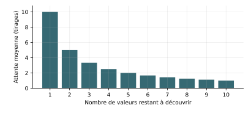
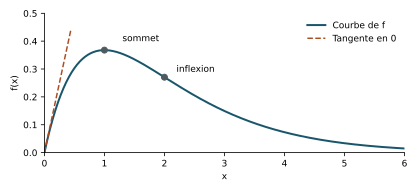
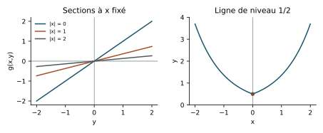
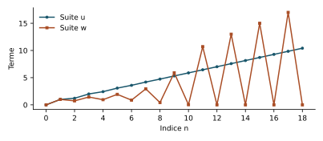

# Banque B/L — Mathématiques, écrit 2025 · Corrigé guidé

*Corrigé rédigé par IA, non officiel. Signalez toute erreur.*

**Rédaction** · GPT-6.2 Astra Ultra · vitesse non renseignée

**Révision (tour 1)** · GPT-6.2 Astra Ultra · vitesse non renseignée

Écrit de quatre heures, sans calculatrice. Les trois problèmes sont indépendants. Le tableau des 64 coefficients totalise 65,5, maximum brut annoncé par le jury. Chaque réponse reçoit une note sur quatre avant pondération et division du total par quatre. Le jury indique également un bonus ou malus de deux points. Le rapport écrit se lit dans les annales de l’APML. [Sujet de la session](https://www.ens.psl.eu/sites/default/files/2025_blses_sujet_mathematiques.pdf) · [Rapport du jury](https://apml-maths.com/wp-content/uploads/2025/11/2025_bl_rapport_ecrit_mathematiques.pdf).

Cette épreuve de quatre heures est commune aux ENS, à l’ENSAE et à l’ENSAI. Les trois problèmes portent sur les translations de polynômes, la collecte de valeurs dans une suite de tirages et l’analyse de fonctions exponentielles.

## Problème A — Translation des polynômes

### Question 1a

> [!INDICATION]
> Placer les images des trois vecteurs canoniques en colonnes.

#### Solution

Les trois coordonnées de $a(x,y,z)$ sont des formes linéaires en $x,y,z$. L’application est donc linéaire et sa matrice canonique est $A=\begin{pmatrix}1&1&1\\0&1&2\\0&0&1\end{pmatrix}$.

### Question 1b

> [!INDICATION]
> Résoudre le système en commençant par la troisième coordonnée.

#### Solution

Triangulaire à diagonale $(1,1,1)$, $A$ a pour déterminant 1 et est inversible. Si $a(x,y,z)=(u,v,w)$, alors $z=w$, $y=v-2w$ et $x=u-v+w$. D’où $A^{-1}=\begin{pmatrix}1&-1&1\\0&1&-2\\0&0&1\end{pmatrix}$.

### Question 1c

> [!INDICATION]
> Composer deux fois l’application ou multiplier ligne par colonne.

#### Solution

L’application composée envoie $(x,y,z)$ sur $(x+2y+4z,y+4z,z)$. Ainsi $A^2=\begin{pmatrix}1&2&4\\0&1&4\\0&0&1\end{pmatrix}$.

### Question 1d

> [!INDICATION]
> Isoler la partie strictement triangulaire de A.

#### Solution

Le calcul donne $A-I_3=\begin{pmatrix}0&1&1\\0&0&2\\0&0&0\end{pmatrix}$, donc $(A-I_3)^2=\begin{pmatrix}0&0&2\\0&0&0\\0&0&0\end{pmatrix}$.

### Question 1e

> [!INDICATION]
> Observer l’effet de la multiplication de deux matrices triangulaires sur leurs diagonales.

#### Solution

Le produit de matrices triangulaires supérieures est triangulaire supérieur et sa diagonale est le produit terme à terme de leurs diagonales. Par récurrence, $A^k$ a donc pour diagonale $(1,1,1)$, ce qui donne $\operatorname{Tr}(A^k)=3$ pour tout $k\ge1$.

### Question 2a

> [!INDICATION]
> Déterminer les valeurs propres, puis exclure explicitement le vecteur nul de l’ensemble demandé.

#### Solution

La triangularité donne la seule valeur propre $1$. L’équation $(A-I_3)(x,y,z)^T=0$ impose $2z=0$ et $y+z=0$, soit $z=y=0$. Les vecteurs propres sont exactement $(x,0,0)$ avec $x\in\mathbb R\setminus\{0\}$.

### Question 2b

> [!INDICATION]
> Comparer la dimension totale des espaces propres à trois.

#### Solution

L’unique espace propre est de dimension 1. Il ne peut donc fournir une base de $\mathbb R^3$, et $A$ n’est pas diagonalisable.

### Question 3a

> [!INDICATION]
> La colonne j représente l’image du monôme de degré j−1.

#### Solution

Dans la colonne $j$, on lit les coefficients de $(x+1)^{j-1}$. Par le binôme de Newton, $B_{ij}=\binom{j-1}{i-1}$ pour $1\le i\le j\le n+1$, et $B_{ij}=0$ pour $i>j$.

### Question 3b

> [!INDICATION]
> Inverser le déplacement de l’argument et vérifier les deux compositions.

#### Solution

L’application $c:P\mapsto[x\mapsto P(x-1)]$ préserve les polynômes de degré au plus $n$. Pour tout $P$, $b(c(P))(x)=P(x)=c(b(P))(x)$. Ainsi $b$ est bijective et $b^{-1}=c$.

### Question 3c

> [!INDICATION]
> Développer le monôme translaté dans le sens inverse.

#### Solution

La colonne $j$ représente $(x-1)^{j-1}$. Le coefficient de $x^{i-1}$ vaut $(B^{-1})_{ij}=(-1)^{j-i}\binom{j-1}{i-1}$ si $i\le j$, et vaut zéro si $i>j$.

### Question 4

> [!INDICATION]
> Que devient un terme dominant de degré positif sous l’opération de différence ?

#### Solution

La matrice $B$ est triangulaire à diagonale 1, donc sa seule valeur propre est 1. Tout polynôme constant non nul est fixé. Si $P$ a degré $d\ge1$ et coefficient dominant $c\ne0$, alors $P(x+1)-P(x)$ a pour terme dominant $cdx^{d-1}$. Il ne peut être nul. Les vecteurs propres sont donc exactement les polynômes constants non nuls.

### Question 5a

> [!INDICATION]
> Appliquer une translation à un polynôme constant.

#### Solution

Écrivons $\Delta=b-\operatorname{Id}$. La différence d’un polynôme constant est le polynôme nul. L’image de $\mathbb R_0[x]$ par $\Delta$ est $\{0\}$.

### Question 5b

> [!INDICATION]
> Identifier les degrés possibles dans l’image, puis vérifier sa dimension.

#### Solution

Pour $1\le k\le n$, la question 4 donne $\ker(\Delta|_{\mathbb R_k[x]})=\mathbb R_0[x]$. La différence d’un polynôme de degré $d\ge1$ est de degré $d-1$, donc l’image est incluse dans $\mathbb R_{k-1}[x]$. Le théorème du rang lui donne la dimension $(k+1)-1=k=\dim\mathbb R_{k-1}[x]$. Ainsi l’image entière est $\mathbb R_{k-1}[x]$.

### Question 5c

> [!INDICATION]
> Itérer la baisse du degré et tenir compte de l’ultime différence d’une constante.

#### Solution

Les $n$ premières différences envoient $\mathbb R_n[x]$ dans les constantes, puis la suivante les annule par 5a. On a donc $\Delta^{n+1}=0$ et $(B-I_{n+1})^{n+1}$ est la matrice nulle.

L’indice de nilpotence est même exactement $n+1$. La différence de $x^n$ a pour terme dominant $nx^{n-1}$. En répétant le calcul, on obtient $\Delta^n(x^n)=n!$, tandis que la différence suivante annule cette constante. Cela contrôle la puissance requise, notamment pour $n=1$.

### Question 6

> [!INDICATION]
> Factoriser les produits communs dans la différence de deux factorielles descendantes.

#### Solution

Pour $j\ge1$, le produit $x(x-1)\cdots(x-j+2)$ est commun à $j!E_j(x+1)$ et à $j!E_j(x)$. La différence des facteurs restants est $(x+1)-(x-j+1)=j$. Donc $\Delta E_j=E_{j-1}$, également pour $j=1$ avec produit vide. Comme $\Delta E_0=0$, la matrice $M$ présente des 1 juste au-dessus de la diagonale, et tous ses autres coefficients sont nuls.

### Question 7a

> [!INDICATION]
> Appliquer la translation d’une unité k fois.

#### Solution

On a $P_0=P$ et $P_{k+1}=b(P_k)$ puisque $P_k(x+1)=P(x+k+1)$. Une récurrence donne $P_k=b^k(P)$.

### Question 7b

> [!INDICATION]
> Appliquer au polynôme fixé l’identité d’endomorphismes trouvée en 5c.

#### Solution

Les endomorphismes $b$ et $\operatorname{Id}$ commutent, donc la formule du binôme dans $\Delta^{n+1}=0$ donne
$$0=(b-\operatorname{Id})^{n+1}P=\sum_{k=0}^{n+1}(-1)^{n+1-k}\binom{n+1}{k}P_k.$$
Les coefficients $\lambda_k=(-1)^{n+1-k}\binom{n+1}{k}$ conviennent pour tout $P$, et $\lambda_{n+1}=1$ assure qu’ils ne sont pas tous nuls.

### Question 8a

> [!INDICATION]
> Raisonner sur le plus petit degré portant un coefficient non nul.

#### Solution

Si $Q\ne0$, soit $j\le n$ le plus petit degré dont le coefficient $c_j$ est non nul. Pour $x\ne0$, $Q(x)/x^j=x^{n-j}\varepsilon(x)\to0$ en 0. Or, par choix de $j$, le membre de gauche tend vers $c_j\ne0$. Cette contradiction impose $Q=0$.

### Question 8b

> [!INDICATION]
> Les coefficients de Taylor du polynôme translaté en zéro sont les dérivées de P évaluées en k.

#### Solution

La formule de Taylor à l’ordre $n$ donne $P(k+x)=\sum_{j=0}^n P^{(j)}(k)x^j/j!+o(x^n)$ lorsque $x\to0$. La différence entre les deux polynômes est de degré au plus $n$ et est $o(x^n)$, donc est identiquement nulle par 8a. Les coordonnées de $P_k$ dans $B_n$ sont ainsi $P(k),P'(k),\ldots,P^{(n)}(k)/n!$ avec, à l’indice $j+1$, le coefficient $P^{(j)}(k)/j!$.

## Problème B — Collectionner toutes les valeurs

### Question 9a

> [!INDICATION]
> Utiliser la moyenne de la loi uniforme sur les entiers de 1 à M.

#### Solution

Pour $U_1$ uniforme sur $\{1,\ldots,M\}$, $\mathbb E(U_1)=(M+1)/2$.

### Question 9b

> [!INDICATION]
> Utiliser la formule de variance avec M valeurs consécutives.

#### Solution

La variance de cette loi uniforme discrète est $\operatorname{Var}(U_1)=(M^2-1)/12$.

### Question 10a

> [!INDICATION]
> Compter les deux issues favorables parmi les M valeurs équiprobables.

#### Solution

L’indicatrice $Y$ suit la loi de Bernoulli de paramètre $2/M$. On a $\mathbb P(Y=1)=2/M$, $\mathbb P(Y=0)=1-2/M$, $\mathbb E(Y)=2/M$ et $\operatorname{Var}(Y)=2(M-2)/M^2$.

### Question 10b

> [!INDICATION]
> Développer le carré et utiliser l’indépendance seulement pour le terme croisé.

#### Solution

On a $Y^2=Y$, $W^2=W$, et $Y,W$ sont indépendantes car elles dépendent respectivement de $U_1,U_2$. Ainsi $\mathbb E[(Y+W)^2]=2(2/M)+2(2/M)^2=4(M+2)/M^2$.

### Question 11a

> [!INDICATION]
> Un seul tirage fournit un nombre déterministe de valeurs différentes.

#### Solution

On a $X_1=1$ presque sûrement. Sa loi est la masse de Dirac en 1, son espérance vaut 1 et sa variance vaut 0.

### Question 11b

> [!INDICATION]
> Pour atteindre k valeurs, imposer un choix explicite des n premiers tirages.

#### Solution

Il faut $1\le X_n\le\min(n,M)$. Pour chaque entier $k$ de cet intervalle, une réalisation possible est $1,2,\ldots,k$, suivie de $n-k$ fois la valeur 1. Par indépendance, cette suite précise a probabilité $M^{-n}>0$. Le support est donc $\{1,\ldots,\min(n,M)\}$.

### Question 11c

> [!INDICATION]
> Exprimer le nombre final comme un, plus l’indicatrice de l’apparition d’une nouvelle valeur.

#### Solution

On a $X_2=1+\mathbf1_{\{U_2\ne U_1\}}$. Pour toute première valeur, la seconde est différente avec probabilité $(M-1)/M$. Ainsi $\mathbb E(X_2)=1+(M-1)/M=2-1/M$.

Plus généralement, si $I_j$ indique que la valeur $j$ a déjà été vue en $n$ tirages, alors $X_n=\sum_{j=1}^M I_j$. L’indépendance des tirages donne $\mathbb P(I_j=0)=(1-1/M)^n$. Par linéarité de l’espérance, $\mathbb E(X_n)=M[1-(1-1/M)^n]$. Au rang deux, on retrouve exactement $2-1/M$.

### Question 12a

> [!INDICATION]
> Ajouter successivement deux valeurs nouvelles après le premier tirage.

#### Solution

La seconde valeur doit différer de la première, avec probabilité $(M-1)/M$, puis la troisième doit éviter les deux précédentes, avec probabilité $(M-2)/M$. D’où $\mathbb P(X_3=3)=(M-1)(M-2)/M^2$.

### Question 12b

> [!INDICATION]
> Lorsque deux valeurs apparaissent dans le triplet, dénombrer les positions possibles du couple de tirages égaux.

#### Solution

Si $X_3=2$, exactement une paire parmi les positions $(1,2),(1,3),(2,3)$ contient des valeurs égales. Par indépendance et identité de loi, ces trois cas sont équiprobables. Le premier est le seul à donner $X_2=1$. Ainsi $\mathbb P(X_2=2\mid X_3=2)=2/3$. Plus explicitement, chaque cas a probabilité $(M-1)/M^2>0$, ce qui justifie le conditionnement.

### Question 13a

> [!INDICATION]
> Identifier l’instant d’apparition de la première valeur.

#### Solution

Le premier tirage apporte nécessairement la première valeur, donc $T_1=1$ presque sûrement.

### Question 13b

> [!INDICATION]
> Une fois une valeur connue, compter les issues nouvelles à chaque tirage.

#### Solution

Le temps $T_2-T_1$ suit la loi géométrique sur $\{1,2,\ldots\}$ de paramètre $(M-1)/M$, le premier nouveau tirage pouvant réussir immédiatement.

### Question 13c

> [!INDICATION]
> Raisonner après la découverte de la deuxième valeur.

#### Solution

L’attente $T_3-T_2$ suit la loi géométrique sur $\{1,2,\ldots\}$ de paramètre $(M-2)/M$.

### Question 13d

> [!INDICATION]
> Décomposer le temps total et utiliser la moyenne d’une attente géométrique.

#### Solution

Par linéarité, $\mathbb E(T_3)=\mathbb E(T_1)+\mathbb E(T_2-T_1)+\mathbb E(T_3-T_2)=1+M/(M-1)+M/(M-2)$.

### Question 14a

> [!INDICATION]
> Encadrer la fonction décroissante sur chaque intervalle unité et traiter le premier terme à part.

#### Solution

Pour $j\ge1$, $1/x\le1/j$ sur $[j,j+1]$, donc $\int_j^{j+1} dx/x\le 1/j$. Pour $j\ge2$, $1/x\ge1/j$ sur $[j-1,j]$, donc $1/j\le\int_{j-1}^j dx/x$. En sommant la première inégalité de 1 à $i$ et la seconde de 2 à $i$, on obtient
$$\ln(i+1)\le h_i\le1+\ln i.$$

### Question 14b

> [!INDICATION]
> Utiliser le minorant divergent.

#### Solution

Puisque $\ln(i+1)\to+\infty$, l’encadrement de 14a entraîne $h_i\to+\infty$.

### Question 14c

> [!INDICATION]
> Identifier les sommes partielles d’une série de Riemann.

#### Solution

La série $\sum_{j\ge1}1/j^2$ converge, car son exposant 2 est strictement supérieur à 1. Ses sommes partielles $v_i$ convergent donc vers une limite finie.

### Question 15a

> [!INDICATION]
> Après la collecte de k valeurs, le nombre d’issues nouvelles reste constant jusqu’au prochain succès.

#### Solution

L’attente $T_{k+1}-T_k$ suit la loi géométrique sur $\mathbb N^*$ de paramètre $(M-k)/M$ pour $1\le k<M$.

### Question 15b

> [!INDICATION]
> Additionner les attentes successives et réindexer selon le nombre de valeurs manquantes.

#### Solution

On écrit $T_M=T_1+\sum_{k=1}^{M-1}(T_{k+1}-T_k)$. Par linéarité,
$$\mathbb E(T_M)=1+\sum_{k=1}^{M-1}\frac M{M-k}=M\sum_{j=1}^M\frac1j=Mh_M.$$

### Question 15c

> [!INDICATION]
> Les attentes sont indépendantes. Écrire la variance géométrique comme différence de deux puissances de l’inverse du paramètre.

#### Solution

Pour une géométrique de paramètre $p$, la variance vaut $1/p^2-1/p$. Les attentes sont indépendantes par hypothèse et $T_1$ est constant. En posant $j=M-k$, puis en ajoutant le terme nul $j=M$, on trouve
$$\operatorname{Var}(T_M)=\sum_{j=1}^M\left(\frac{M^2}{j^2}-\frac Mj\right)=M^2v_M-Mh_M.$$

Le terme $j=1$ correspond à la recherche du tout dernier objet. À lui seul, il contribue $M^2-M$ à la variance et $M$ à l’espérance. À l’autre extrémité, $j=M$ correspond au premier tirage, certain de réussir, dont la variance vaut zéro. Ces deux cas vérifient le sens de la réindexation.

### Question 15d

> [!INDICATION]
> Centrer la variable par sa moyenne exacte avant d’appliquer Bienaymé–Tchebychev.

#### Solution

Comme $Mh_M=\mathbb E(T_M)>0$, l’événement de l’énoncé équivaut à $|T_M-\mathbb E(T_M)|\ge\varepsilon Mh_M$. L’inégalité de Bienaymé–Tchebychev donne
$$\mathbb P\!\left(\left|\frac{T_M}{Mh_M}-1\right|\ge\varepsilon\right)\le\frac{\operatorname{Var}(T_M)}{\varepsilon^2M^2h_M^2}.$$

### Question 15e

> [!INDICATION]
> La variance normalisée fait apparaître une somme bornée divisée par le carré de la somme harmonique.

#### Solution

La borne de 15d est positive ou nulle et est majorée par $v_M/(\varepsilon^2h_M^2)$ par 15c. Or $v_M$ est bornée et $h_M\to\infty$. Pour tout $\varepsilon>0$ fixé, la probabilité considérée tend donc vers 0.

## Problème C — Fonctions exponentielles, loi à densité et suites

### Question 16a

> [!INDICATION]
> Distinguer la continuité en zéro et la croissance comparée à l’infini.

#### Solution

Pour $f(x)=xe^{-x}$, la limite à droite en 0 vaut 0 par continuité. Lorsque $x\to+\infty$, la croissance comparée donne $x/e^x\to0$.

### Question 16b

> [!INDICATION]
> Utiliser la règle du produit en incluant la dérivée à droite à l’origine.

#### Solution

Le produit de $x$ et de $e^{-x}$ se prolonge en une fonction dérivable sur $\mathbb R$. Pour $x\ge0$, $f'(x)=(1-x)e^{-x}$. En particulier la pente à droite en 0 vaut 1.

### Question 16c

> [!INDICATION]
> Le signe de la dérivée dépend uniquement du facteur affine.

#### Solution

La dérivée est positive pour $0\le x<1$, s’annule en 1 et est négative pour $x>1$. On obtient
$$\begin{array}{c|ccccc}x&0&&1&&+\infty\\\hline f'(x)&&+&0&-&\\ f(x)&0&\nearrow&e^{-1}&\searrow&0\end{array}$$

### Question 17a

> [!INDICATION]
> Vérifier le changement de signe de la dérivée seconde au point candidat.

#### Solution

La dérivée seconde est $f''(x)=(x-2)e^{-x}$. Elle est négative avant 2 et positive après 2. Il y a donc un unique point d’inflexion, de coordonnées $(2,2e^{-2})$.

### Question 17b

> [!INDICATION]
> Placer l’origine, la tangente, le sommet et l’inflexion avant de prolonger vers l’asymptote.

#### Solution

À l’origine la tangente a pour équation $y=x$. La courbe atteint $(1,e^{-1})$, passe en $(2,2e^{-2})$, puis tend vers l’axe des abscisses par valeurs positives.

### Question 18a

> [!INDICATION]
> Prendre une primitive puis faire tendre la borne supérieure vers l’infini.

#### Solution

On a $\int_0^R e^{-x}dx=1-e^{-R}\to1$. Ainsi $\int_0^\infty f_0(x)dx=1$.

### Question 18b

> [!INDICATION]
> Intégrer par parties sur un segment fini.

#### Solution

La primitive $-(x+1)e^{-x}$ donne $\int_0^R xe^{-x}dx=1-(R+1)e^{-R}$. Le dernier terme tend vers 0, donc $\int_0^\infty f_1(x)dx=1$.

### Question 18c

> [!INDICATION]
> Vérifier l’annulation du terme de bord avant le passage à l’infini.

#### Solution

Pour $n\ge1$, une intégration par parties sur $[0,R]$ donne $\int_0^R x^ne^{-x}dx=-R^ne^{-R}+n\int_0^R x^{n-1}e^{-x}dx$. Le terme de bord tend vers 0. Si l’intégrale $I_{n-1}$ converge, on obtient la convergence de $I_n$ et $I_n=nI_{n-1}$, où $I_j=\int_0^\infty f_j(x)dx$.

### Question 18d

> [!INDICATION]
> Itérer la récurrence en partant de la valeur d’ordre zéro.

#### Solution

Comme $I_0=1$, la question 18c donne par récurrence $I_n=n!$ pour tout $n\in\mathbb N$, avec $0!=1$.

### Question 19

> [!INDICATION]
> L’exponentielle n’a besoin d’être développée qu’au troisième ordre.

#### Solution

Puisque $e^{-x}=1-x+x^2/2-x^3/6+o(x^3)$ en 0, on a pour tout $n\ge0$,
$$f_n(x)=x^n-x^{n+1}+\tfrac12x^{n+2}-\tfrac16x^{n+3}+o(x^{n+3}).$$

### Question 20a

> [!INDICATION]
> Intégrer la puissance de la variable multipliée par la densité sur son support.

#### Solution

La densité vaut $xe^{-x}$ pour $x\ge0$ et 0 pour $x<0$. Pour $n\ge0$, le moment absolu converge par 18d et $\mathbb E(X^n)=\int_0^\infty x^{n+1}e^{-x}dx=(n+1)!$.

### Question 20b

> [!INDICATION]
> Prendre la queue de l’intégrale de densité.

#### Solution

Pour $t\ge0$, $\mathbb P(X>t)=\int_t^\infty xe^{-x}dx=(1+t)e^{-t}$ à l’aide de la primitive de 18b.

### Question 20c

> [!INDICATION]
> Le second événement est inclus dans l’événement de conditionnement.

#### Solution

Comme $s\ge0$, $\{X>t+s\}\subseteq\{X>t\}$ et $\mathbb P(X>t)>0$. Par la définition de la probabilité conditionnelle,
$$\mathbb P(X>t+s\mid X>t)=\frac{(1+t+s)e^{-(t+s)}}{(1+t)e^{-t}}=\frac{1+t+s}{1+t}e^{-s}.$$

### Question 21a

> [!INDICATION]
> Étudier séparément les demi-plans et la droite de raccord, y compris le cas où y est nul.

#### Solution

Partout, $\partial_y g(x,y)=e^{-|x|}$. Pour $x<0$, $\partial_xg(x,y)=y e^x$, et pour $x>0$, $\partial_xg(x,y)=-y e^{-x}$. À $x=0$, les dérivées unilatérales en $x$ valent respectivement $y$ et $-y$. La dérivée partielle en $x$ existe exactement si $y=0$ sur cette droite, et vaut alors 0.

### Question 21b

> [!INDICATION]
> Fixer x donne un coefficient multiplicatif constant dans la variable y.

#### Solution

Pour $x$ fixé, le graphe de $y\mapsto g(x,y)$ est la droite de l’origine de pente $e^{-|x|}$, strictement positive et au plus égale à 1. La pente est maximale pour $x=0$ et diminue quand $|x|$ augmente. Les droites correspondantes figurent à gauche du graphique en 21e.

### Question 21c

> [!INDICATION]
> Vérifier ce qui se passe de part et d’autre de tout point dans la direction verticale.

#### Solution

Pour chaque $(x,y)$ et chaque $h>0$, on a $g(x,y-h)<g(x,y)<g(x,y+h)$ puisque la pente verticale est strictement positive. Ces points peuvent être pris arbitrairement proches de $(x,y)$, donc $g$ ne possède aucun extremum local.

### Question 21d

> [!INDICATION]
> Isoler la coordonnée y dans l’équation d’un niveau réel.

#### Solution

Pour tout $c\in\mathbb R$, $g(x,y)=c$ équivaut à $y=c e^{|x|}$, pour tout $x\in\mathbb R$. En particulier le niveau 0 est l’axe des abscisses.

### Question 21e

> [!INDICATION]
> Écrire explicitement chacune des branches de la ligne de niveau.

#### Solution

Pour $c=1/2$, la ligne de niveau est $y=e^{-x}/2$ si $x\le0$ et $y=e^x/2$ si $x\ge0$. Elle est symétrique par rapport à l’axe des ordonnées et atteint sa hauteur minimale $1/2$ en zéro, où ses demi-tangentes ont les pentes $-1/2$ et $1/2$.

### Question 22a

> [!INDICATION]
> La première borne vient de la positivité de l’exponentielle. Insérer ensuite cette borne au rang précédent.

#### Solution

La récurrence est $u_n=n\exp(-|u_{n-1}|/n)$, donc $0<u_n\le n$ pour tout $n\ge1$, même si $u_0<0$. Pour $n\ge2$, $0<u_{n-1}\le n-1$ et par conséquent
$$n e^{-(n-1)/n}\le u_n\le n.$$
En particulier $u_n\ge n/e$ pour $n\ge2$. Au premier rang, la valeur exacte est $u_1=e^{-|u_0|}$.

### Question 22b

> [!INDICATION]
> Utiliser la minoration linéaire en n.

#### Solution

Comme $u_n\ge n/e$ dès $n\ge2$, on obtient $u_n\to+\infty$.

### Question 23a

> [!INDICATION]
> Sous l’hypothèse d’une limite finie, examiner le facteur exponentiel qui multiplie n.

#### Solution

La relation est cette fois $w_n=n\exp(-|w_{n-1}|)$. Si $w_n\to\ell\in\mathbb R$, alors $\exp(-|w_{n-1}|)\to e^{-|\ell|}>0$, et $w_n$ tendrait vers $+\infty$. Cela contredit l’hypothèse d’une limite finie.

### Question 23b

> [!INDICATION]
> Comparer la croissance linéaire à celle d’une exponentielle de taux positif.

#### Solution

La croissance comparée donne $(n+1)e^{-n/e}\to0$. Il existe donc $n_0\ge1$ tel que $(n+1)e^{-n/e}\le1$ pour tout $n\ge n_0$.

### Question 23c

> [!INDICATION]
> À partir d’un petit terme, minorer le suivant puis majorer celui qui vient deux rangs après.

#### Solution

Écrivons $k=n_1+2j$. Dès que $0<w_k\le1$, on a $w_{k+1}=(k+1)e^{-w_k}\ge(k+1)/e$, puis
$$0<w_{k+2}=(k+2)e^{-w_{k+1}}\le(k+2)e^{-(k+1)/e}\le1,$$
la dernière inégalité venant de 23b puisque $k+1\ge n_0$. L’hypothèse $w_{n_1}\le1$ et la positivité dès le rang 1 initialisent la récurrence. La borne supérieure précédente tend vers zéro, donc $w_{n_1+2j}\to0$.

### Question 23d

> [!INDICATION]
> Lire la minoration des indices intermédiaires dans la preuve précédente.

#### Solution

Pour tout $j\ge0$, $w_{n_1+2j+1}\ge(n_1+2j+1)/e$, donc $w_{n_1+2j+1}\to+\infty$. On obtient même $w_{n_1+2j+1}/(n_1+2j+1)=e^{-w_{n_1+2j}}\to1$.

Les conclusions de 23c et 23d utilisent l’existence de $n_1\ge n_0$ imposée par le sujet. Sous cette hypothèse, la suite entière a pour limite inférieure zéro et pour limite supérieure $+\infty$. L’argument de 23a valait déjà pour tout terme initial, avant cette hypothèse supplémentaire.

