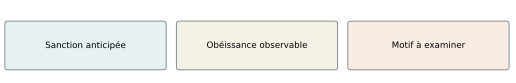
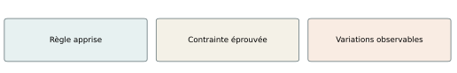

# ENS B/L · Oral de philosophie du 23 juin 2025 · Corrigé brut

*Corrigé rédigé par IA, non officiel. Signalez toute erreur.*

**Rédaction** · GPT-6.2 Astra Ultra · vitesse non renseignée · 26 novembre 2026

Le feuillet officiel réunit 11 billets de deux sujets. Le jury accorde 1 h 30 de préparation. La personne interrogée annonce son choix au passage, puis dispose de vingt minutes d’exposé et de dix minutes d’entretien. Les propositions ci-dessous suivent les billets dans leur ordre et traitent les deux options.

## Billet 1

Sur le feuillet, le jury indique en gras le sujet choisi au passage, **La bienveillance**.

### La bienveillance

Proposer à un ami de décider à sa place peut partir du désir de lui faire du bien. S’il demandait seulement du temps pour choisir, ce bien voulu risque de l’empêcher d’agir. La bienveillance tient-elle à la disposition de l’agent ou au bien qu’il reconnaît à autrui ?

Aristote distingue dans l’*Éthique à Nicomaque* la bienveillance, qui consiste à vouloir du bien à quelqu’un, de l’amitié accomplie, qui suppose réciprocité, durée et vie partagée. On peut souhaiter du bien à une personne inconnue. La disposition a déjà une portée morale car elle vise une autre fin que notre seule satisfaction. Pourtant une représentation mal informée du bien d’autrui peut nourrir un paternalisme sincère.

La bienveillance devient exigeante lorsque l’on accepte que le bénéficiaire puisse dire ce qui lui convient, refuser l’offre ou modifier notre projet. Elle ne garantit ni la compétence technique de l’aide ni sa justice envers des tiers. Sa valeur est d’orienter l’attention vers le bien d’une personne singulière, sous le contrôle de ses droits et de sa parole.

### En politique, peut-on faire table rase du passé ?

Une assemblée peut abolir une institution d’un vote. Elle travaille pourtant dans une langue, un territoire et des procédures qui ont eux-mêmes une histoire. Que peut signifier rompre politiquement lorsque les moyens de la rupture sont en partie hérités ?

L’idée de table rase exprime d’abord une revendication légitime. Une règle ancienne ne tire pas sa justice du seul fait qu’elle a duré. Abolir un privilège introduit une discontinuité réelle dans les droits. Mais la modification d’un texte laisse parfois intactes des habitudes administratives, des inégalités de ressources et les souvenirs de ceux qui ont subi l’ancien ordre. Décréter que tout recommence également pour tous peut alors protéger les avantages déjà acquis.

La fondation politique est plus exigeante qu’un effacement. Elle doit choisir ce qui sera transmis, réparé ou transformé et créer des procédures capables de soutenir cette transformation. La mémoire critique du passé peut être une condition de la rupture qu’elle semble contrarier. On peut ainsi instituer une règle nouvelle tout en reconnaissant les obligations présentes nées de l’histoire.

## Billet 2

Sur le feuillet, le jury indique en gras le sujet choisi au passage, **La pratique des sciences met-elle à l’abri des préjugés ?**.

### Le dévouement

Une bénévole réserve chaque semaine du temps pour un voisin. Elle répond à un besoin précis. Un employeur peut en revanche invoquer le « dévouement » de salariés pour leur demander de compenser indéfiniment un manque d’effectifs. Dans les deux cas quelqu’un donne plus que ce qui est strictement prévu. À quelles conditions ce dépassement a-t-il une valeur ?

Se dévouer, c’est attacher une part de son temps et de ses forces à une personne ou à une cause. Sa valeur vient de la fin servie et de la liberté de l’engagement. Le sacrifice visible n’est pas une mesure suffisante. Une aide discrète, ajustée aux besoins, peut servir mieux qu’un renoncement spectaculaire dont personne ne profite.

Le dévouement suppose aussi des limites. On peut manquer à d’autres obligations, installer une dépendance ou servir une cause injuste avec une fidélité admirablement constante. Une collectivité qui exige le dévouement comme une dette efface d’ailleurs le caractère libre du don. Le véritable examen porte sur l’attention à ceux que l’on sert, la qualité de la cause et les conditions sous lesquelles on est libre d’arrêter.

### La pratique des sciences met-elle à l’abri des préjugés ?

Un laboratoire peut corriger une croyance reçue en répétant une expérience. Il peut aussi choisir ses questions, ses instruments ou ses catégories à partir d’habitudes qu’aucun de ses membres ne pense à interroger. La pratique des sciences supprime-t-elle les préjugés ou fournit-elle des moyens déterminés de les mettre à l’épreuve ?

Un préjugé est un jugement adopté avant un examen suffisant et maintenu comme s’il avait déjà été éprouvé. Une hypothèse de travail peut également précéder l’expérience, mais elle indique des conséquences attendues et accepte la possibilité d’être corrigée. La méthode scientifique rend cette différence opératoire par des protocoles, le contrôle des mesures et la critique publique. Bachelard montre dans *La Formation de l’esprit scientifique* que des idées familières peuvent constituer des obstacles intérieurs à l’enquête.

Ces dispositifs ont besoin d’être effectivement pratiqués. Un résultat qui contredit une attente peut être écarté comme une anomalie sans examen approprié. La diversité des critiques et la transparence des procédures accroissent les possibilités de correction. L’autorité acquise dans une discipline ne donne pas davantage une compétence universelle en dehors d’elle. La science offre une discipline de révision dont personne ne bénéficie une fois pour toutes.

## Billet 3

Sur le feuillet, le jury indique en gras le sujet choisi au passage, **La crainte du châtiment**.

### La crainte du châtiment

Une personne rend un objet quand elle aperçoit une caméra. Le même geste aurait pu être accompli parce qu’il appartient à autrui. La crainte d’une sanction peut obtenir une conduite conforme. Que garantit cette conformité sur la justice de l’ordre et la formation du jugement ?

L’anticipation d’un coût modifie les choix et peut protéger les personnes exposées au tort. Dans un ordre commun, la peine annoncée doit aussi être connue, proportionnée et appliquée selon une procédure. Un châtiment arbitraire suscite de la peur sans apprendre la règle que l’on est censé respecter. Une peine démesurée peut encourager la dissimulation et défaire la confiance dans l’institution.

La crainte peut soutenir extérieurement une habitude, mais elle ne suffit pas à produire la reconnaissance de la raison d’une règle. Lorsque la surveillance disparaît, le calcul d’intérêt peut s’inverser. Une éducation morale et civique doit donc permettre de comprendre le dommage évité, d’examiner la justice de la règle et de reconnaître les droits d’autrui. La sanction garde une fonction limitée dans cet ensemble.

### La philosophie peut-elle disparaître ?

On peut fermer un département de philosophie, cesser de transmettre certains textes ou perdre la connaissance d’une tradition. La question demeure de savoir si peut disparaître l’activité qui consiste à examiner les principes de ce que nous disons et faisons.

La philosophie a besoin d’institutions, d’une langue, de temps et de modes de discussion. Ces conditions sont historiquement fragiles. Il serait donc peu prudent d’assurer son éternité en invoquant une nature humaine spontanément philosophe. Une société peut traiter des décisions techniques et affirmer des valeurs sans donner de véritable place à leur examen public. Inversement, un questionnement philosophique peut se poursuivre sous d’autres noms, par exemple dans une controverse sur ce qui constitue une preuve ou une personne.

Un paradoxe subsiste. La thèse selon laquelle toute question philosophique serait désormais close doit elle-même expliquer ses critères de vérité et de pertinence. Elle réintroduit ainsi une difficulté de type philosophique. Cette nécessité logique d’un examen des présupposés ne garantit pas que des communautés auront toujours les moyens ou le désir de le pratiquer. Sa transmission demeure une responsabilité historique.

## Billet 4

Sur le feuillet, le jury indique en gras le sujet choisi au passage, **La souffrance a-t-elle un sens ?**.

### Le quotidien

Chaque matin on ouvre une porte sans observer la poignée. Lorsqu’elle se bloque, toute une organisation de gestes et d’attentes devient visible. Le quotidien est ce qui revient, mais aussi ce qui cesse d’attirer l’attention parce que nous savons déjà nous y orienter.

La répétition donne une stabilité nécessaire. Elle épargne la dépense qu’exigerait la décision de chaque geste et libère l’attention pour d’autres tâches. Elle peut également soustraire à la discussion une répartition du temps ou du travail que chacun traite comme naturelle. Savoir qui remplit un réfrigérateur apparemment toujours plein fait apparaître une activité longtemps inaperçue. La description du quotidien acquiert alors une portée critique.

Perec, dans ses textes sur l’infra-ordinaire, invite à interroger ce qui semble trop banal pour être consigné. Regarder ainsi une habitude ne commande pas de la détruire. Il s’agit de retrouver la différence entre ce qui fournit un appui, ce qui enferme dans un geste et ce qui pourrait être organisé autrement. Le quotidien est une matière de liberté précisément parce qu’il paraît d’abord aller de soi.

### La souffrance a-t-elle un sens ?

Une douleur peut signaler qu’une blessure demande des soins. La personne éprouvée peut pourtant demander « pourquoi moi ? » sans chercher une cause biologique. Le sens peut désigner un signal, une explication ou une signification donnée à une expérience. Confondre ces plans expose à justifier inutilement le mal subi.

La fonction d’alarme de certaines douleurs ne prouve pas que toute souffrance soit utile, proportionnée ou méritée. Une souffrance durable peut au contraire désorganiser l’attention, la parole et les projets. Lui assigner une leçon de l’extérieur risque d’ajouter une exigence de gratitude à une épreuve déjà lourde. La première réponse d’autrui peut être l’aide ou l’écoute sans interprétation imposée.

Une personne peut cependant inscrire ce qu’elle a traversé dans un récit ou un engagement de solidarité. Cette signification est alors élaborée après coup et sous sa propre autorité. Elle peut évoluer et laisser subsister une part d’absurde. Demander si la souffrance a un sens conduit donc à distinguer l’explication du mal et la liberté fragile de faire quelque chose de ce qui a été subi.

## Billet 5

Sur le feuillet, le jury indique en gras le sujet choisi au passage, **Peut-on tout désirer ?**.

### L’aveu

À qui reconnaît une erreur, on peut répondre « nous le savions déjà ». Pourtant l’aveu peut encore changer la situation. Il ne transmet pas seulement un fait nouveau. La personne accepte d’en être reconnue comme le sujet et de répondre de ce qu’elle dit.

Cette prise de parole peut rétablir la confiance et ouvrir une réparation. Mais les conditions de sa production importent. Une déclaration obtenue sous pression peut être fausse ou conforme à l’attente d’un enquêteur. L’intensité du récit ne supplée pas l’établissement des faits. Foucault s’intéresse, dans son histoire des pratiques d’aveu, aux institutions qui demandent à un individu d’énoncer une vérité sur lui-même et qui décident de ce qui comptera comme vérité.

L’aveu peut porter sur un tort, un sentiment ou une identité jusque-là tenue secrète. Ces situations n’impliquent pas la même dette envers autrui. Il faut donc distinguer le droit de parler, l’obligation éventuelle de reconnaître un tort et la prétention d’un tiers à connaître toute intériorité. La franchise tire une part de sa valeur des conditions de liberté qui la rendent possible.

### Peut-on tout désirer ?

On peut souhaiter revenir dans le passé tout en sachant cela impossible. La possibilité de désirer excède donc celle de réaliser. Mais puis-je désirer littéralement tout, y compris ce que je suis incapable de me représenter, ou ce qui détruirait les conditions mêmes de mon désir ?

Le besoin renvoie à ce dont dépend une capacité ou la vie. Le désir vise un objet sous une description qui le rend attirant, même si cet objet ne répond à aucun besoin. L’imagination et le langage en élargissent indéfiniment les figures. Un objet dangereux peut être recherché sous l’aspect d’une reconnaissance ou d’un soulagement attendu. Cette analyse explique comment le désir est possible sans en faire une approbation morale.

Le « pouvoir » de la question peut aussi désigner un droit ou une maîtrise. Les désirs surgissent parfois avant toute décision, mais on peut les entretenir, les examiner ou refuser de les traduire en actes. On ne choisit pas à volonté de désirer chaque objet possible, et la légitimité d’une action ne découle pas de la seule existence d’un désir. Le champ du désirable est ouvert sous certaines représentations, sans être indifférent à toute condition.

## Billet 6

Sur le feuillet, le jury indique en gras le sujet choisi au passage, **Que faut-il savoir pour agir ?**.

### La vengeance

Une personne estime qu’un tort resté sans réponse rend durablement inégale la relation. Lui rendre la pareille semble restaurer un équilibre. Mais celui qui fixe la mesure de la riposte est ici celui que la blessure affecte le plus directement. Comment distinguer la demande justifiée de reconnaissance et la répétition du tort ?

La vengeance atteste que le dommage compte et que la victime n’accepte pas d’être traitée comme négligeable. Son attrait est d’autant plus fort quand une institution refuse d’entendre la plainte. Pourtant infliger une perte en retour ne répare pas nécessairement ce qui a été détruit. Les proches de l’un et de l’autre peuvent compter différemment les torts et chaque réponse devenir le point de départ d’une nouvelle exigence.

La justice confie l’établissement des faits et la détermination de conséquences à une procédure avec des droits de défense. Elle doit aussi reconnaître l’expérience de la victime et rendre possible une réparation, faute de quoi son impartialité risque d’être perçue comme indifférence. Renoncer à la vengeance n’est donc pas renoncer à demander des comptes.

### Que faut-il savoir pour agir ?

Le médecin doit parfois agir avant de connaître toute l’histoire d’un symptôme. Attendre une certitude complète peut accroître le risque, tandis qu’agir au hasard exposerait la personne à un dommage évitable. Le savoir requis se détermine donc aussi par l’urgence, la gravité et la possibilité de corriger l’action.

Une connaissance générale des moyens et des conséquences ne suffit pas à choisir la fin. Aristote appelle prudence la capacité de délibérer sur ce qu’il convient de faire dans des circonstances particulières. Cette capacité mobilise l’expérience et l’attention aux détails qui changent le sens d’une règle. Il faut aussi savoir ce qu’on ignore et à qui demander une compétence qui manque.

L’exigence de savoir ne donne donc pas toujours la priorité à l’expert dans la décision finale. Celui qui connaît les probabilités d’un résultat ne décide pas seul de la valeur que l’intéressé lui accorde. Une action justifiable s’appuie sur des raisons proportionnées aux enjeux, explicite ses incertitudes et prévoit comment être révisée. Une part d’inconnu peut rester compatible avec la responsabilité.

## Billet 7

Sur le feuillet, le jury indique en gras le sujet choisi au passage, **Qu’est-ce qu’un fait social ?**.

### Maître et disciple

Une pianiste commence par reproduire les gestes de sa professeure. Plus tard, elle interprète le même morceau autrement et peut justifier son choix. La réussite de la relation semble conduire le disciple à se passer du modèle auquel il doit pourtant sa formation.

Le maître rend visible une pratique dont les critères ne se transmettent pas tous par des consignes explicites. Corriger une hésitation, proposer un exercice et donner un exemple construisent peu à peu une capacité de discernement. L’asymétrie initiale peut donc servir l’autonomie. Mais elle devient domination si l’autorité exige que toute divergence soit tenue pour une infidélité ou soustrait ses propres décisions à l’examen.

Le disciple, de son côté, transforme l’enseignement en se l’appropriant. Il peut prolonger une méthode en contestant une conclusion de son maître. Juger de sa fidélité demande de préciser si elle porte sur des résultats à répéter, des exigences à maintenir ou une personne à satisfaire. Une relation éducative féconde prépare le moment où un désaccord argumenté pourra témoigner de ce qui a été appris.

### Qu’est-ce qu’un fait social ?

Une langue existe avant ma naissance, mais aucun mot ne serait prononcé sans des personnes concrètes. Comment une manière de faire peut-elle être extérieure aux individus tout en n’existant que dans leurs pratiques ?

Dans *Les Règles de la méthode sociologique*, Durkheim caractérise le fait social par des manières d’agir, de penser ou de sentir qui exercent une contrainte extérieure sur l’individu. L’obligation de rendre la monnaie selon certaines unités, les horaires scolaires ou les conventions linguistiques se manifestent lorsqu’on s’en écarte et rencontre une sanction ou une incompréhension. L’habitude peut les rendre presque insensibles lorsque l’on s’y conforme.

La simple fréquence d’une conduite ne suffit pas. Si tous ouvrent leur parapluie sous la pluie, une même cause physique et des décisions semblables peuvent expliquer la régularité. Il faut mettre en évidence un mode d’apprentissage, des attentes mutuelles ou une institution qui organise l’action. Reconnaître la réalité du fait social laisse ouverte sa transformation par les individus qui en reprennent, contestent ou modifient les règles.

## Billet 8

Sur le feuillet, le jury indique en gras le sujet choisi au passage, **Vieillir**.

### Vieillir

L’anniversaire indique partout la même durée écoulée. Mais on peut se voir attribuer une place sociale de « personne âgée » avant de se reconnaître soi-même dans cette catégorie. Vieillir engage le corps, la mémoire de sa propre vie et le regard d’autrui, selon des temporalités qui ne coïncident pas nécessairement.

Un changement de mobilité ou de sensibilité modifie les prises offertes par le milieu. Un trottoir, un escalier ou un trajet familier peuvent réclamer un nouvel effort. Ces transformations ne se laissent réduire ni à une maladie unique ni à une somme de pertes. Une expérience et des savoir-faire donnent aussi d’autres capacités d’anticipation. Dans *La Vieillesse*, Simone de Beauvoir examine la situation vécue et la position assignée aux personnes âgées, notamment par l’organisation sociale du travail et des ressources.

L’enjeu est de ne pas déduire de l’âge chronologique ce qu’une personne peut vouloir, apprendre ou décider. L’aménagement du milieu et les relations peuvent amplifier ou atténuer un changement corporel. Vieillir est une transformation irréversible de la relation au possible, dont la signification reste en partie ouverte et doit pouvoir être dite par l’intéressé.

### La culture est-elle un luxe ?

Un concert exige du temps et parfois de l’argent. Une chanson apprise en famille participe pourtant à l’expérience d’un enfant bien avant qu’il puisse acheter un billet. La culture désigne à la fois les formes symboliques d’une vie commune et des œuvres dont l’accès peut être réservé à ceux qui disposent de ressources.

Au premier sens, demander si elle est un luxe est paradoxal. Langues, récits et pratiques sont les conditions dans lesquelles nous apprenons à désirer et à juger du nécessaire. Au second sens, les coûts matériels et les inégalités de familiarité peuvent faire de certains biens culturels des signes de distinction. La gratuité d’une entrée ne suffit pas toujours si manquent le temps, la proximité ou le sentiment d’être autorisé à entrer.

Le jugement « c’est un luxe » peut donc décrire un accès inégal ou signifier que la dépense serait superflue. Le passage du premier sens au second serait injustifié. Une politique peut considérer l’accès aux œuvres comme un bien commun et discuter les priorités de financement sans supposer que seuls les besoins immédiatement biologiques comptent dans une vie humaine.

## Billet 9

Sur le feuillet, le jury indique en gras le sujet choisi au passage, **Avons-nous le droit de juger autrui ?**.

### L’envie

Je souhaite apprendre une technique qu’une amie maîtrise. Cette admiration peut nourrir un projet sans que sa réussite me blesse. L’envie apparaît lorsque le bien d’autrui devient lui-même un motif de peine ou lorsque la comparaison rend mon propre bien insuffisant.

Dans le livre III de l’*Éthique*, Spinoza analyse l’envie dans le réseau des affects par lesquels le bonheur et le malheur d’autrui modifient notre joie ou notre tristesse. La comparaison peut faire dépendre notre satisfaction d’un rang relatif. Il devient alors tentant de vouloir que l’autre perde son avantage même si cette perte ne nous procure aucune capacité nouvelle.

Il serait pourtant commode de qualifier d’envieuse toute critique d’un privilège. Une exigence d’égalité peut se justifier par des raisons publiques, indépendamment du sentiment de celui qui la formule. La distinction se laisse éprouver par une question concrète. Souhaite-t-on étendre une possibilité à d’autres ou diminuer le bien du seul bénéficiaire ? Une action juste peut accueillir l’alarme d’une comparaison tout en soumettant son interprétation à l’examen.

### Avons-nous le droit de juger autrui ?

Reconnaître une injustice demande de juger l’acte de quelqu’un. Mais une appréciation morale peut prendre la forme d’une condamnation totale de la personne, prononcée sans l’avoir entendue. De quel « droit » s’agit-il, compétence juridique, légitimité morale ou liberté de former une opinion ?

Un tribunal reçoit le pouvoir de statuer sous des règles de preuve, d’impartialité et de défense. Le jugement quotidien possède une autre portée. Nous devons parfois lui recourir pour protéger quelqu’un ou décider en qui avoir confiance. L’ignorance des motifs intimes n’interdit pas d’examiner un geste et ses effets. Elle oblige à distinguer les faits, les intentions supposées et la valeur de la personne entière.

La possibilité même d’être jugé à notre tour impose une épreuve de réciprocité. Accepterions-nous ces critères et ces preuves lorsque notre propre conduite est en cause ? Un jugement légitime donne des raisons, laisse une place à la réponse et peut être corrigé. Le respect dû à autrui n’abolit pas la critique. Il en rend l’usage plus précis et limite la prétention à connaître une personne tout entière.

## Billet 10

Sur le feuillet, le jury indique en gras le sujet choisi au passage, **Le laboratoire**.

### Le laboratoire

On transporte un échantillon dans une enceinte où température et pression sont contrôlées. Le résultat paraît artificiel précisément parce qu’il a été produit hors des conditions ordinaires. Comment un milieu construit peut-il nous apprendre quelque chose sur un monde qui n’a pas été préparé pour lui ?

L’isolement de variables rend possible une comparaison qui, dans la nature, serait brouillée par plusieurs changements simultanés. Les appareils matérialisent des choix théoriques et des étalons. L’expérience n’est donc pas une simple réception de faits bruts. Mais sa construction ne livre pas le résultat à la volonté de l’expérimentateur. Une mesure inattendue, la réplication et la critique d’un protocole peuvent mettre en défaut ce qu’il attendait.

La portée extérieure du résultat dépend ensuite des conditions de transport. Un mécanisme isolé peut intervenir autrement lorsqu’il rencontre d’autres facteurs. Il faut préciser ce que le montage a exclu et confronter ses conséquences à des observations distinctes. Le laboratoire est ainsi un lieu de production de différences contrôlées et de connaissances partageables, dont la validité tient aussi à l’explicitation des limites du dispositif.

### Quand la guerre finira-t-elle ?

Une date d’armistice peut être inscrite dans les manuels, tandis que les familles déplacées attendent encore de pouvoir se retrouver. Demander « quand » peut appeler une prévision, une définition du terme de la guerre ou une réflexion sur les conditions d’une paix durable. Confondre ces sens ferait prendre l’annonce d’un accord pour la preuve de sa stabilité.

La cessation des combats est déjà un changement décisif. Une paix juridique implique aussi des engagements, des garanties et la possibilité de régler les différends autrement. Kant, dans *Vers la paix perpétuelle*, s’interroge sur les institutions qui permettraient de dépasser une simple suspension des hostilités. Le fait qu’une paix doive être instituée ne la rend ni impossible ni garantie par le cours de l’histoire.

Il faut enfin distinguer la fin d’une guerre déterminée de la disparition de toute guerre. Un conflit particulier peut connaître un terme datable selon des critères explicites. L’espérance d’une paix durable demande des raisons d’agir sur les institutions et les relations entre peuples, sans fournir un calendrier universel. Les conséquences humaines de la guerre rendent nécessaire de dire à quelle échelle on en constate la fin.

## Billet 11

Sur le feuillet, le jury indique en gras le sujet choisi au passage, **Être engagé**.

### Être engagé

« Je m’engage » évoque une décision. « Je suis engagé » peut décrire une relation que je découvre déjà nouée, comme une promesse dont quelqu’un attend légitimement l’exécution. Être engagé désigne-t-il un choix souverain ou la condition de celui dont les actes comptent déjà pour d’autres ?

Un engagement donne une durée à une décision. Il permet à autrui de former des attentes et transforme ce que signifierait mon retrait. L’engagement ne vaut donc pas seulement par la force de la conviction présente. Il se reconnaît à ce que l’on accepte de faire lorsque l’enthousiasme retombe. Cependant nous sommes aussi engagés dans des institutions et des relations que nous n’avons pas choisies. Prendre conscience de leurs effets peut conduire à les assumer ou à les contester.

La difficulté est de tenir une promesse sans transformer la fidélité en obstination. Si la cause révèle une injustice ou si un engagement devient incompatible avec des droits plus fondamentaux, il faut être capable d’en répondre devant ceux qu’il affecte. Être engagé consiste ainsi à reconnaître des liens effectifs, à orienter sa conduite dans leur durée et à rendre raison de leurs transformations.

### Qu’est-ce qu’un principe ?

Une géomètre part d’un axiome, un arbitre invoque un principe d’impartialité et un physicien cherche un principe explicatif. Dans ces trois cas le principe est premier sous un certain rapport. Mais premier dans le temps, dans la justification ou dans l’ordre des causes sont des sens différents.

Un principe de raisonnement rend d’autres propositions démontrables. Sa fécondité tient aux conséquences qu’il organise et à sa cohérence avec le système où il opère. Un principe pratique oriente des décisions variées et demande une interprétation lorsque les circonstances changent. Dire que chacun doit être entendu ne détermine pas à lui seul le temps exact de chaque audition. L’attention au cas maintient la portée du principe au lieu de le remplacer.

La demande de principe comporte une difficulté de fondation. Si tout principe devait être déduit d’un principe antérieur, la justification reculerait indéfiniment. On peut néanmoins examiner les présupposés, les conséquences et les alternatives d’un principe sans faire comme s’il était une conclusion ordinaire. Un principe est donc un point de départ réglant un domaine de raisons ou d’actions, dont la priorité doit être spécifiée et défendue.

[Feuillet du 23 juin 2025](https://www.ens.psl.eu/sites/default/files/philosophie_23_juin.pdf) · [Rapport annuel du jury de philosophie](https://www.ens.psl.eu/sites/default/files/2025_bl_rapport_oral_philosophie.pdf)
