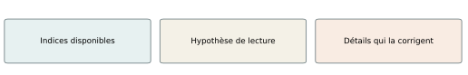
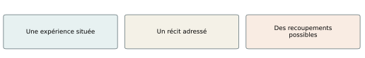

# ENS B/L · Oral de philosophie du 25 juin 2025 · Corrigé brut

*Corrigé rédigé par IA, non officiel. Signalez toute erreur.*

**Rédaction** · GPT-6.2 Astra Ultra · vitesse non renseignée · 26 novembre 2026

Le feuillet officiel réunit 11 billets de deux sujets. Le jury accorde 1 h 30 de préparation. La personne interrogée annonce son choix au passage, puis dispose de vingt minutes d’exposé et de dix minutes d’entretien. Les propositions ci-dessous suivent les billets dans leur ordre et traitent les deux options.

## Billet 1

Sur le feuillet, le jury indique en gras le sujet choisi au passage, **Chercher son intérêt est-il rationnel ?**.

### Science et sagesse

Savoir établir qu’un remède produit généralement un effet ne dit pas encore quelle décision conviendra à une personne dont la situation, les préférences et les risques sont particuliers. La science recherche des connaissances justifiées. La sagesse désigne aussi une manière de juger et de vivre. La seconde complète-t-elle simplement les informations que la première n’a pas encore obtenues ?

Chez Aristote, la sagesse théorique et la prudence pratique entretiennent des rapports distincts avec leurs objets. Une connaissance démonstrative vise ce qui peut être saisi universellement, tandis que la délibération pratique concerne ce qui pourrait être autrement et dépend en partie de nous. Savoir plus sur les conséquences éclaire le choix, sans suffire à ordonner toutes les fins entre lesquelles il faut arbitrer.

La sagesse ne peut cependant se dispenser de se renseigner. Une conduite prétendument sage qui néglige des effets établis manque à sa propre exigence de jugement. Réciproquement, les habitudes scientifiques de contrôle, d’écoute des objections et de reconnaissance de l’incertitude peuvent nourrir une disposition sage. La relation est celle d’une coopération entre exigences distinctes, capable de résister à la prétention de tout trancher par le prestige d’un savoir.

### Chercher son intérêt est-il rationnel ?

Un voyageur gagne quelques minutes en passant devant les autres. Si tous font de même, la file se désorganise et chacun attend plus longtemps. Le geste peut paraître avantageux à court terme et devenir contraire à l’intérêt que chaque voyageur a au fonctionnement de la règle commune. De quel intérêt et de quelle rationalité s’agit-il ?

Une action est rationnelle au sens instrumental si elle utilise des moyens appropriés à une fin, compte tenu des informations disponibles. Cela ne rend pas toutes les représentations de notre intérêt correctes. Le plaisir immédiat, la sécurité future, la réputation et la qualité des relations peuvent entrer en conflit. Une préférence exprimée sous une information erronée peut être révisée sans incohérence.

Il faut enfin distinguer le choix rationnel des moyens et la justification de la fin devant autrui. Une personne peut avoir de bonnes raisons de tenir une promesse coûteuse parce qu’elle reconnaît un droit à son interlocuteur. Rebaptiser « intérêt » toute fin effectivement poursuivie rendrait la thèse impossible à éprouver. Chercher son intérêt peut être rationnel sous certaines hypothèses, mais la raison pratique s’exerce aussi dans l’examen de ce qui mérite d’être cherché.

## Billet 2

Sur le feuillet, le jury indique en gras le sujet choisi au passage, **Qu’est-ce qui est sacré ?**.

### La duplicité

Une personne change d’avis après avoir entendu une objection. Une autre soutient sciemment deux engagements incompatibles auprès d’interlocuteurs qui s’ignorent. Le contraste invite à distinguer le caractère changeant d’une conduite et la duplicité proprement dite.

La duplicité suppose une mise en scène de soi. L’agent maintient plusieurs apparences afin que chacun lui accorde un crédit qu’une connaissance plus complète modifierait. Le dommage tient à l’exploitation de la confiance, même si chaque phrase prise isolément peut recevoir une interprétation vraie. La simple réserve ne suffit pas à établir ce diagnostic. Chacun peut garder une part de vie privée ou adapter ses explications aux compétences d’un public.

Le critère important est ce que l’agent laisse légitimement croire et la manière dont il répondrait si les différents engagements étaient rapprochés. Une fonction exige parfois de séparer des rôles, par exemple pour protéger un secret confié. La duplicité commence lorsque cette séparation sert à obtenir des avantages ou des engagements que l’on sait incompatibles, tout en empêchant autrui de pouvoir juger la situation.

### Qu’est-ce qui est sacré ?

Un objet matériel ordinaire peut être tenu pour sacré dans un lieu, par un groupe et à certaines dates. D’autres biens sont dits sacrés sans appartenir à une religion, comme un droit que l’on refuse de négocier. La sacralité est-elle une propriété de l’objet, un sentiment ou un statut institué ?

Dans *Les Formes élémentaires de la vie religieuse*, Durkheim étudie la distinction du sacré et du profane. Des interdits et des rites mettent à part des choses, organisent leur approche et forment autour d’elles une communauté. La même matière peut donc recevoir des usages très différents. Réduire le sacré à un sentiment privé laisserait incomprise la force des obligations partagées. Réduire la croyance du fidèle à la seule pression collective laisserait de côté le sens qu’il reconnaît à ce qu’il vénère.

L’extension du terme à la dignité humaine révèle une difficulté. Déclarer quelque chose inviolable peut protéger contre l’arbitraire, mais peut aussi fermer toute discussion sur la règle qui l’entoure. Comprendre ce qui est sacré demande d’identifier ce qui est mis à part, par quelles pratiques et avec quelle prétention à obliger.

## Billet 3

Sur le feuillet, le jury indique en gras le sujet choisi au passage, **Que montre un tableau ?**.

### La solidarité

Une panne sur une ligne de transport affecte des personnes qui ne se connaissent pas. Cette interdépendance de fait constitue-t-elle déjà une solidarité, ou faut-il qu’elles prennent aussi en charge certains risques les unes pour les autres ?

La division du travail rend chacun dépendant de fonctions qu’il ne peut remplir seul. Durkheim analyse cette solidarité organique dans *De la division du travail social*. Elle peut être rendue visible par des institutions qui répartissent des responsabilités, des contributions et des droits. Une assurance sociale organise, par exemple, le partage de risques entre personnes qui ignorent lesquelles en auront besoin. Le bénéficiaire dispose alors d’un droit qui ne dépend pas de l’émotion ponctuelle d’un donateur.

L’interdépendance peut pourtant être profondément inégale. Des personnes dépendent d’un acteur capable, lui, de se passer facilement d’elles. Appeler cette relation solidaire risquerait de dissimuler son asymétrie. La solidarité normative demande de décider quelles charges doivent être partagées et qui participe à cette décision. Elle lie une réalité de dépendances à une exigence de réciprocité que les institutions doivent rendre effective.

### Que montre un tableau ?

Devant un portrait on voit à la fois un visage et des zones de peinture sur une toile. Si l’on s’approche assez, un détail que l’on prenait pour un reflet devient une touche de couleur. Que signifie montrer lorsque l’objet représenté n’est pas physiquement présent et que certaines œuvres ne représentent aucun objet identifiable ?

Un tableau organise une surface par des rapports de forme, de couleur et de matière. Dans une œuvre figurative, ces rapports peuvent faire apparaître une scène reconnaissable. Mais ce qu’elle donne à voir dépend des choix de cadrage, d’échelle et de lumière. *Les Ménines* de Velázquez place notamment le spectateur devant des regards et des reflets dont l’agencement interroge la place de celui qui voit.

Une peinture abstraite peut montrer une tension entre surfaces ou entre matière et geste sans cacher derrière elles un message à déchiffrer. Le spectateur peut défendre une lecture en désignant ce qui, dans l’œuvre, la soutient. Un tableau rend donc visible une organisation sensible en même temps qu’il propose, selon les œuvres, des objets et une manière de les regarder.

## Billet 4

Sur le feuillet, le jury indique en gras le sujet choisi au passage, **Qu’est-ce qu’une mauvaise interprétation ?**.

### Le déni

Deux personnes contestent un résultat. L’une demande de refaire une mesure fragile. L’autre déplace sans cesse les critères dès qu’une vérification risque de la convaincre. La première peut exercer un doute légitime. Le déni désigne une difficulté plus profonde à reconnaître ce que certains indices devraient nous conduire à examiner.

Il faut distinguer le déni de la simple ignorance et du mensonge délibéré. Dans le mensonge, un agent peut croire clairement ce qu’il cache à son interlocuteur. Le déni pose précisément la question de la manière dont une information peut être à la fois rencontrée et tenue à distance dans la conduite. Une institution peut aussi accumuler des signalements tout en organisant des procédures qui empêchent leur prise en compte effective.

Toutefois accuser quelqu’un de déni n’est pas une preuve de ce que l’on affirme contre lui. Le diagnostic doit s’appuyer sur des indices indépendants, sur la répétition des réponses et sur l’impossibilité organisée de réviser la conclusion. Répondre au déni exige alors à la fois des faits vérifiables et des conditions permettant de les reconnaître sans réduire l’interlocuteur à une étiquette.

### Qu’est-ce qu’une mauvaise interprétation ?

Deux lectrices défendent des lectures différentes d’un poème. Leur désaccord n’établit pas que l’une a nécessairement échoué. Pourtant une lecture qui omet précisément le vers contredisant sa thèse paraît mauvaise. Peut-on construire des critères d’interprétation sans exiger que tout texte ait une seule signification correcte ?

L’interprète cherche à rendre intelligible un ensemble de traces ou de signes. Une hypothèse acquiert du poids si elle respecte le détail, explique des relations jusque-là obscures et tient compte du genre et des usages contemporains de l’œuvre. Le sens d’une phrase dépend de son contexte, mais le contexte doit à son tour être reconstruit à partir de phrases et d’indices particuliers. Ce va-et-vient peut modifier l’hypothèse première.

Une interprétation devient mauvaise lorsqu’elle s’immunise contre ces corrections, impose au matériau une question étrangère sans le dire ou transforme une conjecture en certitude. La pluralité des lectures demeure compatible avec une comparaison raisonnée. Il faut demander ce qu’une lecture fait voir, ce qu’elle oblige à négliger et ce qui pourrait conduire à lui en préférer une autre.

## Billet 5

Sur le feuillet, le jury indique en gras le sujet choisi au passage, **Pourquoi écrire ?**.

### La résistance

Un matériau résiste à une pression, une personne résiste à une injonction et un groupe peut opposer un refus durable à une institution. Le terme commun désigne ce qui s’oppose à une action sans cesser d’agir à son tour. Mais une résistance physique et une résistance politiquement justifiée ne relèvent pas du même jugement.

Résister suppose d’abord d’endurer ou de contrarier une force qui s’exerce déjà. La portée du geste dépend de ce que l’on entend préserver. Une règle injuste peut rencontrer une résistance légitime, tandis qu’un privilège peut également résister à une réforme équitable. La position de celui qui dit non ne suffit donc pas à lui donner raison. Il faut examiner les droits en jeu, les options ouvertes et les effets du refus sur d’autres personnes.

La résistance peut ensuite devenir inventive. En maintenant des pratiques de parole, d’entraide ou de mémoire, des individus peuvent préserver les conditions d’une vie commune différente. Sa valeur tient alors à l’articulation entre ce qu’elle empêche et ce qu’elle rend possible, sous des formes proportionnées aux fins qu’elle défend.

### Pourquoi écrire ?

Une liste de courses garde une information, une lettre s’adresse à quelqu’un qui est absent, un essai transforme une idée qui était encore confuse avant sa rédaction. Ces usages ont une propriété commune. L’inscription détache la parole de l’instant où elle est formulée et crée un objet auquel on peut revenir.

Dans le *Phèdre*, Platon met en discussion les avantages et les limites de l’écriture. Le texte circule en l’absence de son auteur et ne peut pas répondre de lui-même à toutes les questions qu’il suscite. Cette fragilité permet aussi sa puissance. Un lecteur éloigné peut reprendre une proposition, la confronter à d’autres et la critiquer dans un contexte imprévu. L’écriture donne ainsi une durée publique à des raisons.

Écrire n’est donc pas exclusivement déposer une pensée déjà achevée. La résistance des phrases révèle des lacunes, oblige à choisir une succession et rend une révision possible. Mais ce pouvoir de fixation peut aussi enfermer un jugement dans une formule durablement mal comprise. Demander pourquoi écrire conduit à préciser quel rapport au temps, au lecteur et à la révision réclame ce que l’on veut faire.

## Billet 6

Sur le feuillet, le jury indique en gras le sujet choisi au passage, **Qu’est-ce qui est irréfutable ?**.

### Le cynisme

Une personne appelle « intérêt caché » tout geste généreux et se félicite de ne plus être dupe. Un philosophe cynique de l’Antiquité peut au contraire mettre en cause les conventions afin de vivre conformément à une exigence tenue pour vraie. Le même mot réunit une posture de soupçon et une tradition de critique vécue.

Chez Diogène, tel que la tradition rapporte ses gestes, la provocation vise notamment les besoins artificiels et le prestige social. La critique engage celui qui parle dans une manière d’habiter et de se conduire. Au sens moderne, le cynique peut au contraire continuer à profiter d’une règle qu’il juge injuste tout en déclarant naïveté toute tentative de la changer. Son absence d’illusion proclamée peut alors devenir une manière de se dispenser d’agir.

Le soupçon peut démasquer une hypocrisie réelle. Il devient lui-même dogmatique lorsqu’aucun acte ne pourrait le démentir. Pour apprécier le cynisme, il faut donc demander si sa lucidité ouvre une épreuve des raisons et des conduites, ou si elle réduit d’avance toute conduite aux mêmes intérêts.

### Qu’est-ce qui est irréfutable ?

Une démonstration valide, une affirmation rendue compatible avec n’importe quel résultat et une phrase portant sur une valeur peuvent toutes être dites « irréfutables ». Elles le sont pourtant pour des raisons différentes. L’impossibilité de réfuter constitue-t-elle une preuve de vérité ?

Dans les mathématiques, une conclusion démontrée suit d’hypothèses selon des règles. On peut encore contester une étape ou choisir d’autres axiomes, mais on ne réfute pas la conséquence en présentant une impression contraire. Dans les sciences empiriques, Popper propose de caractériser une théorie testable par ce qu’elle interdit. Si aucune observation possible ne pourrait la mettre en difficulté, sa sécurité apparente peut signaler une faiblesse empirique. L’énoncé « quoi qu’il arrive, mon modèle aura eu raison » ne prend aucun risque informatif.

D’autres propositions demandent des raisons morales ou une interprétation. Leur examen ne se réduit pas à la recherche d’un fait réfutant. Il faut donc préciser le domaine, les règles de preuve et le genre d’objection pertinent. Être irréfuté à ce jour, être démontré et se rendre invulnérable à toute épreuve ont des statuts très différents.

## Billet 7

Sur le feuillet, le jury indique en gras le sujet choisi au passage, **Pourquoi des cérémonies ?**.

### La perfection

Un cercle géométrique peut être défini exactement, tandis que qualifier une interprétation musicale de parfaite n’implique pas que toute autre serait fautive. La perfection signifie-t-elle conformité complète à un modèle ou accomplissement d’une possibilité qui ne possédait pas de modèle préalable ?

Dans un travail réglé, une fin déterminée permet de dire qu’il ne manque rien d’essentiel. Une preuve parfaite sous un certain rapport peut être correcte, complète et assez claire pour être contrôlée. Mais plusieurs présentations valides peuvent servir des lecteurs différents. Le choix des critères fait donc partie du jugement. Il serait incohérent d’exiger qu’un même objet maximise simultanément toutes les qualités imaginables, y compris lorsqu’elles s’opposent.

L’idéal de perfection peut guider une transformation patiente. Il devient paralysant si tout résultat provisoire est jugé sans valeur ou si l’on applique à une vie finie le modèle d’un produit sans défaut. La perfection gagne à être pensée relativement à une activité et à ses exigences légitimes, tout en laissant place à l’invention de formes que les critères anciens ne permettaient pas d’anticiper.

### Pourquoi des cérémonies ?

Une remise de diplôme prend du temps et ne change pas rétroactivement les résultats. Elle accomplit pourtant quelque chose que le relevé de notes seul ne produit pas. Un passage est rendu visible devant un public et reçoit une forme que les participants peuvent reprendre et partager.

Une cérémonie organise l’espace, les gestes et la parole selon des règles reconnues. Dans certains cas, une déclaration rituelle prononcée par la personne habilitée transforme effectivement un statut. Dans d’autres, comme une commémoration, elle fait durer une mémoire commune. Les participants ne sont pas obligés d’éprouver exactement la même émotion pour reconnaître le sens du geste. Cette différence explique comment une forme commune peut soutenir des expériences singulières.

La répétition comporte aussi un risque. Un rite peut imposer une hiérarchie, exclure certaines mémoires ou substituer une manifestation officielle à une réparation attendue. Interroger sa valeur demande de préciser qui y prend la parole, quels effets il produit et si sa signification peut être discutée. Une cérémonie est justifiée lorsqu’une communauté a besoin de donner une forme publique à un événement qui engage ses relations.

## Billet 8

Sur le feuillet, le jury indique en gras le sujet choisi au passage, **Peut-il y avoir de bons tyrans ?**.

### L’aventure

Un retard de train peut bouleverser un programme sans devenir une aventure. Inversement un voyage bien préparé peut rester aventureux si ses participants acceptent que l’expérience transforme leurs projets. L’aventure engage un rapport singulier à l’inconnu, que le simple hasard ne définit pas complètement.

Dans son essai sur l’aventure, Simmel insiste sur le détachement d’un épisode par rapport au cours ordinaire de la vie et sur l’intensité d’un présent qui possède sa propre unité. L’aventurier s’expose à ce qu’il ne contrôle pas tout en essayant d’agir sur le déroulement des événements. Une activité entièrement garantie devient une simulation d’aventure. Une épreuve entièrement subie peut manquer de l’ouverture que suggère ce mot.

Raconter après coup transforme encore l’expérience en lui attribuant un début, des péripéties et une fin. Ce pouvoir du récit impose une prudence. Ce qu’un visiteur nomme aventure peut constituer pour d’autres une insécurité imposée et durable. La valeur de l’aventure dépend de la possibilité de consentir à l’exposition, des responsabilités envers autrui et de la manière dont l’inconnu est accueilli.

### Peut-il y avoir de bons tyrans ?

Un souverain sans contrôle peut prendre une mesure salutaire. Le qualifier de bon tyran semble alors possible si l’on juge un acte ou un caractère. Mais la tyrannie désigne une forme de pouvoir dans laquelle les gouvernés dépendent d’une volonté insuffisamment soumise à des règles communes. Une décision heureuse suffit-elle à rendre bon ce rapport politique ?

L’argument favorable repose sur la compétence et la rapidité. Un dirigeant bien informé peut parfois décider avec efficacité. Reste que la qualité de ses décisions n’est garantie ni par un droit de recours ni par la participation des personnes concernées. L’idée républicaine de liberté comme non-domination éclaire cette différence. Même un pouvoir qui intervient peu rend autrui dépendant lorsqu’il conserve la capacité d’intervenir arbitrairement et sans contrôle.

Si le souverain transforme durablement ses pouvoirs, accepte une juridiction indépendante et rend aux gouvernés la possibilité de contester, il peut accomplir un acte politiquement bon. Il modifie alors précisément ce qui faisait de son régime une tyrannie. On peut reconnaître de bonnes actions sous un pouvoir tyrannique sans en tirer sa légitimité.

## Billet 9

Sur le feuillet, le jury indique en gras le sujet choisi au passage, **La connaissance du singulier**.

### La connaissance du singulier

Pour reconnaître un visage parmi des centaines, il faut discerner des traits qui se retrouvent pourtant sur d’autres visages. Si les concepts classent toujours plusieurs cas, comment connaître cet individu comme tel et non comme un exemplaire interchangeable ?

La connaissance scientifique recherche souvent des régularités. Un médecin en a besoin pour interpréter un symptôme, mais le diagnostic porte sur cette personne, son histoire et des signes particuliers. La règle générale n’épuise pas le cas. Inversement, une impression de familiarité difficile à formuler peut être exacte ou trompeuse. La connaissance du singulier demande des moyens de repérer, de décrire et de recouper ce qui permet l’identification.

L’historien procède de façon instructive. Une lettre, un registre et une trace matérielle peuvent se rapporter au même événement, dont aucune loi générale ne dispense de faire l’enquête. Les concepts rendent comparables les indices. Leur agencement reconstruit une occurrence datée. Le singulier peut ainsi être connu sans être intégralement résumé par une définition universelle ni livré à une intuition privée invérifiable.

### De quoi suis-je inconscient ?

Je conserve mon équilibre en marchant sans calculer chaque mouvement. Une habitude affective peut, elle aussi, orienter mes réactions avant que je ne sache la nommer. Les deux phénomènes échappent à l’attention présente sans posséder nécessairement la même structure.

Il faut distinguer ce qui est simplement absent de mon champ d’attention, ce qui relève de mécanismes corporels auxquels je n’ai pas d’accès direct et ce que l’hypothèse freudienne rapporte à un conflit psychique. Une adresse mémorisée peut me revenir sur demande. Une régularité dans mes choix peut exiger une enquête, la confrontation de récits ou l’observation de situations répétées. Tout ce qui m’est inconnu n’est donc pas un contenu psychique caché dont j’aurais quelque part la connaissance complète.

La question présente un paradoxe fécond. Pour dire de quoi je suis inconscient, je dois pouvoir en identifier quelque effet, mais le fait d’en devenir conscient aujourd’hui ne supprime pas l’influence qu’il exerçait auparavant. La connaissance de soi peut progresser par hypothèses révisables et par le dialogue, sans prétendre rendre entièrement transparente la vie de l’esprit.

## Billet 10

Sur le feuillet, le jury indique en gras le sujet choisi au passage, **Les frontières**.

### Les frontières

Sur une carte, une frontière apparaît comme une ligne. Pour deux personnes munies de documents différents, le même passage peut pourtant être une formalité ou un obstacle durable. La frontière est une institution de séparation et de passage dont les effets dépendent de catégories et de pratiques.

Un territoire défini permet de savoir qui fait la loi, qui répond d’un service et où des droits pourront être invoqués. Une frontière rend aussi possibles des échanges en précisant les conditions de circulation. Mais le même principe peut produire des inégalités de mobilité et soustraire certaines personnes à l’accès effectif à des droits. Son existence historique et politique ne la rend ni arbitraire en tout point ni naturellement juste.

Le terme s’étend aux langues et aux disciplines. Il désigne alors des distinctions qui organisent le travail et peuvent être traversées ou déplacées. Dans les deux domaines, supprimer verbalement la frontière n’efface pas les obstacles réels. Le jugement doit porter sur ce qui est distingué, ceux qui décident du franchissement et les raisons pour lesquelles certaines différences deviennent des empêchements.

### Faut-il aimer la vie ?

Recommander d’aimer la vie peut exprimer une invitation à remarquer ce qui mérite notre attention. Présenter cet amour comme un devoir soulève une difficulté. Peut-on ordonner un sentiment et juger fautive une personne qui traverse une période difficile ?

Il est possible de cultiver des dispositions par des liens, des habitudes et une attention au présent. Ce pouvoir indirect n’autorise pas à exiger une adhésion affective immédiate à toute situation. Aimer vivre ne signifie pas tenir chaque circonstance pour bonne. Le refus d’une injustice et la recherche de conditions plus habitables peuvent exprimer précisément un attachement à la valeur de l’existence.

Il convient encore de distinguer l’affection spontanée et le devoir pratique de prendre soin des êtres vivants, de soi et des autres. Une communauté peut rendre plus accessibles les relations et les possibilités qui donnent du prix à la vie. Lui revient alors une tâche concrète de soutien. L’invitation à aimer la vie garde un sens comme ouverture à des biens possibles, à condition de ne pas se transformer en reproche adressé à celui qui peine à les éprouver.

## Billet 11

Sur le feuillet, le jury indique en gras le sujet choisi au passage, **Art et interdit**.

### Art et interdit

Une exposition peut interdire au public de toucher une œuvre et lui proposer dans le même temps une œuvre qui conteste une norme sociale. L’interdit désigne donc aussi bien une condition de conservation, une règle interne à une pratique ou une limite imposée à ce qui peut être montré.

Une contrainte artistique peut stimuler la recherche. Renoncer à telle couleur ou à tel procédé fait apparaître d’autres ressources et rend un choix perceptible. La censure, elle, porte sur l’accès public à une expression. Une œuvre peut mettre en question des institutions et faire entendre un point de vue jusqu’alors exclu. Mais la simple transgression n’atteste pas la valeur artistique ni la légitimité de toutes les conditions de production. Le consentement des personnes représentées et les droits des participants peuvent faire surgir des obligations déterminées.

Le jugement doit donc distinguer qui interdit quoi, à qui et selon quelle procédure. L’art a besoin d’une liberté d’exploration et d’interprétation. La défendre demande de nommer précisément les atteintes à cette liberté et d’examiner les droits qu’une œuvre peut elle-même mettre en jeu.

### Qu’est-ce qu’un témoin ?

Une caméra enregistre une scène. Une personne qui y assistait accepte de rapporter ce qu’elle a vu et de répondre aux questions sur sa position. Les deux sources peuvent fournir des traces, mais le témoin engage une parole adressée à quelqu’un qui n’a pas nécessairement eu accès à l’événement.

Son autorité dépend d’abord d’une présence ou d’un accès déterminés. Il doit pouvoir distinguer ce qu’il a vu, ce qu’on lui a raconté et ce qu’il a inféré. Le point de vue est limité, la mémoire peut changer et le récit sélectionne des détails. Ces limites justifient le recoupement avec d’autres paroles ou des traces matérielles. Elles ne rendent pas le témoignage inutile, notamment lorsque des événements laisseraient autrement peu de documents.

Témoigner comporte enfin un engagement de véracité. Le destinataire accorde une confiance qui peut être questionnée sans traiter d’avance la personne comme mensongère. Un bon examen cherche les conditions dans lesquelles un récit peut être tenu pour fiable et laisse la possibilité de préciser ou de corriger un souvenir. La qualité de témoin allie ainsi une situation, une adresse et une responsabilité.

[Feuillet du 25 juin 2025](https://www.ens.psl.eu/sites/default/files/philosophie_25_juin.pdf) · [Rapport annuel du jury de philosophie](https://www.ens.psl.eu/sites/default/files/2025_bl_rapport_oral_philosophie.pdf)
