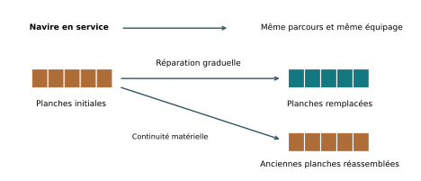
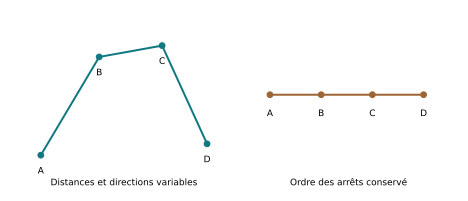
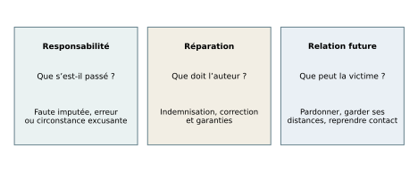

# ENS B/L · Philosophie 2025 · Onze autres tirages du jury · Corrigé guidé

*Corrigé rédigé par IA, non officiel. Signalez toute erreur.*

**Rédaction** · GPT-6.2 Astra Ultra · vitesse non renseignée · 26 novembre 2026

La page 6 du rapport de l’oral commun donne ces onze billets sans date individuelle. Pour chacun, la mention du sujet retenu reproduit le choix de la candidate ou du candidat, indiqué en gras dans le rapport. Chacune des deux propositions de ce billet reçoit un exposé indépendant.

Le jury prévoit 1 h 30 de préparation sans ouvrage, 20 minutes d’exposé sur le sujet choisi et 10 minutes de questions. On peut préparer l’oral en développant les situations analysées, en expliquant les références et en éprouvant chaque réponse sur un cas nouveau.

Sur votre brouillon, formulez une difficulté unique que le libellé oblige à résoudre. Reprenez chaque exemple en distinguant ce qu’il établit, l’objection qu’il soulève et la réponse qui rend possible la suite de l’exposé. Gardez un temps de préparation pour la conclusion et les questions du jury.

## Billet 1

Sujet retenu à l’oral selon le rapport du jury — **Que disent les légendes ?**

### Être et devenir

> [!INDICATION]
> Demandez ce qui subsiste quand on déplace une statue et quand on en fond le bronze. Puis testez le même critère sur une mélodie.

On dit d’un enfant qu’il est devenu adulte. Pour affirmer le changement, on doit pouvoir désigner le même individu avant et après. Pourtant, si tout était demeuré identique, rien ne serait devenu autre. Le problème porte sur le statut du sujet de cette phrase. Est-ce un être tout constitué auquel surviennent des changements, ou son existence même se fait-elle dans le devenir ?

**Ce qui demeure rend le changement intelligible.** Comparons une statue déplacée avec du bronze fondu pour produire une cloche. Dans le premier cas, la statue existe avant et après le déplacement. Dans le second, la même matière entre dans deux objets successifs. La distinction aristotélicienne entre matière, forme et privation permet de demander sous quel rapport quelque chose persiste et sous quel rapport une détermination apparaît. La puissance désigne une capacité déterminée. Une graine peut devenir un arbre par un développement dont le bronze est incapable. Le devenir acquiert ainsi un sens positif entre la détermination présente et celle qui advient.

**Certaines permanences résultent elles-mêmes d’une activité.** Un organisme vivant renouvelle sa matière. Si son identité tenait à la conservation de toutes ses parties, il cesserait continuellement d’être lui-même. Sa relative stabilité tient à des opérations qui se poursuivent. Imaginons ensuite une mélodie. On peut isoler chacune de ses notes sur une portée. Quand la seconde résonne, la première se prolonge dans la manière dont nous entendons l’intervalle. Bergson appelle durée cette succession où les moments se pénètrent. Une liste d’états ponctuels donnerait les hauteurs et les dates, tout en laissant échapper la phrase entendue.

Le paradoxe du bateau de Thésée précise la difficulté. Chaque planche est remplacée après usure et le bateau reste en service. Si l’on reconstitue ailleurs un navire avec les anciennes planches, le critère matériel désigne celui-ci, tandis que la continuité d’usage désigne le premier. On peut répondre différemment selon que l’on enquête sur l’origine du bois ou sur l’histoire d’un équipage. Cette distinction n’abolit pas le problème d’identité. Elle oblige à justifier le critère sous lequel on parle du même être.

**L’identité dépend de ce dont on suit l’histoire.** Deux exécutions d’une mélodie peuvent présenter la même organisation et constituer deux événements. Un engagement pris il y a dix ans peut encore obliger quelqu’un dont les dispositions ont changé. La continuité pertinente tient ici à une histoire publiquement reconnaissable, comprenant une parole donnée et quelqu’un à qui elle s’adressait. On peut donc concevoir l’être comme un principe de détermination qui permet d’identifier un devenir. Pour un vivant ou pour une personne, ce principe se maintient en partie par ce que cet être fait et traverse.

**Entretien.** Un changement absolument total pourrait-il être décrit ?

Le décrire exige déjà un repère, par exemple un lieu, une histoire causale ou la comparaison de deux états. Ce repère peut appartenir à l’enquête sans être une substance matériellement inchangée.

### Que disent les légendes ?

> [!INDICATION]
> Choisissez un lieu montré au visiteur. Distinguez la date du lieu, celle du récit et celle de l’usage public que vous analysez.

Une ville conserve l’histoire d’un saint qui aurait sauvé ses habitants. L’historienne demande quels témoins établissent l’événement. L’enfant qui écoute demande pourquoi les habitants ont promis de se réunir chaque année. Ces deux questions portent sur le même récit. Quelle sorte de vérité celui-ci propose-t-il lorsque la vérification de son intrigue reste incertaine ?

**Un récit transmet une prétention sur le passé.** La légende s’attache volontiers à une personne, un lieu ou une trace visible. On montre un rocher puis on raconte comment il aurait reçu sa forme. Cette liaison donne prise à la mémoire et confère au récit une autorité. Elle présente aussi un risque de cercle. Si l’on identifie le rocher grâce à la légende, le rocher ainsi nommé ne suffit pas à prouver l’histoire. Il faut dater les témoignages, comparer les versions et demander ce qui aurait pu les faire diverger. Plusieurs récits qui proviennent d’une même source comptent comme une transmission.

**Raconter configure ce qu’une communauté juge mémorable.** Les versions de la fondation de Rome que rapporte Tite-Live au premier livre de son histoire associent la naissance de la ville à la rivalité des frères. La mort de Rémus donne à la limite urbaine un sens politique. Franchir cette limite est un défi à l’autorité en train de s’instituer. Le récit présente aussi une difficulté que la célébration de la fondation pourrait masquer. Un meurtre fraternel accompagne l’institution d’une communauté. Les variantes et le doute rapportés par le narrateur ouvrent un espace à l’interprétation.

Imaginons deux versions d’une fête de fondation. La première attribue le salut de la ville à un prince, la seconde à des bateliers qui ont transporté les vivres. La différence importe même si les deux motifs sont historiquement incertains. Le premier récit concentre l’initiative et le second en répartit la mémoire. Une enquête peut chercher depuis quand les bateliers y figurent et qui a porté cette version. Elle fait alors l’histoire de la légende sans prétendre établir d’emblée celle du sauvetage.

**L’usage présent de la légende engage une responsabilité.** Une même histoire peut accueillir un nouvel habitant à une fête, légitimer le pouvoir d’une famille ou faire taire la mémoire des vaincus. Rechercher qui la raconte, dans quelles circonstances et avec quelles variantes précise ce qu’elle fait entendre aujourd’hui. On peut reconnaître cette efficacité symbolique et contester une affirmation factuelle dès lors qu’elle est invoquée pour établir un droit ou une culpabilité. Les légendes disent ainsi ce qu’un groupe a voulu rendre transmissible. Leur pluralité permet aussi de rouvrir la dispute sur l’héritage transmis.

**Entretien.** La légende peut-elle servir de source à l’histoire ?

Oui. Une version datée atteste qu’une histoire circulait sous telle forme et dans tel milieu. Établir l’événement qu’elle raconte demande une enquête supplémentaire.

## Billet 2

Sujet retenu à l’oral selon le rapport du jury — **La danse**

### La danse

> [!INDICATION]
> Mettez en regard un pas appris, le même pas dansé à deux et sa reprise en spectacle. Cherchez ce qui change pour le corps et pour celui qui regarde.

Le voyageur court pour prendre son train. Une interprète peut reprendre cette course sur scène et l’intégrer à une danse. Les mouvements pourraient être presque identiques sur une suite de photographies. Où passe la différence entre un déplacement du corps et un geste dansé ?

**Le mouvement devient lui-même un objet d’attention.** Dans la course à la gare, le parcours s’achève lorsque le voyageur est arrivé. Dans une phrase dansée, une suspension qui retarde l’arrivée peut être précisément ce qui importe. La danse organise des poids, des directions, des reprises. Elle peut employer une chute sans faire de l’arrivée au sol son but principal. Paul Valéry, dans *Philosophie de la danse*, interroge cette dépense qui institue un temps réglé par l’activité elle-même. Un mouvement apparemment inutile pour le transport devient nécessaire à la phrase. Une ronde de fête, sans scène ni public extérieur, répond déjà à ce critère.

**L’apprentissage transforme ce que le corps peut percevoir et entreprendre.** La danseuse débutante compte les temps et surveille ses pieds. Une fois le pas acquis, elle peut sentir une légère avance de sa partenaire et infléchir l’appui. La notion d’habitude corporelle chez Merleau-Ponty éclaire ce gain. Le corps s’approprie une manière de répondre à une situation. Il ne déroule pas une série de commandes qu’un esprit devrait contrôler une à une. Une technique rigoureuse peut ainsi rendre possible une improvisation plus attentive.

Reprenons la course sur scène. Une première interprète traverse l’espace seule. Une seconde reprend la phrase en sens inverse au moment où la première s’arrête. Ce qui paraissait une urgence individuelle devient un appel ou une poursuite, selon le rythme et le regard. Rien n’oblige l’auditoire à raconter une histoire déterminée. Il peut néanmoins discuter de ce qu’il a vu en désignant la distance maintenue, le silence à l’arrêt et l’instant de la reprise. Le sens du geste est ainsi discutable publiquement.

**Le mouvement crée des relations exposées à l’interprétation.** Dans un duo, tendre le bras peut inviter, repousser ou soutenir. Le geste reçoit du sens de ce qui le précède et de la réponse de l’autre. Une notation conserve des contraintes et permet de reprendre l’œuvre, mais plusieurs interprètes feront sentir différemment le poids d’une attente. La danse peut avoir un rôle religieux, social ou politique sans se réduire à un message traduisible en phrases. Ce qu’elle donne à comprendre tient alors à l’organisation partagée d’un temps, d’un espace et de corps capables d’y répondre.

**Entretien.** Une danse immobile est-elle concevable ?

Une suspension tenue conserve la tension du mouvement qui la précède et peut préparer une reprise. Le contexte et l’attention à l’appui permettent de distinguer cet arrêt d’un simple repos.

### Est-il difficile d’être heureux ?

> [!INDICATION]
> Éprouvez successivement une définition du bonheur sur une faim satisfaite, une amitié durable et un deuil.

On peut accomplir une tâche difficile avec plaisir et passer une journée confortable à regretter la vie que l’on mène. La difficulté du bonheur n’est donc pas mesurée par le seul effort du moment. Que faudrait-il réussir pour être heureux, et quelle part de cette réussite dépend de nous ?

**Nos désirs fournissent à la fois un mobile et un obstacle.** Chaque satisfaction semble indiquer ce dont nous avions besoin. Pourtant, le succès qui procure de la joie peut devenir la nouvelle mesure à dépasser. Dans la *Lettre à Ménécée*, Épicure distingue notamment les désirs naturels et nécessaires des désirs dont l’objet dépend d’une opinion sans limite. Manger met fin à une faim déterminée. Vouloir être admiré davantage que tous laisse dépendre sa satisfaction d’un classement toujours susceptible de changer. Examiner le désir peut rendre le bonheur moins difficile en supprimant une épreuve qui se renouvelle indéfiniment.

**Régler son désir n’abolit pas la vulnérabilité.** Une amitié est une source de joie parce qu’un autre être compte pour lui-même. Exiger d’avance que sa perte nous laisse indifférent changerait la qualité du lien. Aristote, dans l’*Éthique à Nicomaque*, inscrit le bonheur dans l’activité d’une vie et reconnaît la part des biens extérieurs. La maladie, le deuil et l’insécurité matérielle peuvent restreindre les possibilités d’agir ensemble. Transformer cette vulnérabilité en faute morale reviendrait à rendre une personne responsable de circonstances qu’elle subit.

Une personne se dit heureuse d’avoir terminé une épreuve épuisante alors qu’une autre est heureuse de poursuivre un travail encore inachevé. Dans le premier cas la joie suit la disparition d’un mal. Dans le second, le bien est déjà dans l’exercice d’une capacité, par exemple apprendre à traduire un texte difficile. Si l’on définissait tout bonheur par le repos qui succède à un effort, on manquerait ce second cas. Il invite aussi à demander si les institutions donnent à chacun du temps et des occasions d’exercer les capacités qui lui importent.

**Un bonheur poursuivi comme une performance risque de se dérober.** Si, au milieu d’une conversation heureuse, je vérifie à tout instant si je suis assez heureux, je retire de l’attention à mon interlocuteur. Certaines conditions se travaillent indirectement, en entretenant des amitiés, en organisant un temps habitable et en agissant sur les conditions communes. Le bonheur reste difficile parce qu’il engage une vie entière et des biens fragiles. Une partie de cette difficulté cède lorsqu’on cesse d’exiger la maîtrise de son état affectif à tout instant.

**Entretien.** Une vie heureuse peut-elle comporter un chagrin profond ?

Oui, si le jugement porte sur la qualité d’une vie et de ses liens. Cette réponse laisse au chagrin sa réalité et permet de demander quand une épreuve prive durablement quelqu’un des conditions d’une vie heureuse.

## Billet 3

Sujet retenu à l’oral selon le rapport du jury — **La pertinence**

### La pertinence

> [!INDICATION]
> Écrivez une réponse vraie mais hors sujet, puis un renseignement incertain qui oriente réellement l’enquête. Cherchez la différence.

Une élève répond exactement à une question que personne ne lui a posée. Toutes ses phrases sont vraies et son intervention manque pourtant sa cible. Qu’ajoute la pertinence à la vérité, et comment en juger lorsque l’enjeu même d’une discussion est contesté ?

**La pertinence se rapporte à une question et à des alternatives.** Un train part à huit heures. L’information convient à qui cherche à arriver avant midi si l’on connaît aussi la durée du trajet. Elle laisse intact le doute de qui cherche à savoir si la gare est accessible. Dans une enquête, un indice est pertinent lorsque sa présence ou son absence modifie la comparaison entre des hypothèses. Un détail spectaculaire peut attirer l’attention sans rien changer à cette comparaison. Il faut donc préciser ce que l’information permet de départager et pour qui cette distinction compte.

**La conversation s’appuie sur des attentes révisables.** Dans son analyse de la coopération conversationnelle, Grice explique pourquoi une réponse indirecte peut faire avancer l’échange. À quelqu’un qui demande où acheter du pain, répondre « les volets de la boulangerie sont ouverts » lui fournit une raison de s’y rendre, à condition que les interlocuteurs partagent certaines connaissances. Si le commerce ferme pour travaux, la même observation perd une partie de sa valeur. Une intervention pertinente peut ainsi rester conjecturale. La prudence commande de rendre perceptible le degré de confiance que mérite l’implication suggérée.

Un juré apprend que le prévenu était désagréable avec ses voisins. Le détail peut être vrai et facile à mémoriser. Reste à établir quel rapport il entretient avec l’acte dont le tribunal juge. Une règle de pertinence protège ici contre une inférence de caractère qui rendrait toute accusation plus vraisemblable sans élément propre aux faits. Un détail banal, par exemple une heure d’ouverture vérifiable, peut avoir bien plus de portée. Le jugement de pertinence doit être argumenté à partir des alternatives en présence.

**Contester une question peut être la réponse la plus pertinente.** Une administration compare deux services d’après la durée moyenne du traitement des dossiers. L’un traite des demandes beaucoup plus complexes. Demander la répartition des cas paraît déplacer la discussion, mais cette demande examine la possibilité même d’imputer le délai à la qualité du service. Il existe ainsi une pertinence interne à un problème et une pertinence critique qui en rectifie les présupposés. La seconde doit montrer en quoi le déplacement change effectivement le jugement. La pertinence est l’art justifiable de sélectionner ce qui fait une différence pour l’enquête commune.

**Entretien.** Une information fausse peut-elle être pertinente ?

L’hypothèse que le train est annulé porte sur le bon problème et mérite vérification. L’affirmer malgré sa fausseté induit le voyageur en erreur. Il faut distinguer la pertinence du contenu envisagé et sa valeur comme renseignement.

### En quoi la patience est-elle une vertu ?

> [!INDICATION]
> Comparez le maître qui laisse chercher et l’employeur qui exige d’attendre. Demandez dans chaque cas qui décide du délai.

Attendre devant une injustice peut l’aggraver. Se hâter de corriger un apprentissage peut empêcher l’élève de comprendre. Le temps écoulé ne fait pas la qualité d’une conduite. Quel rapport au temps mérite le nom de patience et dans quelles conditions contribue-t-il au bien agir ?

**La patience maintient une fin lorsque son accomplissement exige du temps.** Le jardinier peut préparer le sol et arroser. Tirer sur la tige pour accélérer la croissance détruirait ce qu’il cherche à produire. Son attente possède un contenu actif, fait d’observation, de reprises et d’ajustements. Dans la relation pédagogique, laisser un élève finir une tentative peut révéler l’obstacle précis qu’une correction immédiate aurait dissimulé. La patience règle ici l’exercice d’une puissance dont une intervention trop prompte compromettrait l’objet.

**La durée supportée peut aussi traduire une contrainte.** La personne qui attend le versement d’un salaire déjà dû subit une dépendance. Lui demander d’être patiente peut favoriser celui qui dispose des ressources. Une vertu doit pouvoir être rapportée à un jugement de l’agent, sur les raisons qu’il a de différer telle action et sur les conséquences pour autrui. La distinction aristotélicienne entre vertu de caractère et simple disposition affective aide à comprendre le rôle de la prudence. Ni l’impatience ressentie ni le calme apparent ne décident à eux seuls du moment opportun.

Supposons qu’un élève reste silencieux après une question. L’enseignante peut lui laisser le temps de chercher, reformuler l’énoncé ou lui proposer une première étape. La patience ne recommande pas automatiquement le premier choix. Observer que le silence provient d’une consigne mal comprise donne une raison d’intervenir. Le délai acquiert donc son sens à partir d’une hypothèse corrigible sur ce qui est en train de se former. Ce caractère attentif explique que la patience puisse commander une initiative rapide.

**Savoir patienter comporte une règle de réexamen.** Dans une négociation, convenir d’un délai permet à l’autre de faire vérifier une proposition. Une échéance, des mesures provisoires et des indices d’avancement permettent aussi d’identifier le moment où prolonger l’attente exposerait quelqu’un à un tort évitable. La patience peut alors préparer une action ferme. Elle est une vertu en tant qu’elle conserve la capacité d’agir tout en accordant aux choses et aux personnes le temps que leur bien exige. C’est précisément pourquoi elle cesse de mériter l’éloge lorsque l’attente sert une domination.

**Entretien.** Peut-on être patient tout en protestant ?

Une protestation peut faire cesser un tort immédiat et ouvrir un travail de longue durée. Le jugement porte sur l’action que l’on diffère, le motif du délai et la personne qui en supporte le coût.

## Billet 4

Sujet retenu à l’oral selon le rapport du jury — **Hésiter**

### Hésiter

> [!INDICATION]
> Demandez ce que l’attente pourrait apprendre dans chaque exemple. Cherchez ensuite un choix dont seul l’accomplissement peut révéler la portée.

Devant deux routes, je peux ignorer laquelle mène au village, ou le savoir et ne pas parvenir à quitter la personne qui m’accompagne. Dans les deux cas ma marche s’interrompt. Pourtant une carte ne résoudrait que le premier problème. Que fait celui qui hésite et jusqu’où peut-il attendre de la réflexion qu’elle décide à sa place ?

**L’hésitation ouvre un intervalle entre une sollicitation et un acte.** À la différence du réflexe, elle me permet de me représenter ce qui arriverait si j’agissais autrement. Elle indique parfois précisément quelle information manque. Si l’un des chemins est inondé, vérifier l’état du pont modifie raisonnablement la décision. Une hésitation peut ainsi manifester une sensibilité accrue à la situation. Le médecin qui suspend un jugement pour examiner un symptôme supplémentaire exerce une compétence.

**Certaines alternatives ne se comparent pas sur une échelle toute faite.** Choisir un métier peut changer les habitudes et les relations à partir desquelles je porte aujourd’hui mon jugement. Attendre de connaître d’avance la personne que je serai une fois formé est demander à la décision de précéder sa propre histoire. Dans l’*Éthique à Nicomaque*, Aristote distingue la délibération, qui examine ce qui est en notre pouvoir, du choix qui reprend cette recherche dans un désir délibéré. Énumérer à l’infini des raisons laisse entière la question de celle à laquelle je consens à donner suite.

Une commune hésite à fermer temporairement une route après une inspection ambiguë. Elle peut différer une réfection définitive, limiter provisoirement la circulation et commander un second examen. Ce choix décompose une alternative qui paraissait obliger à agir ou à attendre en bloc. Si le second examen prend six mois, les restrictions ont elles-mêmes des effets à justifier. L’hésitation devient rationnelle lorsqu’on discerne des décisions de durée et de réversibilité différentes au lieu de suspendre indéfiniment toute prise de responsabilité.

**Décider peut prolonger intelligemment l’hésitation.** Dans la troisième partie du *Discours de la méthode*, Descartes évoque des voyageurs égarés dans une forêt. Changer sans cesse de direction les empêche d’en sortir. La résolution autorise une conduite suivie dans un monde où l’action n’attend pas la certitude. Cette maxime perdrait son sens si le voyageur refusait de regarder une carte nouvellement découverte. Agir par étapes, fixer ce qui conduirait à réviser le choix et tenir compte du coût du délai permettent de distinguer la résolution de l’entêtement. Hésiter est fécond lorsqu’on peut dire ce que l’intervalle doit permettre d’éprouver.

**Entretien.** Choisir au hasard est-il toujours un aveu d’échec ?

Si deux options sont réellement équivalentes et qu’attendre leur fait perdre leur valeur, un tirage au sort règle légitimement la décision. Il convient d’abord d’examiner les intérêts d’autrui qui pourraient rompre cette équivalence.

### La connaissance suppose-t-elle une éthique ?

> [!INDICATION]
> Testez le verbe « suppose » sur trois objets différents, une proposition vraie, une croyance justifiée et une enquête autorisée.

Deux personnes appliquent correctement le même calcul. L’une a volé son cahier, l’autre a inventé une partie des mesures dont elle annonce le résultat. Ces fautes n’affectent pas le savoir de la même manière. En quel sens des exigences morales peuvent-elles être des conditions de la connaissance elle-même ?

**La vérité d’un énoncé et la conduite de celui qui le prononce répondent à des questions distinctes.** Une démonstration valide demeure vérifiable si son auteur s’est mal conduit. Disqualifier un résultat par la seule réputation de son auteur dispense abusivement d’en examiner les raisons. Réciproquement, la sincérité d’un témoin ne garantit pas l’exactitude de ses souvenirs. Il faut donc résister à une assimilation entre mérite personnel et compétence à connaître.

**Le passage de la conviction au savoir rend cependant certaines conduites indispensables.** Si la chercheuse présente seulement les mesures favorables, le calcul peut être impeccable et la conclusion sans justification. Conserver les données, expliciter la sélection et permettre à d’autres de discuter l’inférence rendent possible une correction qui dépasse le for intérieur. Dans ses travaux sur les normes de la science, Robert Merton décrit notamment la mise en commun des résultats et le scepticisme organisé. Ce sont des attentes institutionnelles. Des archives consultables ou la possibilité de publier un résultat négatif leur donnent un effet que la seule exhortation à être honnête n’aurait pas.

Une expérience réussit dans un seul laboratoire. Communiquer les méthodes et les échecs permet à une autre équipe d’examiner si le résultat dépend d’un appareil local. Supposons toutefois que les cahiers contiennent des informations médicales identifiantes. Livrer intégralement les données au public compromettrait les personnes. Un accès contrôlé et des vérifications indépendantes peuvent répondre aux deux exigences. L’éthique de la connaissance demande ici de construire des dispositifs capables d’articuler contrôle des raisons et protection des participants.

**Il faut enfin examiner ce que l’enquête fait aux personnes dont elle parle.** Un entretien obtenu sous pression peut produire des réponses conformes aux attentes du supérieur présent dans la salle. Protéger la parole contribue ici à sa fiabilité. Dans d’autres cas, un procédé pourrait apprendre quelque chose tout en demeurant moralement inadmissible. Le consentement ne se déduit pas de l’utilité scientifique attendue. La connaissance suppose donc une éthique en plusieurs sens inégalement forts. Des vertus et des institutions de vérification soutiennent la qualité des raisons. Une éthique de la recherche fixe aussi des limites à ce qu’il est permis d’entreprendre au nom du savoir.

**Entretien.** Une découverte accidentelle suppose-t-elle déjà ces vertus ?

L’événement heureux peut survenir sans intention méthodique. Transformer la surprise en résultat connaissable demande à l’enquêteur et à ses lecteurs un travail de description, de vérification et de correction.

## Billet 5

Sujet retenu à l’oral selon le rapport du jury — **L’attente**

### L’attente

> [!INDICATION]
> Comparez deux files de même durée, l’une avec un horaire fiable, l’autre sans aucune annonce. Relevez les possibilités d’action qui changent.

Sur le quai, dix minutes mesurées à la montre paraissent beaucoup plus longues lorsque toute annonce a disparu. Je n’attends pourtant pas nécessairement que le temps passe. J’attends quelqu’un ou quelque chose dont la venue importe. Comment un avenir absent peut-il structurer aussi puissamment le présent ?

**L’attente est une manière d’habiter l’intervalle.** Celui qui attend un ami reconnaît un pas parmi les bruits de la rue et regarde plus attentivement certaines silhouettes. Une même scène perceptive s’organise à partir de l’événement attendu. Au livre XI des *Confessions*, Augustin décrit la récitation d’un chant connu. Ce qu’on anticipe passe par l’attention présente et entre progressivement dans la mémoire. Cette analyse éclaire la continuité vécue d’un acte temporel. Dans l’attente ordinaire, cependant, on ignore souvent si l’événement aura lieu. Cette incertitude marque la différence avec le chant déjà appris.

**Le pouvoir de faire attendre se distribue inégalement.** Un service qui reporte un rendez-vous sans en fixer le prochain terme prive l’usager de la possibilité d’organiser son travail ou son déplacement. Même si la durée finale reste identique, une date connue ménage une liberté de préparer autre chose. Chez Beckett, dans *En attendant Godot*, la promesse d’une venue toujours différée organise gestes, conversations et recommencements. La pièce fait éprouver ce que devient l’action lorsque la confirmation de son sens est suspendue à quelqu’un qui n’arrive pas.

Un hôpital avertit une famille qu’un médecin parlera après l’examen en cours et qu’un personnel identifié pourra la tenir informée. Il ne peut promettre l’issue de cet examen. Il peut cependant transformer une attente abandonnée en attente accompagnée. Une information fiable sur le déroulement présent modifie ce que la famille peut décider, sans supprimer l’incertitude sur l’avenir. L’exemple fait apparaître une obligation envers celui qu’on fait attendre, même lorsque personne ne maîtrise le terme de l’événement attendu.

**Attendre peut devenir une pratique de disponibilité ou de résistance.** Veiller auprès d’un proche consiste à se tenir prêt sans pouvoir produire soi-même le mieux attendu. On peut lire, parler ou se taire selon ce que requiert le présent. À l’inverse, une collectivité peut refuser une attente indéfiniment imposée en exigeant un échéancier. La qualité d’une attente dépend du pouvoir qu’on conserve d’y agir et d’en revoir la raison. Elle dévoile à la fois notre orientation vers le possible et la dépendance dans laquelle ce possible peut nous tenir.

**Entretien.** L’ennui est-il toujours de l’attente ?

On peut s’ennuyer sans rien attendre de déterminé. Si l’on se met à guetter la fin d’un discours, l’ennui se donne alors un horizon précis et prend la forme d’une attente.

### Un jeu peut-il être sérieux ?

> [!INDICATION]
> Comparez le mouvement interdit, la faute involontaire et le refus de continuer. Précisez qui peut réclamer quoi dans chaque cas.

Deux personnes consacrent des années aux échecs et s’assoient devant une position qu’elles auraient pu quitter en quelques minutes. L’une regrette profondément une faute, les deux reconnaissent qu’elles jouaient. Le sérieux exige-t-il qu’une activité se rapporte à une fin extérieure, ou qualifie-t-il déjà une certaine manière de répondre de ce qu’on fait ?

**Jouer crée des raisons d’agir propres à l’activité.** On pourrait déplacer la tour en diagonale pour gagner un temps précieux. Un tel déplacement supprimerait la position dont le joueur cherche la solution. Les règles rendent possibles des réussites et des difficultés qui n’existent que dans le jeu. Huizinga, dans *Homo ludens*, insiste sur le temps et l’espace distincts qu’institue l’activité ludique. Le participant accepte d’y prendre ses mouvements au sérieux, précisément pour qu’un échange et une incertitude puissent se produire. La gravité de l’expression du visage en dit peu sur cette fidélité au jeu.

**Une conséquence réelle peut entrer dans la partie et en transformer le sens.** Dans le sport professionnel, un contrat et un revenu dépendent du résultat. Pour le joueur, la compétition peut à la fois constituer un métier et conserver des défis internes. À l’inverse, demander à un enfant de jouer en le punissant chaque fois qu’il perd trouble la possibilité de consentir au défi et de recommencer. Ce qui menace le jeu tient ici au pouvoir exercé sur le participant. Une issue peut avoir des conséquences durables sans effacer automatiquement les règles que les joueurs reconnaissent.

Dans une partie d’échecs entre débutante et joueuse expérimentée, cette dernière peut proposer avant le départ de se priver d’une pièce. Les deux jouent ensuite sérieusement selon la situation acceptée. Si, en cours de partie, elle laisse discrètement gagner sa partenaire, elle risque de rendre incompréhensible la valeur du résultat. Adapter publiquement les contraintes peut donc approfondir le jeu, tandis qu’une manipulation bien intentionnée retire à l’autre la possibilité de mesurer ses progrès.

**Le jeu sérieux permet d’éprouver des engagements dans un cadre révisable.** Au théâtre ou dans un jeu de rôle, une décision fictive peut faire apparaître une difficulté morale réelle. Pour qu’un exercice collectif de simulation instruise, il faut ensuite examiner ce que les règles ont rendu visible et ce qu’elles ont exclu. Gagner dans une simulation de gestion ne prouve pas que la même décision conviendra à une ville réelle. Le sérieux du jeu tient à la qualité de l’attention et des engagements assumés, à condition de savoir à quel moment la partie commence, qui peut la quitter et ce que son résultat autorise à conclure.

**Entretien.** La triche prouve-t-elle qu’on prend le jeu au sérieux ?

Elle peut prouver qu’on tient au classement ou à la récompense. Elle compromet la difficulté partagée qui donnait au classement sa valeur, ce qui permet de distinguer deux objets du sérieux.

## Billet 6

Sujet retenu à l’oral selon le rapport du jury — **L’éphémère**

### L’éphémère

> [!INDICATION]
> Pour le concert, l’archive administrative et le message privé, dites ce que la trace conserve, et à qui profite sa disparition.

Une trace de buée disparaît en quelques secondes. Une fête annuelle est aussi dite éphémère, bien qu’on puisse la retrouver l’année suivante. La brièveté objective suffit-elle à caractériser l’éphémère ou faut-il que la disparition fasse partie de la manière dont quelque chose nous apparaît et vaut pour nous ?

**Une durée devient brève relativement à un processus et à une attente.** La floraison d’un arbre dure peu au regard de sa vie. Cet intervalle concentre pourtant une activité biologique décisive. Pour le visiteur, le caractère éphémère tient aussi au fait que, s’il revient trop tard, il aura manqué cette floraison-ci. L’annuelle répétition du cycle ne restitue pas l’événement passé. Distinguer le type reproductible et l’occurrence singulière permet de comprendre comment une forme durable organise des apparitions fugitives.

**La limite peut contribuer à la valeur d’une expérience.** Lorsque des musiciens improvisent, chaque réponse transforme ce que les autres pourront reprendre. Un enregistrement conservera les sons et permettra un travail d’écoute ultérieur. Il ne rendra pas à l’auditeur la situation d’hésitation partagée au moment où plusieurs suites étaient encore possibles. L’analyse bergsonienne de la durée aide à comprendre pourquoi la répétition de la même suite sonore constitue une nouvelle expérience. La mémoire de la première audition appartient maintenant au présent de la seconde.

Pensons à un dessin à la craie réalisé sur une place avant la pluie. Le restaurer chaque soir à l’identique conserverait sa forme et transformerait le projet, si l’artiste avait intégré l’effacement à l’œuvre. Le document photographique a alors aussi pour fonction de laisser voir une disparition que l’objet matériel ne montrera plus. Pour décider ce qui mérite d’être transmis, il faut distinguer la trace durable, l’intention de l’auteur et l’expérience des personnes présentes devant l’effacement.

**Il serait pourtant injuste de faire de toute disparition un bien.** Une décision publique prise oralement et aussitôt oubliée échappe à ceux qui doivent pouvoir en vérifier les raisons. Des archives préservent une possibilité de recours. Dans d’autres circonstances, effacer une parole confiée ou une donnée intime protège la personne contre une exposition indéfinie. Décider ce qui doit laisser trace demande d’identifier les obligations liées à cette trace et ceux qu’elle engage. L’éphémère caractérise donc à la fois certaines existences temporelles et une relation à leur disparition. Celle-ci peut rendre l’attention plus aiguë, menacer une mémoire commune ou préserver la liberté de commencer autrement.

**Entretien.** Une photographie détruit-elle la valeur de l’éphémère ?

Elle fait durer une image et peut aiguiser le souvenir de l’événement passé. Le cas change si le souci d’enregistrer retire toute disponibilité à la rencontre présente.

### Qu’a-t-on le droit d’exiger ?

> [!INDICATION]
> Transformez trois phrases qui commencent par « je veux » en revendications précises. Voyez lesquelles peuvent désigner un débiteur et une obligation.

On exige un salaire convenu, on demande un service et on souhaite être aimé. Prononcer le souhait avec autorité ne lui donne pas le statut d’une créance. À quelles conditions une attente autorise-t-elle à sommer autrui de s’y conformer ?

**Exiger suppose un titre et un destinataire.** Si mon employeur me doit mon salaire, je peux réclamer le paiement d’une somme déterminée à une personne tenue de l’acquitter. L’analyse des relations juridiques par Hohfeld distingue notamment le droit-créance, corrélatif d’un devoir chez autrui, et la liberté d’accomplir un acte. Avoir la liberté de prendre la parole ne signifie pas que quiconque soit tenu de m’écouter à toute heure. Une convention, une règle publique ou une obligation née d’un dommage peuvent préciser qui doit quoi et selon quelles modalités.

**Un titre légal ne règle pas à lui seul la légitimité morale.** Des citoyens exclus d’un droit peuvent en exiger la reconnaissance au nom de l’égalité qui devrait gouverner la règle elle-même. Une telle revendication ne désigne pas toujours une personne capable de produire immédiatement le bien demandé. Le droit à l’instruction oblige notamment des institutions à organiser des écoles et à répartir des ressources. Il n’autorise pas à rendre un enseignant isolé responsable de toutes les insuffisances du système. L’effectivité suppose de partager les obligations et de ménager une voie de recours.

Une ville annonce un service accessible aux personnes en fauteuil. Un usager peut légitimement en exiger l’accès, même si aucun chauffeur isolé n’a le pouvoir de transformer l’aménagement d’une station. Le droit indique alors plusieurs niveaux d’action, dont l’organisation immédiate d’une solution de transport et la correction durable de l’infrastructure. Répondre qu’un agent de première ligne ne peut rien faire ne règle pas la question de ce que l’usager peut demander à l’institution qui l’a mandaté.

**Certaines choses changent de nature lorsqu’on veut les obtenir par contrainte.** Je peux exiger qu’un collègue me traite sans humiliation et respecte ses engagements. Son estime ou son amitié comportent une liberté de jugement que l’ordre rendrait insincère. Cela laisse place à des devoirs de conduite au sein des relations affectives, comme tenir parole ou prendre soin d’un enfant. Il faut examiner à la fois le bien visé, la capacité de celui qu’on interpelle et le moyen de le rendre responsable. Avoir le droit d’exiger donne le pouvoir de demander des comptes sur une obligation justifiable. L’étendue de cette obligation reste soumise au respect de ceux qui auront à l’exécuter.

**Entretien.** La gratitude peut-elle être exigée ?

Une institution peut exiger qu’un service soit reconnu ou rémunéré conformément à un accord. Le sentiment intime de gratitude suppose une appréciation que le commandement ne suffit pas à produire.

## Billet 7

Sujet retenu à l’oral selon le rapport du jury — **Gouverner**

### Gouverner

> [!INDICATION]
> Partez d’une ligne de bus à déplacer. Répartissez les questions selon ce qu’un expert peut calculer, ce que les habitants peuvent signaler et ce qu’une autorité doit arbitrer.

Un capitaine conduit son navire vers un port fixé. Un gouvernement doit aussi décider quels ports construire et qui consentira à payer pour eux. L’image du pilotage éclaire la part d’habileté dans l’action politique, tout en laissant ouverte la question des fins. Comment conduire une action collective quand les gouvernés sont eux-mêmes capables de juger de sa direction ?

**Gouverner exige des connaissances et un pouvoir d’initiative.** Un budget doit être arrêté avant que toutes les conséquences de son exécution soient connues. L’autorité doit recueillir des informations, arbitrer entre dépenses et conserver la capacité de réviser une décision. Dans le *Politique*, Platon distingue l’art de gouverner des activités auxiliaires dont il coordonne les compétences. On comprend ainsi qu’une juxtaposition de savoirs spécialisés ne produit pas à elle seule un jugement sur le bien commun. L’expertise en transport indique ce qu’un tracé rend possible, tandis que donner priorité à un quartier engage une conception de la justice.

**Les gouvernés ont des titres à participer à la détermination des fins.** Un dispositif de circulation peut réduire les temps de trajet moyens et séparer des habitants de leur lieu de travail. Les intéressés connaissent certains effets qu’une moyenne ne montre pas. Chez Rousseau, distinguer souveraineté et gouvernement permet de rapporter la puissance exécutive à une volonté qui l’autorise et la limite. L’élection ou la consultation la plus régulière ne garantit pourtant pas que les inquiétudes minoritaires puissent recevoir une réponse. Il faut des délais de recours, de la publicité et des responsabilités identifiables.

Supposons qu’après une inondation un exécutif centralise la distribution des secours. Une coordination rapide empêche les doublons. Plusieurs semaines plus tard, maintenir le dispositif sans consulter les communes peut empêcher de voir de nouveaux besoins. La même organisation peut donc être adaptée à un moment et devenir un obstacle à un autre. Une décision de gouvernement se juge aussi sur les conditions de sortie du régime d’urgence et sur la possibilité pour les administrés de signaler que la situation a changé.

**Gouverner consiste aussi à rendre possible la correction de l’action.** Une collectivité peut décider une mesure provisoire, publier les critères de son évaluation et indiquer quel organe devra la réexaminer. Elle garde ainsi la possibilité d’agir fermement sans transformer chaque décision en preuve d’infaillibilité. Déléguer peut être une manière de bien gouverner si les compétences déléguées et les voies de contrôle restent compréhensibles. Gouverner des personnes libres engage donc un art pratique des moyens et une responsabilité politique envers ceux qui subissent les conséquences et peuvent légitimement en contester les fins.

**Entretien.** Gouverne-t-on mieux en consultant tout le monde sur tout ?

La consultation peut informer l’arbitrage, tandis qu’une urgence demande de décider dans un temps donné. Il reste possible de fixer publiquement la compétence, d’expliquer l’action et d’en revoir ensuite les effets.

### Y-a-t-il des mentalités collectives ?

> [!INDICATION]
> Conservez au titre sa graphie imprimée. Au brouillon, passez du constat de ressemblance à une hypothèse de transmission que des contre-exemples pourraient éprouver.

Un voyageur découvre que ses hôtes pensent spontanément le temps à partir de fêtes et d’échéances qui lui sont étrangères. Faut-il attribuer cette différence à un esprit du groupe ? À l’inverse, la seule description des croyances individuelles explique-t-elle pourquoi des personnes qui ne se connaissent pas disposent des mêmes catégories ?

**Il existe des formes de pensée que chacun reçoit déjà instituées.** Le calendrier répartit les jours, rapproche les événements et détermine ce qui compte comme retard. Dans *Les Formes élémentaires de la vie religieuse*, Durkheim étudie notamment comment les rythmes de l’activité commune soutiennent les divisions sociales du temps. Une personne peut détester une fête et organiser malgré tout son travail autour de la fermeture des commerces ce jour-là. Le collectif se manifeste dans des pratiques, des mots et des institutions dont aucun individu ne décide seul.

**Une régularité commune n’implique pas l’unanimité des consciences.** Deux familles suivent le même calendrier, l’une par conviction religieuse, l’autre en raison de la cantine scolaire. Le mot « mentalité » devient trompeur s’il transforme une distribution variable de pratiques en tempérament fixe d’une population. Une comparaison rigoureuse doit examiner les désaccords à l’intérieur du groupe, ses contacts avec d’autres groupes et l’histoire des catégories utilisées par l’observateur. Employer une expression au pluriel peut même faire oublier la personne qui la conteste.

Un enquêteur pourrait croire qu’une école partage une « mentalité compétitive » parce que les élèves se renseignent souvent sur leur rang. Pour éprouver cette interprétation, on observerait les matières où les notes sont anonymisées, les récits des élèves et les manières de coopérer hors de la classe. Une conduite peut répondre à une contrainte d’orientation sans exprimer un goût pour la compétition. Le concept de mentalité devient explicatif lorsqu’il permet de poser de telles questions et de comprendre des variations.

**Le collectif s’explique par des mécanismes observables de transmission et de transformation.** Dans un établissement, l’évaluation chiffrée conduit les élèves à classer leurs travaux. L’entrée dans une formation fondée sur les commentaires peut modifier ce qu’ils appellent réussir. On peut suivre la reprise des mots, les changements de conduite et les résistances, sans supposer un sujet collectif pensant en dehors de tous ses membres. Il y a donc des manières de percevoir et de juger collectivement organisées. Leur existence s’établit si l’on peut montrer comment des relations et des supports communs les font durer, et comment des personnes peuvent s’en écarter.

**Entretien.** Un sondage majoritaire prouve-t-il une mentalité collective ?

Il décrit la distribution de réponses à une question formulée d’une certaine façon. Pour établir un cadre partagé, il faut encore observer comment les personnes comprennent la question et dans quelles pratiques leurs réponses prennent sens.

## Billet 8

Sujet retenu à l’oral selon le rapport du jury — **A-t-on l’obligation de pardonner ?**

### L’abstrait et le concret

> [!INDICATION]
> Essayez deux usages du plan de métro, rejoindre une correspondance et estimer une marche. Expliquez précisément pourquoi le même document réussit puis échoue.

Un plan de métro simplifie la ville au point de déformer les distances. Pourtant il peut guider plus sûrement un changement de ligne qu’une photographie aérienne très détaillée. Le passage à l’abstrait nous éloigne-t-il des choses ou peut-il nous apprendre à rencontrer le concret avec davantage de justesse ?

**Abstraire isole un rapport sous une description choisie.** Un plan retient la succession des stations et les correspondances, quitte à placer à égale distance des arrêts inégalement espacés. Ce qu’il conserve explique l’usage auquel il convient. Le promeneur qui voudrait estimer la distance à pied doit disposer d’une autre représentation. Une abstraction réussie définit donc des conditions d’inférence précises. L’abondance de détails perceptibles ne suffit pas, en retour, à faire connaître une situation. Devant un échangeur inconnu, la photographie peut rester presque illisible.

**Le concret lui-même peut être le résultat d’un travail intellectuel.** Dans l’introduction de 1857 aux manuscrits préparatoires de sa critique de l’économie politique, Marx prend l’exemple de la population. Partir de ce mot semble saisir un tout réel. Pourtant, ignorer les rapports qui en structurent la vie le réduit à une représentation pauvre. L’analyse de déterminations plus abstraites, puis de leur articulation historique, peut reconstruire une totalité plus précise. Le cours d’un loyer rapproche ainsi propriétaires, locataires, règles de crédit et localisation des emplois. Le montant isolé dit peu sur ces rapports.

Pour distribuer un budget de bibliothèque, on peut comparer le nombre d’entrées par quartier. Un établissement peu fréquenté peut être inutile, mal desservi ou trop souvent fermé. L’indicateur rapproche trois situations qui appellent des décisions différentes. Recueillir horaires, transports et témoignages aide à reconstruire les relations que ce nombre résume. L’enquête peut se terminer par une nouvelle abstraction, par exemple le nombre d’habitants ayant accès à une salle ouverte après leur journée de travail.

**L’abstraction devient trompeuse lorsque son usage dépasse ses conditions.** Calculer un temps moyen de trajet éclaire la comparaison de deux réseaux. Si une minorité dépend d’un dernier bus très rare, la moyenne peut masquer une contrainte décisive. Descendre dans le détail permet alors de revoir les catégories et d’introduire, par exemple, la distribution des temps d’attente. L’abstrait et le concret désignent ainsi des opérations liées. Séparer rend certains rapports visibles, les recomposer et les confronter aux situations permet de savoir jusqu’où ils expliquent ce dont on parle.

**Entretien.** Le nombre est-il toujours abstrait au même sens ?

Une moyenne détache une propriété d’un ensemble. Trois billets précisément comptés dans un portefeuille individualisent aussi un fait concret. Il faut demander quelle opération et quel usage donnent son sens au nombre.

### A-t-on l’obligation de pardonner ?

> [!INDICATION]
> Faites jouer séparément quatre verbes sur le même cas, excuser, amnistier, pardonner et se réconcilier. Attribuez à chacun son sujet.

Après une offense, le fautif présente des excuses puis s’indigne que la victime refuse de les accepter. Sa seconde réaction semble contredire sa première démarche. Peut-il néanmoins exister des raisons morales si fortes que pardonner devienne un devoir, sans que l’auteur du tort puisse s’en prévaloir comme d’un droit ?

**Le pardon suppose de pouvoir encore imputer une faute.** Si l’enquête montre que l’accusé n’a rien fait, il faut reconnaître son innocence. Si des circonstances abolissent sa responsabilité, on l’excuse. Pardonner vise le rapport à quelqu’un que l’on tient pour responsable. Une sanction peut rester justifiée pour protéger autrui, alors même que la victime renonce personnellement à faire de la faute la mesure définitive de toute relation future. Réciproquement, une amnistie décidée par l’État ne produit pas le pardon intime des victimes. Elle modifie des effets de droit relevant d’une autre autorité.

**Des raisons positives peuvent incliner au pardon sans fonder une créance.** Dans *Condition de l’homme moderne*, Arendt rapproche le pardon de l’irréversibilité de l’action. Nul ne peut faire que son acte n’ait pas eu lieu. Si toute relation future en demeurait la répétition, commencer quelque chose de nouveau deviendrait impossible. La sincérité du regret, une réparation et la transformation des pratiques donnent à cette possibilité un appui réel. Mais celui qui a causé le tort doit réparer même si la personne lésée ne pardonne jamais. Faire de la réparation le prix d’un pardon obligatoire reconduirait sa prétention à décider pour elle.

Imaginons un conducteur responsable d’un accident qui reconnaît les faits et participe à la réparation du dommage. La victime peut accepter l’indemnisation et demeurer incapable de lui pardonner. Le tribunal peut encore prononcer une sanction pour protéger les autres usagers. Ces trois décisions ont des objets et des auteurs distincts. On comprend ainsi pourquoi une excuse publique peut ouvrir un chemin de pardon sans acquitter une dette matérielle ni retirer à la collectivité sa responsabilité propre.

**Les devoirs qui entourent le pardon ne commandent pas tous le même acte.** On peut être tenu de respecter les droits du fautif, d’écarter une accusation fausse ou de renoncer à une vengeance disproportionnée. Ces exigences demeurent concevables lorsque la confiance est détruite et que la victime souhaite garder ses distances. Le pardon peut alors représenter une générosité dont la valeur tient à l’initiative du sujet. L’exhorter à laisser ouverte la possibilité d’un avenir ne donne à aucun tiers le pouvoir d’exiger une réconciliation. Un ordre général de pardonner inquiète précisément parce qu’il ferait porter à la personne lésée le poids moral de la rupture.

**Entretien.** Refuser de reprendre contact signifie-t-il qu’on n’a pas pardonné ?

La reprise de contact exige une confiance et des garanties tournées vers l’avenir. Une personne peut renoncer à réduire l’autre à son acte tout en choisissant de conserver une distance protectrice.

## Billet 9

Sujet retenu à l’oral selon le rapport du jury — **La désinvolture**

### La désinvolture

> [!INDICATION]
> Conservez le même geste, un sourire ou un retard. Changez la position de la personne qui en assume les conséquences.

Une musicienne traverse avec aisance un passage difficile. À côté d’elle, un collègue hausse les épaules devant une répétition manquée dont les autres assument le coût. On peut dire de l’un et de l’autre qu’ils sont désinvoltes. Comment une même allure détachée peut-elle signifier maîtrise de soi ou défaut d’égard ?

**L’aisance peut condenser un long travail.** Dans *Le Livre du courtisan*, Castiglione nomme *sprezzatura* un art de faire paraître sans effort un geste préparé. Dans la conversation, une personne qui maîtrise son propos peut s’écarter de ses notes pour accueillir une objection. Sa liberté envers la règle atteste ici une compétence. Pourtant l’apparence seule donne peu de preuves du travail accompli. Si des conditions sociales favorables sont prises pour une grâce innée, la facilité apparente peut servir à exclure celui qui doit manifester l’effort de son apprentissage.

**Le détachement devient fautif lorsqu’il fait supporter l’effort à autrui.** Le retardataire qui plaisante avec ceux qui l’attendent peut alléger un moment embarrassant si chacun accepte la plaisanterie et si le retard est réparé. Si un subordonné doit annuler sa propre activité pour absorber chaque retard, le même trait d’esprit signale surtout la possibilité, réservée à l’un, de traiter les contraintes comme facultatives. Le critère est relationnel. Qui a le pouvoir de relâcher la règle, qui peut protester et qui doit assurer la continuité du travail ?

Dans un restaurant, une cheffe expérimentée improvise une recette. Si les commis ont été prévenus, disposent des ingrédients et peuvent lui signaler un danger, sa liberté de geste peut bénéficier au travail commun. Si l’équipe apprend à la dernière minute qu’elle devra rester tard pour rattraper les modifications, le même panache a un autre envers. L’exemple distingue l’indépendance à l’égard d’un protocole technique et l’indifférence aux personnes qui rendent cette indépendance possible.

**Il reste une valeur à une certaine légèreté.** Un président de séance peut suspendre un protocole encombrant pour laisser parler la personne qui n’en maîtrise pas les codes. Son geste est désinvolte à l’égard de l’apparat et attentif à l’égard des interlocuteurs. Il doit encore pouvoir rendre raison du choix, car l’indifférence sélective aux procédures favoriserait les proches. La désinvolture s’apprécie ainsi sur deux plans, le rapport de l’agent à ses propres gestes et son rapport aux conséquences imposées aux autres. Une aisance admirable peut coexister avec de graves manquements sur le second plan.

**Entretien.** La spontanéité exclut-elle toute préparation ?

Une compétence incorporée permet de répondre à l’imprévu et peut donc favoriser une conduite spontanée. Préparer chaque effet pour imposer une image d’aisance constitue un cas différent.

### La pauvreté est-elle une injustice ?

> [!INDICATION]
> Faites varier l’accès au transport ou au soin à revenu constant. Indiquez ensuite quelle institution pourrait modifier la liberté réelle des personnes concernées.

Une récolte détruite rend une famille pauvre. Des voisins également touchés disposent d’assurances et de réserves qui leur permettent de repartir. Faut-il appeler injuste le malheur initial, sa répartition ou la manière dont une société laisse certaines personnes sans moyen de s’en relever ?

**Il faut distinguer le manque subi et le jugement sur les rapports qui le produisent.** Un événement naturel peut causer une privation sans être lui-même un agent auquel adresser un reproche. Cependant, l’accès à des terres sûres, au crédit et au secours dépend de règles humaines. Une injustice peut résulter de leurs effets combinés, même lorsqu’aucun voisin n’a voulu appauvrir cette famille. La question est alors de savoir si cette distribution est justifiable à ceux qui en portent les risques et si des alternatives raisonnables existaient.

**La pauvreté ne se lit pas entièrement dans un montant de revenu.** Amartya Sen propose d’examiner les libertés réelles d’accomplir certaines activités. Deux personnes disposant du même revenu peuvent avoir des possibilités très différentes de se déplacer si l’une a besoin d’un transport adapté. Le prix des services essentiels et la possibilité de participer sans honte à la vie commune comptent également. Ce déplacement permet de comprendre pourquoi la pauvreté constitue une atteinte à l’égalité sociale lorsque des personnes sont durablement privées des moyens de se faire entendre ou de refuser un arrangement humiliant.

Un secours soumis à des formalités impossibles à accomplir sans connexion internet existe juridiquement et reste inaccessible à certains de ses destinataires. Expliquer leur situation par la seule faiblesse de leur revenu omet le fonctionnement de la règle et le temps qu’ils doivent consacrer à la faire valoir. Ouvrir un guichet ou rendre les justificatifs moins coûteux peut accroître leur liberté réelle sans modifier immédiatement le montant de l’allocation. Cela précise le sens institutionnel d’une politique de justice.

**Le remède engage des obligations de justice et des choix collectifs.** Un don ponctuel peut soulager une urgence. Un système d’assurance, des services accessibles et un recours effectif modifient la position depuis laquelle l’intéressé peut faire valoir ses droits. Il reste à comparer le coût et les effets des institutions proposées, y compris la manière dont elles traitent le travail de soin ou l’irrégularité des revenus. La pauvreté est une injustice dans la mesure où une organisation sociale évitable impose, tolère ou transmet une privation incompatible avec une égale liberté de participer. Cette qualification demande de nommer les responsabilités et donne à la personne pauvre un titre à la discussion des règles.

**Entretien.** Choisir volontairement une vie frugale est-il subir la pauvreté ?

Une personne qui peut revenir sur ce choix conserve une liberté dont celui qui manque du nécessaire est privé. Comparer les alternatives réelles éclaire cette différence sans minimiser la difficulté de certaines formes de vie choisies.

## Billet 10

Sujet retenu à l’oral selon le rapport du jury — **Faut-il se méfier de l’imagination ?**

### L’authenticité

> [!INDICATION]
> Comparez le cas du tableau attribué et celui de la promesse réinterprétée. Quel contrôle peut, dans chacun, infirmer une prétention à l’authenticité ?

Un tableau peut être authentique alors que son sujet représente un événement inventé. Une personne peut exprimer un sentiment sincère et pourtant répéter une manière de juger qu’elle refuse d’examiner. Origine véritable, sincérité présente et fidélité à soi désignent des exigences différentes. Laquelle convient à une existence capable de changer ?

**L’authenticité de l’objet appelle une enquête sur sa provenance.** Deux toiles indiscernables à l’œil peuvent recevoir des attributions différentes si les archives établissent que l’une a été exécutée par l’artiste, l’autre par un imitateur. L’originalité esthétique et l’authenticité d’attribution répondent ainsi à deux questions. Transposé à la personne, ce modèle invite à chercher derrière les apparences un moi d’origine. Mais quelles expériences auraient le privilège d’en livrer une version incontestable ? Nos premiers goûts nous ont eux-mêmes été transmis.

**Se connaître engage une manière d’assumer ce qui nous détermine.** Dans *L’Être et le Néant*, Sartre examine la mauvaise foi du garçon de café qui joue à coïncider entièrement avec sa fonction. L’exemple ne condamne ni la compétence professionnelle ni les gestes appris. Il montre la tentation de traiter un rôle comme une nature qui déciderait de tout à sa place. La tentation inverse consisterait à se proclamer libre de toute histoire ou de toute obligation. Être authentique demanderait alors de reconnaître les circonstances reçues et la responsabilité de la façon dont on s’y engage.

Une personne affirme qu’elle doit parler durement aux autres parce qu’elle a « toujours été comme cela ». Elle peut décrire honnêtement une habitude réelle. En invoquant cette habitude comme si aucune autre réponse ne lui était possible, elle transforme une histoire en excuse. L’authenticité exigée consisterait ici à reconnaître le trait et ses effets, puis à pouvoir répondre du choix de le maintenir ou de le modifier. Une fidélité à soi qui interdirait toute transformation finirait par appauvrir ce soi.

**La fidélité à soi peut justifier un changement public.** Une élue découvre que la mesure qu’elle défendait aggrave la situation d’une partie des habitants. Persister lui donnerait une apparence de constance. Expliquer son erreur et prendre en charge les conséquences de son revirement peut lui permettre d’être plus fidèle à l’engagement qui motivait sa décision. La parole d’autrui fournit ici une épreuve et des raisons de se reprendre. L’authenticité personnelle tient moins à la conservation intacte d’un contenu qu’à une relation véridique et responsable à son histoire. Elle n’accorde aucune immunité morale aux actes que l’on revendique comme siens.

**Entretien.** Une conviction injuste peut-elle être authentique ?

Elle peut être sincèrement assumée et cohérente avec une histoire. Cette qualité de la relation à soi ne rend pas la conviction juste. La critique par autrui garde tout son sens.

### Faut-il se méfier de l’imagination ?

> [!INDICATION]
> Pour la même image vive, écrivez ce qu’elle permet d’envisager, puis ce qu’elle suffirait réellement à prouver.

La même faculté me permet d’anticiper un accident qui ne se produira peut-être jamais et de concevoir une solution que personne n’a encore observée. Quelle méfiance serait justifiée sans compromettre cette invention, et comment reconnaître le moment où une représentation possible se fait passer pour un indice de réalité ?

**La force d’une image peut excéder sa valeur de preuve.** Un récit détaillé d’un incident rare s’impose à la mémoire et peut donner l’impression que ce danger est fréquent. Dans les *Pensées*, Pascal décrit l’empire de l’imagination sur le jugement en analysant, entre autres, les signes qui entourent les magistrats. L’apparat peut nous disposer à croire une autorité savante ou juste avant l’examen de ses raisons. Pour corriger cet effet, il faut séparer ce qui rend une scène frappante de ce qui augmente effectivement la vraisemblance d’une hypothèse.

**L’enquête a besoin de possibilités qu’aucune observation actuelle ne livre toutes faites.** Une ingénieure imagine plusieurs causes à la panne d’une machine. Elle peut ensuite chercher une observation qui recevrait des explications différentes selon la cause retenue. Si elle se contente de choisir le scénario le plus facile à visualiser, elle raisonne mal. Si elle s’interdit toute invention, elle ne sait plus quelle comparaison construire. Le rôle fécond de l’imagination apparaît dans cette capacité à varier les conditions et à soumettre les possibles à une épreuve qu’ils ne commandent pas.

Représentons-nous une classe dont un élève est souvent absent. Imaginer une situation familiale difficile peut suffire à suspendre un jugement hâtif et à proposer un échange. En déduire publiquement les causes de l’absence sans avoir entendu la personne porterait atteinte à celle-ci et affaiblirait l’enquête. La même hypothèse peut ainsi justifier une précaution et être insuffisante pour une affirmation factuelle. Cette dissociation précise de quoi, dans l’imagination, il convient de se méfier.

**L’imagination morale elle-même demande une correction par autrui.** Dans la *Théorie des sentiments moraux*, Adam Smith examine comment nous nous représentons la situation de quelqu’un dont nous n’éprouvons pas directement les sensations. Ce déplacement peut ouvrir l’attention à une peine jusque-là invisible. Il peut aussi projeter nos propres priorités sur la personne concernée. Écouter sa réponse et accepter qu’elle démente notre scénario transforment le statut de l’image. La méfiance justifiée porte donc sur l’autorité que nous attribuons à nos représentations. Elles donnent des possibilités à chercher, des expériences à tenter et des points de vue à interroger.

**Entretien.** Une fiction invraisemblable peut-elle instruire ?

Elle peut isoler une relation ou rendre sensible une possibilité morale. Ce qu’elle fait concevoir demande une justification supplémentaire avant de devenir une affirmation sur la fréquence ou la cause d’événements réels.

## Billet 11

Sujet retenu à l’oral selon le rapport du jury — **La famille**

### La famille

> [!INDICATION]
> Tracez séparément l’arbre de filiation, les liens juridiques et les relations de soin. Examinez une situation où ces trois dessins diffèrent.

Une enfant grandit avec une personne qui la soigne chaque jour, une autre dont elle porte le nom et des proches éloignés qui prennent des décisions importantes pour elle. Les liens de naissance, de droit et de soin peuvent se recouvrir ou diverger. Qu’est-ce qui fait leur unité et à quel titre les obligations familiales peuvent-elles être revendiquées ?

**La dépendance d’un nouveau-né appelle des relations instituées.** Nourrir et protéger un enfant requiert une continuité qui dépasse un acte ponctuel de bienveillance. Pourtant la naissance biologique ne détermine pas seule la distribution du nom, de l’héritage ou de l’autorité. L’adoption constitue une filiation durable sans supposer un engendrement par les parents adoptifs. Chez Hegel, dans les *Principes de la philosophie du droit*, la famille est une forme de vie éthique où les membres se comprennent dans une unité affective. Sa forme institutionnelle engage notamment des biens communs et l’éducation, qui donnent à l’attachement des effets durables.

**L’amour ne dispense pas d’examiner les pouvoirs que ces relations confèrent.** Une affection sincère peut accompagner une répartition inégale du soin ou faire passer la volonté du plus fort pour l’intérêt de tous. Dans une succession familiale, l’héritage transmet des ressources dont les destinataires n’ont pas déterminé le montant. Des règles publiques doivent donc préciser qui est responsable, comment protéger les membres vulnérables et quelles décisions peuvent faire l’objet d’un recours. Garantir la vie privée protège une intimité précieuse. Ce principe ne peut supprimer les droits individuels de ceux qui vivent dans la famille.

Quand une grand-mère assure tous les jours la sortie d’école, elle acquiert une connaissance et une responsabilité pratiques que l’arbre généalogique ne suffit pas à exprimer. Si elle doit consentir en urgence à un acte administratif, il faut aussi savoir de quelle délégation elle dispose. L’attachement, la pratique et le droit se soutiennent parfois et peuvent parfois entrer en tension. Leur articulation doit être évaluée à partir de l’intérêt de l’enfant et de la possibilité de demander des comptes.

**Une famille accomplit aussi une tâche qui transforme sa propre unité.** Élever un enfant implique de l’aider à acquérir le pouvoir de former des jugements et des relations indépendantes des attentes de ses proches. Cette perspective éclaire le passage hégélien de la famille à une pluralité de sujets autonomes. Des solidarités choisies ou recomposées peuvent prendre en charge des fonctions comparables avec des droits différents selon les institutions. La famille est ainsi un ensemble de relations reconnues de filiation, de proximité et de responsabilité, traversé par une tension constitutive entre la particularité des attachements et l’égale dignité de chacun.

**Entretien.** Le soin quotidien suffit-il pour établir une filiation ?

Il peut fonder des responsabilités et rendre visible un lien essentiel. Une filiation juridique produit aussi des effets durables et doit prendre en compte les droits de l’enfant et les liens déjà reconnus. L’un des critères ne règle pas seul tous les conflits.

### Doit-on se faire l’avocat du diable ?

> [!INDICATION]
> Comparez une objection jamais examinée et une objection récemment réfutée. Formulez la condition précise qui justifierait de rouvrir le second dossier.

Dans une réunion unanime, quelqu’un défend à titre d’essai la position que personne n’a voulu soutenir. Il peut faire découvrir un point aveugle, ou transformer une objection déjà réfutée en doute artificiel. Le devoir d’examiner une thèse implique-t-il de prendre sa défense en toute circonstance ?

**Une contradiction organisée peut produire de meilleures raisons.** Lorsqu’un groupe tient une mesure pour évidente, il a tendance à présenter ses avantages dans les circonstances les plus favorables. Charger une personne de construire l’objection la plus forte oblige à préciser les hypothèses, à chercher les conséquences négligées et à répondre devant d’autres. Dans *De la liberté*, John Stuart Mill explique qu’une opinion vraie, si ses défenseurs ne connaissent plus les raisons qui la soutiennent ni les objections qu’elle affronte, risque de devenir une formule morte. L’exercice peut ainsi bénéficier aux partisans de la thèse éprouvée.

**Défendre provisoirement une proposition engage une responsabilité envers son auditoire.** Une commission qui doit évaluer la sécurité d’un équipement a de bonnes raisons de tester un scénario peu probable si les conséquences d’une erreur seraient considérables. Un débat qui présente comme également établies une conclusion solidement vérifiée et une supposition déjà réfutée déforme au contraire l’état de l’enquête. L’objection vaut par les raisons ou les faits qu’elle met à l’épreuve. La symétrie du temps de parole ne mesure pas la force comparative des preuves.

Lorsqu’une équipe prépare une enquête expérimentale, elle peut désigner une collègue pour imaginer une explication concurrente du résultat attendu. Celle-ci demande un groupe de comparaison, spécifie quel résultat affaiblirait son hypothèse, puis reconnaît l’objection levée si l’expérience répond à sa demande. L’exercice produit un progrès identifiable. Un contradicteur qui déplace sans fin le critère de preuve après chaque réponse rend au contraire toute clôture impossible. Examiner les règles de sortie du rôle complète la réflexion sur ses motifs.

**La procédure peut être réglée pour éviter que le jeu de rôle dispense de répondre.** Nommer clairement le rôle de contradicteur, formuler l’objection sous une forme contrôlable et préciser ce qui permettrait de la lever préservent la discussion. Lorsque des personnes sont directement concernées, on doit aussi considérer le coût de leur demander d’entendre continuellement remettre en cause leurs droits ou leur témoignage. Il peut être plus juste de vérifier les pièces ou de confier l’examen à un tiers indépendant. Il y a un devoir de soumettre nos raisons à une contradiction sérieuse. Se faire personnellement l’avocat du diable constitue l’un des moyens de l’accomplir, dont la pertinence dépend de l’objet, du lieu et des conséquences de la prise de parole.

**Entretien.** Le contradicteur doit-il présenter sa conviction personnelle ?

Il peut annoncer qu’il examine une hypothèse et préciser les raisons qu’il juge sérieuses. Son rôle lui permet de tester une position sans déclarer qu’il y adhère, à condition de ne pas tromper l’auditoire sur les preuves disponibles.
