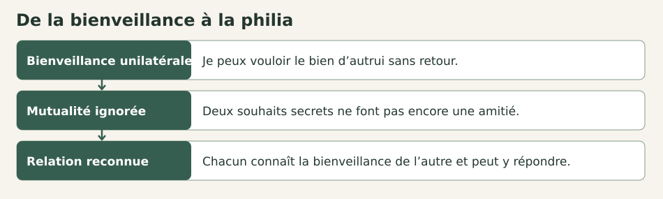

# BEL BL — Philosophie 2025 · Corrigé brut

*Corrigé rédigé par IA, non officiel. Signalez toute erreur.*

**Rédaction** · Claude Opus 4.8 · effort non renseigné · vitesse non renseignée

**Révision (tour 1)** · modèle exact non renseigné · effort non renseigné · vitesse non renseignée

**Révision (tour 2)** · GPT-6.2 Astra Ultra · vitesse non renseignée

**Révision (tour 3)** · GPT-6.2 Astra Ultra · vitesse non renseignée

Composition de philosophie, épreuve commune (BEL — ENS Ulm, Lyon, Paris-Saclay), filière B/L, session 2025 : 6 heures, coefficient 3, calculatrice non autorisée. Sujet commun : « Aimer. »

**Problématique** : aimer, est-ce subir ou agir — et quelle temporalité et quelle liberté singulières le mixte de passivité et d'activité engage-t-il ?

* * *

## Introduction

Je n’ai pas décidé à quelle heure je commencerais à aimer quelqu’un. Pourtant je peux choisir de prêter attention à ce qui lui importe, d’honorer une promesse ou de cesser de traiter ses désirs comme la simple confirmation des miens. Comment peut-on agir dans un rapport dont on n’a pas choisi l’apparition ? L’infinitif « aimer » maintient la question au niveau de ce que fait ou éprouve un sujet dans le temps. La voix active de la conjugaison ne suffit pas à prouver une activité volontaire : « subir » est lui aussi un verbe. Il faut donc chercher la part d’initiative dans les transformations concrètes de la relation.

C'est précisément là que surgit la difficulté. Car rien ne paraît moins actif que d'aimer. On ne décide pas d'aimer : on *tombe* amoureux, on est *frappé* par un coup de foudre. Entendu au sens le plus large, aimer, c'est éprouver à l'égard d'un objet ou d'une personne un sentiment, une inclination ou une affection, en tant qu'on estime qu'il ou elle peut nous procurer un bien — et « éprouver » dit la réceptivité, non l'initiative. La forme verbale promet une action là où l'expérience se donne comme une passion subie. Il faut d'emblée écarter deux facilités : trancher si aimer est un bien ou un mal (le fait d'aimer ne se juge pas, il se comprend) ; et rabattre aimer sur sa seule genèse sociale (que des individus proches sur l'échiquier social se rapprochent n'explique rien de propre à aimer — l'imaginaire collectif célèbre au contraire Tristan et Iseult ou Roméo et Juliette, c'est-à-dire des amours qui défient tout rapprochement social).

Nous chercherons d’abord en quoi l’attachement nous atteint avant toute décision. Mais ce que nous recevons transforme ensuite notre attention et notre désir. Enfin, aimer quelqu’un dont la liberté compte pose une limite à notre pouvoir d’agir : je peux vouloir son bien sans produire à moi seul une relation réciproque. Le temps d’aimer sera ainsi examiné comme passage d’une rencontre subie à une conduite dont on peut répondre.

---

## I. Aimer : l'épreuve d'une passivité

Aimer se conjugue grammaticalement à l'actif, mais se vit au passif. Celui qui aime n'a pas élu son amour comme on choisit une fin : il le découvre déjà là, l'éprouvant plutôt qu'il ne le produit. De là le caractère *idiosyncrasique et arbitraire* du sentiment : on aime telle personne, telle œuvre, sans pouvoir tout à fait justifier pourquoi. Les goûts, dit-on, ne se discutent pas ; l'amour non plus ne se démontre. Cette apparente gratuité fait d'aimer une *passion* au sens classique : un état où le sujet est agi par ce qui l'affecte, non l'agent de ce qu'il fait.

Quel manque éprouve celui qui aime ? Dans le *Banquet*, Socrate amène Agathon à distinguer le désir de ce que l’on ne possède pas et le désir de conserver pour l’avenir un bien déjà présent (200a-e). L’alternative corrige le modèle trop simple du besoin qui s’éteindrait dès que son objet est obtenu. Je peux aimer un ami présent et désirer que son bien dure ; cette orientation vers un avenir que je ne possède pas n’implique pas que l’ami soit pour moi un objet à acquérir. Le récit de Diotime sur Éros, fils de Pénia et de Poros (203b-e), fait ainsi coexister pauvreté et ressource. La passivité du manque appelle déjà une recherche. Il faut encore examiner si cette activité tend seulement à me combler ou si elle peut avoir pour fin le bien d’un autre.

Cette passivité se lit enfin dans ses *signes*. Des signes internes — le trouble, l'accélération du cœur, ce que la tragédie met en scène depuis la Phèdre de Racine — que le sujet reconnaît comme la marque en lui d'un amour ; et des signes externes — cadeaux, déclaration — qu'il adresse et par lesquels autrui reconnaît qu'il aime. Déjà ces signes compliquent la thèse de la pure passivité : donner, déclarer, ce sont des actes.

Reste que la passivité amoureuse porte en elle une *ambivalence* qu'on ne saurait taire. Parce qu'aimer expose, dépossède, rend dépendant, l'individu qui aime peut se sentir menacé dans son rapport à soi et renverser son amour en haine. On aurait tort d'y voir la rencontre de deux sentiments que tout oppose : il faut plutôt se demander si l'amour d'autrui ne tient pas une part de sa force de l'amour que l'on se porte à soi-même — au point que la blessure du premier réveille la défense du second. Ce renversement possible ne condamne pas d'aimer ; il indique qu'une analyse par la seule passivité est insuffisante. **Aimer se donne d'abord comme passion subie et singulière ; mais cette passion est déjà tendue vers une valeur et se traduit en actes — signe qu'une activité s'y cache.**

## II. Aimer : la dynamique d'une élévation

Si la passivité amoureuse vise une valeur, elle n'est peut-être pas aussi aveugle qu'elle le paraît. Rien n'interdit que l'inclination réponde non à un caprice des sens mais à des *propriétés objectives* de l'objet aimé, dotées d'une valeur que la raison peut attester. C'est manifeste dans l'amour du bien, du prochain, de la justice, de la sagesse — dont l'amour (*philo-sophia*) a donné son nom à la philosophie. Dans ces cas, aimer n'est pas pâtir d'un objet : c'est s'élever vers lui. Une dimension jusqu'ici inaperçue apparaît : aimer engage une *dynamique d'ascension active*, suscitée par la valeur de ce qui est aimé.

Le *Banquet* en offre le modèle. Diotime y décrit une montée réglée : l'amant part de la beauté d'un seul corps, passe à la beauté de tous les beaux corps, puis à la beauté des âmes, puis à celle des belles pratiques et des lois, puis des savoirs, pour saisir enfin le Beau en soi, éternel et incréé (210a-211d). Ce parcours n'est pas une fuite hors du sensible mais une *continuité* : chaque degré, aimé pour sa beauté, prépare le suivant. Et son ressort est le désir d'immortalité, qui se satisfait par l'« enfantement dans le beau » (206b-207a). Deux traits comptent ici. D'une part, la dynamique est *initiatique* : elle requiert un guide, Diotime instruisant Socrate. D'autre part, elle est exactement un *mixte* : l'amant est attiré, passivement, par une beauté qui le dépasse, mais il doit activement gravir chaque échelon. Aimer, c'est donc à la fois subir un attrait et accomplir une élévation.

Ce mixte est-il indépassable ? Peut-on concevoir aimer comme *activité pure* ? Deux figures le suggèrent. La première est l'*agapê* (ou *caritas*) : le don d'amour désintéressé, inconditionnel et oblatif, qui descend de Dieu vers les hommes et que les croyants peuvent s'efforcer d'imiter. Là, plus de montée graduelle ni d'attrait reçu : une activité pleine et entière, qui n'attend rien de son objet et le constitue en le gratifiant. La seconde est l'*amour pratique* kantien. Comment, demande Kant, commander l'amour du prochain — un ordre peut-il faire naître un sentiment ? Sa réponse distingue deux amours. L'amour *pathologique*, au sens courant, relève des penchants sensibles ; réceptif et passif, il ne peut être commandé — ni par autrui ni par le sujet lui-même. L'amour *pratique*, en revanche, consiste à agir avec bienfaisance par devoir, indépendamment de l'inclination ; lui seul peut être prescrit. Mais la *Critique de la raison pratique* précise qu'une volonté aimant la loi au point d'y obéir « volontiers », affranchie de toute sensibilité, serait sainte : c'est un idéal vers lequel l'homme peut tendre sans l'atteindre, « parce qu'il est une créature » et jamais pur esprit (Ak V, 83-85). L'amour comme activité pure, pleine et entière, excède ainsi la portée humaine : il demeure un *horizon transcendant*.

On objectera que cette élévation confine à l'illusion : l'amant idéalise, prête à l'aimé des qualités qu'il n'a pas. Pascal semble lui donner raison lorsqu'il demande ce qu'est le « moi » : on n'aime en autrui que des qualités (la beauté, l'esprit), lesquelles « peuvent périr sans que le moi périsse » — « on n'aime donc jamais personne, mais seulement des qualités » (Lafuma 688). Mais ce diagnostic, loin de clore la question, la relance. Car l'idéalisation amoureuse n'est pas seulement une illusion vouée à se dissiper : en faisant exister des qualités qui n'ont pas encore de manifestation effective, elle *appelle* l'aimé à les réaliser. Elle est partie prenante de la dynamique d'élévation : aimer, ce n'est pas seulement constater une valeur, c'est la saisir comme une *promesse*. **Aimer apparaît ainsi comme un mixte réglé de passivité et d'activité, mû par une valeur et orienté vers une élévation dont l'activité pure reste l'horizon idéal.**

## III. Aimer : la réciprocité d'une relation

Tout ce qui précède conçoit aimer comme un rapport d'un sujet à un objet — fût-il une personne ou une valeur. Or le verbe autorise une autre construction : *s'aimer*, aimer et être aimé. En la négligeant, on manque la dimension la plus propre d'aimer quand son objet est un autre sujet : la *réciprocité*. Aimer, alors, n'est pas agir *sur* autrui mais entrer *avec* lui dans une relation.

Aristote en fournit l'analyse dans les livres VIII et IX de l'*Éthique à Nicomaque*, sous le nom de *philia*. L'amitié, dit-il, « est ce qui maintient les cités » (VIII, 1) : elle n'est pas un sentiment privé mais le lien même de la communauté. Aristote en distingue trois espèces selon leur objet : l'amitié utile, l'amitié agréable, et l'amitié par excellence, fondée sur la vertu, où l'on aime l'autre « pour ce qu'il est en lui-même » et non pour l'avantage ou le plaisir qu'il procure (VIII, 3). Or — et c'est capital — la *philia* se distingue de la simple affection par deux traits. Elle suppose d'abord un *choix* : on peut éprouver de l'affection pour un être inanimé, non de l'amitié, car l'amitié veut le bien de l'autre *et* le veut réciproquement, chacun sachant l'autre bienveillant (VIII, 2). Elle suppose ensuite l'*égalité*, décisive dans l'amitié parfaite entre semblables.

Supposons que deux personnes se souhaitent du bien en secret. La réciprocité existe alors pour un observateur qui connaîtrait leurs pensées. Pour devenir une relation d’amitié vécue, il faut encore que chacune reconnaisse la disposition de l’autre et puisse agir avec elle en conséquence.

La différence devient nette dans le cas d’une affection sans retour. Je peux continuer à vouloir le bien de quelqu’un qui ne m’aime plus. Je ne peux pas, par le seul exercice de ma volonté, faire que nous soyons amis. Chez Aristote, la bienveillance mutuelle doit être connue des deux parties pour constituer une amitié ; un souhait secret, même partagé par hasard, n’établit pas encore cette relation. Les amitiés entre inégaux demandent aussi une proportion, là où l’amitié de vertu se développe exemplairement entre semblables. Ces précisions évitent de transformer l’égalité stricte en condition de tout lien. La liberté d’aimer comporte alors une limite positive : traiter autrui comme quelqu’un dont le bien compte m’interdit précisément de lui prescrire de répondre à mon affection.

Cette limite transforme le sens de l’activité. L’un peut offrir une présence, l’autre la refuser, et le premier peut respecter ce refus sans que son affection antérieure ait été fictive. Dans l’amitié mutuelle, chacun répond et rend possible une activité durable à deux. Cette dernière possibilité explique la portée éthique et politique de la *philia* sans faire de la réciprocité la récompense inévitable de toute manière d’aimer.

## Conclusion

Aimer engage une liberté qui s’exerce sur une situation que l’on n’a pas produite à volonté. Ce qui nous attire peut modifier nos habitudes d’attention ; ce que nous faisons de cette attraction peut approfondir une relation ou méconnaître l’autre en lui prêtant d’avance une réponse. La durée donne à un attachement des occasions de s’éprouver et de se rectifier. La réciprocité fait naître, lorsqu’elle existe, une activité réellement commune. Son absence n’efface pas le fait d’aimer : elle montre exactement où s’arrête la puissance d’un seul sujet.

Reste une question que nos analyses laissent ouverte : qu'est-ce qui s'oppose à aimer ? Nous avons rencontré la haine, ce renversement de l'amour en son contraire ; mais le véritable opposé d'aimer n'est peut-être pas la haine — qui est encore une manière, violente, d'être affecté par l'autre — mais l'*indifférence*, où autrui cesse même d'apparaître comme digne d'être aimé ou haï. Ce serait le signe qu'aimer, quelle qu'en soit la forme, est d'abord une manière d'être tourné vers ce qui n'est pas soi.

[Sujet officiel](https://www.ens.psl.eu/sites/default/files/2025_blses_sujet_philosophie.pdf) · [Rapport du jury](https://www.ens.psl.eu/sites/default/files/2025_bl_rapport_ecrit_philosophie.pdf)
